# C4 Model

Part: [21 — Architecture Documentation](PART_OVERVIEW.md) · Status: Drafted

## 1. Introduction

The C4 model is a method for describing the structure of a software system as a set of diagrams at four zoom levels: Context, Containers, Components, and Code. Each level answers a different question for a different audience, and the levels share a small, fixed vocabulary of building blocks so that a diagram drawn by one engineer can be read by another without a legend negotiation. The idea is deliberately modest: it does not tell you how to design a system, only how to draw what you have designed so that it can be understood, challenged, and kept current.

For an engineer moving into architecture, this is a skill with unusually high leverage. An architect's influence is exercised mostly through shared understanding: a decision that only one head contains is not an architecture, it is a rumour. Teams that cannot explain their system on one page tend to disagree about its boundaries, duplicate responsibilities, and discover integration surprises late. A disciplined diagramming approach gives a review board, a new hire, a security assessor, and an operations engineer a common starting point, and it gives you a way to ask precise questions: "is this a new container or a new component?" has a testable answer, whereas "is this a new service?" often does not.

The chapter treats C4 as a documentation tool with limits. It is a way to communicate structure; it does not capture every concern (data models, security controls, and runtime behaviour need additional views), and a well-drawn diagram of a bad design is still a bad design.

This chapter owns the C4 model: its abstractions, its four levels, how to choose a level from a question, and the practice of drawing and maintaining the Context view. The boundaries with neighbouring material are deliberate:

- The conceptual case for architecture views and stakeholder concerns, including the 4+1 view model, belongs to [What is Software Architecture?](../01_Architecture_Mindset/CH01_What_is_Software_Architecture.md); this chapter supplies one concrete notation, not the theory of views.
- Decision records, including their template and review checklist, belong to [Architecture Thinking](../01_Architecture_Mindset/CH03_Architecture_Thinking.md) and the Part 21 chapter [Architecture Decision Record](CH03_ADR_Architecture_Decision_Record.md); this chapter only shows how diagrams link to them.
- The solution-design workflow that produces the components being drawn belongs to [High-Level Design](../07_System_Design_and_Distributed_Systems/CH03_High_Level_Design.md).
- General-purpose modelling notation belongs to [UML](CH02_UML.md), and the detailed treatment of interaction and infrastructure diagrams belongs to [Sequence Diagrams](CH05_Sequence_Diagrams.md) and [Deployment Diagrams](CH06_Deployment_Diagrams.md).
- Enterprise-level viewpoints and the ArchiMate notation belong to [ArchiMate](../18_Enterprise_Architecture/CH03_ArchiMate.md).
- Review practice for architecture artifacts belongs to [Architecture Reviews](CH11_Architecture_Reviews.md).

After studying this chapter, a reader should be able to:

1. Define the four C4 abstractions (person, software system, container, component) and apply the container definition without confusing it with a Docker container.
2. Explain why C4 uses zoom levels and a small notation, and when a different notation is the better choice.
3. Select the appropriate level for a stakeholder question and defend the decision not to draw a level.
4. Draw a System Context view with correct boundary, audience, and labelled relationships, including a decision on which external parties to include.
5. Recognize common diagram failure modes such as mixed abstraction levels, unlabelled arrows, and stale diagrams, and design review checks against them.
6. Apply the approach to a concrete, hypothetical system and decide what to document next.

## 2. Background and History

Software teams have drawn boxes and arrows for as long as they have designed systems, and the lack of agreed meaning for those boxes is an old complaint. Two earlier efforts shaped the landscape. The 4+1 view model proposed by Philippe Kruchten argued that one diagram cannot serve every stakeholder and that several views, tied together by scenarios, are needed. The Unified Modeling Language (UML) standardized a rich set of diagram types, which gave precision but, in practice, many teams found it heavy to learn and to keep current, and they fell back to informal sketches.

The C4 model was devised by Simon Brown as a lightweight response to that gap. It keeps the multiple-view insight and a hierarchical decomposition, but constrains the vocabulary to a handful of abstractions and does not mandate a visual notation: boxes, lines, and text with a legend are sufficient. The name refers to the four levels. Tooling exists that can render C4 diagrams from text descriptions, and several diagram-as-code tools offer C4 support; this chapter shows Mermaid because it renders in the handbook, and it is silent on tool versions and feature details, which change. The practical implication is that C4 is a convention you adopt, not a standard you comply with: write down your local rules (how you show external systems, what a legend contains) and apply them consistently.

## 3. The Problem C4 Solves

Architecture diagrams fail in a few predictable ways. The patterns below are general, not reported incidents.

| Failure pattern | Mechanism | What C4 contributes |
| --- | --- | --- |
| The everything diagram | One drawing mixes users, services, classes, and servers, so no audience can read it | Separate views per level, each with one kind of element |
| Undefined boxes | "Service", "module", and "component" mean different things to different readers | A fixed vocabulary with testable definitions |
| Missing boundary | Nobody can say what is inside the system versus a dependency | A Context view that makes the boundary the first fact |
| Unlabelled relationships | Arrows imply coupling but not purpose, direction, or protocol | Every relationship carries a short intent label |
| Detail without audience | Class-level diagrams drawn for readers who needed a context picture | Audience and question stated per view |
| Rot | Diagrams drift from reality and are no longer trusted | Small element sets, ownership, and update triggers |

Alternatives exist. A team can use free-form whiteboard sketches (fast, but not reusable, and each author invents a notation), UML (precise, but the cost of learning and maintaining a full set is high for many teams), or an enterprise modelling tool such as ArchiMate (strong for portfolio-level relationships, less suited to showing one system's runtime units). C4 is chosen when a team needs a shared, low-ceremony vocabulary for describing one software system to mixed audiences; it is a weaker choice when the need is formal verification, code generation from models, or enterprise-wide capability mapping.

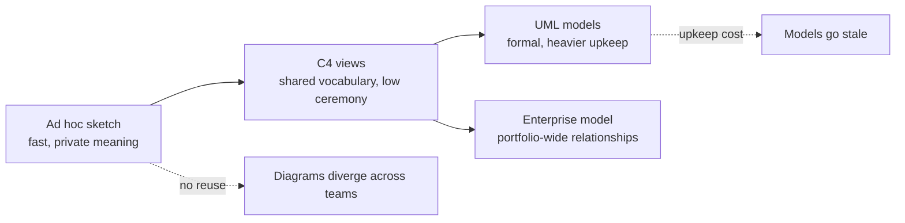

The diagram positions C4 on a spectrum of formality. The implication is that the choice is about the cost of keeping the artifact true, not about which notation is more correct: a formal model nobody updates is worth less than a simple one the team maintains.

## 4. The Abstractions and the Four Levels

### 4.1 The building blocks

C4 uses a small set of elements, each with a definition you can test against a real system:

- **Person**: a human user or role that interacts with the system, named by role rather than by individual.
- **Software system**: the highest level of abstraction, something that delivers value to its users. It is a boundary: the system you are describing is drawn as one box, and everything else is an external system.
- **Container**: an independently runnable or deployable unit that must be running for the system to work, such as a web application, a mobile application, a service, a database, or a message broker. The term predates and is unrelated to container images; a Docker container may host a C4 container, but the two concepts are separate. A useful test is whether the unit has its own process or runtime and its own deployment lifecycle.
- **Component**: a cohesive grouping of related code behind a defined interface inside one container, such as a controller, an application service, or an adapter. Components are not separately deployable.
- **Code**: the implementation of a component, such as classes and functions. It is the most detailed level and is usually left to source code and generated documentation.

Every element has a name, a type, a short description of its responsibility, and, when it matters, a technology label. Every relationship has a direction and a label saying why the interaction exists.

### 4.2 The levels as a zoom hierarchy

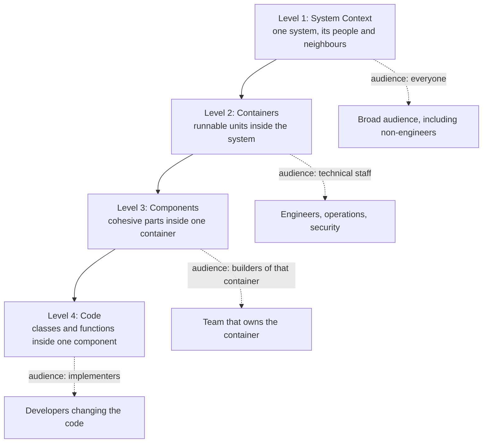

Each level zooms into exactly one element of the level above, which is why the hierarchy is a tree and not a menu. The consequence for authors is a discipline: the Context view has one system in the middle, a Container view opens that one system, and a Component view opens one container. A diagram that opens two containers at once is mixing levels, and readers will not know which boxes are deployable.

Zooming also changes the audience. Levels 1 and 2 are for broad readership, including non-engineers for the first. Levels 3 and 4 serve the people who build or change a specific container, and they carry the highest cost of staleness, which is why they are drawn selectively.

### 4.3 Edge cases in the definitions

Real systems blur the lines, and a documentation convention should say how you treat them:

- **A database shared by two systems.** The database is a container of whichever system owns its schema and operations; for the other system it is an external dependency. If ownership is genuinely shared, name it as a separate software system and say who administers it.
- **A single-page application and its backend served from one deployment.** If they deploy and run as one unit, draw one container; if they deploy separately, draw two. The deployment evidence decides, not the code layout.
- **A serverless function.** Treat each independently deployed function as a container only if the distinction helps the audience; grouping a set of related functions as one container with the functions as components is also defensible. State the rule you chose.
- **A managed third-party service the team configures but does not run.** Usually an external software system, with configuration ownership noted in the description.
- **A library.** Not a container; it runs inside one. It may be a component or, in a Code view, a dependency.

The rule underneath all of these is the same: pick the interpretation that matches how the system is run and owned, record it in your conventions, and apply it consistently.

## 5. Select a View From the Question

The most common mistake with C4 is treating it as a checklist of four diagrams per system. It is a menu of zoom levels, and the selection rule is the question being asked. Every view should state its audience, scope, assumptions, and update owner, and should exist because someone needs it to decide or understand something.

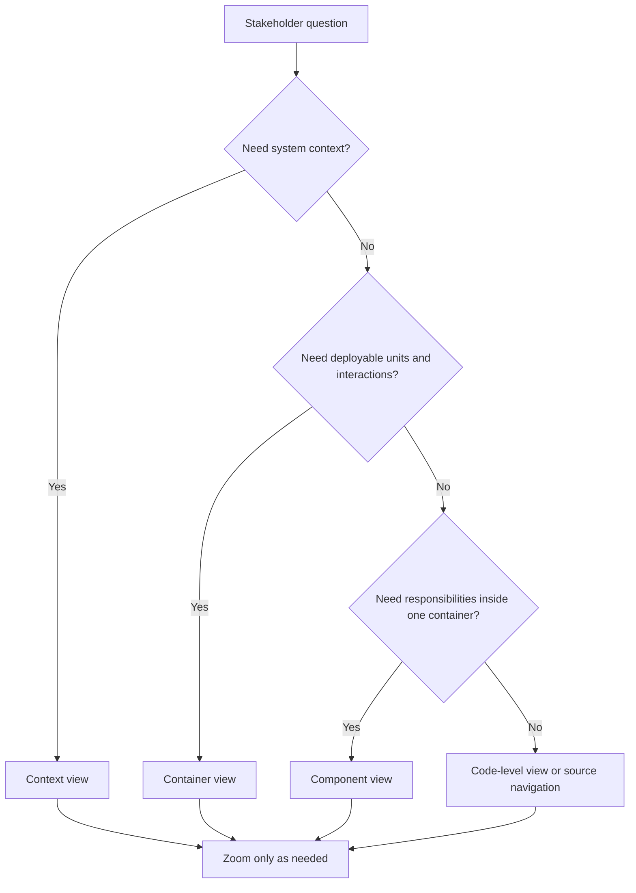

Do not descend levels automatically. If the decision concerns an external integration, a component diagram may add noise. If the question is about module ownership or change impact, context alone may be too coarse.

### 5.1 Mapping questions to levels

| Typical question | Best level | Why | What is not needed |
| --- | --- | --- | --- |
| Who uses this and what does it depend on? | Context | Establishes boundary and neighbours | Technology detail |
| Which parts must be deployed, scaled, or secured separately? | Container | Shows runnable units and their links | Internal class structure |
| Where does a change to pricing rules land? | Component | Shows responsibilities inside one container | Other containers' internals |
| How is this interface implemented? | Code, via source | Implementation fidelity matters only here | A hand-drawn diagram that will rot |
| What happens when payment times out? | Dynamic or sequence view | Static views cannot show ordered behaviour | A larger static diagram |

Two conclusions follow. First, the question determines the view, not the other way around: if nobody can name the question, do not draw the diagram. Second, "not needed" is a legitimate outcome. A small internal tool may need only Context and Container views, and writing down that decision is better than producing a Component view nobody will update.

### 5.2 Worked scenario: choosing views for a review (illustrative)

A hypothetical team of eight proposes adding a returns capability to an order platform. The review board has three questions: which external parties are affected, whether the change forces a new deployable, and where in the existing order service the logic will sit.

The architect answers them in order. The Context view, updated with a refund provider as a new external system, answers the first. The Container view, unchanged because returns logic will live in the existing order service, answers the second and is cited as evidence that no new deployment unit is required. A Component view of the order service, drawn for this review only, shows a new returns component beside the existing order components and flags that it shares the pricing policy component. The team does not draw a Code view; the interface sketch in the proposal suffices. The review records the three views against the decision, and the pricing component is flagged as a change-coupling risk to examine in the design. The failure mode avoided is a single large diagram that would have taken an hour to read and answered none of the three questions cleanly.

## 6. Context View: Establish the Boundary

### 6.1 Definition and purpose

A System Context view shows one software system as a single box, surrounded by the people who use it and the external software systems it depends on or that depend on it. It is the least technical view and the one with the widest audience. Its job is to fix the boundary: after reading it, anyone should be able to say what the team is accountable for and what it is not.

Keep internal technology out unless it changes the conversation. Name people by role and systems by responsibility; annotate protocols only when they matter to the decision.

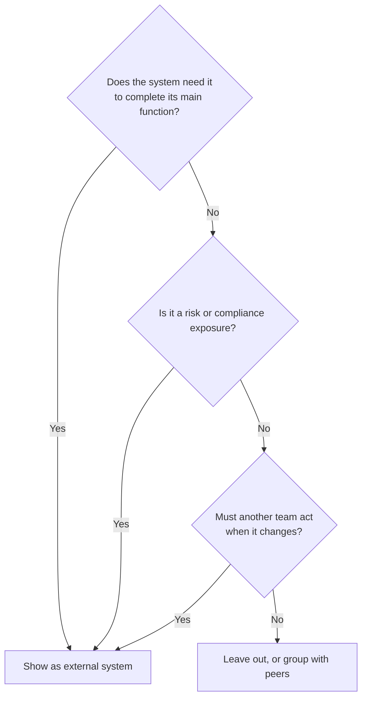

The decision tree makes the inclusion test explicit: a box earns its place by affecting behaviour, risk, or change. Applying it consistently is what keeps Context views small and comparable across systems.

### 6.2 Notation and a worked example (illustrative)

The hypothetical commerce platform below shows the conventions: people on the left, the system in the middle, external systems on the right, and a verb-phrase label on every arrow. Dashed styling marks external systems the team does not own.

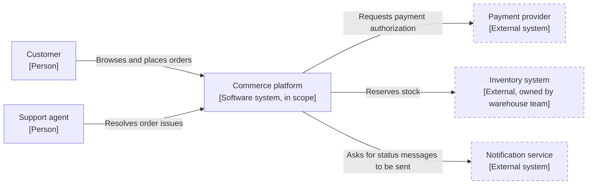

Reading it as a reviewer: the arrows describe intent, not protocol, so a reader learns that the platform depends on a payment provider for authorization without being told how. Direction follows the initiator of the interaction, which matters when the notification service later calls back; that would be a second relationship, not a double-headed arrow. The inventory system carries an owner label because a dependency without a named owner cannot be assessed for risk or escalated.

### 6.3 A text template for the view

Each Context view should travel with a short description block, so the diagram is not the only carrier of meaning:

```markdown
## System Context: <system name>

- Audience: <who reads this and for what decision>
- Scope: <the system in the centre; what is explicitly out of scope>
- Last reviewed: <date> by <owner>; next trigger: <event or date>
- Assumptions: <for example, "payment provider is treated as always reachable over the public network">

| Element | Type | Responsibility | Owner |
| --- | --- | --- | --- |
| Customer | Person | Places and tracks orders | n/a |
| Payment provider | External system | Authorizes card payments | Vendor, contract owner: <role> |

Relationships: <one row per arrow: from, to, intent, criticality>
```

The table is the maintained source; the diagram is a rendering of it. Keeping the description in text, version-controlled beside the diagram source, lets reviewers see a change as a diff and lets the update owner be named.

### 6.4 Decisions: what to include and what to leave out

The recurring judgement is which external parties earn a box, and the decision tree above summarizes it. Include an external system when it affects behaviour (the system cannot complete its main function without it), risk (it is a regulatory, security, or availability exposure), or change (another team must act when this system changes). Omit generic infrastructure, such as the network, the domain name system, or a cloud provider's control plane, unless the system's purpose is directly tied to it. Group peers that share a role into one box when their individual identity does not matter, for example "Card networks", but split them when contracts, owners, or failure modes differ.

A further decision is whether to show the people at role or at persona level. Roles keep the diagram stable; personas help for product conversations but change more often. Prefer roles in architecture documentation and link to persona material elsewhere.

### 6.5 Failure modes and what the Context view is not for

- **Boundary drift.** A team draws a database inside the box in one diagram and outside it in another. Fix by publishing a single definition of the boundary in the description block.
- **Technology leakage.** Product names crowd the view and imply decisions that were not made. Fix by moving technology to the Container view.
- **Missing the quiet dependencies.** Scheduled file transfers, vendor reports, and manually operated spreadsheets are real integrations. If they affect behaviour or risk, they appear as external systems or people.
- **Orphan arrows.** Relationships without labels, or with labels such as "uses" that carry no information.
- **Treating the picture as the design.** A Context view says nothing about security controls, data classification, capacity, or failure handling.

The Context view is not a network diagram, a data flow diagram, a trust boundary model, or a requirements list. Those answer different questions and are covered by their own artifacts; the Context view only tells the reader where to look next.

### 6.6 Keeping it current

A Context view should change rarely, which makes drift cheap to detect. Define update triggers: a new external integration, a retired one, a change in ownership of a dependency, a new user role, or a contract change that alters behaviour. Attach the check to the places those changes already pass through, such as the design review template and the release checklist for integration changes, rather than to a calendar reminder. Review it as you would code: a pull request with a diff to the text description, reviewed by someone who did not draw it, with the question "could a new joiner state the system's boundary from this alone?"

## 7. Container View: Show Runtime Responsibilities

### 7.1 Purpose and the zoom from the Context view

The Container view opens the single system box from the Context view and shows the runnable units inside it. It is the view most readers mean when they say "the architecture diagram", because it is where deployment, scaling, trust, and operational ownership questions become answerable. The scope rule from Section 4.2 applies: one system is opened, the people and external systems from the Context view are carried over unchanged (same names, same owners), and nothing from a different level appears.

The hypothetical commerce platform from Section 6.2 is used for the rest of this chapter. Its containers are a browser application for customers, a support console for support agents, a Commerce application programming interface (API) service, an order database, a message broker, and a notification worker. The payment provider, inventory system, and notification service remain external, exactly as drawn in the Context view.

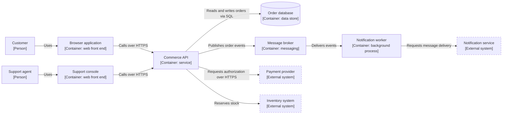

In the diagram, HTTPS is the Hypertext Transfer Protocol Secure and SQL is the Structured Query Language; both appear on arrows only because they tell a reviewer where encryption and query access must be considered. The implication for review is that every arrow is now a candidate for questions: what happens when this call is slow, who authenticates it, and does it cross a trust boundary. The Context view could not support those questions because it did not show the internal runnable units.

### 7.2 What counts as a container, and what to label

Apply the definition from Section 4.1: a unit is a container if it has its own process or runtime and its own deployment lifecycle. Label four things on each container: name, type, responsibility in one sentence, and technology when the technology shapes a decision (for example, a relational store versus a document store matters to a data-consistency discussion; the web framework usually does not). Label each relationship with intent and, when it matters, the interaction style (synchronous request, asynchronous event, scheduled batch).

| Container | Responsibility | Owner (illustrative) | Notable decision hook |
| --- | --- | --- | --- |
| Browser application | Presents catalogue and checkout to customers | Web team | Runs on untrusted devices; no secrets |
| Support console | Lets agents view and amend orders | Support tooling team | Higher privilege than the customer front end |
| Commerce API | Validates and processes orders; owns business rules | Order team | Single entry point for both front ends |
| Order database | Stores order state | Order team | Only the Commerce API writes to it |
| Message broker | Carries order events between containers | Platform team | Delivery semantics shape consumer design |
| Notification worker | Turns order events into notification requests | Order team | Must tolerate duplicate events |

The "Notable decision hook" column is not part of C4; it is a local addition that links the view to the questions reviewers actually ask. Adding such columns is acceptable if the convention is written down.

### 7.3 Decision criteria: when to split or merge containers in the diagram

The diagram should follow reality, but reality admits more than one honest drawing. Use these criteria:

- **Deployment evidence first.** If two units are built, released, and scaled together, draw one container and show the units as components. If they can be released independently, draw two.
- **Different trust or privilege levels.** The customer front end and the support console run in different trust contexts, so they are separate containers even if one codebase produced both.
- **Different failure or scaling behaviour.** A background worker that can fall behind without affecting customers deserves its own box, because its failure mode differs from the request path.
- **Ownership boundary.** Where a different team operates a unit, name the owner; a managed database operated by another team is a container of the system that owns its schema, with an operational dependency recorded.

A frequent error is to draw one container per code repository. Repositories are a source-control decision; containers are a runtime decision. Another is the reverse: showing a modular monolith as one box and then hiding that it has three separately scaled worker pools.

### 7.4 Failure modes in Container views

- **Implied independence.** Two boxes suggest independent deployment, but they release together. Reviewers then credit a resilience property the system does not have.
- **Hidden shared database.** Two containers both write the same tables, but the diagram shows each with a private store. The coupling surfaces during a schema change.
- **Missing asynchronous paths.** Scheduled jobs and broker consumers are omitted, so a review misses a dependency that fails silently.
- **Technology overload.** Version numbers and product names bury the responsibilities; the view dates quickly.
- **Orphan containers.** A box with no owner or no incoming relationship, often an abandoned process that still runs.

The mitigation for all of them is the same review question: for each box, can the team name its deployment unit, its owner, and the arrow that makes it necessary?

## 8. Component View: Explain Internal Responsibility

### 8.1 Purpose and scope

A Component view opens exactly one container and shows its cohesive internal parts. Draw it when the audience is the team that builds or changes that container, or when a reviewer needs to know where a change lands and what it can disturb. It is the first level at which staleness becomes expensive, so draw it selectively and for containers whose internals are in dispute or changing.

For the Commerce API container, the question is: where does order placement logic live, and how does it reach the database and the payment provider without being coupled to either?

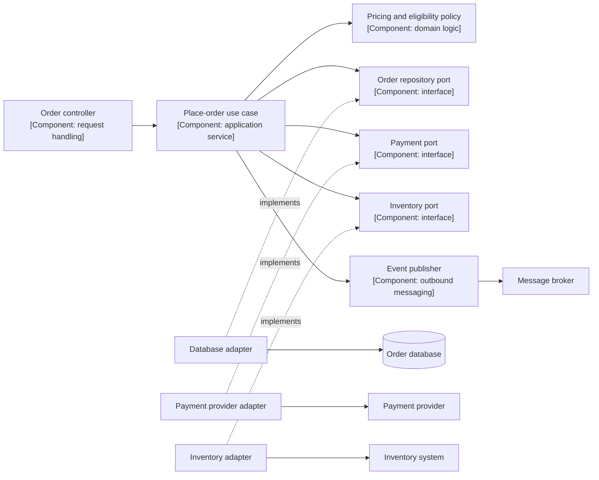

The diagram shows a ports-and-adapters arrangement: the use case depends on interfaces, and adapters connect to the outside. The consequence for review is that replacing the payment provider is a change confined to one adapter, and the pricing policy is a shared dependency that other use cases (such as a future returns capability, Section 5.2) will also touch. That shared dependency, not the adapters, is the change-coupling risk worth discussing. The ports-and-adapters style is one option among several; this chapter uses it because it makes dependencies visible, not because C4 requires it.

### 8.2 Choosing the right granularity

Name components by responsibility, not by framework artifact. "Place-order use case" tells a reader what the part is for; "OrderServiceImpl" tells them how it was coded. Select components using three tests:

| Test | Include the component if... | Leave it out if... |
| --- | --- | --- |
| Change | A realistic change request would modify it separately from its neighbours | It always changes together with a neighbour |
| Ownership | Different people or teams own or review it | One person owns the whole cluster |
| Risk | It enforces a security, money, or data rule | It is plumbing with no business rule |

A useful size target is a view a reader can absorb in a few minutes; if the diagram needs more than roughly a dozen boxes, either the container is too large (a candidate for splitting, and that is a design finding) or the view should be split by use-case area.

### 8.3 Components versus the UML notion of a component

C4 components and UML components overlap in name but not in discipline. A C4 component is defined by responsibility inside one container and carries no deployment meaning; UML offers a formal component notation with provided and required interfaces. When a team has both, state in the conventions which one a diagram uses. The treatment of the formal UML notation is in [UML](CH02_UML.md); here the point is only that the same word should not mean two things in the same document set.

### 8.4 Failure modes in Component views

- **Class diagram in disguise.** Every class becomes a box; the view is unreadable and out of date within weeks. Fix by raising the abstraction to cohesive groups, or by pointing to source navigation instead.
- **Layered by fashion.** Boxes named "service layer", "manager", and "helper" say nothing about responsibility. Rename by the job done.
- **Missing the rule holders.** The component that decides eligibility or price is absent because it is "just a library". If it holds a business rule, it belongs in the view.
- **Wrong container.** Components from two containers appear together, hiding a runtime boundary. Redraw as two views, or promote to a Container view.
- **Aspirational structure.** The view shows the intended modularity while the code has cycles. Label it "target" or draw reality and record the gap as a risk.

The mitigation for stale Component views is to generate or verify them from source where tooling allows, and otherwise to date them and name an owner. Treat a view that nobody will update as a candidate for deletion.

## 9. Dynamic Views and Consistency Across Zoom Levels

### 9.1 What a dynamic view adds

Static views describe structure; a dynamic view shows one scenario moving through that structure in order. The Container view cannot say whether the Commerce API waits for the notification, whether payment is authorized before or after stock is reserved, or what the customer sees when payment times out. Those are questions about order and timing, and they need a dynamic view. C4 describes dynamic views as numbered interactions between elements already shown in the static views; this chapter draws them as sequence diagrams, which are treated in depth in [Sequence Diagrams](CH05_Sequence_Diagrams.md).

The scenario below is order placement in the commerce platform, with the payment step and the asynchronous notification path both shown.

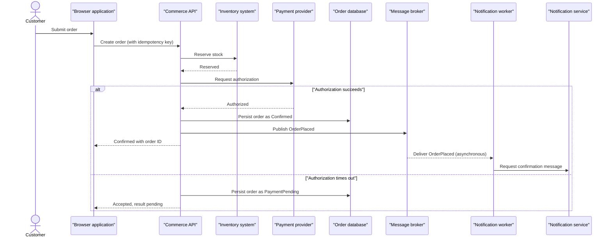

Three points follow from the diagram. First, the customer response is returned before the notification path runs, so a notification outage cannot block order acceptance; that is the property the review in Section 11 depends on. Second, the timeout branch shows that the system must define an intermediate state and a reconciliation path, which the static views cannot express. Third, the idempotency key on the create request is a design choice that makes client retries safe; its mechanics belong to [Idempotency](../07_System_Design_and_Distributed_Systems/CH16_Idempotency.md), and the asynchronous delivery semantics to [Async APIs](../08_API_Architecture/CH06_Async_APIs.md). The diagram records that the choice exists; it does not specify it.

### 9.2 Naming and identifier consistency

A dynamic view is only trustworthy if its participants match the static views. Apply these rules:

| Rule | Example of compliance | Example of violation |
| --- | --- | --- |
| Participants are elements from the Container or Component view | "Commerce API" | "Order microservice" appearing only here |
| External parties keep their Context-view names | "Payment provider" | "Stripe-like gateway" |
| Technology labels match the Container view | Same label or none | Broker called a queue in one view, a topic bus in another |
| A new participant triggers a static-view update | Add "Fraud screening" to the Context view first | Appears only in a sequence |

If a participant cannot be mapped to a static element, either the static view is incomplete or the dynamic view is drawing detail below its level. Fix the static view first; the dynamic view is derived from it.

### 9.3 Showing failure honestly

A success-only sequence is documentation of the optimistic path. Include a failure branch when the branch changes a decision: timeouts at the payment call, a duplicate event delivered to the worker, or the broker being unavailable at publish time. Do not attempt to draw every error; choose the branches that a reviewer would otherwise have to ask about. When the failure behaviour is complex, keep the sequence for the main path and describe the rest in a table of failure cases and the chosen response, linked to the relevant ADR (Architecture Decision Record) in [Architecture Decision Record](CH03_ADR_Architecture_Decision_Record.md).

### 9.4 Which scenarios deserve a dynamic view

Draw a dynamic view for scenarios that cross two or more containers, involve an external system, carry a money or data-integrity rule, or are disputed in review. Skip it for single-container operations whose behaviour is clear from the Component view. A small set of three to five scenarios, each with an owner, usually outperforms an attempt to diagram every use case.

## 10. Deployment View and Evolution

### 10.1 What the deployment view shows

A deployment view places the containers from the Container view onto infrastructure nodes, such as regions, clusters, virtual machines, or managed services, and shows network and trust boundaries around them. It answers questions the Container view deliberately avoids: which failure domain does each unit sit in, which units share a node, and what crosses a network boundary. The full treatment of deployment notation is in [Deployment Diagrams](CH06_Deployment_Diagrams.md); this section covers only how the C4 deployment view relates to the other levels.

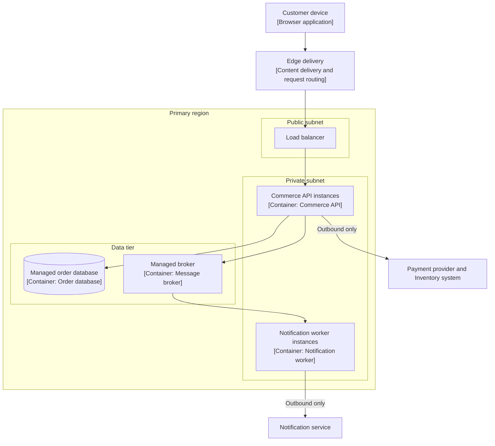

The diagram makes three facts reviewable that earlier views hide. Everything runs in one region, so a regional outage takes down the platform; the deployment view is where that single failure domain becomes visible and a resilience discussion starts. The database and broker are managed services, so their availability and backup behaviour are the provider's responsibility under a service agreement, which the review must read rather than assume. The external systems are reached by outbound connections only, which is a security-relevant constraint that threat analysis in [Threat Models](CH09_Threat_Models.md) can use.

### 10.2 Consistency rules between deployment and container views

- Every deployed node maps to a container named in the Container view; a deployed process with no container is a documentation gap or an orphan.
- Instance counts and environment names are labelled per environment (for example, a production view and a smaller test view) because they differ.
- Provider-specific product names appear only when they shape the decision, since they make the view non-portable and short-lived. A managed relational database is often a sufficient label.
- Trust zones and network boundaries are drawn explicitly when the audience is security or operations.

### 10.3 Evolution: versioning and update triggers

Architecture changes in steps, and diagrams should record the step they describe. Three practices keep the views useful over time:

1. **Version the diagram with the decision.** Store the diagram source beside the decision record and name the release or decision it reflects, so a reader can tell whether a view is current or historical.
2. **Draw target and current states separately.** A target view labelled as such is a proposal; mixing planned and actual elements in one diagram misleads reviewers.
3. **Define update triggers per level.** The Context view changes with integrations and roles; the Container view with new deployable units or ownership; the Component view with significant internal restructuring; the deployment view with infrastructure moves. Attach the check to the change process that already exists for those events.

| Change event | Views to update |
| --- | --- |
| New external integration | Context, Container, relevant dynamic views |
| New background worker | Container, Deployment |
| Moving a database to a managed service | Container (owner label), Deployment |
| Refactoring inside the Commerce API | Component only |
| Adding a region | Deployment, dynamic views for failover |

The table is a starting convention. Its value lies in making the question "what else must change?" part of the change itself, rather than something remembered later.

## 11. Worked Scenario: Can Orders Be Placed When Notifications Are Down? (Illustrative)

### 11.1 The question and the chain of views

A hypothetical architecture review asks: can customers place orders when the notification service is unavailable? The answer is assembled from the views drawn in this chapter, each contributing one fact.

| Step | View | Fact established |
| --- | --- | --- |
| 1 | Context (Section 6.2) | The notification service is external and not owned by the team; the platform depends on it only to ask for messages to be sent |
| 2 | Container (Section 7.1) | The only container that calls the notification service is the notification worker, which is fed by the message broker, not by the Commerce API directly |
| 3 | Component (Section 8.1) | The place-order use case calls an event publisher and has no dependency on any notification adapter |
| 4 | Dynamic (Section 9.1) | The browser receives its confirmation before the worker runs; notification is after the response |
| 5 | Deployment (Section 10.1) | The worker runs in the private subnet with outbound-only access to the notification service, so its failure is isolated from the request path |

The conclusion is that the notification service being unavailable does not block order acceptance, provided the broker and the order database are available. The diagrams support the claim, but they do not prove it: the claim also depends on the code actually matching the Component view and on the publish step not failing the request. A review should therefore ask for a test or a fault-injection result for the claim, and record the evidence beside the diagrams.

### 11.2 What the views leave unresolved

Establishing that placement continues leaves design questions that no C4 view answers, and the review should convert them into decisions:

- What happens to confirmation messages while the service is down: are they retried, for how long, and who is alerted?
- If the order is persisted but the event is not published (a crash between the two steps), is the notification lost? The pattern for closing that gap is a design topic for the messaging chapters, and delivery guarantees are treated in [Exactly-Once Processing](../07_System_Design_and_Distributed_Systems/CH17_Exactly_Once_Processing.md) and [Deduplication](../07_System_Design_and_Distributed_Systems/CH19_Deduplication.md).
- What does the customer see: a confirmation page that promises an email, or one that states the status without promising delivery time?

The order and its notification are linked by a small set of states, shown below, which the team should record in the decision.

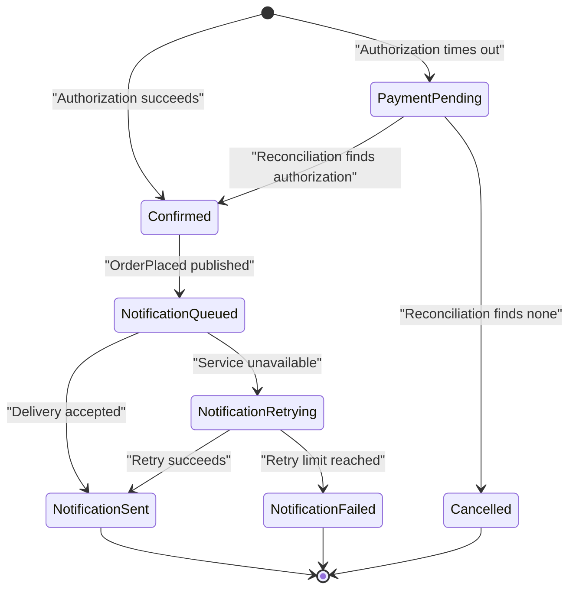

The state diagram separates two lifecycles that the earlier views blur: the order's commercial status, which must be correct, and the notification status, which may lag. The implication is that support agents need a way to see notification failure without it altering the order status, and that the retry limit and alert owner are decisions needing an ADR, not defaults left to a library.

### 11.3 Why no Code view

The team does not draw class-level diagrams. They would not change the availability decision, and the interface of the event publisher is captured in the Component view and in source. Declining a view is part of the method, and recording the reason avoids the question being asked again in the next review.

## 12. Failure Scenarios and Common Mistakes

### 12.1 Catalogue

The entries are general patterns drawn from the mechanisms in this chapter, not reports of specific incidents.

| Failure | Symptom | Detection | Mitigation |
| --- | --- | --- | --- |
| Mixed abstraction levels | Readers argue about whether a box is deployable | Review question: "Which level is this, and can every box be run on its own?" | One system or container opened per view; split the diagram |
| Stale views | Onboarding engineers find boxes that do not exist, or miss ones that do | Compare a view against deployment manifests or service inventory during review | Named owner, update triggers (Section 10.3), delete views nobody maintains |
| Unlabelled or vague arrows | "Uses" arrows hide direction, style, and purpose | Checklist item: every arrow has intent and style | Verb-phrase labels; asynchronous arrows marked |
| Boundary drift | The same database is inside the system in one view and outside in another | Cross-check element lists between views | Boundary defined in the description block (Section 6.3) |
| Implied independence | Reviewers credit resilience that does not exist | Ask which boxes release together | Merge boxes that share a release; show components inside |
| Hidden shared data store | Schema change breaks an unexpected container | Search code and access configuration for each store's clients | Draw every client of each store; assign a single owner |
| Aspirational diagram | The view shows target structure as if current | Compare to code dependencies or run history | Separate current and target views, labelled |
| Success-only dynamic view | Incident reveals undocumented timeout or retry behaviour | Ask "what if this call fails or repeats?" for each arrow | Add failure branches for money and integrity paths |
| Technology overload | Diagrams unreadable and outdated at each upgrade | Count product names against decisions they inform | Keep technology labels only where decision-relevant |
| Orphan containers | A running process no one owns | Reconcile the diagram with the deployed inventory | Owner label per container; retire or adopt |
| Tool lock-in | Diagrams unrecoverable when a tool changes | Check that source is text and in version control | Diagram-as-code; export from a model, not only images |

### 12.2 Anti-patterns

- **The poster.** A single enormous diagram printed for a wall, which has every level on it and is updated once. It is read by nobody after the first week. Replace with views per question.
- **Diagram as deliverable.** The team is measured on producing diagrams, not on decisions they support. Views then proliferate without owners. Tie each view to a decision or a recurring audience.
- **Four diagrams per system, always.** Mechanical completeness produces Component and Code views nobody needs (Section 5.1). Record which levels are intentionally omitted.
- **Notation without conventions.** Colours and shapes mean different things across teams. Publish a short legend and rules for externals, databases, and asynchronous links.
- **Drawing to defend a design.** The diagram is chosen to hide a weakness, for example omitting the shared database. Review should ask what the view leaves out as well as what it shows.
- **Confusing the container with the container image.** An image or pod is a packaging artifact; a C4 container is a runtime responsibility. Several containers can share a pod, and one container can run as many instances.

### 12.3 How a stale view typically forms

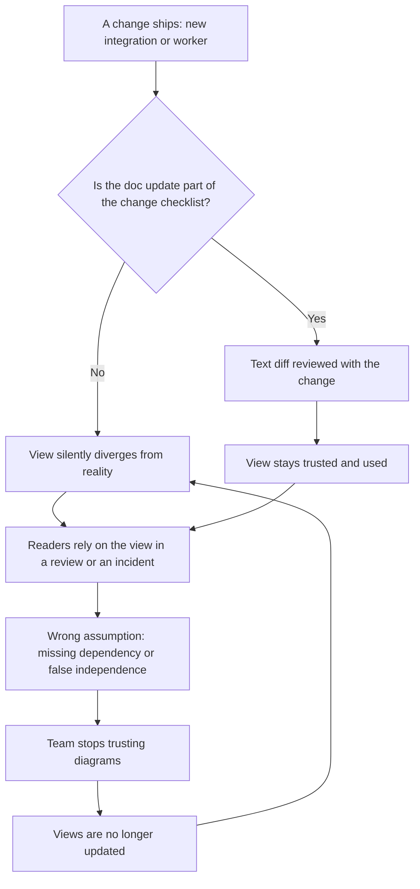

The loop in the left branch is self-reinforcing: each failure to update lowers the value of the diagrams, which lowers the motivation to update them. The implication is that the intervention point is the change process, not exhortation. Where an update is part of the change checklist, the cost is small and the loop does not start; where it is a separate task, drift is the default.

## 13. Trade-off Analysis and Decision Framework

### 13.1 Comparing documentation approaches

| Approach | Strengths | Weaknesses | Best fit | Maintenance cost |
| --- | --- | --- | --- | --- |
| Whiteboard sketches | Fast; good for exploration | No shared vocabulary; lost or inconsistent | Early design conversations | Very low, but no reuse |
| C4 views as diagram-as-code | Shared vocabulary; diffable; reviewable | Needs conventions and discipline; limited for behaviour | One system, mixed audiences, ongoing change | Low to moderate |
| C4 views in a drawing tool | Easy layout; familiar | Binary or opaque sources; harder to review as diffs | Teams without code-based workflow | Moderate |
| UML models | Precise; rich behaviour and structure notation | Learning curve; heavy upkeep | Formal design, generation, regulated contexts | High |
| Enterprise modelling (ArchiMate) | Portfolio relationships; capability mapping | Not intended to show one system's runtime units | Enterprise architecture teams | Moderate to high |
| Generated diagrams from code or infrastructure definitions | Accurate against source | Structure without intent; low-level | Deployment and dependency inventory | Low once set up |

No approach dominates. The cost of keeping the artifact true is the deciding factor more often than expressive power. A combination is common: C4 for structure, sequence diagrams for behaviour, and generated inventories for accuracy.

### 13.2 Decision framework

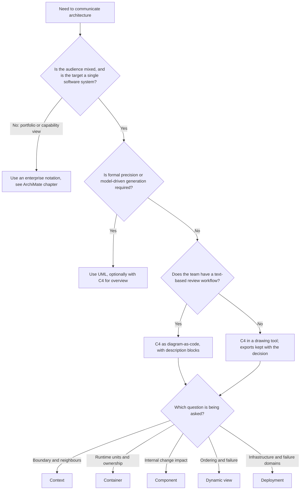

The flowchart separates two decisions that teams often merge: which notation to adopt, and which view to draw. The first is made rarely and recorded in conventions; the second is made each time and driven by the question. If the first answer is unclear, defaulting to C4 plus text descriptions is a reasonable and low-regret starting point, since views can be re-expressed in another notation later if needs change.

### 13.3 Trade-offs inside C4 itself

| Decision | Option A | Option B | Consider |
| --- | --- | --- | --- |
| Breadth of views | Few views, kept current | Many views, partially stale | Prefer A unless readership demands more |
| Technology labels | Included | Omitted | Include when a decision depends on it; omit otherwise |
| Level of detail in the Component view | Coarse groups | Fine-grained | Use coarse unless a change-impact question needs fine |
| Authoring location | Beside the code | In a wiki or tool | Beside the code improves review and currency |
| Target versus current | Separate views | Mixed annotation | Separate, to avoid false confidence |

C4 as a whole trades expressive depth for speed and consistency. When a question needs formal semantics, such as verifying a protocol, no amount of C4 discipline substitutes for a different technique.

## 14. Illustrative Composite Case Study and Architect Review Checklist

### 14.1 Case study: a documentation reset (hypothetical)

The following is a constructed composite, not a report of a real organization. A mid-sized retail team runs the commerce platform described in this chapter. Over two years it has accumulated a wiki of diagrams, one per sprint demo, with inconsistent notation. A new architect is asked to prepare the platform for an external security assessment and a returns feature review.

**Situation.** The wiki has eleven diagrams. Three show the order database inside the platform and two show it outside. One diagram shows a "notification microservice" that nobody on the team can find in the deployment inventory. The support console appears in one diagram and is absent from the rest, although agents use it daily.

**Approach.** The architect does not redraw everything. She works in the order the questions arrive:

1. She writes a boundary definition (the platform includes the order database and the notification worker; the notification service, payment provider, and inventory system are external) and publishes the Context view with the description block from Section 6.3.
2. She reconciles the Container view against the deployment inventory. The "notification microservice" turns out to be the notification worker under an older name; the support console, previously undocumented, is added with its higher privilege level noted for the assessor.
3. She draws a Component view of the Commerce API only, because the returns review needs to know where pricing logic lives, and records that the pricing policy is shared.
4. She draws two dynamic views, order placement and returns, each with a failure branch on the payment call.
5. She marks the rest of the wiki as superseded and deletes nothing silently; the old pages link to the new ones.

**Outcome (illustrative).** The assessor receives a Context and Container view with named owners and an explicit statement that the support console holds elevated privileges. The returns review uses the Component view to identify the shared pricing policy as a coupling risk and decides, in an ADR, to extract a pricing policy interface before adding returns. The team adds a line to its change checklist requiring an update to the relevant view for any new integration or deployable. None of this required a new tool; it required a boundary definition, conventions, and update triggers.

**Lessons the case illustrates.** Starting from questions limits the work; reconciling against deployed reality finds the orphan and the missing console; and attaching updates to the change process is what keeps the result from decaying.

### 14.2 Architect review checklist

Use this checklist when reviewing a C4 view set. It extends the questions that the chapter's earlier sections motivate.

**Purpose and scope**

- [ ] Each view states its audience, scope, and the question it answers.
- [ ] Omitted levels are listed with a reason.
- [ ] Each view has a named owner and a last-reviewed date.

**Boundary and elements**

- [ ] The system boundary is defined in text, and every view applies it identically.
- [ ] External systems are named by responsibility and have a named owner.
- [ ] People are shown by role.
- [ ] Containers meet the definition in Section 4.1 and are not confused with container images.
- [ ] Shared data stores show every client and a single owner.

**Relationships**

- [ ] Every arrow has a direction, an intent label, and, where relevant, an interaction style.
- [ ] Asynchronous paths, scheduled jobs, and manual integrations that affect behaviour or risk are shown.

**Consistency**

- [ ] Names in dynamic and deployment views match the static views.
- [ ] Deployment nodes map to containers and vice versa.
- [ ] Current and target states are in separate views.

**Currency and traceability**

- [ ] Update triggers are defined and attached to the change process.
- [ ] Views are version-controlled as text, beside or linked to the relevant decision records.
- [ ] Failure branches appear in dynamic views for money and integrity paths.
- [ ] Claims drawn from the views (for example, "notification outage does not block orders") are backed by a test or other evidence, not by the diagram alone.

A review outcome is "accept", "accept with changes", or "redraw"; reviews are covered in [Architecture Reviews](CH11_Architecture_Reviews.md).

## 15. Interview Questions

1. **What are the four C4 levels, and who is each for?**
   Context (one system and its neighbours, for everyone), Containers (runnable units, for technical staff), Components (cohesive parts of one container, for the team that builds it), and Code (implementation, for developers changing it). Each level zooms into one element of the level above.

2. **What is a container in C4, and how does it differ from a Docker container?**
   It is an independently runnable or deployable unit that must be running for the system to work, such as a service, front end, or database. A Docker container is a packaging and runtime mechanism; one may host a C4 container, but the concepts are separate.

3. **How do you decide which levels to draw?**
   By the question and audience. Boundary questions need Context, deployment and ownership questions need Container, change-impact questions inside one container need Component. Omitting a level is legitimate if no one will use or maintain it, and the omission is recorded.

4. **What belongs on a Context view and what does not?**
   The system, people by role, and external systems that affect behaviour, risk, or change. Generic infrastructure, internal technology, and class-level detail are left out.

5. **Why add a dynamic view when you already have a Container view?**
   Static views show structure, not ordering, timing, or failure. A dynamic view shows whether a call is synchronous, what happens on a timeout, and where state is persisted.

6. **How do you keep diagrams from going stale?**
   Keep sources as text under version control, name an owner, define update triggers per level, and attach the update to the change checklist so that it is reviewed with the change. Delete views nobody will maintain.

7. **A teammate draws one box per repository in the Container view. What is your feedback?**
   Containers are runtime units, not source-control units. Redraw by deployment lifecycle and ownership: merge repositories that deploy as one unit, split a repository that produces several independently released units.

8. **When would you not use C4?**
   When the need is formal verification, model-driven code generation, or portfolio-level capability mapping. UML or an enterprise notation fits better, though C4 can still give an overview.

## 16. Hands-on Exercises

1. **Draw a Context view.** Choose a system you know, or use a hypothetical expense-reporting tool. List people by role and external systems, apply the inclusion test from Section 6.4, and write the description block from Section 6.3. Deliverable: diagram source plus a table with owners. Check: can a reader state the boundary from the page alone?

2. **Reconcile a Container view with reality.** Pick a system with a deployment inventory (a list of running services, jobs, and data stores). Draw its Container view, then compare it with the inventory. Record every mismatch (orphans, undocumented processes, shared stores). Deliverable: the view and a list of discrepancies with proposed fixes.

3. **Choose and defend views.** For a feature request, "add scheduled invoice exports to a finance partner", write three stakeholder questions and map each to a level or a dynamic view using the table in Section 5.1. State which levels you decline to draw and why. Deliverable: a half-page decision note.

4. **Add a failure branch.** Take the order-placement sequence in Section 9.1 and extend it with a branch for the broker being unavailable at publish time. Decide whether the order should be accepted, and what state results. Deliverable: the revised sequence and a short note on the trade-off, written as an outline for an ADR.

## 17. Design and Architecture Review Questions

1. **A diagram shows the order database inside the platform in one view and outside in another. How do you resolve it?**
   Determine who owns the schema and operates the store; that owner's system contains it. Record the rule in the description block and update every view. If ownership is truly shared, show the store as a separate software system with a named administrator. Then add a review check that compares element lists across views.

2. **Your team proposes a Component view for every container. Is that appropriate?**
   Not by default. Component views are costly to maintain and justified where internals are disputed, risky, or changing. Select the containers where a change-impact question exists, such as the Commerce API before a returns feature, and record the rest as intentionally omitted. Review the list at release or decision milestones.

3. **A dynamic view shows only the success path for a payment call. What do you ask for?**
   Ask what happens on timeout, duplicate request, and partial failure, since the payment step carries money and integrity risk. Request a branch showing the intermediate state and reconciliation, and a link to the decision for retries. The success-only view should not be accepted as evidence of resilience.

4. **Two containers are drawn separately but release together. Does this matter?**
   Yes, because the diagram implies independent deployment and therefore resilience and scaling properties that do not exist. Redraw as one container with two components, or change the release process to make independence real. Note the decision and the reason, so readers know the drawing reflects the operational fact.

5. **A reviewer asks whether the notification outage can block orders, and the team points to the diagrams as proof. Is that sufficient?**
   The diagrams establish the intended design, but proof requires evidence that the code behaves accordingly. Ask for a test, a fault-injection exercise, or a code trace showing the publish step is not coupled to notification delivery. Record the result beside the diagrams, and identify the retry and alert ownership as separate decisions.

## 18. Summary

C4 describes a software system as four zoom levels (Context, Containers, Components, Code) built from a small vocabulary of people, software systems, containers, and components. The abstractions are definable and testable, which is why the container is a runtime unit rather than a Docker image, and why each view opens one element of the level above. Selecting a view starts from the stakeholder question, and declining a level is a recorded, legitimate decision. The Context view fixes the boundary, owners, and which external parties earn a place; the Container, Component, dynamic, and deployment views then answer questions about runtime units, internal responsibility, ordering and failure, and failure domains.

The chapter's recurring cautions apply to all views: avoid mixed levels, unlabelled arrows, aspirational diagrams, and success-only sequences, and prevent staleness by tying updates to the change process rather than to good intentions. A diagram supports a claim but does not prove it, so evidence from tests belongs beside it. Choose C4 when a mixed audience needs a shared, low-ceremony description of one system; choose UML, enterprise notations, or generated inventories when the need is formal, portfolio-wide, or accuracy-driven.

Mapped to the outcomes in the Introduction: you can define the abstractions (1), explain the zoom design and alternatives (2), select levels from questions (3), draw a Context view (4), recognize and review failure modes (5), and apply the approach to the commerce platform scenario (6).
