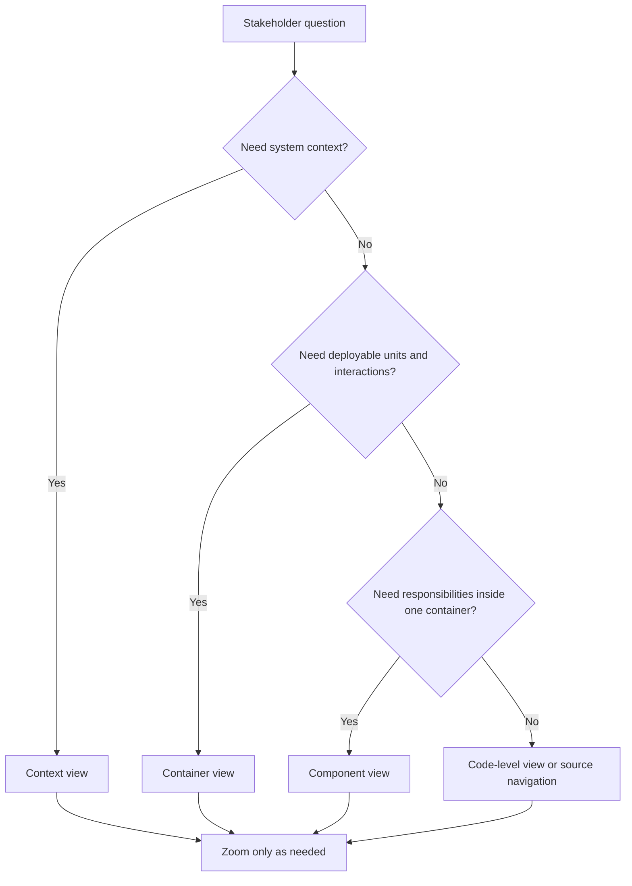
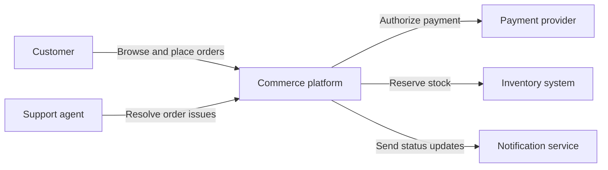
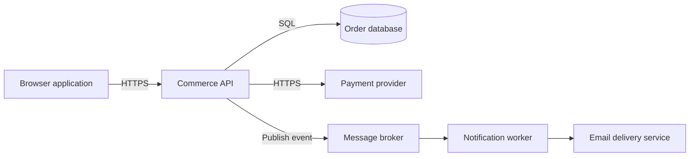
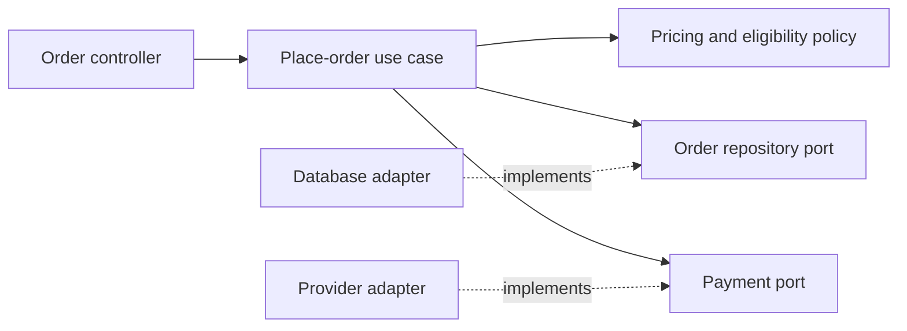
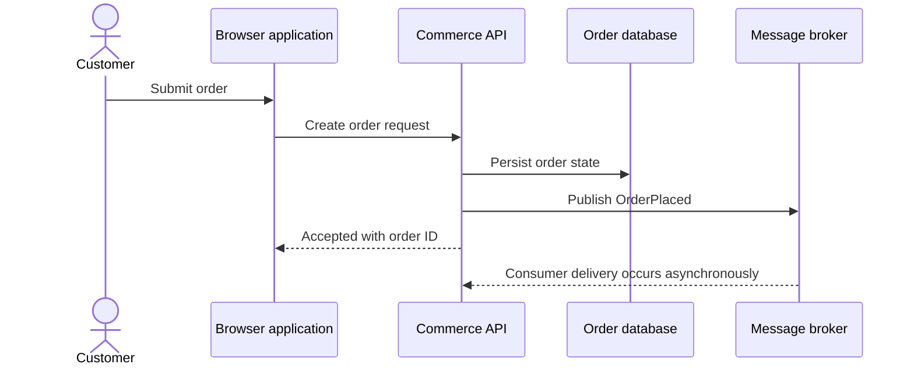
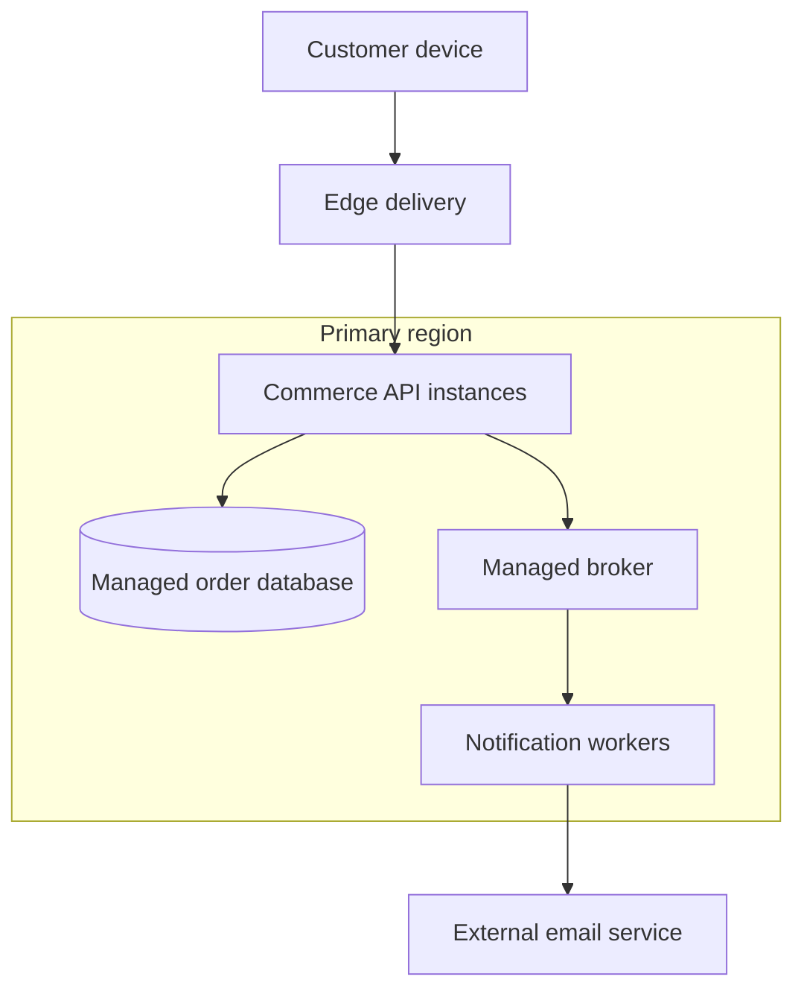

# C4 Model

Part: [21 — Architecture Documentation](PART_OVERVIEW.md)

The C4 Model organizes software architecture views at four zoom levels: Context, Containers, Components, and Code. It helps an architect select the level of detail that answers a stakeholder's question without implying that every system needs every diagram. C4 is a model and notation; it does not define the architecture or replace the reasoning behind it.

Part 21 owns documentation models. Part 01 owns architecture foundations, Part 07 owns solution design workflow, and Part 18 owns enterprise architecture viewpoints.

## Select a View From the Question

Context shows the system boundary, people, and external systems. Container shows deployable or executable units and their responsibilities. Component shows the internal structure of a container when that detail matters. Code shows implementation-level structure. Keep that detail in source or generated documentation close to the implementation. A view should state its audience, scope, assumptions, and update owner.

Do not descend levels automatically. If the decision concerns an external integration, a component diagram may add noise. If the question is about module ownership or change impact, context alone may be too coarse.

## Context View: Establish the Boundary

A context view communicates who uses the system, what external systems it depends on, and the purpose of those relationships. Keep internal technology out unless it changes the conversation. Name people by role and systems by responsibility; annotate protocols only when they matter to the decision.

Context diagrams should be consistent about what is inside the boundary and which party owns each external dependency. Do not label every internet connection as a separate system; include the systems that affect behavior, risk, or change.

## Container View: Show Runtime Responsibilities

In C4, a container is an independently runnable or deployable unit such as a web application, service, database, or mobile application. It is not necessarily a Docker container. Show technology choices only when they inform the architecture decision, and label each container's responsibility and relationships.

This view supports questions about deployment, scaling, trust boundaries, and operational ownership. If two units deploy together and share a lifecycle, do not imply independent deployment without evidence. Databases managed by another team need a named owner and documented dependency behavior.

## Component View: Explain Internal Responsibility

Use a component view to explain meaningful internal structure within one container: controllers, application services, domain modules, adapters, or other cohesive responsibilities. Avoid showing every class or framework artifact. Include boundaries where ownership, testing, or change propagation is important.

Component names should reflect responsibilities rather than implementation fashions. Keep the view at a scale where relationships remain legible. Code-level details belong in source, generated documentation, or a narrower design view when they are necessary to answer a concrete question.

## Keep Zoom Levels and Dynamic Views Consistent

Static diagrams describe structure; dynamic views show a scenario moving through that structure. Identifiers and names should line up across levels. A sequence diagram should not call a container by a name absent from the container view unless it is explicitly an external actor or detail.

The dynamic view supplements rather than replaces the container view. Make synchronous and asynchronous boundaries explicit, and show errors or retries when they materially affect the scenario. Avoid drawing a success-only sequence as if it documented failure behavior.

## Deployment and Evolution

C4 can be extended with deployment views that show containers placed on infrastructure nodes and network boundaries. Deployment detail should agree with container names and declared environments. Version diagrams with the architecture decision or system release they describe, and update them when a meaningful boundary, dependency, or operating assumption changes.

Deployment views should identify trust zones, failure domains, and responsibility where relevant. Avoid presenting provider-specific products as portable C4 elements; technology labels belong in the view only when they shape the decision.

## Worked Case: Order Placement

An architecture review asks whether order placement can remain available when email delivery is down. The context view identifies customers, the commerce platform, payment, inventory, and notification systems. The container view shows that email is handled asynchronously by a worker. The component view identifies the order use case and the event publication boundary. A dynamic view confirms that order acceptance does not synchronously wait for email.

Each view answers a different question and uses consistent names. The diagrams are linked to a decision about notification delay, retry ownership, and customer-visible status. The team avoids adding class-level views because they do not change the availability decision.

## Review Questions

1. Which C4 level answers the current stakeholder question?
2. What belongs inside the system context boundary?
3. Does “container” mean an operating-system or Docker container in this model?
4. How does a dynamic view relate to a static container view?
5. What changes should trigger an update to a C4 diagram?

C4 is most useful when each view is selected for a real question and zoom levels remain consistent. Start with context, add detail only when it changes a decision, and treat names, boundaries, ownership, and update triggers as part of the model.
