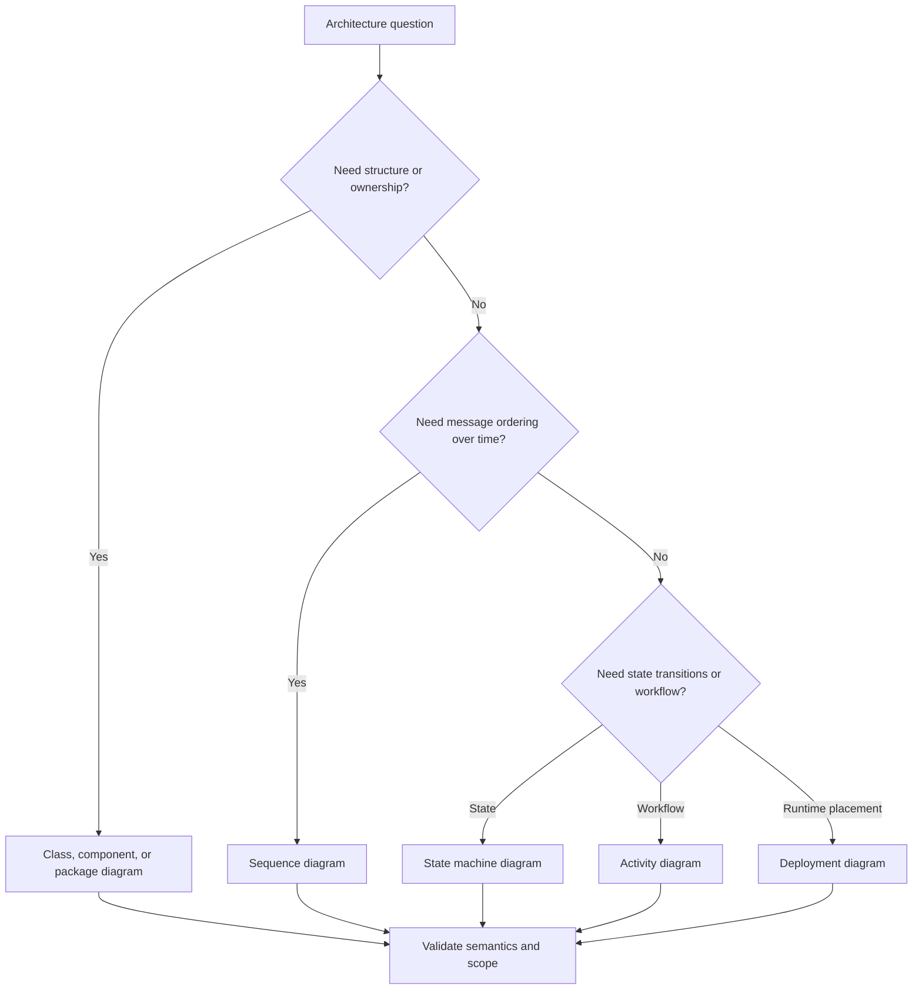
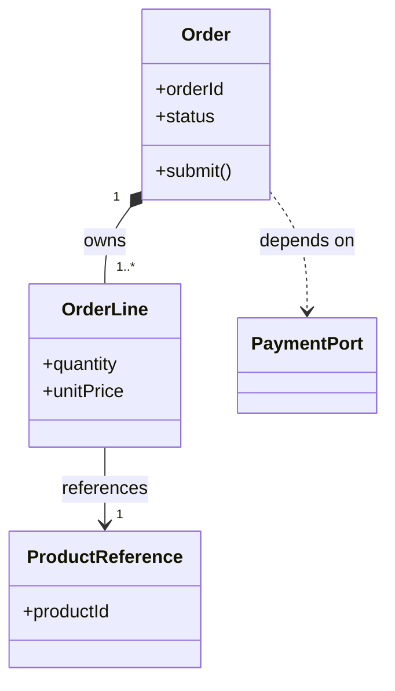
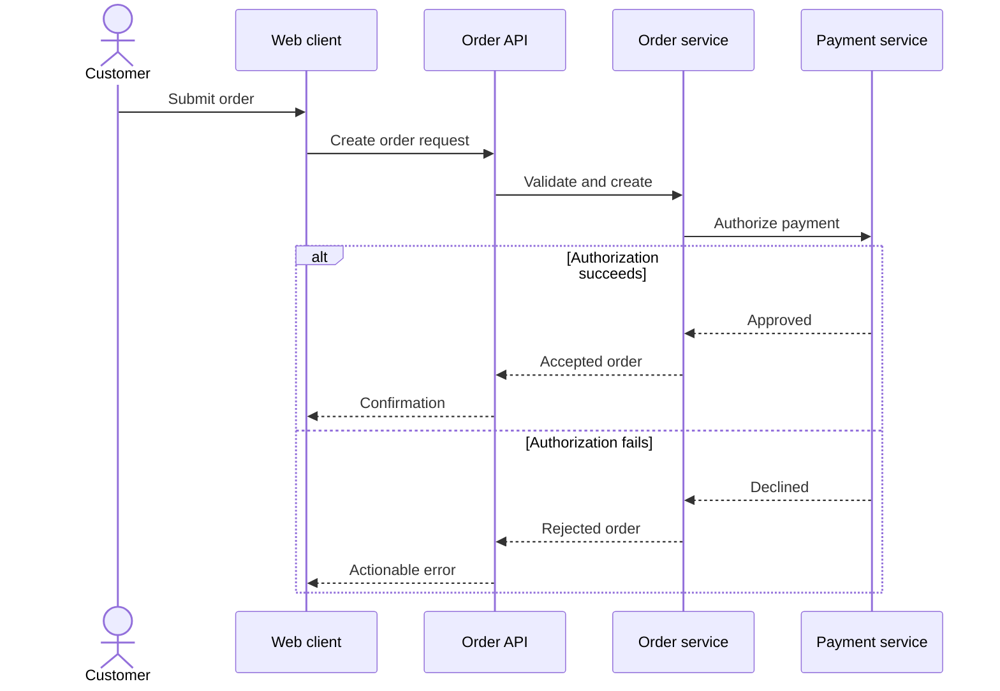
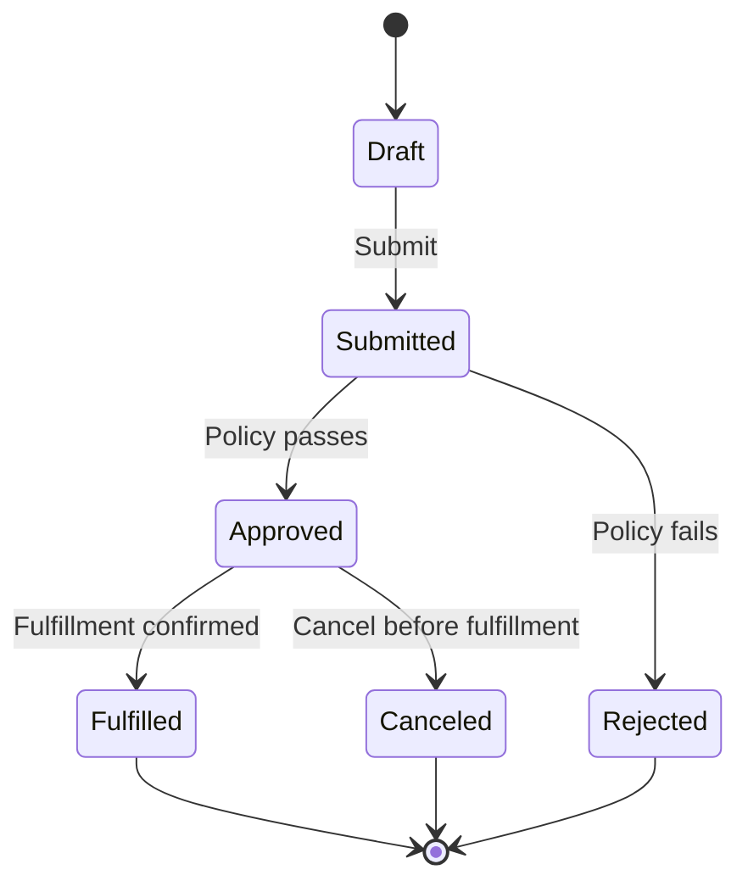
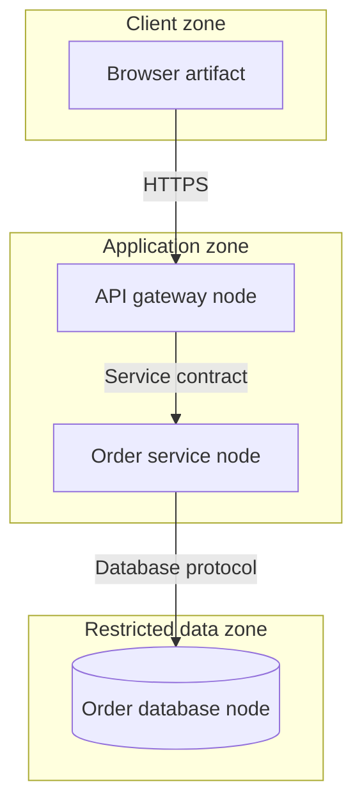

# UML: Unified Modeling Language

Part: [21 — Architecture Documentation](PART_OVERVIEW.md)

Unified Modeling Language (UML) is a standardized family of notations for describing software structure and behavior. Its diagrams can make relationships, interactions, state, and deployment constraints precise when stakeholders share the notation. UML does not prescribe an architecture process or require every system to use every diagram type.

Part 21 owns documentation notation. Part 07 owns solution design workflow; Part 21 CH01 covers C4 views and their audience-oriented zoom levels.

## Choose a Diagram by the Question

Structural diagrams show static elements and relationships. Behavioral diagrams show activity, state, or interaction over time. Select a diagram based on the decision, reader, and needed precision. A class diagram cannot explain runtime ordering; a sequence diagram cannot show the full deployment topology.

UML includes additional diagram types beyond this selection. Use the smallest diagram set that answers the architecture question, and define any organization-specific conventions that affect interpretation.

## Model Class Relationships Precisely

Class diagrams show classifiers, attributes or operations when relevant, and relationships such as association, generalization, dependency, aggregation, and composition. Multiplicity constrains how many instances participate. A diagram should distinguish ownership and lifecycle, not use different line styles decoratively.

Composition implies lifecycle ownership; a plain association does not. Use multiplicity and navigability when they affect invariants or coupling. Avoid using a class diagram as a substitute for a database schema or domain model without clarifying which one it represents.

## Describe Interactions With Sequence Diagrams

Sequence diagrams show participants and messages in time order. Use activation, synchronous calls, asynchronous signals, alternatives, and loops only where they clarify behavior. Show response and error paths when they influence ownership, latency, or recovery. Part 21 CH05 focuses on sequence diagram documentation practice in more detail.

Use a sequence diagram to answer who calls whom, in which order, and what happens on a material branch. Do not infer durability or exactly once behavior from a message arrow; document those semantics separately.

## Represent Lifecycle With State Machines

State machine diagrams describe valid states and transitions triggered by events or guards. They help expose illegal transitions, terminal states, and recovery. Define whether states are mutually exclusive, what persists across restart, and who owns the transition.

Avoid ambiguous state labels such as “processing” without an owner or exit condition. If a process is better represented as concurrent activities, use an activity diagram or sequence view. State machines should align with persisted status fields and operational dashboards where that consistency matters.

## Map Components to Deployment Nodes

Deployment diagrams show execution nodes, artifacts, communication paths, and environments. Use them to discuss placement, trust boundaries, scaling, and operational ownership. Do not collapse logical components and physical nodes into one unlabeled box; readers need to distinguish software responsibilities from infrastructure placement.

Label environments and trust zones consistently. A deployment view is a model of an intended or observed placement; identify which it is and when it was validated. Part 21 CH06 addresses deployment-diagram artifact practice and consistency.

## Worked Case: Order Cancellation

An architecture review asks whether a cancellation can race with payment capture. A state machine shows allowed order states and cancellation cutoff. A sequence diagram shows the API, order service, payment provider, and event publication. A class or component view identifies which module owns the transition, while a deployment view shows the network boundary to the provider.

The team avoids one oversized UML model. It uses each diagram to answer a specific question, shares consistent names, and links the views to a decision about idempotency and cancellation deadlines. Runtime tests validate the race behavior; the diagrams communicate intended semantics but do not prove implementation conformance.

## Review Questions

1. Which UML diagram type answers the current architecture question?
2. What does composition mean that a plain association does not?
3. How should synchronous and asynchronous messages differ visually?
4. Which state transitions and terminal outcomes need to be explicit?
5. What distinction must a deployment view make between software and node?

UML is most useful when notation precision serves a stakeholder decision. Choose diagram types deliberately, use relationships according to their semantics, and keep structure, behavior, and deployment views consistent without forcing every model into one artifact.
