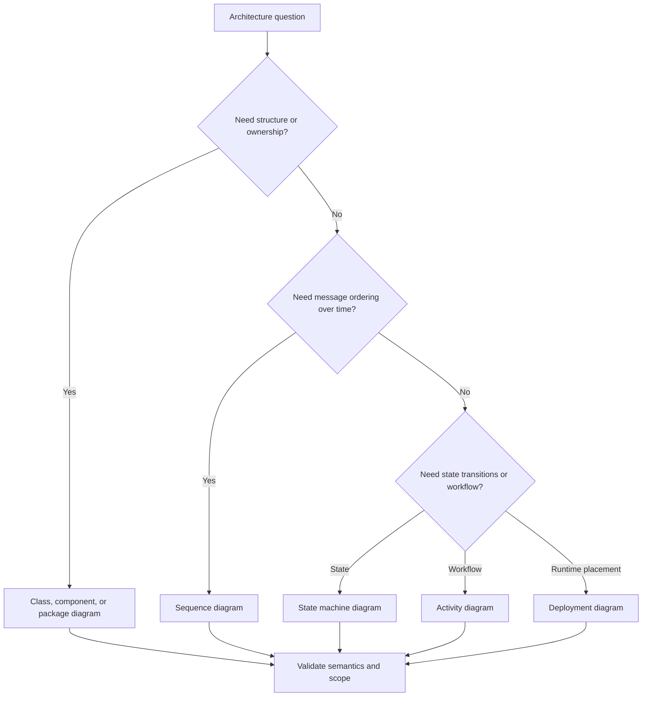
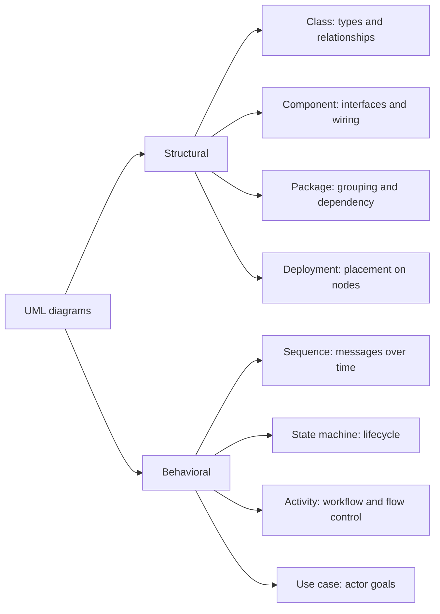
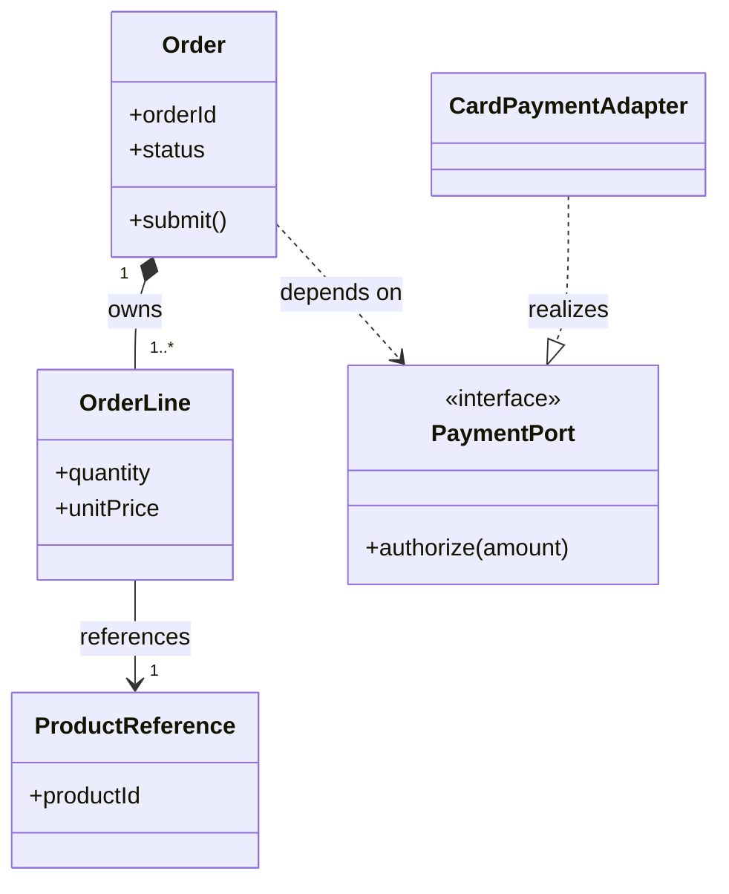
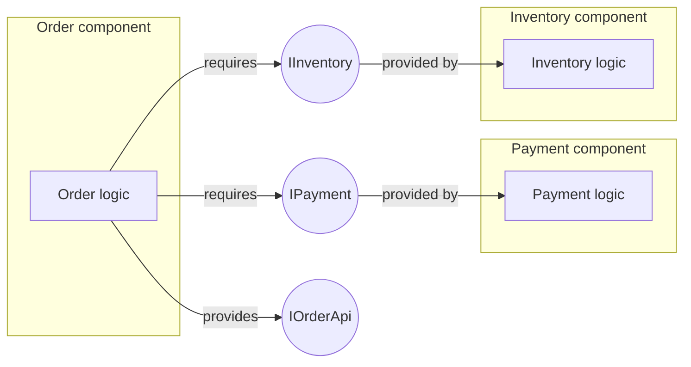
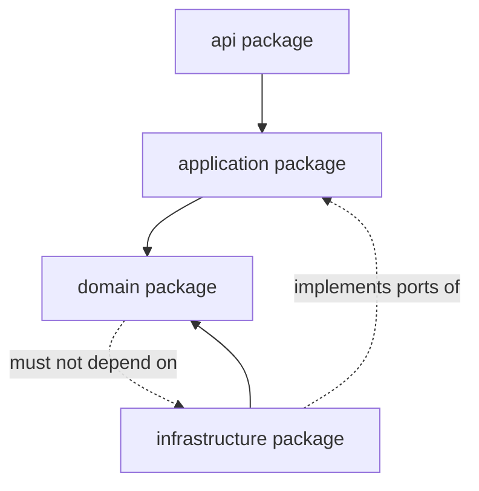
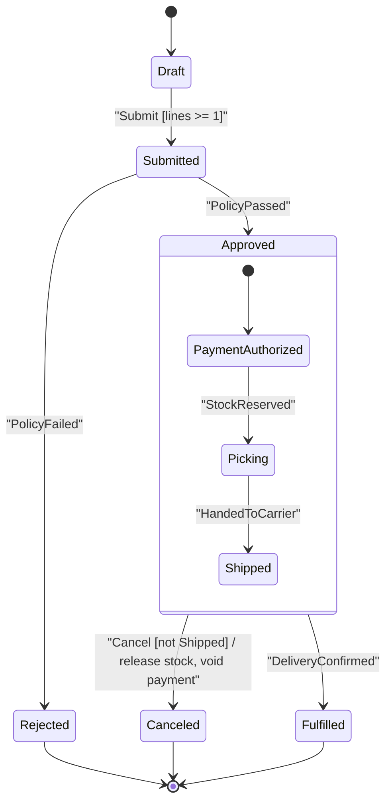
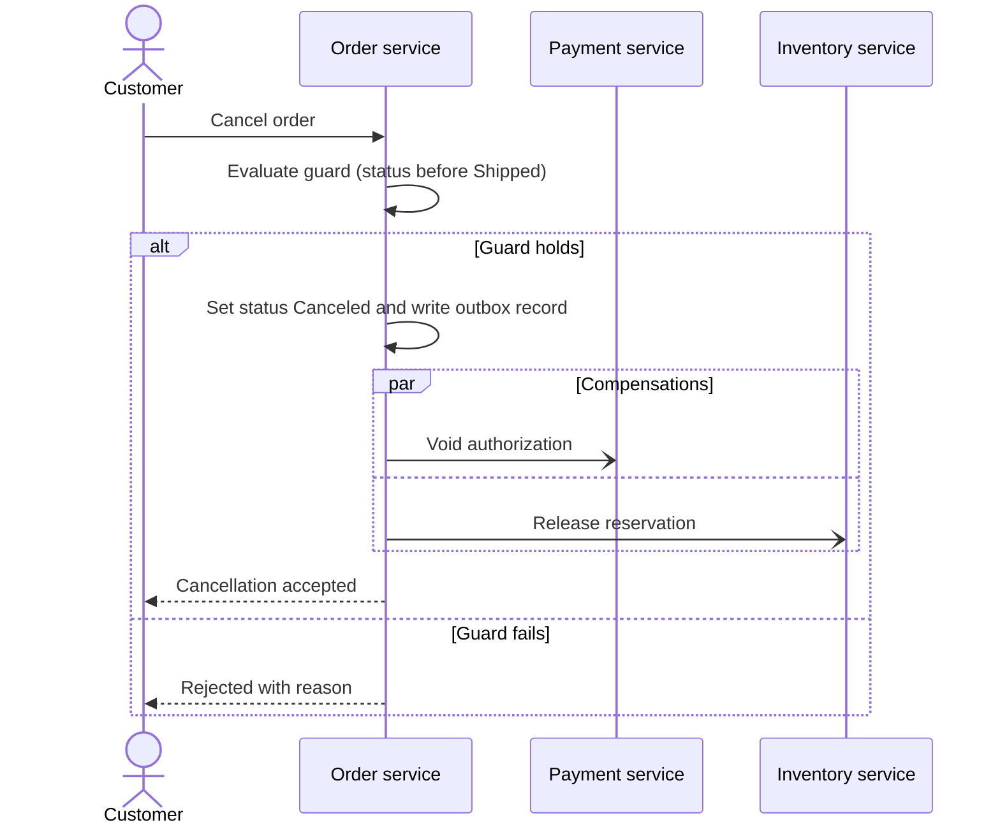
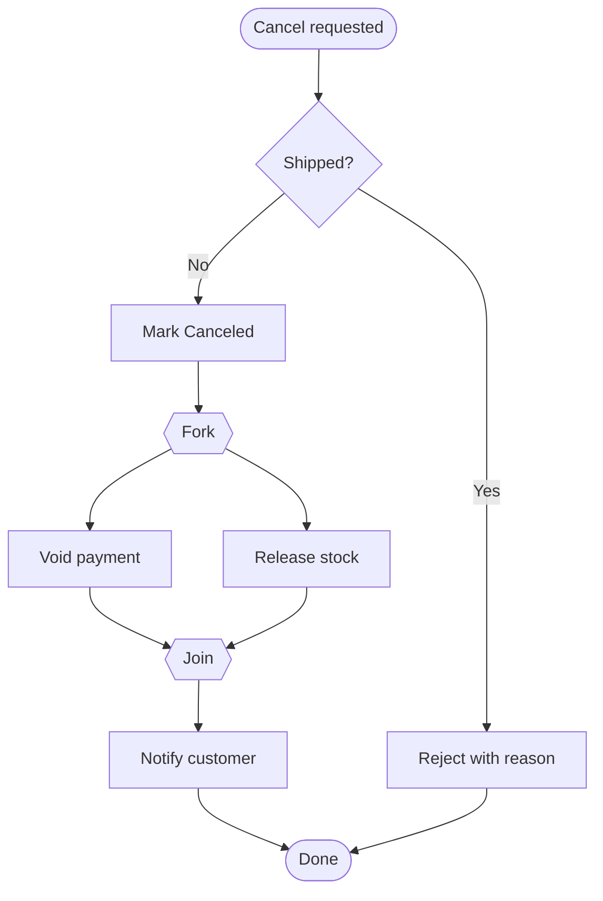
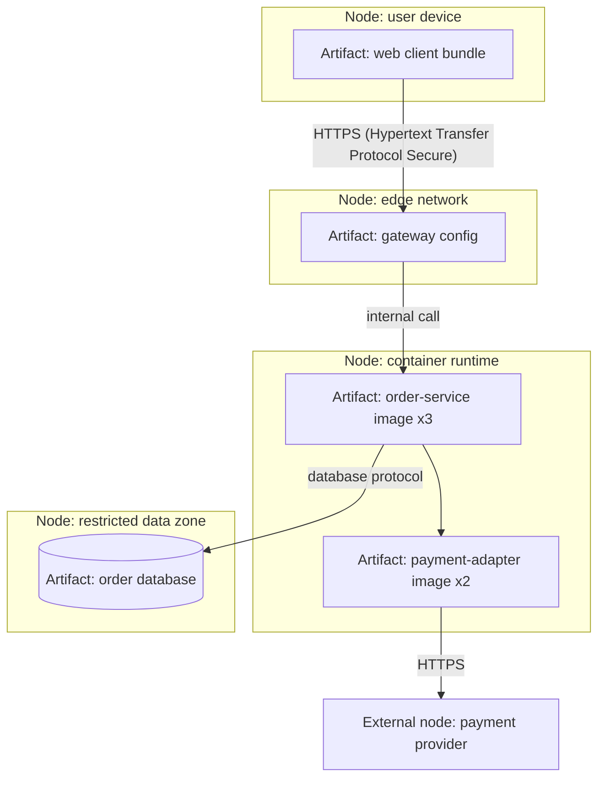
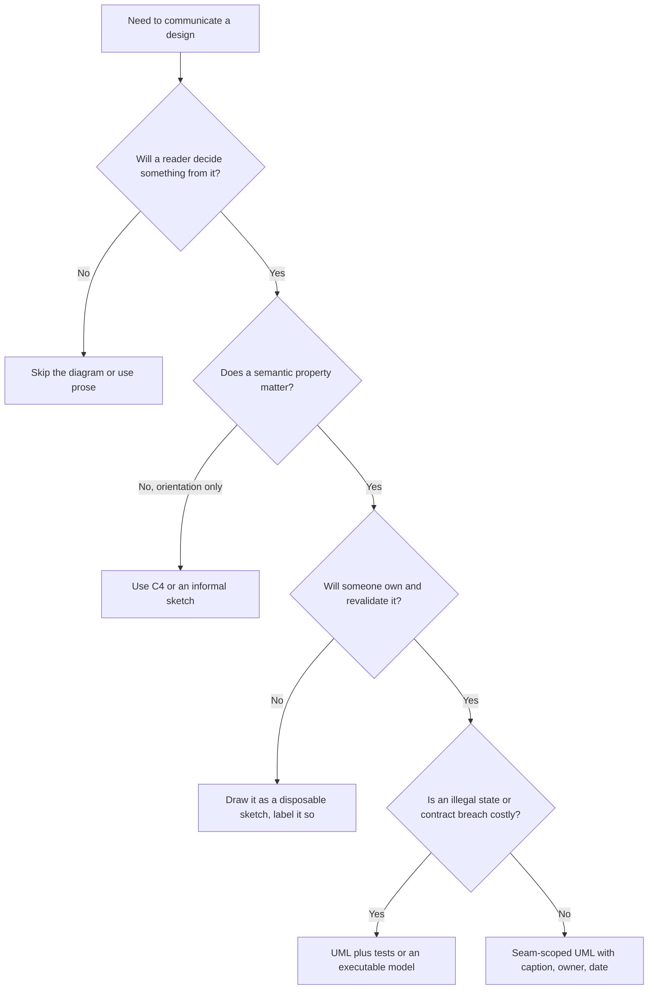

# UML: Unified Modeling Language

Part: [21 — Architecture Documentation](PART_OVERVIEW.md) · Status: Drafted

## 1. Introduction

Unified Modeling Language (UML) is a standardized family of graphical notations for describing the structure and behavior of software-intensive systems. Its value is precision with a shared vocabulary: when a reader knows that a filled diamond means "owns the lifecycle of" and a dashed arrow means "depends on", a diagram can carry constraints that prose and boxes-and-arrows sketches leave ambiguous. UML does not prescribe an architecture process, and no system needs every diagram type.

For an engineer moving into architecture, the skill is not memorizing notation. It is choosing the one diagram that answers the question a specific reader is about to decide, drawing it with the semantics the notation promises, and keeping it true as the system changes. Architects are routinely handed diagrams where line styles are decorative, boxes mean different things in the same picture, and nobody can say whether the picture describes the code, the intent, or last year's design. Each of those failures costs review time and, worse, produces confident misunderstandings.

This chapter owns UML notation and the selection of diagram types. The boundaries with neighbouring material are deliberate:

- Audience-oriented zoom levels, system context, containers, and the C4 (Context, Containers, Components, Code) vocabulary belong to [C4 Model](CH01_C4_Model.md); this chapter compares the two rather than re-teaching C4.
- Sequence diagram documentation practice belongs to [Sequence Diagrams](CH05_Sequence_Diagrams.md), and deployment diagram practice belongs to [Deployment Diagrams](CH06_Deployment_Diagrams.md); this chapter recaps where each fits among the other diagram types.
- The solution design workflow, including how high-level and low-level designs are produced, belongs to [High-Level Design](../07_System_Design_and_Distributed_Systems/CH03_High_Level_Design.md) and [Low-Level Design](../07_System_Design_and_Distributed_Systems/CH04_Low_Level_Design.md).
- Stakeholder and viewpoint framing, including the 4+1 view model, belongs to [What is Software Architecture?](../01_Architecture_Mindset/CH01_What_is_Software_Architecture.md).
- Recording the decisions that diagrams illustrate belongs to [ADR (Architecture Decision Record)](CH03_ADR_Architecture_Decision_Record.md).

After studying this chapter, a reader should be able to:

1. Explain what UML is, what it is not, and when a formal notation is worth its cost compared with informal sketches or C4.
2. Map an architecture question to the appropriate UML diagram family and name the questions a given diagram cannot answer.
3. Draw class diagrams whose association, aggregation, composition, generalization, and dependency relationships mean what the notation says.
4. Use multiplicity, navigability, and stereotypes to state invariants and coupling.
5. Draw component and package diagrams that expose provided and required interfaces and dependency direction.
6. Review a UML artifact for semantic correctness, scope, and currency, and recognize when it should be deleted instead of updated.

## 2. Background and History

UML emerged in the 1990s when several object-oriented analysis and design methods, each with its own notation, were unified into one language; the best-known contributors were Grady Booch, Ivar Jacobson, and James Rumbaugh. UML was subsequently adopted as a standard by the Object Management Group (OMG), and a version of it was also published as an International Organization for Standardization (ISO) standard. The specification has been revised several times since; consult the current OMG specification for exact diagram types and rules rather than relying on any summary, including this one.

Two points matter to a practitioner. First, UML defines both a notation and an underlying metamodel, so in principle a diagram is a view of a model rather than only a drawing. In practice most teams draw diagrams in lightweight tools and treat them as pictures, which is acceptable if the team is honest about it. Second, UML was designed to be general, which is why it feels heavy for small problems. Later approaches such as C4 deliberately trade breadth for approachability. The implication is that UML is best used selectively, as a precise tool for the few views where its semantics pay off.

## 3. The Problem UML Solves

Architectural communication fails in predictable ways. The patterns below are general, not reported incidents.

| Failure pattern | Mechanism | What UML contributes |
| --- | --- | --- |
| Ambiguous lines | An arrow might mean calls, owns, depends on, or sends data; readers pick different meanings | A defined vocabulary for each relationship kind |
| Wrong diagram for the question | A box-and-line picture is used to argue about message ordering or state validity, which it cannot show | Distinct diagram families for structure, behavior, and placement |
| Hidden lifecycle rules | Nobody records which object may exist without which other, so deletion and consistency bugs follow | Composition, multiplicity, and navigability |
| Mixed abstraction levels | A single picture shows classes, services, and servers together | Separate structural, behavioral, and deployment views |
| Unreviewable diagrams | Each author invents conventions, so reviewers cannot check correctness | Conventions that a reviewer can verify against a reference |

Alternatives exist. Informal sketches are fastest and are the right default for early exploration. C4 gives audience-friendly zoom levels and is easy to teach. Prose and tables express rules that diagrams handle badly, such as policy and thresholds. Code itself is the most accurate description of structure, at the cost of readability. UML is chosen when a reader must reason about a specific semantic property, such as ownership, cardinality, or allowed transitions, and when the audience shares or can quickly learn the notation. The decision criterion is whether precision changes a decision; if the diagram would read the same with every line style replaced by a plain arrow, UML adds cost without value.

## 4. Choosing a Diagram by the Question

UML groups diagrams into structural families, which describe what exists, and behavioral families, which describe what happens. Select by the decision, the reader, and the precision needed. A class diagram cannot explain runtime ordering, and a sequence diagram cannot show a full deployment topology.

### 4.1 A decision flow

The flow below maps the question being asked to a diagram family. It is a starting heuristic, not a rule.



The flow shows that the first split is between what exists and what happens. Its implication is that most disagreements in review come from asking one diagram to answer a question from the other family. When a reviewer says "this diagram does not show X", first ask whether X belongs to a different view rather than adding it here.

### 4.2 The diagram families

UML includes more diagram types than most architecture work needs. The map below groups the ones this part uses and notes where each is covered. Treat the grouping as a teaching aid; the current OMG specification is the authority on the full list.



Class, component, and package diagrams are developed in this chapter. Sequence diagrams are covered in [Sequence Diagrams](CH05_Sequence_Diagrams.md) and deployment diagrams in [Deployment Diagrams](CH06_Deployment_Diagrams.md); here they are only positioned in the family. The implication of the map is a budget: a typical architecture package needs two to four of these, chosen for the decisions at stake, not one of each.

### 4.3 UML compared with C4 and with informal sketches

| Dimension | Informal sketch | C4 | UML |
| --- | --- | --- | --- |
| Primary strength | Speed in exploration | Audience-oriented zoom levels | Precise semantics for a chosen property |
| Learning cost | None | Low | Moderate to high |
| Covers behavior and state | Ad hoc | Limited (dynamic views) | Yes, with dedicated diagram types |
| Risk | Ambiguity | Over-simplification of semantics | Over-modelling and stale detail |
| Best fit | Whiteboard design | Onboarding and overview | Reviewing invariants, lifecycle, and interfaces |

The families are complementary. A common pattern is to use C4 for the overview a newcomer reads first, then UML class, state, or sequence views at the specific seams where precision matters. C4 does not forbid UML at its lowest level; it notes that code-level detail can be shown with notations such as UML class diagrams, and the choice should be made per audience.

### 4.4 What each family is not for

- Class diagrams are not a database schema or a deployment description; they say nothing about storage or runtime placement unless stereotypes and notes say so.
- Component diagrams are not process diagrams; a component box does not imply a separately deployed process.
- Package diagrams are not ownership charts; a package boundary says nothing about which team owns it unless documented.
- Behavioral diagrams do not prove implementation conformance; tests and runtime evidence do.

## 5. Class Diagrams and Relationship Semantics

### 5.1 Mechanism

A class diagram shows classifiers (classes, interfaces, enumerations), optionally their attributes and operations, and the relationships among them. For architecture, the relationships matter far more than the members. Show only the attributes and operations that support the point being made; a class diagram listing every field is a code listing in disguise, and it ages as fast as code does.

The relationship kinds and their intended meaning are:

| Relationship | Meaning | Typical notation | Architectural signal |
| --- | --- | --- | --- |
| Association | One classifier holds a reference to another or they otherwise collaborate over time | Solid line, optional arrowhead for navigability | Structural coupling that persists |
| Aggregation | Whole-part with no lifecycle ownership (weak "has") | Solid line with hollow diamond at the whole | Often overused; many teams avoid it because it adds little beyond association |
| Composition | Whole-part where the part cannot outlive the whole | Solid line with filled diamond at the whole | Lifecycle and deletion rules; consistency boundary |
| Generalization | Subtype specializes supertype | Solid line with hollow triangle at the supertype | Substitutability obligations |
| Realization | A classifier implements an interface | Dashed line with hollow triangle | Contract separation |
| Dependency | Use that does not persist as a structural reference | Dashed line with open arrowhead | Change impact without stored coupling |

Mermaid supports these forms in its classDiagram syntax with minor rendering differences from the UML specification; check the rendered output when precision matters.



Composition implies that an order line is created and deleted with its order, so deleting an order must delete its lines and no line can be shared between orders. The association from line to product reference is a plain reference: the product has its own lifecycle. The dependency on the payment port is not a stored reference; the order uses the port during an operation. The realization separates the contract from its adapter, so replacing the payment provider changes the adapter and not the order. The implication for review is that every line style in the picture is a checkable claim about code and data, not decoration.

### 5.2 Multiplicity, navigability, and stereotypes

Multiplicity states how many instances take part: `1`, `0..1`, `1..*`, `*`. It encodes invariants: `1..*` on order lines asserts that an order without lines is invalid, which becomes a validation rule and a database constraint candidate. Navigability, shown by an arrowhead, states which side holds the reference. Navigability from line to product, and not the reverse, says the product catalogue does not know which lines reference it, a decoupling that is often intentional. When both ends are navigable, state why, because bidirectional references are a common source of cyclic coupling.

Stereotypes, written in guillemets such as `«interface»` or `«entity»`, extend the vocabulary. Mermaid expresses them with the `<<interface>>` annotation. Use stereotypes the audience knows or define them in a legend; a private stereotype with no legend makes a diagram unreadable to anyone outside the team.

### 5.3 Failure modes and edge cases

- Aggregation versus composition confusion: authors draw a hollow diamond expecting "contains" and readers infer shared lifecycles, or the reverse. Prefer plain association when unsure and state ownership in a note.
- Generalization used for code reuse: inheritance chosen to share fields rather than to express substitutability leads to fragile hierarchies. Prefer composition or interfaces unless the subtype truly honours the supertype contract.
- Diagram stands in for the schema: classes with foreign keys, join tables, and column types mix object and relational concerns. Label the diagram as a domain model, a code model, or a data model, and keep it to one.
- Everything on one page: a hundred classes cannot be reviewed. Split by bounded area and show only the seam classes in each view.
- Cross-service references: in a distributed system, an association between classes in different services is not an in-memory reference but an identifier or a remote call. Draw it as a dependency or an identifier reference with a note, so nobody assumes transactional consistency across it.

### 5.4 Worked scenario (illustrative, hypothetical)

A team is reviewing the design for an order service. A reviewer asks whether a cancelled order can leave orphaned lines, and whether the product catalogue can be changed without touching orders. The class diagram answers both: composition from order to line says lines are deleted with the order, and the single-direction reference from line to product reference says the catalogue holds no pointers back. The reviewer then asks why `Order` depends on `PaymentPort` rather than a concrete provider class. The answer, the realization to an adapter, is visible in the diagram and is recorded as a decision in an architecture decision record.

The reviewer also spots that the diagram shows an `OrderLine` `unitPrice` attribute. The team clarifies in a note that the price is a snapshot copied at submission, not a live reference to the catalogue price, which resolves a pricing-consistency question before code is written. None of this required a long document; one diagram, each line checkable, produced three review conclusions. The diagram does not, however, show what happens when two cancellation requests arrive concurrently; that question belongs to a state machine and a sequence view.

### 5.5 Keeping class diagrams current

A class diagram is worth keeping only if someone will notice when it is wrong. Three practices help: keep the diagram close to the code or design document it describes; scope it to stable seams, not volatile internals; and review it when the related interface, aggregate, or contract changes. Generating the diagram from code removes drift but tends to produce noisy, undifferentiated output; hand-drawn seam diagrams are smaller and carry intent. A diagram with no named owner and no review trigger should be deleted rather than left to mislead.

## 6. Component and Package Diagrams

### 6.1 Mechanism

A component diagram shows components, the interfaces they provide, and the interfaces they require, and wires required interfaces to provided ones. In UML notation these are drawn as lollipops (provided) and sockets (required). Mermaid has no native component diagram, so a flowchart with explicit interface nodes is a practical approximation; state this in a legend, because it is a modelling convention, not UML-conformant notation.



The diagram shows that the order component depends on two contracts and exposes one, and that payment and inventory know nothing about orders. The implication is that contract changes to `IPayment` or `IInventory` are the points where change impact must be assessed, and that component substitution is possible wherever the interface is respected. Compare this with the C4 component level: a C4 component is usually a grouping of code behind a defined responsibility, whereas a UML component is a modular unit with explicit provided and required interfaces. The two vocabularies overlap but are not interchangeable; state which you mean.

### 6.2 Package diagrams and dependency direction

A package diagram groups elements into namespaces and shows dependencies between the groups. Its architectural use is making the dependency direction visible, so that a rule such as "domain does not depend on infrastructure" can be reviewed and, where tooling allows, enforced.



The solid arrows show the intended direction: api to application to domain, with infrastructure depending inward on the domain. The dotted prohibition is the review rule. The implication is that a package diagram is most useful when paired with a mechanical check; a diagram alone documents intent but cannot prevent a stray import. Cycles between packages are the main failure to look for: one cycle often signals that two packages are really one, or that an interface is missing.

### 6.3 Failure modes and what these diagrams are not for

- Component boxes that stand for deployable services in one view and code modules in another; label the granularity.
- Interfaces drawn but not defined: an interface node with no operations, error semantics, or versioning policy is a placeholder, not a contract.
- Package diagrams that list every package: show only the layers or modules whose dependency rule is under review.
- Treating either diagram as a deployment view: they say nothing about processes, hosts, or networks.

### 6.4 Worked scenario (illustrative, hypothetical)

A team splitting a monolith wants to know which modules can be extracted first. A package diagram of the monolith shows the order, payment, and inventory packages, with a dependency cycle between inventory and order. The cycle explains why extracting inventory keeps failing: it needs types from orders. The team introduces an interface owned by the inventory package, which orders implement, and the cycle disappears in the diagram before it disappears in code. The component view then documents the resulting contracts as the extraction seam. The diagrams do not decide the sequencing; they make the coupling visible so the sequencing decision rests on evidence, and the decision itself goes into an architecture decision record.

### 6.5 Reviewing and keeping UML artifacts current

Review a structural diagram with four questions: does each relationship mean what its notation says, is the abstraction level consistent, does it match the code or design at a stated date, and does it answer a named question? Record in the diagram's header or caption the question it answers, its owner, the date or version it was last validated, and whether it describes intended or implemented structure.

```text
Diagram: Order seam class diagram
Question answered: Who owns order lines and how are payments abstracted?
Describes: intended design (not generated from code)
Owner: order service team
Last validated: <date> against <commit or design version>
Review trigger: change to Order, OrderLine, or PaymentPort contracts
```

## 7. State Machine Diagrams

### 7.1 Mechanism

A state machine diagram describes the states one entity can be in, the events that move it between states, and the conditions and actions attached to those moves. It is the diagram family to choose when the question is "which transitions are legal, and what happens on each?" Class diagrams cannot answer that, and sequence diagrams show only the paths someone chose to draw.

The vocabulary a reviewer should be able to check:

| Element | Meaning | Review question |
| --- | --- | --- |
| State | A condition during which the entity waits for events and satisfies an invariant | What is true in this state, and who may observe it? |
| Event | A trigger such as a command, message, or timeout | Where does it originate, and can it arrive twice? |
| Guard | A boolean condition that must hold for the transition to fire | Is it evaluated against current persisted data? |
| Action on transition | Behavior performed while moving | Is it atomic with the state change? |
| Entry and exit actions | Behavior run whenever a state is entered or left, regardless of the transition used | Is it safe to run again on recovery? |
| Composite state | A state containing nested states, sharing entry, exit, and outgoing transitions | Does an outer transition apply to every inner state? |
| Terminal state | No further transitions | Is it reachable only intentionally? |

The conventional label for a transition is `event [guard] / action`. Mermaid renders event and guard text as a plain label, so keep the full label in quotes or short text and explain the convention in a caption.

### 7.2 A composite state in depth

The order lifecycle below nests fulfillment steps inside a composite `Approved` state. Because the cancellation transition leaves the composite itself, it applies to every inner state until the cutoff guard says otherwise.



Three things this diagram says that prose usually hides. First, `Submit` has a guard: an order with no lines cannot be submitted, which ties back to the `1..*` multiplicity in section 5. Second, cancellation is defined once for the composite state rather than three times, so adding an inner state does not require redrawing the exit. Third, the guard `not Shipped` and the compensating action are part of the transition, so the diagram is a reviewable statement of the business rule. The diagram does not decide whether the guard is evaluated atomically with the write; that is an implementation property recorded elsewhere.

### 7.3 Entry and exit actions, and recovery

Entry actions run on every entry, so a state that sends a notification on entry will send it again if the process replays an event after a restart. This is the most common state machine defect in practice. Mitigation options:

- Make entry actions idempotent, or record a durable marker that the action was performed. See [Idempotency](../07_System_Design_and_Distributed_Systems/CH16_Idempotency.md) and [Deduplication](../07_System_Design_and_Distributed_Systems/CH19_Deduplication.md).
- Move externally visible side effects to the transition action and persist the state change and an outbox record together, so the effect follows the state rather than racing it.
- Document which actions are best-effort and which are required, because recovery behavior differs.

### 7.4 Alternatives and when each wins

| Approach | Strength | Weakness |
| --- | --- | --- |
| A single status field with ad hoc checks | Minimal effort | Rules scatter across code; illegal transitions appear |
| A state machine diagram plus a transition table | Rules reviewable before coding | Diagram and code may drift |
| A state machine library or workflow engine | Rules executable and enforced | Added dependency and learning cost |
| A flowchart or activity diagram | Good for ordered steps | Weak at expressing "which events are legal in which state" |

The decision criterion is the number of states and the cost of an illegal transition. Three states with no side effects need a sentence; a money-moving lifecycle with cancellation, retries, and timeouts justifies a diagram and a transition table kept next to the code.

### 7.5 Failure modes and edge cases

- Missing transitions for unexpected events: define what happens when `Cancel` arrives in `Fulfilled`. Silently ignoring, rejecting with an error, and compensating are different decisions; record which.
- Duplicate and out-of-order events: a transition table with an explicit "no-op" cell for repeated events is clearer than a diagram with every self-loop.
- States named after activities such as "Processing" with no exit condition, owner, or timeout; split them or add a timeout transition.
- Diagram states that do not match persisted status values, so dashboards and support staff use different vocabulary from the model.
- Concurrent regions: if two independent things advance at once (payment and stock), either use orthogonal regions deliberately or model two machines; one flat machine multiplies states combinatorially.

A compact transition table complements the diagram and is easy to test:

```text
State        Event            Guard              Next        Action
Submitted    PolicyPassed     -                  Approved    reserve stock
Approved     Cancel           not Shipped        Canceled    release stock, void payment
Approved     Cancel           Shipped            (stay)      reject with reason
Fulfilled    Cancel           -                  (stay)      reject with reason
Canceled     Cancel           -                  (stay)      no-op (idempotent)
```

## 8. Interaction and Activity Diagrams: UML-Specific Points

### 8.1 Where sequence diagrams fit

Sequence diagrams show participants and the messages between them in time order. Their documentation practice, including granularity, error paths, and maintenance, is owned by [Sequence Diagrams](CH05_Sequence_Diagrams.md); this section covers only the points that come from the UML notation itself. For asynchronous interfaces, see also [Async APIs](../08_API_Architecture/CH06_Async_APIs.md).

| UML construct | Meaning | Common misuse |
| --- | --- | --- |
| Lifeline | A participant's existence over the interaction | Drawing a lifeline per class instead of per participant that matters |
| Synchronous message (filled arrowhead) | Caller waits for completion | Using it for fire-and-forget messaging |
| Asynchronous message (open arrowhead) | Caller continues without waiting | Implying delivery or ordering guarantees |
| Return message (dashed) | Reply to an earlier call | Omitting error returns that drive recovery |
| Combined fragment (`alt`, `opt`, `loop`, `par`, `break`) | Conditional, optional, repeated, parallel, or exceptional flow | Nesting so deeply that the happy path disappears |
| Interaction reference | Points to another sequence diagram | Duplicating the sub-flow inline |

An arrow is a statement about control flow, not about durability. Delivery, retries, and exactly-once processing need separate documentation.

### 8.2 A fragment-heavy interaction

The cancellation interaction below uses `alt` and `par` fragments to show a guarded branch and two independent compensations. It is a different view from the state machine: it shows who does the work, not which transitions exist.



The `par` fragment states that the two compensations are independent and unordered, so neither may assume the other finished. The asynchronous arrows say the order service does not wait for them, which means "accepted" does not yet mean "refunded". The implication is that the customer-facing wording, the support runbook, and the timeout handling must all reflect eventual completion. The diagram cannot show retries or what happens if a compensation fails permanently; those need a note or a separate failure-path view.

### 8.3 Activity diagrams

An activity diagram models a workflow as actions, decisions, forks, and joins, with optional swimlanes assigning actions to participants. Use it when the question is "what steps happen and which can run in parallel?" rather than "which states exist". Mermaid has no native activity diagram, so a flowchart approximation is used, and the caption should say so.



The fork and join nodes make explicit that notification waits for both compensations in this workflow variant. That is a design choice the diagram exposes: the sequence view above did not wait. Reconciling the two is exactly the kind of inconsistency a review should find. An activity diagram is weaker than a state machine at stating which events are legal in which state, and weaker than a sequence diagram at showing who talks to whom, so pick it only for step ordering and parallelism.

### 8.4 Choosing among the behavioral views

Use a state machine for legality of transitions, a sequence diagram for collaboration order, an activity diagram for workflow steps and parallelism, and prose or a table for policy thresholds. Using two for the same flow is useful only if they are checked against each other.

## 9. Deployment Diagrams: UML-Specific Points

### 9.1 What the notation adds

A UML deployment diagram shows nodes, which are execution environments such as devices or runtimes, the artifacts deployed on them, and the communication paths between nodes. Practice for producing and maintaining deployment views is owned by [Deployment Diagrams](CH06_Deployment_Diagrams.md); this section covers the UML-specific points and how the view relates to component diagrams. For the broader view framing, see [What is Software Architecture?](../01_Architecture_Mindset/CH01_What_is_Software_Architecture.md).

The distinctions the notation forces are valuable:

- A component is a logical unit; an artifact is a concrete deployable file or package that manifests it; a node is where the artifact runs. Conflating them hides the question of how many copies run and where.
- A node may be nested, such as a container runtime inside a host, which keeps trust and scaling boundaries visible.
- A communication path carries a protocol and implies a network boundary; stating the protocol makes security review possible.

### 9.2 Flowchart approximation

Mermaid has no native UML deployment diagram, so the view below is a flowchart approximation using subgraphs for nodes and labelled edges for communication paths. Say so in the caption and keep the legend consistent.



The multiplicities in artifact labels (three order-service replicas, two adapter replicas) are the kind of fact that a component diagram cannot hold and that matters for availability reasoning. The implication is that the deployment view is where trust boundaries, replica counts, and external dependencies are reviewed, and that every component in section 6 should map to at least one artifact here. A component with no artifact is either not yet built or not actually deployed; either answer matters.

### 9.3 Failure modes

- Boxes that mix logical components and physical nodes with no distinction.
- Environments blurred: production topology presented as if it applied to test, or the reverse.
- Intended versus observed topology unlabeled; the diagram quietly becomes fiction after the next infrastructure change.
- Missing external nodes: third-party providers omitted, hiding the dependency that dominates failure behavior.

## 10. Worked Case: Order Cancellation Across Views

### 10.1 The question

Continuing the illustrative order service from sections 5 and 6, an architecture review asks whether a cancellation can race with shipment or payment capture. No single diagram answers that, so the team assigns one question to each view and checks them against each other.

### 10.2 Which view answers what

| Question | View | Finding (illustrative) |
| --- | --- | --- |
| Which statuses allow cancellation? | State machine (section 7) | Cancel is legal from any inner state of `Approved` until shipment |
| Who does the compensating work? | Sequence (section 8.2) | Order service voids payment and releases stock asynchronously |
| Do steps wait for each other? | Activity (section 8.3) | The activity variant waits at a join; the sequence variant does not |
| Which module owns the transition? | Component and package (section 6) | The order component alone writes status; others react to events |
| Where is the network boundary to the provider? | Deployment (section 9) | The payment adapter is the only node calling out |

### 10.3 What the comparison found

The comparison exposes one inconsistency (whether notification waits for compensations) and one gap (nothing says what happens if voiding the payment fails). The team resolves the first by choosing the non-waiting variant and wording the customer message as "cancellation accepted". It resolves the second by adding a retry-then-alert policy, recorded in an architecture decision record per [ADR (Architecture Decision Record)](CH03_ADR_Architecture_Decision_Record.md), and a runbook entry per [Runbooks](CH07_Runbooks.md). Duplicate cancellation requests are handled by the idempotent no-op row in the transition table.

### 10.4 Limits

The diagrams state intended semantics. They do not prove the implementation matches or that the race is absent. Concurrency tests and runtime evidence validate behavior; tracing, as described in [Tracing](../14_Observability/CH03_Tracing.md), shows what actually happened in production.

## 11. Failure Scenarios and Common Mistakes

### 11.1 Failure catalogue

| Failure | Symptom | Detection | Mitigation |
| --- | --- | --- | --- |
| Wrong diagram type for the question | Review debates what the picture "should" show | Reviewer cannot point to the line answering the question | State the question in the caption; pick the family per section 4 |
| Relationship semantics misused | Different readers infer different ownership | Ask three readers to explain one diamond | Legend; prefer association plus a note when unsure |
| Stale diagram | New engineers rely on structure that no longer exists | Spot-check against code at a stated date | Owner, review trigger, delete when unowned |
| Tooling-induced noise | Generated diagram shows everything and explains nothing | Reviewers skip it | Hand-draw seam views; filter generated output |
| Illegal state transition in production | Orders in impossible statuses | Data queries for invalid status pairs | Transition table, enforced guards, tests |
| Entry action repeated on replay | Duplicate notifications or charges | Duplicate-effect monitoring | Idempotent actions, outbox, markers |
| Views contradict each other | Sequence waits, activity does not | Cross-view review (section 10) | One owner per flow; reconcile before approval |
| Notation approximated silently | Readers assume Mermaid shapes are UML-conformant | Reader confusion about "component" or "node" | Say "flowchart approximation" in captions |
| Over-modelling | Diagrams absorb effort that code would have answered | Time spent exceeds decisions informed | Budget two to four diagrams per decision |

### 11.2 Anti-patterns

- Diagram as decoration: every line style replaced by a plain arrow would change nothing, so the notation adds only cost.
- The one giant model: one diagram attempting structure, behavior, and deployment together.
- Big design up front in UML: modelling every class before any code exists, then treating the model as binding.
- Round-trip fantasy: assuming a model and the code stay synchronized without a process or tooling that actually does it.
- Unowned diagram in a wiki: nobody notices when it is wrong.
- Status field as an unwritten state machine: legal transitions exist only in the heads of whoever wrote the code.

## 12. Trade-off Analysis and Decision Framework

### 12.1 Comparison

| Option | Precision | Cost to produce | Cost to keep current | Best when |
| --- | --- | --- | --- | --- |
| No diagram, prose only | Low | Lowest | Low | Rules are policy, not structure |
| Informal sketch | Low to medium | Low | Disposable | Exploration, workshops |
| C4 | Medium | Low | Medium | Orientation and overview |
| UML, seam-scoped | High for the property shown | Medium | Medium to high | Invariants, lifecycles, contracts under review |
| UML generated from code | High, but undifferentiated | Low | Low | Code-level exploration, not communication |
| Executable model or state machine library | Highest, enforced | High | Lowest, as it is the code | Money-moving or safety-relevant lifecycles |

The trade-off is precision against upkeep. The more precisely a diagram claims something, the more damaging it is when false, so claim only what someone will verify.

### 12.2 Decision flow



The flow's implication is that ownership is a gate, not an afterthought: a precise diagram without an owner is worse than a sketch labelled as disposable. For money-moving lifecycles, move from diagram to enforcement.

## 13. Illustrative Composite Case Study and Review Checklist

### 13.1 Composite case study (hypothetical)

This case is a composite constructed for teaching; it does not describe any real organization. A team operating an order platform has an architecture wiki with forty diagrams in assorted notations. During a design review for a new cancellation feature, the reviewers find that three diagrams of the order lifecycle disagree about whether a shipped order can be canceled, and no diagram has an owner.

The team resolves to reduce the set rather than update it. It keeps one C4 container view for onboarding, one seam class diagram for order ownership and payment abstraction, one state machine with a transition table for the order lifecycle, one sequence diagram for cancellation, and one deployment view. It deletes the rest. Each kept diagram receives a caption with its question, owner, last validated date, and review trigger, and the transition table becomes a test fixture so that code and model can no longer drift silently. The effort goes into five artifacts that someone is accountable for, and the reduction in debate comes from the consistency, not from any added notation.

### 13.2 Architect review checklist

- Does the diagram state the question it answers and who decides from it?
- Is the diagram family the right one for that question (section 4)?
- Does every relationship symbol mean what the notation says, with a legend for any convention?
- Are multiplicity and navigability stated where they encode invariants?
- Is the abstraction level consistent, and are components, artifacts, and nodes kept distinct?
- Does every state have an owner, an exit condition, and a defined response to unexpected events?
- Are guards, entry and exit actions, and transition actions safe under retry and replay?
- Do the structural, behavioral, and deployment views agree with each other?
- Are Mermaid approximations of UML (component, deployment, activity) labelled as such?
- Are owner, validation date, and intended-versus-implemented status recorded?
- Is there a mechanical check or test for any rule the diagram claims?
- Is there a linked decision record for choices the diagram illustrates?

## 14. Interview Questions

1. **When would you choose UML over C4?** When a reader must reason about a precise property such as ownership, cardinality, interface contracts, or legal state transitions. C4 suits orientation across audiences; the two are complementary.
2. **What is the difference between aggregation and composition?** Composition means the part cannot outlive the whole, so lifecycle and deletion are tied. Aggregation is a weak whole-part with independent lifecycles and is often replaced by plain association.
3. **What does a dashed arrow mean versus a solid one in a class diagram?** Dashed arrows express dependency or realization, with no stored structural reference; solid lines express association or generalization. The head and line style distinguish the exact kind.
4. **How do guards differ from entry actions in a state machine?** A guard decides whether a transition may fire; an entry action runs whenever a state is entered. Guards need current data; entry actions must be safe if replayed.
5. **Why use a composite state?** It lets inner states share outgoing transitions, entry, and exit behavior, so a cancellation defined once applies to every inner step.
6. **How would you prevent a state machine from drifting from the code?** Keep a transition table next to the code, derive tests from it, and use a library that enforces transitions where illegal ones are costly.
7. **A sequence diagram shows an arrow to a message queue. What can you conclude about delivery?** Nothing beyond control flow; delivery guarantees, ordering, and retries must be documented separately.
8. **How do you handle UML needs when your diagramming tool lacks a notation?** Use an approximation such as flowchart subgraphs, label it as an approximation in the caption, and keep conventions consistent so readers are not misled.

## 15. Hands-on Exercises

1. **Relationship audit.** Take an existing class diagram from a codebase you know. For each line, write the claim it makes about lifecycle or coupling and check it against code. List mismatches and decide whether to fix the diagram or the code.
2. **State machine and table.** Model a support-ticket lifecycle with at least six states, one composite state, two guards, and one entry action. Produce the diagram and a transition table with explicit no-op rows for duplicate events.
3. **Cross-view reconciliation.** For one workflow, draw a state machine, a sequence diagram, and a flowchart-based activity diagram. Identify every point where they disagree and write the resolution as a short decision record.
4. **Seam-scoped component and deployment pair.** For a three-component system, draw a component view with provided and required interfaces and a flowchart-approximation deployment view. Verify that every component maps to an artifact and note replica counts and trust boundaries.

## 16. Design and Architecture Review Questions

1. A team proposes UML for every service. How do you decide which diagrams to keep? *Outline:* Ask which decisions each diagram informs and who owns it. Keep seam-scoped views where semantics matter, such as lifecycle and contracts. Drop views nobody will revalidate. Replace disposable exploration with sketches labelled as such. Record the policy so it is not renegotiated per project.
2. A review finds that the sequence diagram and the state machine disagree on cancellation. What do you do? *Outline:* Treat it as a design defect, not a drawing defect. Decide the intended behavior with the owning team. Update both views and the transition table. Add a test that encodes the decision, and log the decision.
3. A reviewer says the class diagram shows a composition between services. Is that valid? *Outline:* Composition implies shared lifecycle and usually shared transactions, which do not hold across independent services. Redraw as an identifier reference or dependency with a note. Document consistency expectations separately. Check whether the boundary is actually right.
4. An order state machine uses a state called "Processing". How do you respond? *Outline:* Ask what is true in the state, who owns it, and what exits it. Split it into concrete states or add a timeout transition. Align names with persisted values and dashboards. Define behavior for unexpected events.
5. A deployment view shows production, but tests use a different topology. What is the risk? *Outline:* Readers may assume behaviors verified in test apply to production. Label environments explicitly. Document differences that affect availability, latency, or security. Consider whether differences invalidate test evidence for specific claims.

## 17. Summary

UML is a precise vocabulary, worth its cost only where precision changes a decision. A reader who finishes this chapter should be able to explain what UML is and when it beats C4 or an informal sketch (outcome 1), and to map a question to a diagram family and name what that diagram cannot answer (outcome 2). Class diagrams carry meaning through association, aggregation, composition, generalization, and dependency, and multiplicity, navigability, and stereotypes state invariants and coupling (outcomes 3 and 4). Component and package diagrams expose provided and required interfaces and dependency direction (outcome 5).

The second half of the chapter extended that toolkit. State machines make legal transitions explicit through guards, entry and exit actions, and composite states, and they need idempotent actions and a transition table to survive retries. Interaction, activity, and deployment views each answer a different question, and their value comes from checking them against each other. Where Mermaid lacks a native notation, a labelled flowchart approximation is acceptable. Finally, a review should test semantic correctness, scope, and currency (outcome 6): every diagram needs a named question, an owner, a validation date, and a deletion path when it is no longer true.

Diagrams state intent, not proof. Tests and runtime evidence confirm that the implementation conforms.

UML is most useful when notation precision serves a stakeholder decision. Choose diagram types deliberately, use relationships according to their semantics, and keep structure, behavior, and deployment views consistent without forcing every model into one artifact.
