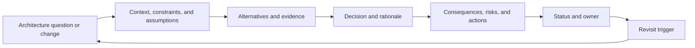
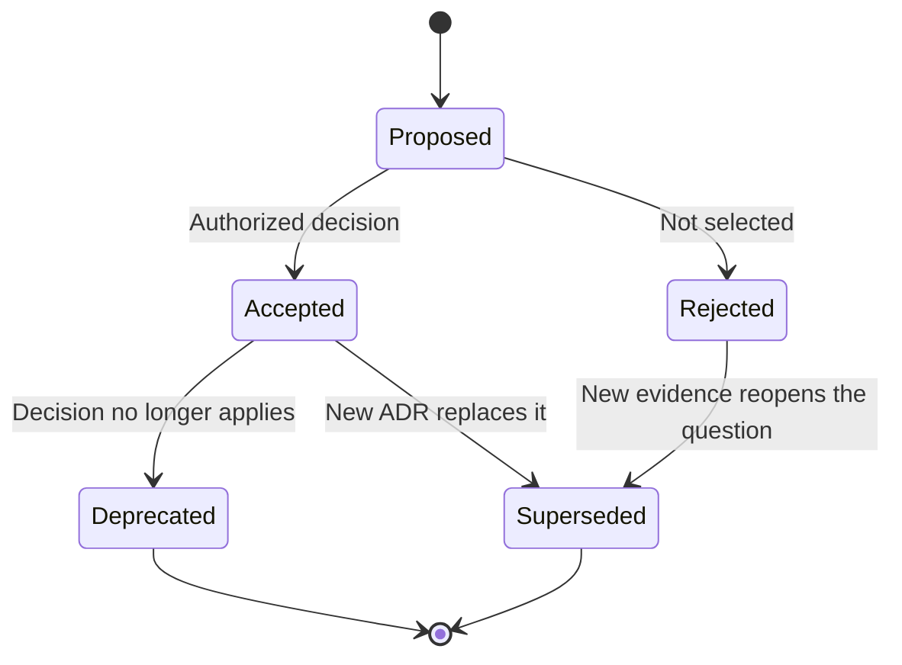
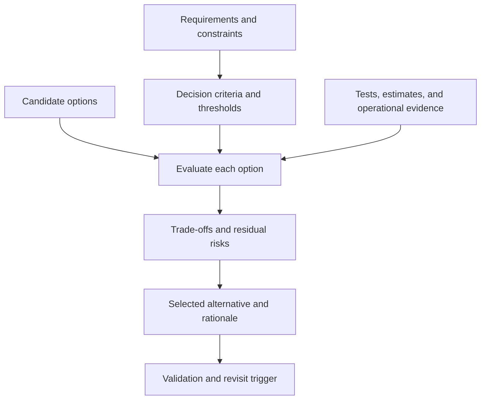
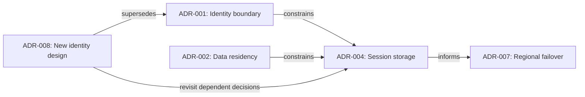
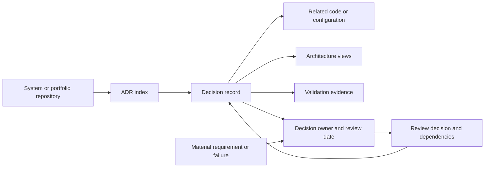

# ADR: Architecture Decision Record

Part: [21 — Architecture Documentation](PART_OVERVIEW.md)

An Architecture Decision Record (ADR) captures one significant architecture decision, its context, alternatives, rationale, consequences, and status. It preserves why a choice was made so future teams can maintain or revisit it with the original constraints visible. Part 01 CH03 owns architecture decision reasoning and trade-off analysis; this chapter owns the ADR artifact, lifecycle, linking, and repository practice.

## Scope One Decision Per Record

An ADR should answer one decision question at a useful granularity. A decision can be provisional or accepted, and it may be superseded later. Record the context that materially shaped the choice, including requirements, constraints, assumptions, alternatives, rationale, consequences, risks, and follow-up. Link supporting evidence instead of copying large documents.

Avoid combining unrelated decisions into one ADR; one status change should not obscure several independent choices. Conversely, split records only when decisions can be understood and revisited independently. Part 01 CH03 owns the reasoning method; this artifact ensures its result remains traceable.

## Move Through a Clear Lifecycle

An ADR may be proposed, accepted, rejected, deprecated, or superseded. Status should reflect the current decision state, not whether the document is polished. Accepted decisions remain historically accurate even when later superseded; do not rewrite them to match the new choice.

Define who can change status and what evidence or authority is required. Reopening a decision should create a new review context; preserve the original rationale and point to the new record. Do not delete rejected options when their history matters to future reviewers.

## Compare Alternatives and Criteria

An ADR should make the selected option and rejected alternatives legible. Criteria derive from the decision context: security, latency, availability, cost, skills, reversibility, and operating ownership may matter differently in each case. Record evidence quality and uncertainty so a future reader can tell measured behavior from assumption.

Do not use a score table as a substitute for reasoning. Explain which criteria are hard constraints, which are preferences, and why an option was rejected. If evidence is incomplete, record the experiment or condition that would change the decision.

## Link Decisions and Supersession

ADRs form a graph: one decision may depend on another, constrain a later choice, or be superseded. Use stable identifiers and explicit links such as “depends on,” “constrains,” and “supersedes.” Avoid copying the full content of earlier ADRs; summarize the dependency and point to the source record.

When an upstream decision is superseded, identify dependent ADRs for review. The new record does not automatically invalidate all dependents; it creates an impact question. Keep links navigable and validate them during repository maintenance.

## Organize the Repository and Ownership

Store ADRs in a versioned repository near the system or portfolio they govern. Provide a stable index and naming scheme. Each record needs an owner, decision date, status, affected scope, and revisit trigger. Keep the decision record versioned with the code or architecture repository where possible. Reliable retrieval matters more than a particular numbering format.

Avoid an orphaned central document store that teams do not update. For cross-system decisions, choose a clear system of record and link local indexes. Do not store secrets or sensitive data in ADRs; link to governed evidence repositories.

## Worked Case: Event Broker Selection

A team must choose a broker for order events. The ADR records peak throughput, retention, ordering scope, operational ownership, and recovery requirements. Alternatives include extending the existing platform, adopting a managed broker, or using a simpler queue. Evidence includes load testing, migration effort, and support coverage. The decision selects the existing platform because it meets measured requirements and has an accountable operations team; it records the scale or isolation threshold that would trigger review.

Later, a regional requirement changes. A new ADR evaluates the data boundary and deployment alternatives, then supersedes only the parts of the original choice that no longer apply. Dependent decisions about schema registry and consumer retry remain under review rather than being rewritten automatically.

## Review Questions

1. What context belongs in an ADR, and what should be linked instead?
2. Why should a superseded ADR remain in the repository?
3. How do hard constraints differ from weighted preferences?
4. What happens to dependent decisions when an ADR is superseded?
5. Who owns the status, revisit trigger, and validation evidence?

ADRs preserve decision history when they stay concise, scoped, linked, and owned. Record alternatives and consequences, retain superseded history, connect dependent choices, and revisit decisions when their assumptions materially change.
