# ADR: Architecture Decision Record

Part: [21 — Architecture Documentation](PART_OVERVIEW.md) · Status: Drafted

## 1. Introduction

An Architecture Decision Record (ADR) is a short, durable document that captures one significant architecture decision: the situation that forced the choice, the options considered, the option chosen, why it was chosen, and what the team now has to live with. It is the architecture equivalent of a commit message for a decision rather than a change. Code shows what the system does; diagrams show how it is shaped; neither shows why it is shaped that way instead of another way. The ADR holds that missing "why".

For an engineer moving into architecture this is one of the first artifacts that is genuinely yours. As a developer you leave rationale in commit messages, pull request threads, and chat, all of which are poorly indexed and quickly lost. As an architect you make decisions whose consequences outlast the people who made them: a messaging technology, a tenancy model, an identity boundary. Two years later someone will ask "why on earth did we do it this way?" and the honest answer is often "nobody remembers". An ADR makes that answer retrievable, and, just as importantly, makes the assumptions behind the decision visible so that the decision can be revisited when those assumptions stop being true.

This chapter owns the ADR as a documentation artifact: its anatomy, the commonly used template shapes, the scoping of a record, its lifecycle, and how to keep it current. The boundaries with neighbouring material are deliberate:

- The reasoning method behind a good decision, including trade-off analysis and the architect's decision toolkit, belongs to [Architecture Thinking](../01_Architecture_Mindset/CH03_Architecture_Thinking.md), which also holds the canonical template and review checklist; this chapter recaps and links rather than re-teaching that method.
- Lightweight decision entries kept when a full record is unnecessary belong to [Decision Logs](CH10_Decision_Logs.md).
- The proposal-and-comment process that often precedes a decision belongs to [RFC (Request for Comments)](CH04_RFC_Request_for_Comments.md).
- Framing problems, evidence and uncertainty, reversibility, and decision timing belong to [Part 22](../22_Architectural_Thinking_and_Decision_Practice/PART_OVERVIEW.md).
- Structural views that a record points to, such as context and container diagrams, belong to [C4 Model](CH01_C4_Model.md).
- Review of whole architectures, as opposed to single decisions, belongs to [Architecture Reviews](CH11_Architecture_Reviews.md).

After studying this chapter, a reader should be able to:

1. Explain what an ADR is, what problem it solves, and what it is not for.
2. Describe the anatomy of a record and write one using a Nygard-style or a MADR-style outline.
3. Decide how much a single record should cover, and when to split or merge.
4. Write an ADR whose context, decision, and consequences remain intelligible years later.
5. Operate the status lifecycle correctly, including supersession, without rewriting history.
6. Review a draft ADR and recognise the common defects that make records useless.

## 2. Background and History

The practice of recording design rationale is older than the term ADR; design rationale and "design decision" documentation have long been discussed in software engineering. The lightweight form used by most teams today is commonly traced to a 2011 blog post by Michael Nygard titled "Documenting Architecture Decisions". Its core proposal was to keep a small collection of short, numbered text files, each describing one architecturally significant decision, kept with the project so that new team members can understand the history of the design. The post suggested a deliberately minimal structure of title, status, context, decision, and consequences.

Later community templates elaborated that idea. One widely used family is the Markdown ADR shape, often called MADR (the name has been expanded in different ways across its history, so check the project you adopt), which adds explicit sections for decision drivers and considered options. Many tools and conventions grew around these formats, such as command-line helpers that create numbered files and index pages. Treat all such tooling as optional: the artifact is a text file in version control, and nothing in the practice requires a particular tool.

The practical implication is that the format is a convention, not a standard. Choose a shape, write down your local rules for it, and apply them consistently.

## 3. The Problem ADRs Solve

Decisions lose their reasons faster than they lose their consequences. The patterns below are general failure modes, not reports of particular incidents.

| Failure pattern | Mechanism | What an ADR contributes |
| --- | --- | --- |
| Decision archaeology | The people who chose a technology leave, and the rationale lives only in chat or memory | A retrievable statement of context and reasons |
| Cargo-cult reversal | A newcomer sees an unusual choice, assumes it was a mistake, and reverses it, reintroducing the problem it solved | The constraint that motivated the choice is written next to the choice |
| Cargo-cult retention | A choice made under past constraints is kept after those constraints vanished, because nobody knows they were temporary | Recorded assumptions and revisit triggers that make staleness detectable |
| Repeated debate | The same question is reopened every quarter because outcomes were never recorded | A record of options rejected and why, so debate starts from the prior result |
| Unowned consequences | A decision imposes costs on other teams that nobody agreed to carry | An explicit consequences section naming who bears what |
| Silent decisions | Significant choices emerge from implementation without anyone deciding | A threshold of significance that triggers a record |

Alternatives exist. Wiki pages and design documents capture thinking but drift out of date and bury the decision in narrative. Commit messages and pull request discussions are close to the code but are not organised by decision and cannot express supersession. Chat history is searchable only by luck. A request for comments (RFC) captures a proposal and its debate, which is valuable, but it is shaped around persuasion and review rather than around the stable outcome. The ADR is chosen when the cost of re-deriving a decision, or of unknowingly reversing it, exceeds the small cost of writing one page at the time. That cost ratio rises with team turnover, the number of teams affected, and the difficulty of reversing the decision.

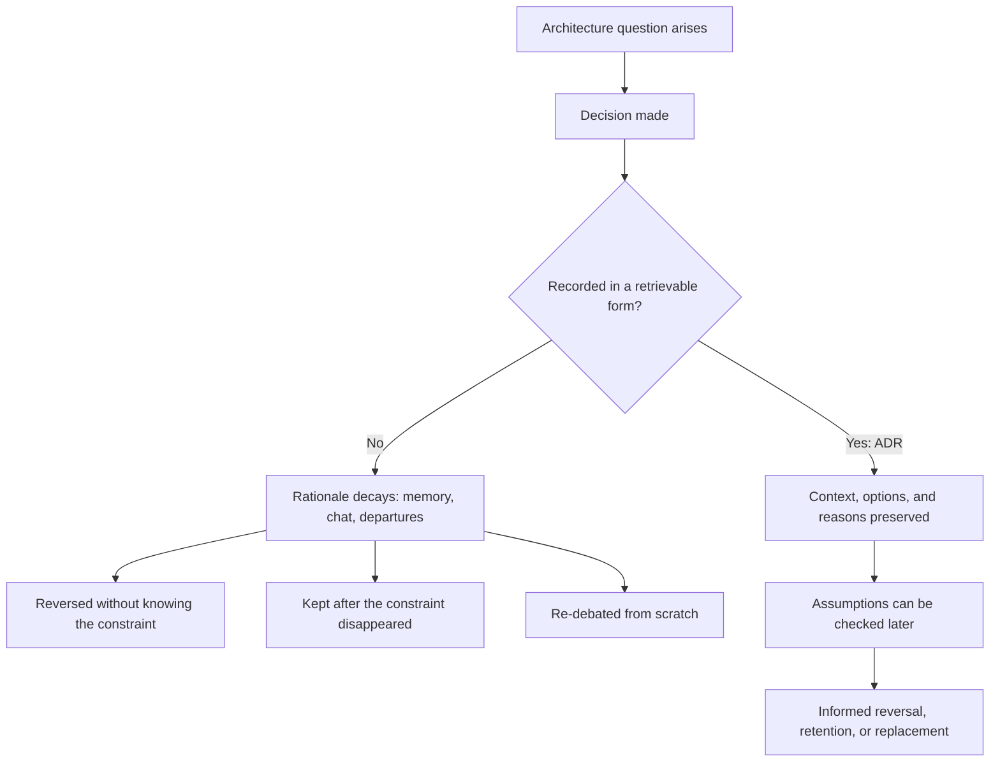

The diagram shows that the value of a record is realised later, at the point where someone must decide whether to keep, change, or retire the choice. This is why the "context" and "consequences" sections matter more than the "decision" sentence: the decision itself is usually visible in the system, while the situation that produced it is not.

## 4. Anatomy of an ADR and Commonly Used Template Shapes

Every useful ADR answers a small, fixed set of questions. The names of the sections vary between templates; the questions do not.

| Question | Typical section | Purpose |
| --- | --- | --- |
| What is this record, and where does it sit among others? | Title and identifier | Stable reference and retrieval |
| Is this decision in force? | Status | Prevents readers from acting on a stale or unapproved choice |
| Why was a decision needed? | Context | Forces, constraints, and assumptions at the time |
| What was chosen? | Decision | A clear statement, in the active voice |
| What else was considered? | Considered options | Shows the choice was a selection, not a default |
| What follows from it? | Consequences | Benefits, costs, new obligations, and risks |
| Who decided, and when? | Date and deciders | Accountability and a basis for review |
| What would change our mind? | Revisit trigger | Makes the decision falsifiable |

### 4.1 A Nygard-style outline

The minimal shape associated with the 2011 post is commonly written as follows. Details differ between teams; treat this as a commonly used shape rather than a specification.

```markdown
# ADR-0007: Use a managed relational database for order data

## Status

Accepted

## Context

What forces are at play? Describe requirements, constraints, and
assumptions in neutral language, as they were known at the time.

## Decision

We will ... (a full sentence, active voice, stating the choice).

## Consequences

What becomes easier or harder as a result? Include positive,
negative, and neutral effects, and the follow-up work created.
```

Its strength is brevity: a record is cheap enough to write for every significant decision. Its weakness is that the alternatives are left implicit, so authors must be disciplined about mentioning what was rejected inside the context or decision text.

### 4.2 A MADR-style outline

A fuller shape in the MADR family makes drivers and options explicit. Section names and optional parts vary by version of the template, so verify against the version you adopt.

```markdown
# Use a managed relational database for order data

* Status: accepted
* Deciders: platform lead, order-service owner
* Date: 2026-03-14

## Context and Problem Statement

One or two sentences framing the question as a problem.

## Decision Drivers

* Driver 1, for example recovery objective
* Driver 2, for example team skills

## Considered Options

* Option A
* Option B
* Option C

## Decision Outcome

Chosen option: "Option A", because it satisfies the drivers that
were hard constraints and was acceptable on the others.

### Consequences

* Good, because ...
* Bad, because ...

## Pros and Cons of the Options

### Option A

* Good, because ...
* Bad, because ...
```

Its strength is that alternatives and drivers are structurally required, which makes weak reasoning visible. Its weakness is weight: teams under time pressure may skip records because the template feels heavy.

### 4.3 Choosing a shape

Choose by decision significance, not by taste. A single organisation can legitimately use the minimal shape for routine decisions and the fuller shape where options are contested or consequences are costly to reverse. The criteria below usually decide it.

| Criterion | Favours minimal shape | Favours fuller shape |
| --- | --- | --- |
| Reversibility | Cheap to reverse | Expensive or one-way |
| Contention | Little disagreement | Contested options, several stakeholders |
| Audience | Same team, near term | Other teams, auditors, future staff |
| Evidence | Obvious or well known | Measured, estimated, or disputed |

The relationship between the artifact's parts is easiest to see as a structure, because each part is a response to a different future reader's question.

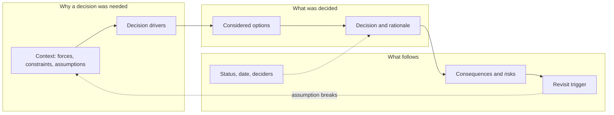

The loop from the revisit trigger back to context is the design intent: a record is a testable claim about a situation. When the situation changes, the trigger fires, and a new context is written rather than the old one being edited.

### 4.4 What an ADR is not for

- It is not a design document. Detailed designs, sequence flows, and interface definitions belong in design artifacts such as [Sequence Diagrams](CH05_Sequence_Diagrams.md) and [C4 Model](CH01_C4_Model.md) views; an ADR links to them.
- It is not a proposal-and-debate vehicle. Open consultation belongs in an [RFC](CH04_RFC_Request_for_Comments.md); the ADR records the outcome.
- It is not a log of every choice. Minor, easily reversed choices belong in [Decision Logs](CH10_Decision_Logs.md) or nowhere at all.
- It is not a runbook or a policy. Operational steps and mandatory standards have their own artifacts and owners.
- It is not a place for secrets or sensitive data; link to governed evidence instead.

## 5. Scope One Decision Per Record

An ADR should answer one decision question at a useful granularity. Two judgements govern scope: whether a decision is significant enough to record at all, and how much of it belongs in one record.

### 5.1 When a decision deserves a record

"Architecturally significant" has no universal definition, so teams need a local test. Questions that commonly indicate significance:

- Is the decision expensive or slow to reverse (a data store, a tenancy model, a public interface)?
- Does it constrain other teams or later decisions?
- Does it affect a quality attribute that matters here, such as availability, security, latency, or cost?
- Was it genuinely contested, with credible alternatives?
- Would a new team member plausibly ask "why did we do it this way?"

If most answers are no, a [decision log](CH10_Decision_Logs.md) entry or a code comment is enough. If several are yes, write an ADR. When unsure, prefer a short record: the penalty for an unnecessary one-page record is small, and the penalty for a missing one is paid years later. The reversibility lens used here is taught in [Reversibility, Optionality, and Decision Timing](../22_Architectural_Thinking_and_Decision_Practice/CH05_Reversibility_Optionality_and_Decision_Timing.md).

### 5.2 How much belongs in one record

The unit of scope is the unit of status change: one record should be accepted, rejected, or superseded as a whole, without that outcome misrepresenting any part of it. This gives two practical tests.

1. Independence test: could part of the content be reversed while the rest stays valid? If yes, split.
2. Single-question test: can the record's title be phrased as one question or one choice? If the title needs "and", it probably holds two decisions.

Both errors occur in practice. Over-bundling hides a minor choice inside a major one, so that revisiting the minor choice appears to reopen the major one. Over-splitting produces records that cannot be understood alone, because the real decision is a combination whose parts only make sense together; in that case record the combined choice and note the parts inside it.

Illustrative example (hypothetical): a team writes one record titled "Adopt event-driven architecture, use Broker X, and enable exactly-once processing". The title carries three decisions of different reversibility: an architectural style, a product, and a processing guarantee. Splitting gives three records, with the product choice and the guarantee linked to the style. When the broker is later replaced, only the product record changes status.

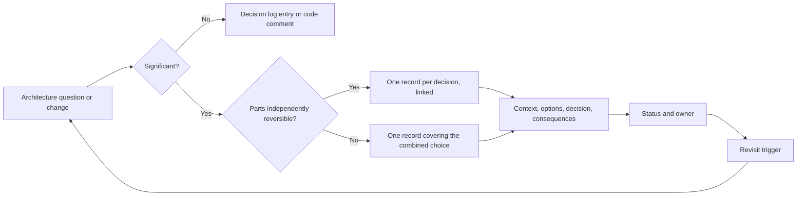

The flow makes the filtering explicit: not every decision becomes a record, and the splitting rule is driven by reversibility rather than by document length. Record the context that materially shaped the choice, including requirements, constraints, assumptions, alternatives, rationale, consequences, risks, and follow-up, and link supporting evidence instead of copying large documents. Part 01 [Architecture Thinking](../01_Architecture_Mindset/CH03_Architecture_Thinking.md) owns the reasoning method; this artifact ensures its result remains traceable.

## 6. Worked Example: Writing an ADR from Start to Finish

The following record is illustrative and hypothetical: the system, numbers, and people are invented to show how the sections work together. It uses a MADR-style outline with a revisit trigger added.

```markdown
# ADR-0012: Use single-region active/passive deployment for the booking service

* Status: accepted
* Deciders: booking-service owner, platform lead, security architect
* Date: 2026-03-14
* Supersedes: none
* Related: ADR-0004 (data residency), ADR-0009 (managed database)

## Context and Problem Statement

The booking service must stay available during regional failures, but
its data must remain within one legal jurisdiction (ADR-0004). The
business has stated a recovery time target of 30 minutes and a recovery
point target of 5 minutes. Assumptions: peak load stays below the
capacity measured in the load test; the team has no experience running
multi-region active/active data stores.

## Decision Drivers

* Hard constraint: data must not leave the approved jurisdiction.
* Hard constraint: recovery time of 30 minutes or less.
* Preference: minimise operational complexity for a small team.
* Preference: control cost; the service is revenue-relevant but not
  latency-critical.

## Considered Options

1. Single region, active/passive, with a standby in a second
   availability zone group inside the same jurisdiction.
2. Multi-region active/active across two jurisdictions.
3. Single region only, with backup and restore.

## Decision Outcome

Chosen option: 1, because it meets both hard constraints and is the
simplest option that does. Option 2 fails the residency constraint for
one of its two regions. Option 3 does not credibly meet the 30-minute
recovery time, according to the restore test summarised in the linked
evidence.

### Consequences

* Good: operationally simple; failover steps fit one runbook.
* Good: cost is roughly the primary plus a scaled-down standby.
* Bad: failover is a manual or semi-automated action, so recovery time
  depends on operator readiness.
* Bad: the standby capacity is idle and must be tested regularly to
  remain trustworthy.
* Follow-up: schedule a quarterly failover rehearsal; write the runbook.

## Revisit Trigger

Review if the recovery time target drops below 15 minutes, if the
residency rule changes, or if sustained load exceeds 70 percent of the
tested capacity.

## Evidence

Links to load-test report, restore-test result, and cost estimate.
```

Several features of this record are deliberate and worth reading closely.

- The problem statement separates facts (the targets, the residency rule) from assumptions (capacity, team experience). When an assumption later fails, the reader knows which part of the argument is affected.
- Hard constraints are distinguished from preferences, so rejecting option 2 is shown to follow from a constraint rather than from taste. This is the same distinction developed in the evidence-and-uncertainty material of Part 22.
- Rejected options carry reasons. Without them, a later reader sees only the chosen path and cannot tell whether the others were considered.
- Consequences include the negatives. A record that lists only benefits reads as advocacy, and loses credibility with reviewers.
- The revisit trigger is concrete and measurable, which converts the decision from a permanent ruling into a condition-bound claim.

Three common weaknesses to avoid when writing your own:

1. A context that describes the solution instead of the situation ("we need Kubernetes because we are deploying containers"). The context should be intelligible without knowing the choice.
2. Options that are straw men, included only to be dismissed. A reviewer who knows a stronger alternative exists will distrust the record.
3. Consequences that restate the decision ("we will use option 1") rather than describe what changes for operators, other teams, cost, and risk.

Edge case: sometimes no option clearly wins and the team must decide under uncertainty. The record is still valuable; state the uncertainty, name the cheapest experiment that would reduce it, and set a short revisit date. Do not hide weak evidence behind confident wording.

## 7. Move Through a Clear Lifecycle

An ADR may be proposed, accepted, rejected, deprecated, or superseded. Status should reflect the current decision state, not whether the document is polished. Accepted decisions remain historically accurate even when later superseded; do not rewrite them to match the new choice.

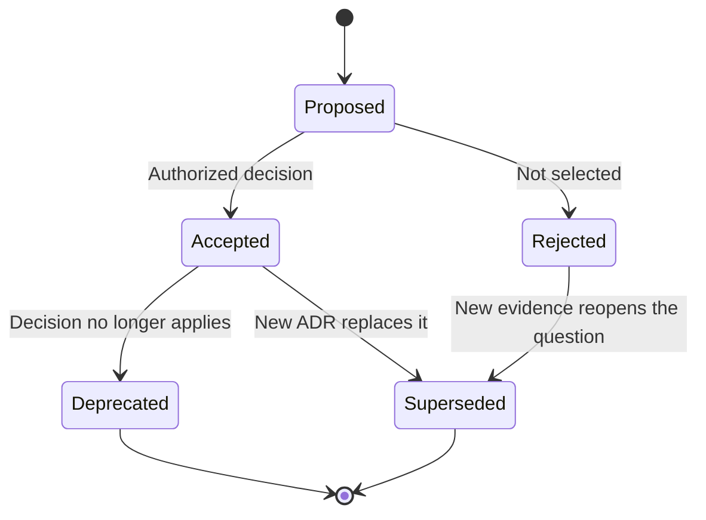

Define who can change status and what evidence or authority is required. Reopening a decision should create a new review context; preserve the original rationale and point to the new record. Do not delete rejected options when their history matters to future reviewers.

### 7.1 What each status means

| Status | Meaning | Who may move it | Typical evidence |
| --- | --- | --- | --- |
| Proposed | Drafted and open for review; not yet binding | Author | A complete draft with options and consequences |
| Accepted | In force; teams should follow it | Named decision authority | Review outcome recorded in the record |
| Rejected | Considered and not chosen; kept for history | Decision authority | Reasons for rejection |
| Deprecated | Still recorded, but no longer applies, with no replacement decision | Owner or authority | Statement of why it no longer applies |
| Superseded | Replaced by a later record | Authority of the new record | Link to the superseding record |

Some teams add states such as "draft" or "withdrawn"; local variations are acceptable if they are documented and every state has a defined meaning and owner. The important rule is that status is a statement about the decision, not about the document: a well-written record that was never approved is still proposed.

### 7.2 Supersession without rewriting history

When a decision changes, the correct move is to write a new record that says it supersedes the old one, and to change only the old record's status line and add a forward link. The body of the old record stays as written, because it accurately describes what was believed and decided at the time. Rewriting it would destroy the evidence future readers need in order to understand why the change happened.

Illustrative example (hypothetical): ADR-0012 above chose active/passive in a single region. Two years later the recovery time target falls to 10 minutes, which fires the revisit trigger. The team writes ADR-0031 choosing a semi-automated failover design, states "supersedes ADR-0012", and records what was learned from the rehearsals. ADR-0012 changes only its status to superseded and gains a link to ADR-0031. A reader of either record can reconstruct the full story.

Partial supersession is a common edge case. If a new record replaces only one aspect of an earlier decision, say so explicitly ("supersedes the data-replication part of ADR-0012") and leave the earlier record accepted for the rest. Otherwise the repository will falsely suggest the whole earlier decision is dead.

### 7.3 Lifecycle failure modes

- Zombie proposals: records left in proposed status indefinitely, so nobody knows whether the decision was made. Set a time limit after which a proposal is accepted, rejected, or withdrawn.
- Silent acceptance: the team implements the choice but never updates the status, so the record looks undecided. Make the status change part of the work that implements the decision.
- Stale acceptance: the record stays accepted although the system diverged from it. Detect this through the revisit trigger and periodic review.
- Edited history: an accepted record rewritten to match current reality. Correct clear factual typos, but record any change of substance in a new record.

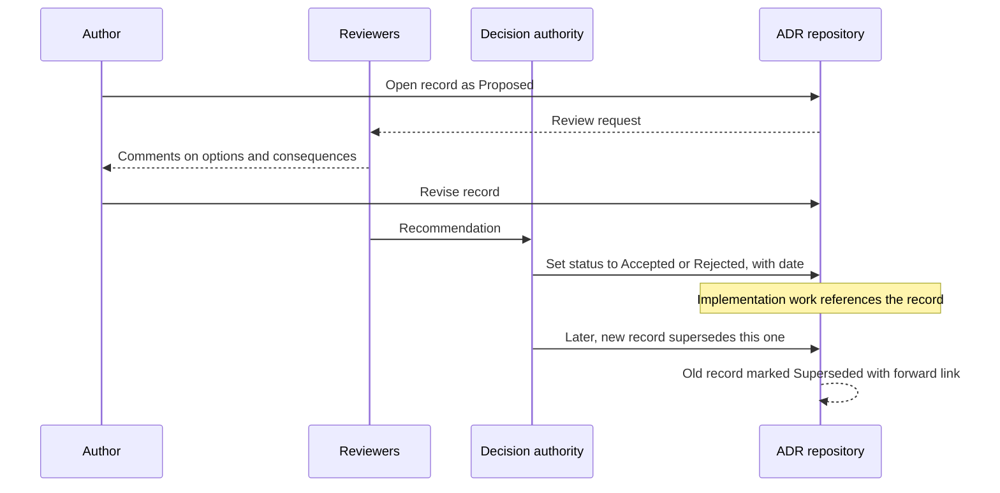

The sequence shows that accountability sits with a named decision authority, while authors and reviewers shape the content. It also shows that the repository, not a meeting or a chat thread, is where the state change becomes real. Consult [RFC (Request for Comments)](CH04_RFC_Request_for_Comments.md) for the consultation stage that often precedes this flow.

## 8. Compare Alternatives Against Criteria

The worked example in Section 6 rejected two options in a sentence each. When the alternatives are closer together, a sentence is not enough, and the record needs a structured comparison. The aim is not to compute an answer. The aim is to make the reasoning inspectable, so a reviewer can disagree with a specific weight or score instead of with an impression. The method of framing criteria belongs to [Architecture Thinking](../01_Architecture_Mindset/CH03_Architecture_Thinking.md) and the treatment of evidence quality to [Part 22](../22_Architectural_Thinking_and_Decision_Practice/CH04_Evidence_Assumptions_and_Uncertainty.md); this section covers how the comparison is recorded.

### 8.1 Gate first, then weigh

Criteria fall into two kinds, and mixing them is the commonest flaw in comparison tables.

- Hard constraints are pass/fail. An option that violates one is eliminated regardless of how well it scores elsewhere. Examples: a residency rule, a mandated recovery target, a required ordering guarantee.
- Weighted preferences are matters of degree. Cost, operability, team familiarity, and headroom are traded against each other.

Apply the gates first and score only the survivors. Putting a hard constraint into a weighted sum lets a strong score elsewhere hide a violation.

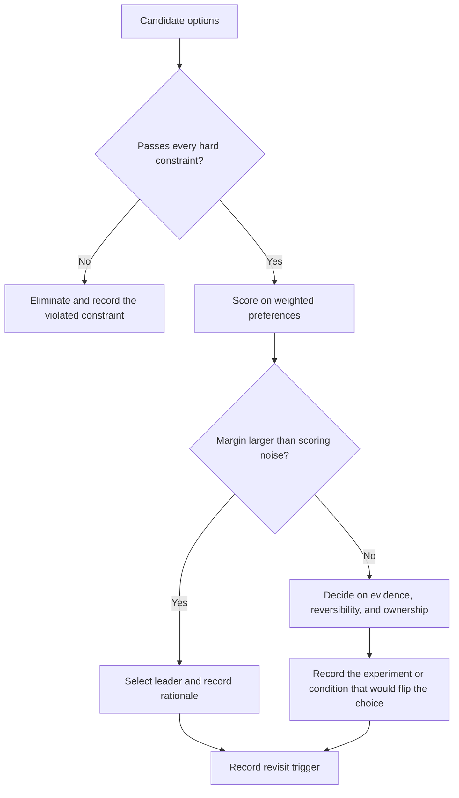

The diagram's key branch is the margin check. If the leading option is ahead by less than the uncertainty in the scores themselves, the matrix has not decided anything, and the record must say what did.

### 8.2 An illustrative weighted decision matrix

Hypothetical scenario, continuing the booking service from Section 6: the service must publish booking events to other services, and the team compares three ways to do it. Hard constraints: events must stay inside the approved jurisdiction (ADR-0004) and events for one booking must be consumed in order. Option C, a simple point-to-point queue, cannot preserve per-booking ordering once consumers scale out, so it is eliminated at the gate and left out of the table.

| Criterion | Weight | A: extend the existing platform | B: managed broker in the jurisdiction |
| --- | --- | --- | --- |
| Fit with recovery target (ADR-0012) | 25 | 4 | 3 |
| Operational burden on a small team | 25 | 4 | 5 |
| Throughput headroom (from load test) | 20 | 4 | 5 |
| Cost | 15 | 3 | 2 |
| Team skills | 15 | 5 | 3 |
| Weighted total (scores 1 to 5, weights sum to 100, divided by 100) | | 4.00 | 3.75 |

Scores are invented for illustration. The way to read the result is as follows: option A leads by 0.25 on a five-point scale. Judgments on a five-point scale are rarely repeatable to that precision, so the gap is not decisive by itself. The record should therefore cite the evidence behind the highest-weighted scores (the failover rehearsal for recovery fit, the on-call model for operational burden) and state the reversibility of each option, rather than lean on the total.

### 8.3 Pitfalls of weighted matrices

| Pitfall | Why it misleads | Countermeasure |
| --- | --- | --- |
| Weights chosen after scores are seen | The matrix is reverse-engineered to justify a favourite | Agree weights before scoring and record the date and participants |
| Hard constraints scored as preferences | A violation is averaged away | Gate first, as in Section 8.1 |
| False precision | Decimal totals imply accuracy the inputs lack | Use coarse scales and compare margin to noise |
| Scores without evidence | Opinion is presented as measurement | Annotate each score as measured, estimated, or assumed |
| Correlated criteria counted twice | Operability and cost may both reflect the same staffing assumption, inflating one concern | Merge or reduce weights on overlapping criteria |
| Sensitivity never tested | A small weight change may flip the result unnoticed | Re-score with plausible alternative weights and state whether the winner changes |
| Missing option | The set omitted a hybrid or the do-nothing case | Include "keep the current approach" as a baseline option |

A short sensitivity statement ("the ranking was re-checked with the cost weight doubled and the winner did not change"), provided the re-check was actually run, costs two lines and is often the most informative part of the comparison.

### 8.4 Recording incomplete evidence

Where evidence is missing, do not hide it behind a score. Mark the criterion as unknown, name the cheapest experiment that would settle it, and set a date by which the experiment is done. This turns a weakness into a visible follow-up, which is exactly what the revisit trigger in the worked example is for.

## 9. Link Decisions and Manage Supersession Chains

Section 7.2 showed one record replacing another. Real repositories hold dozens of records that depend on each other, and the links between them are as valuable as the records. A decision about session storage is only intelligible alongside the identity and residency decisions that constrain it.

### 9.1 Link types

Use a small, fixed vocabulary and apply it consistently. A suggested set follows; adopt your own, but document it.

| Link | Meaning | Effect when the target changes |
| --- | --- | --- |
| Supersedes / superseded by | The new record replaces all or part of the old one | Old record's status changes; scope of replacement must be stated |
| Depends on | This decision is valid only if the target holds | Review this record when the target is superseded |
| Constrains | The target limits this record's option space | Re-check options that relied on the constraint |
| Informs | The target is useful context, not a precondition | No mandatory review |
| Conflicts with | Two accepted records cannot both hold | Must be resolved by a new record |

Link by stable identifier, never by title or file path alone, because titles change and files move. Summarise a dependency in one sentence and point to the source rather than copying its content, otherwise the copies drift.

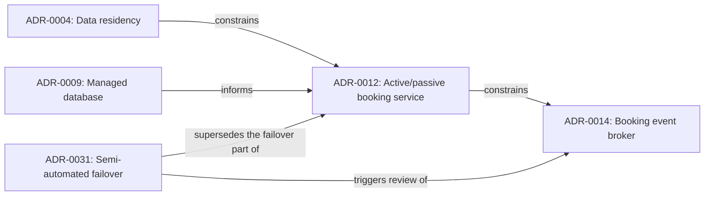

The diagram reuses the identifiers from the booking scenario. Notice that ADR-0031 does not point at ADR-0004 or ADR-0009: it inherits their constraints through the record it modifies. It does point at ADR-0014, because the broker's standby behaviour was chosen under the old failover design.

### 9.2 Impact of a supersession

When an upstream record is superseded, its dependents are not automatically invalid. They enter a review queue. For each dependent, ask whether its context or its constraints actually changed. Three outcomes are normal: reaffirm (add a dated note and keep the status), amend (write a small superseding record for the affected part), or replace (write a full new record).

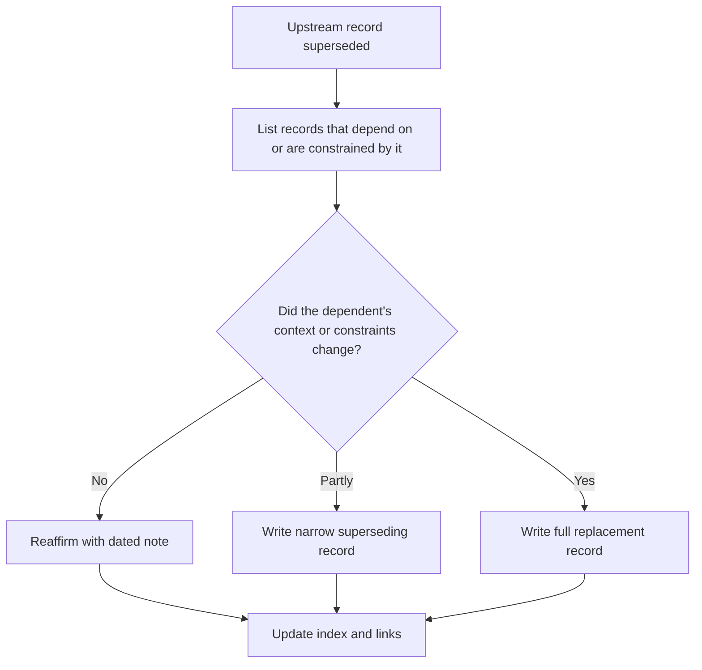

Without this triage, two opposite failures appear: dependents are ignored and quietly become wrong, or they are all rewritten in a rush and the history is lost.

### 9.3 Chains and cycles

A long supersession chain (A replaced by B replaced by C) is healthy if the index shows the current head and each record links forward. Make the index list only heads by default, with history one click away. Cycles are a defect: if A supersedes B and B supersedes A, the status of both is undefined. A validation check (Section 11) can detect cycles and dangling links mechanically.

## 10. Organize the Repository and Assign Ownership

Where records live determines whether they are found and maintained. The practical goal is reliable retrieval: a person with a question about the system should reach the relevant record in a few steps, and a person changing the system should be nudged to consult it.

### 10.1 Layout options

| Layout | Strengths | Weaknesses | Fits when |
| --- | --- | --- | --- |
| Record directory inside each service repository | Versioned with the code; changes can be reviewed in the same pull request | Cross-service decisions have no natural home; discoverability across services is poor | Decisions are mostly local to one team |
| One central architecture repository | Single index, easy cross-cutting search | Drifts from the code; teams treat it as someone else's | A small number of teams or a strong architecture function |
| Hybrid: local records plus a central index or a cross-cutting repository | Local ownership with a portfolio view | Needs index maintenance and a rule for where each decision goes | Many teams with some shared decisions |
| Wiki pages | Low barrier to entry | Weak versioning, no review trail, easy silent edits | Rarely recommended as the system of record |

For the hybrid layout, state the routing rule in one sentence, for example: "a decision affecting only one deployable unit lives with it; a decision binding two or more teams lives in the shared repository." A rule that cannot be applied in under a minute will not be followed.

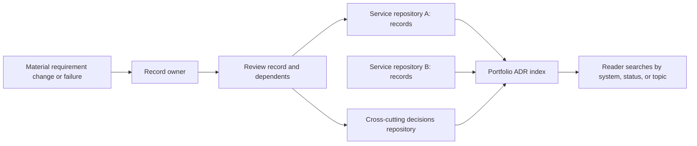

The index is a derived view, not a second source of truth. If it is edited by hand it will diverge, which is why Section 11 treats index generation as something to automate.

### 10.2 Naming and metadata

Choose a numbering scheme and keep it simple: a zero-padded sequence number plus a short slug is common, for example `0012-active-passive-booking.md`. Sequence numbers are never reused, even for rejected records. For concurrent branches that both claim the next number, resolve the collision at merge and rename the later one before acceptance; renumbering after others have linked to the number is a defect, so allocate numbers at proposal time where possible.

Minimum metadata per record: identifier, title, status, decision date, deciders, affected scope, links, and revisit trigger. Ask for no more than the team will maintain.

### 10.3 Ownership roles

Ownership is split by function, and the split should be written down.

| Role | Responsible for |
| --- | --- |
| Author | Drafting, collecting evidence, addressing comments |
| Reviewers | Challenging options, consequences, and evidence |
| Decision authority | Moving status to accepted or rejected; named per scope (team, domain, portfolio) |
| Record owner | Keeping status, links, and revisit trigger accurate after acceptance; normally the team that operates the affected system |
| Index maintainer | Ensuring the index builds and links resolve; ideally automated |

The record owner is the role most often left empty. An accepted decision with no owner receives no revisit review, because nobody's job includes noticing that a trigger has fired.

### 10.4 Content hygiene

Do not store secrets, credentials, personal data, or sensitive configuration in a record; link to a governed location instead. Records are often widely readable, and version history is hard to scrub. Also avoid recording security-weakness details to an audience wider than the one that needs them; point to the controlled document.

## 11. Review and Automate Record Quality

Human review judges whether a decision is sound. Mechanical checks can judge whether a record is well formed, which frees reviewers to concentrate on substance. The pipeline mechanics belong to [CI/CD](../13_DevOps/CH02_CI_CD.md); this section describes what an ADR check should verify.

### 11.1 What can be checked mechanically

| Check | Detects | Limit |
| --- | --- | --- |
| Required fields present (status, date, deciders, options, consequences) | Skeleton records and missing sections | Cannot tell whether the content is meaningful |
| Status drawn from the documented set | Typos and invented states | None significant |
| Unique, never-reused identifiers | Number collisions between branches | Needs the target branch for comparison |
| Links resolve to existing records | Dangling references | Does not judge link type correctness |
| Supersession is reciprocal and acyclic | Old record not marked superseded; cycles | Does not detect an undeclared replacement |
| Accepted records not rewritten | Edited history | Needs diff awareness; typo fixes need an escape hatch |
| Stale proposals | Zombie proposals older than the agreed limit | Threshold is a policy choice |
| Revisit date or trigger present | Records with no review condition | Cannot tell whether a trigger has fired |
| Index regenerates cleanly | Out-of-date hand-edited indexes | None significant |

Some qualities cannot be checked by a script: whether options are straw men, whether consequences are honest, and whether the trigger is measurable. Those remain the reviewer's job (see the checklist in Section 15).

### 11.2 A conceptual pipeline

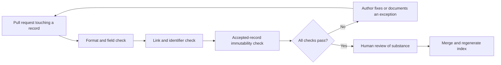

The ordering puts cheap, deterministic checks before human attention, so reviewers do not spend time on missing fields. Any exception path (for example a label permitting a typo fix to an accepted record) should be logged, otherwise the immutability rule erodes.

### 11.3 A minimal check script

The following sketch validates status values and in-repository links for records that use a `* Status: value` line as in Section 6. It is illustrative; adapt the patterns to your template.

```python
import pathlib
import re
import sys

ALLOWED = {"proposed", "accepted", "rejected", "deprecated", "superseded"}
STATUS = re.compile(r"^\* Status:\s*([A-Za-z]+)", re.MULTILINE)
LINK = re.compile(r"\]\(([^)#]+\.md)(?:#[^)]*)?\)")


def check(path: pathlib.Path) -> list[str]:
    text = path.read_text(encoding="utf-8")
    problems = []
    match = STATUS.search(text)
    if match is None:
        problems.append(f"{path}: no status line")
    elif match.group(1).lower() not in ALLOWED:
        problems.append(f"{path}: unknown status '{match.group(1)}'")
    for target in LINK.findall(text):
        if "://" not in target and not (path.parent / target).exists():
            problems.append(f"{path}: dangling link {target}")
    return problems


if __name__ == "__main__":
    root = pathlib.Path(sys.argv[1])
    all_problems = [p for f in sorted(root.glob("*.md")) for p in check(f)]
    print("\n".join(all_problems))
    sys.exit(1 if all_problems else 0)
```

The script exits non-zero when any record is malformed, which lets a continuous integration (CI) job fail the change. It does not cover supersession reciprocity or immutability; those require comparing records or comparing against the target branch.

### 11.4 Review cadence

Automation covers form at the time of change. Add two scheduled activities that automation cannot replace: a periodic scan of accepted records whose revisit triggers may have fired, and a periodic scan of proposals past their time limit. A quarterly pass is a common choice, but the right frequency depends on how fast your context changes. Related ideas on measuring whether decisions delivered their expected outcome belong to [Part 22](../22_Architectural_Thinking_and_Decision_Practice/CH09_Measuring_Decision_Outcomes_and_Reconsideration_Triggers.md).

## 12. Failure Scenarios and Common Mistakes

The failures below are general patterns drawn from how the practice works, not reports of specific incidents.

### 12.1 Failure catalogue

| Failure | Symptom | Detection | Mitigation |
| --- | --- | --- | --- |
| Decision made, never recorded | Team cannot explain a choice; debate recurs | Onboarding questions; repeated threads on the same topic | Define a significance threshold (Section 5.1); make the record part of the definition of done for qualifying changes |
| Record written after the fact to justify | Options are straw men; consequences list only benefits | Reviewer cannot name a credible alternative that was rejected | Draft before implementation; require at least one strong alternative and one honest negative consequence |
| Zombie proposals | Many records in proposed status with old dates | Scheduled scan for proposals past the time limit | Accept, reject, or withdraw within the stated limit |
| Silent acceptance | Code implements the choice; record still says proposed | Compare status with code and merge history | Status update is part of the implementing change |
| Edited history | Accepted record changed to match reality | Immutability check on pull requests; diff review | New superseding record; narrow exception for typos |
| Orphaned dependents | Records rest on a superseded upstream decision | Link graph query for dependents of superseded records | Triage as in Section 9.2 |
| Unowned record | No one reviews the revisit trigger | Records lacking an owner; triggers fire unnoticed | Assign the operating team as owner at acceptance |
| Unmeasurable trigger | "Revisit if requirements change" | Reviewer asks how it would be noticed | Replace with a threshold, date, or observable event |
| Index drift | Index missing records or listing wrong status | Index build check; spot audits | Generate the index from record metadata |
| Over-recording | Hundreds of trivial records; readers stop looking | Low reading and low edit rates; high count per team | Raise the threshold; use [Decision Logs](CH10_Decision_Logs.md) for minor choices |
| Under-scoped record | A bundle of decisions in one file; partial reversal is impossible | Record with several independent decisions | Split per Section 5.2 |
| Sensitive content embedded | Credentials or internal weakness details in a widely readable file | Secret scanning; review | Link to governed storage; scrub and rotate if exposed |

### 12.2 Anti-patterns

- The retroactive ADR: written months later by someone who did not attend the discussion, so it records plausible reasons rather than actual ones. If reconstruction is necessary, label it as reconstructed, name the sources, and say what is unknown.
- The rubber-stamp review: reviewers approve for form (all headings present) without challenging substance. Counter by assigning one reviewer explicitly to argue for the best rejected alternative.
- The score table as verdict: the matrix is treated as the reason rather than as a summary of reasoning (Section 8.3).
- The permanent ruling: records written in absolute language with no condition under which they would change. A record without a revisit trigger asserts that circumstances never change.
- Governance theatre: every decision must pass a board before it is recorded, so teams stop recording. Keep approval proportional to significance and reversibility.
- The solution-as-context: the context section restates the chosen technology instead of describing the situation (the first weakness listed in Section 6).

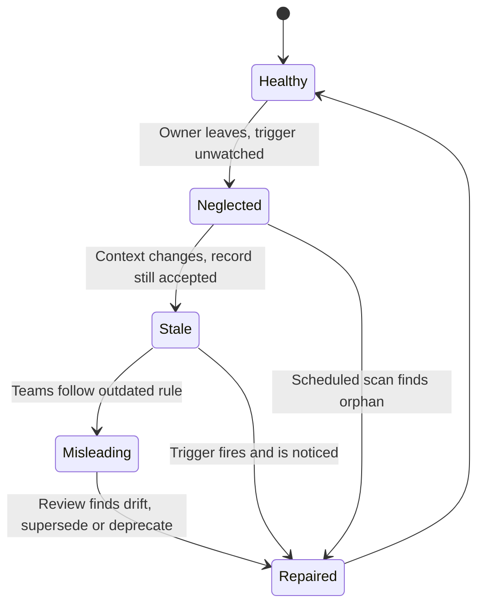

The diagram traces how a good record degrades. The dangerous state is not "no record" but "misleading record", where the repository confidently states a rule that no longer holds. The two exits that avoid it are an owner who watches the trigger and a scheduled scan that catches the cases where the owner has gone.

## 13. Trade-off Analysis and Decision Framework

Recording a decision is itself a decision with costs: time to write, time to maintain, and the risk of noise. The question for the architect is not "should we record everything?" but "which capture mechanism fits this decision?"

### 13.1 Comparing capture mechanisms

| Mechanism | Cost to create | Cost to maintain | Best for | Weak at |
| --- | --- | --- | --- | --- |
| Full ADR (Section 4 shapes) | Moderate: options, evidence, consequences | Low if scoped well; needs owner | Significant, hard-to-reverse, cross-team decisions | Trivial choices; fast-moving experiments |
| Lightweight decision-log entry | Low | Low | Minor or easily reversed choices that still merit traceability ([Decision Logs](CH10_Decision_Logs.md)) | Detailed option analysis |
| RFC | Moderate to high: proposal and consultation | Closed once decided | Gathering input and objections before deciding ([RFC](CH04_RFC_Request_for_Comments.md)) | Being the durable outcome record on its own |
| Design document | High | High; drifts | Explaining a whole design | Isolating individual decisions and supersession |
| Pull request description or commit message | Very low | None, but not organised | Local, code-level rationale | Retrieval and cross-cutting decisions |
| Nothing | Zero now | Cost deferred to the day someone asks | Truly trivial, reversible, obvious choices | Everything else |

These are not exclusive. A common and reasonable pattern is RFC for consultation, followed by an ADR for the outcome, with the RFC linked as evidence.

### 13.2 Choosing template depth

| Factor | Pushes toward a minimal outline | Pushes toward an options-rich outline |
| --- | --- | --- |
| Reversibility | Easy to reverse | Hard or costly to reverse |
| Number of teams affected | One | Several |
| Contention | Little disagreement | Real alternatives with advocates |
| Evidence available | Obvious | Measurements and trade-offs to preserve |
| Expected lifetime | Short | Years |

### 13.3 Decision flowchart

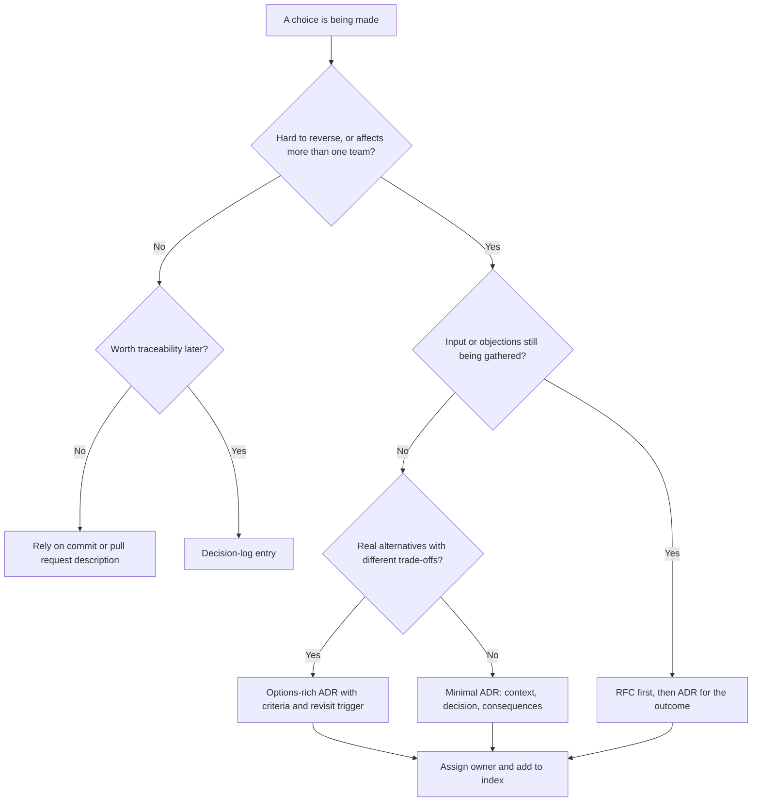

The flowchart is a starting heuristic, not a rule. Its first question carries most of the weight: reversibility and breadth of impact decide how much record keeping is worth the effort. The treatment of reversibility itself belongs to [Part 22](../22_Architectural_Thinking_and_Decision_Practice/CH05_Reversibility_Optionality_and_Decision_Timing.md).

### 13.4 Trade-offs inherent to the practice

- Immutability versus accuracy: keeping accepted records unchanged preserves history but means a reader must follow links to the current truth. The index, which lists heads, compensates.
- Brevity versus completeness: shorter records are written and read more often but leave out evidence. Link to evidence rather than embedding it.
- Strict gates versus adoption: strong automation improves consistency but may discourage a new team from writing records at all. Start with few checks and tighten as the habit forms.
- Central versus local storage: central improves discovery, local improves upkeep (Section 10.1).
- Speed versus consultation: waiting for consensus delays delivery, but an unrecorded decision made fast may be repeated at greater cost. Time-box proposals instead of leaving them open.

## 14. Illustrative Composite Case Study: A Broker Decision Across Two Years

This case is entirely hypothetical and composite. The organisation, numbers, and events are invented to show how the mechanisms in this chapter interact; nothing here describes a real company. It extends the booking service of Section 6.

### 14.1 Starting position

The booking service runs single-region, active/passive, under ADR-0012, within a jurisdiction fixed by ADR-0004. Other services (notifications, invoicing, reporting) need to react to booking changes. A proposal to publish booking events starts as an RFC (see [RFC (Request for Comments)](CH04_RFC_Request_for_Comments.md)), where two teams object to polling the database. The consultation converges on an event stream, and the author opens ADR-0014 as proposed to record the broker choice.

### 14.2 The decision record

ADR-0014 follows the structure of Section 6 and records:

- Hard constraints: events stay inside the jurisdiction; events for one booking are consumed in order; the broker's failover must fit the recovery targets already accepted in ADR-0012.
- Options: extend the existing messaging platform (option A), adopt a managed broker in the jurisdiction (option B), use a point-to-point queue (option C).
- Evaluation: option C fails the ordering gate when consumers scale out. Options A and B are compared with the weighted matrix of Section 8.2; the margin is judged within scoring noise, so the record rests the decision on two pieces of evidence: a load test showing headroom and a rehearsal showing the existing platform's standby fits the recovery target.
- Decision: option A, chosen because it meets the constraints, has an accountable operations team, and has the lower migration effort.
- Consequences: the booking team depends on the platform team's roadmap (bad); no new vendor onboarding (good); consumer retry and schema evolution are explicitly left to later records.
- Revisit trigger: sustained throughput above a stated fraction of tested capacity, or any change to ADR-0012's failover design.
- Links: constrained by ADR-0012 and ADR-0004; informs two follow-up records on schema management and consumer retry.

### 14.3 Change arrives

The recovery time target tightens, firing the trigger in ADR-0012. As in Section 7.2, ADR-0031 chooses semi-automated failover and supersedes only the failover part of ADR-0012. The link graph in Section 9.1 flags ADR-0014 as a dependent through its constraint link and its own trigger.

```mermaid
sequenceDiagram
    participant Own as Booking team (record owner)
    participant Scan as Scheduled trigger scan
    participant Auth as Decision authority
    participant Repo as ADR repository
    Scan->>Own: ADR-0012 trigger fired: recovery target changed
    Own->>Repo: Open ADR-0031 as Proposed, supersedes failover part of ADR-0012
    Repo-->>Own: Dependents listed: ADR-0014 and two follow-up records
    Own->>Auth: Request acceptance with failover rehearsal evidence
    Auth->>Repo: ADR-0031 Accepted; ADR-0012 marked partly superseded
    Own->>Repo: Triage ADR-0014: amend standby section only
    Repo-->>Own: Index regenerated; links validated
```

The sequence shows why ownership and automation pair well: the scan produces a signal, the owner acts, the authority decides, and the repository records each state change. Nobody has to remember that the broker decision depended on the failover design.

### 14.4 Outcome and triage

For ADR-0014 the owner chooses the "amend" outcome: a short record, ADR-0032, supersedes only the standby-replication paragraph, and leaves the throughput and ordering reasoning intact. The two follow-up records are reaffirmed with dated notes. A reader arriving later can trace the whole story from any of the five records.

### 14.5 What the case illustrates

| Mechanism | Where it appeared |
| --- | --- |
| Gate before weigh | Option C eliminated on ordering before any scoring |
| Evidence over margin | Matrix margin judged noisy; load test and rehearsal carried the decision |
| Partial supersession | ADR-0031 replaced only the failover part of ADR-0012 |
| Dependency triage | ADR-0014 amended, follow-ups reaffirmed |
| Owner plus scan | Fired trigger noticed without relying on memory |
| RFC then ADR | Consultation first, durable outcome second |

## 15. Architect Review Checklist

Use this list when reviewing a draft or an accepted record. A "no" answer is not automatically a rejection, but it should be explained.

Context and scope

- [ ] Is the context understandable without knowing the chosen option?
- [ ] Are facts separated from assumptions?
- [ ] Does the record cover one decision, or should it be split (Section 5.2)?
- [ ] Is the significance threshold met, or would a decision-log entry suffice?

Options and reasoning

- [ ] Are hard constraints separated from preferences, and applied as gates?
- [ ] Is there at least one credible alternative, including keeping the current approach?
- [ ] Does each rejected option carry a reason traceable to a criterion?
- [ ] Is evidence labelled as measured, estimated, or assumed, with links?
- [ ] If a matrix is used, were weights agreed before scoring, and was sensitivity stated?

Consequences and risk

- [ ] Are negative consequences listed, and are the bearers named?
- [ ] Are follow-up actions and residual risks recorded?
- [ ] Is the revisit trigger measurable?

Lifecycle and linking

- [ ] Is status correct and does it match the implementation?
- [ ] Are supersession links reciprocal, with scope stated for partial replacement?
- [ ] Are dependents of any superseded record triaged?
- [ ] Does the record have a named owner and decision authority?

Hygiene

- [ ] Free of secrets, personal data, and sensitive weakness detail?
- [ ] Linked from the index and from related views such as [C4 Model](CH01_C4_Model.md) diagrams where relevant?
- [ ] Do automated checks pass, and is any exception recorded?

## 16. Interview Questions

1. What is an ADR and what problem does it solve?
   A short record of one significant decision: context, options, choice, and consequences. It preserves the reasons that code and diagrams do not show, so later readers can tell whether the assumptions still hold.

2. How do you decide whether a decision needs an ADR?
   By reversibility, breadth of impact, and cost of re-deriving it. Hard-to-reverse or cross-team choices qualify; trivial or easily reversed ones go in a commit message or a decision log.

3. Why must accepted ADRs not be edited to match later reality?
   They document what was believed and decided at the time. Rewriting destroys the evidence for why a change happened. Write a new record that supersedes the old one and change only the old record's status and forward link.

4. What is the difference between a hard constraint and a weighted preference in a comparison?
   A hard constraint is pass/fail and eliminates an option; a preference is traded off by degree. Apply constraints as gates before scoring, otherwise a good score can mask a violation.

5. A weighted matrix shows option A at 4.0 and option B at 3.9. What do you do?
   Treat the gap as within scoring noise. Check sensitivity to weights, cite the evidence behind the highest-weighted criteria, compare reversibility and ownership, and name the experiment that would break the tie.

6. What goes wrong with a "Proposed" status left indefinitely?
   Nobody knows whether the decision was made; teams implement or ignore it inconsistently. Set a time limit after which the proposal is accepted, rejected, or withdrawn.

7. When an upstream ADR is superseded, what happens to dependents?
   They enter a review queue. For each, reaffirm, amend with a narrow superseding record, or replace, depending on whether its context or constraints actually changed.

8. How do ADRs relate to RFCs and decision logs?
   An RFC gathers input before a decision; the ADR records the durable outcome; a decision log holds lightweight entries for smaller choices. Each can link to the others.

## 17. Hands-on Exercises

### Exercise 1: Write a record

Pick a real or invented technology choice for a small system (for example a cache, a queue, or a tenancy model). Write an ADR in the MADR-style outline of Section 4.2 with at least three options, labelled facts versus assumptions, honest negative consequences, and a measurable revisit trigger. Have a colleague try to find a straw man in it.

### Exercise 2: Build and stress a decision matrix

Take the decision from Exercise 1. Separate hard constraints from preferences, eliminate options at the gate, and score the survivors with weights fixed in advance. Then re-score with two other plausible weight sets. Write two sentences stating whether the ranking is stable and what evidence would be needed to settle a close result.

### Exercise 3: Supersession and impact triage

Create four records: A constrains B, B informs C, and D supersedes A in part. Draw the link graph in the style of Section 9.1, mark which records enter the review queue, and decide for each whether to reaffirm, amend, or replace. Write the status lines and forward links for all four.

### Exercise 4: Automate a check

Using the sketch in Section 11.3 as a starting point, extend it to verify that every record marked superseded names a successor that exists and that no record supersedes itself. Run it on a directory of sample records, including one with a dangling link and one with an invalid status, and confirm it exits non-zero.

## 18. Design and Architecture Review Questions

1. A team writes ADRs only after implementation is complete. What risks does that create and what would you change?
   Reference outline: records become justifications, options look like straw men, and rationale is reconstructed rather than remembered. Show the review cannot influence the outcome. Move drafting before implementation for qualifying decisions, require a credible rejected alternative, and tie the status update to the implementing change. Where a retroactive record is unavoidable, label it as reconstructed and list what is unknown.

2. A reviewer finds a record that says "we chose option B because it scored highest." How would you improve it?
   Reference outline: ask which criteria were hard constraints and whether they were applied as gates. Ask when weights were set and whether sensitivity was tested. Request the evidence behind the highest-weighted scores and a statement of the margin versus scoring noise. Add reversibility and ownership as explicit considerations, and add a revisit trigger.

3. An identity decision is superseded. Eleven records reference it. How do you proceed without rewriting the repository?
   Reference outline: list dependents from the link graph, then triage rather than rewrite. For each, check whether context or constraints changed: reaffirm with a dated note, amend narrowly, or replace. Prioritise by blast radius and reversibility. Update the index and verify links with automated checks, and assign owners to any record without one.

4. Your organisation has two hundred records, most unread. Diagnose and respond.
   Reference outline: likely over-recording, stale heads in the index, and no ownership. Measure reading and edit rates and the proportion of accepted records with fired triggers. Raise the significance threshold and move minor choices to [Decision Logs](CH10_Decision_Logs.md). Show only current heads in the index, run a scheduled trigger scan, and archive or deprecate records that no longer apply.

5. A delivery team says the review of ADRs slows them down. What do you propose?
   Reference outline: separate form checks from substantive review, automating the former. Time-box proposals and match approval effort to reversibility, so cheap decisions use lighter capture. Run consultation as an RFC in parallel where it adds value. Track cycle time for records and look for the stage where records wait, instead of removing the review altogether.

## 19. Summary

An ADR is a short, scoped record of one significant architecture decision: its context, the options considered, the choice, and the consequences that follow. Its value is realised later, when someone must decide whether to keep, change, or retire the choice, so context, rejected alternatives, honest negatives, and a measurable revisit trigger matter more than the decision sentence.

Return to the outcomes in the Introduction. You can now explain what an ADR is and where it is not appropriate (Sections 1 to 5, 13). You can write one using a Nygard-style or MADR-style outline, and compare alternatives by applying hard constraints as gates before weighing preferences (Sections 4, 6, 8). You can decide how much a record should cover and when to split it (Section 5). You can operate the lifecycle, link dependent decisions, triage the impact of supersession, and keep history intact (Sections 7 and 9). You can organise repositories, assign ownership, and automate form checks (Sections 10 and 11). Finally, you can review a draft for the defects that make records useless, using the catalogue and checklist (Sections 12 and 15), and apply the chapter through the case study, interview questions, exercises, and review questions that follow from it (Sections 14 and 16 to 18).

The central discipline is to write records that remain truthful: do not edit accepted history, supersede explicitly, assign an owner, and watch the trigger.
