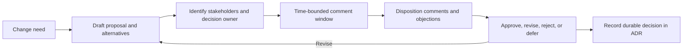
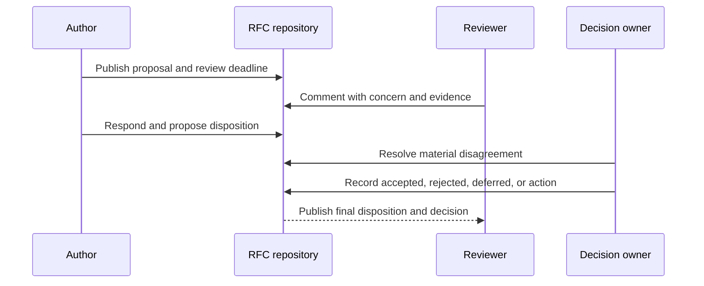
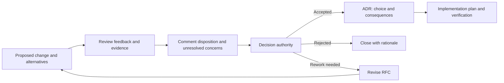
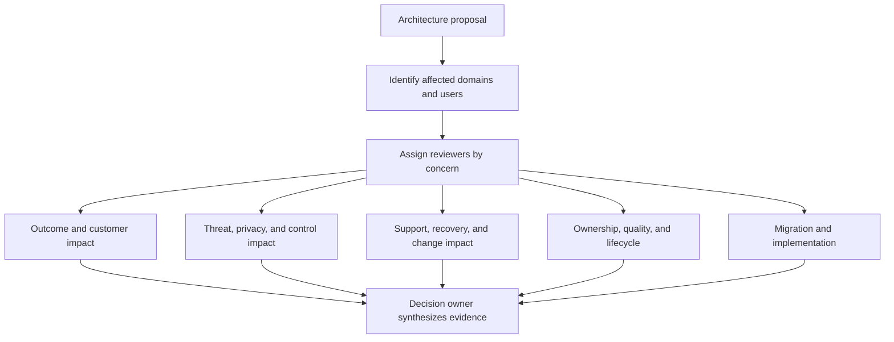
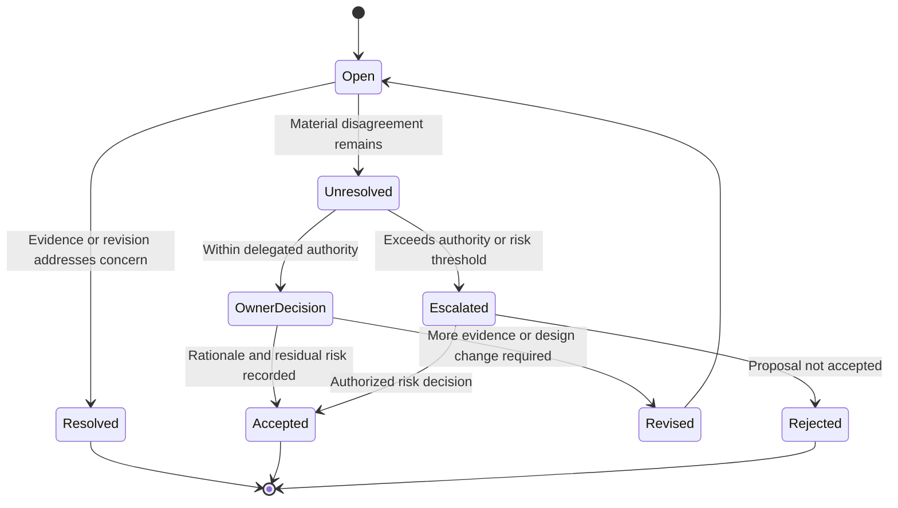

# RFC: Request for Comments

Part: [21 — Architecture Documentation](PART_OVERVIEW.md)

A Request for Comments (RFC) is a time-bounded proposal used to gather broad technical review before a consequential change is implemented. It makes the problem, constraints, design, alternatives, risks, and decision request visible to affected stakeholders. This chapter covers the architecture-team practice, not Internet standards-track RFC publication. Part 01 CH03 owns decision reasoning; Part 21 CH03 owns the durable Architecture Decision Record (ADR) artifact.

## Frame the Proposal and Review Window

An RFC should state the problem, goals and non-goals, current context, proposal, alternatives, quality scenarios, migration implications, risks, open questions, decision owner, and review deadline. Define who must review and which feedback can change the design. A review window without a decision owner or closure rule creates comments but no decision.

Keep the proposal concise enough for review, but include the evidence needed to assess impact. Link detailed designs, threat models, benchmarks, and operational plans. State unresolved assumptions rather than burying them in appendices.

## Trace Feedback to Disposition

Comments should be tied to a section, risk, or decision criterion. The author or decision owner records whether each substantive comment was accepted, rejected with rationale, deferred, or converted into a follow-up action. Silence is not approval unless the process explicitly defines it and affected stakeholders have been notified.

Separate editorial suggestions from substantive objections. A substantive objection names a requirement, risk, or assumption that changes the decision. The owner should respond to those directly and preserve unresolved objections in the decision record.

## Hand Off the Decision to an ADR

An RFC is a discussion and proposal artifact; an ADR records the resulting decision and consequences. The RFC can remain as the evidence and review history, while the ADR becomes the canonical record of the selected option. Link the two in both directions and include the decision owner and date.

Do not treat an accepted RFC as automatically equivalent to an ADR if the RFC does not capture status, rationale, and consequences in the repository's decision format. Avoid copying the entire discussion into the ADR; link to the RFC and summarize the evidence that matters to future reconsideration.

## Identify the Right Stakeholders

Reviewers should cover the domains affected by the proposal: product or business ownership, application teams, data, security, operations, platform, support, and legal or compliance when relevant. Review is not a popularity vote; the decision owner weighs evidence and has explicit authority. Escalate only when scope or risk exceeds delegated authority.

Invite reviewers early enough to change direction and give them a bounded question. Avoid sending every RFC to every mailing list; irrelevant review reduces signal and delays important decisions.

## Escalate Unresolved Objections

Most comments can be resolved by clarifying requirements or adjusting the proposal. When a material objection remains, summarize both positions, affected quality attributes, evidence, risk acceptance, and decision authority. Set a response date and escalation route. Do not claim consensus when a valid dissent remains.

The escalation process should preserve technical dissent without making every disagreement a veto. Record who owns residual risk and the condition that would reopen the decision.

## Worked Case: Shared Event Platform

An organization proposes consolidating several event brokers. The RFC describes consumer groups, retention needs, ordering, migration, security, and cost. Reviewers include service owners, platform operations, data governance, and security. Comments identify that a regulated domain requires longer retention and a regional boundary not covered by the initial proposal.

The author revises the RFC with a supported regional variant and a migration plan. A decision owner accepts the shared platform for compatible domains and defers the regulated domain pending evidence. The ADR records the accepted scope and residual risk; the RFC retains the comment history and links to the migration validation plan.

## Review Questions

1. What information lets reviewers evaluate the proposal rather than react to a solution label?
2. How are substantive comments distinguished from editorial feedback?
3. What remains in the RFC, and what belongs in the ADR?
4. Who owns a material unresolved objection?
5. How does the process avoid both silent approval and unlimited review?

An RFC is valuable when it turns a consequential proposal into time-bounded, traceable technical review. Name the decision owner and affected reviewers, close comments with dispositions, preserve unresolved risk, and record the outcome in a linked ADR.
