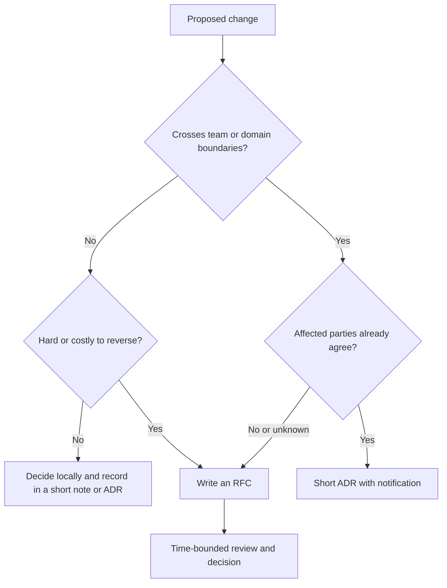
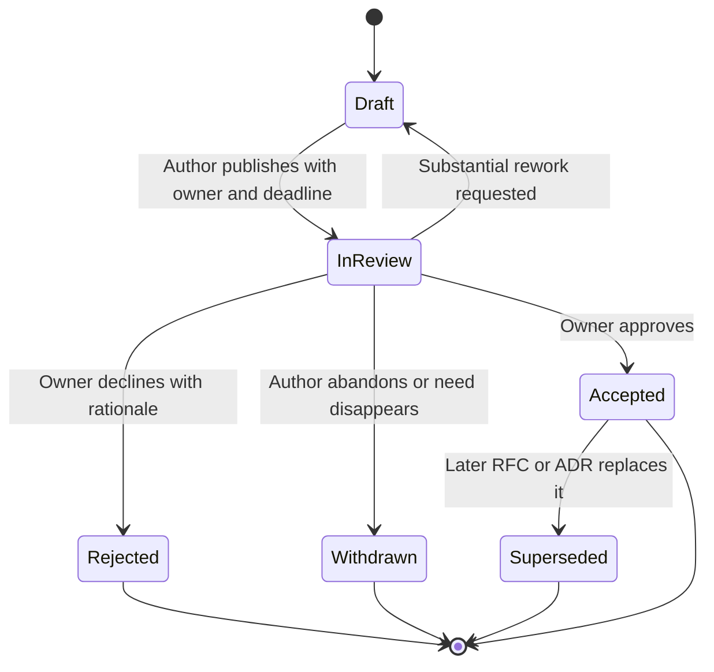
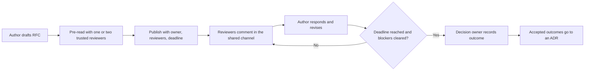
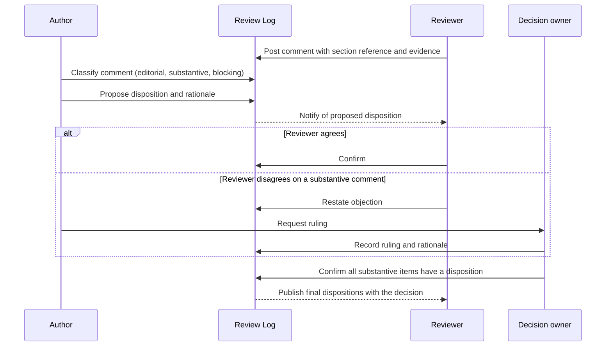
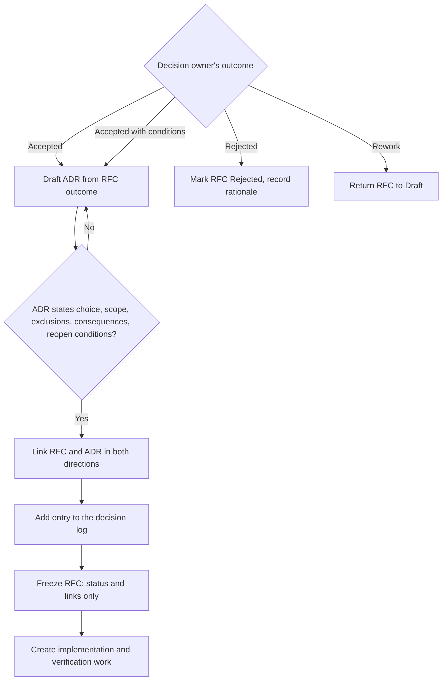
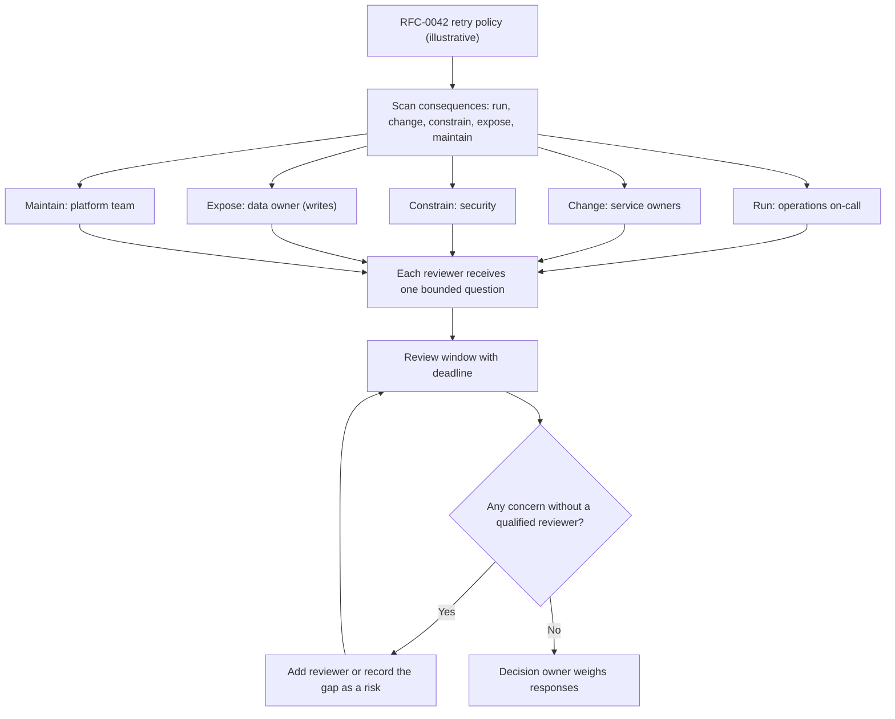
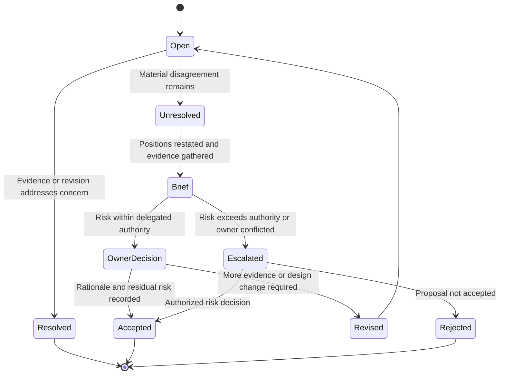
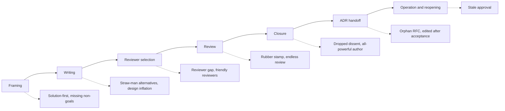
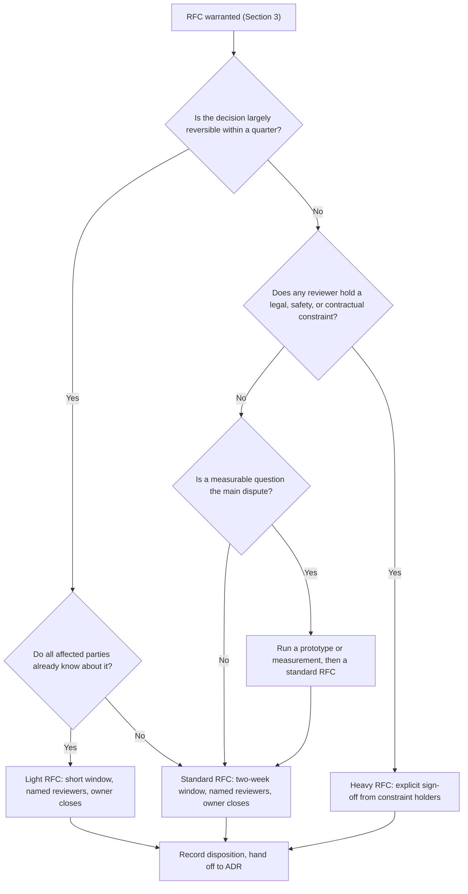
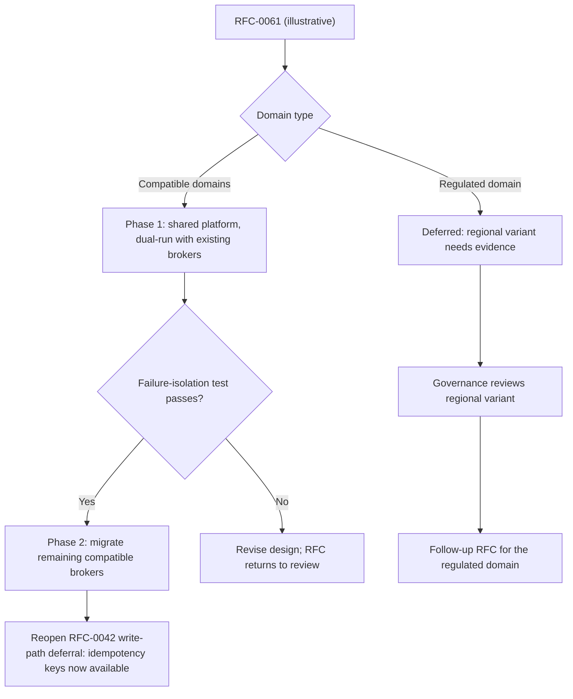

# RFC: Request for Comments

Part: [21 — Architecture Documentation](PART_OVERVIEW.md) · Status: Drafted

## 1. Introduction

A Request for Comments (RFC) is a written proposal, circulated for a bounded time to the people a change will affect, so that problems with the idea are found while changing it is still cheap. The author states the problem, the constraints, the proposed design, the alternatives considered, the risks, and the decision being requested. Reviewers respond in writing, and a named person decides. The artifact is simple; the discipline around it is what makes it useful.

For an experienced engineer moving into architecture, the RFC is often the first instrument that works through influence rather than authority. A solution architect rarely owns every team a decision touches. A design that is argued in a meeting is remembered selectively, decided by whoever is present, and unavailable to the person who joins next quarter. A design that is written down, reviewed in the open, and closed with recorded dispositions can be audited, challenged, and reused. The RFC converts architectural intent from a conversation into evidence.

It also matters because of what it protects against. Consequential changes fail less often from a bad idea than from an unexamined one: a regulatory constraint nobody in the room knew about, an operational burden that lands on a team that was never asked, or an assumption that three other teams would have contradicted in five minutes. An RFC is a cheap, deliberate mechanism for surfacing those facts before code, contracts, or migrations depend on them.

This chapter owns the engineering RFC as a documentation and review practice: what the artifact contains, how it moves through states, who reviews it, and what it is not for. The boundaries with neighbouring material are deliberate:

- The reasoning that produces a good decision (framing, trade-offs, reversibility) belongs to [Architecture Thinking](../01_Architecture_Mindset/CH03_Architecture_Thinking.md), which also owns the ADR template and worked example; this chapter recaps only what the RFC-to-decision handoff needs.
- The durable record of a decision, its status, and its consequences belongs to [ADR (Architecture Decision Record)](CH03_ADR_Architecture_Decision_Record.md); an RFC feeds an ADR and does not replace it.
- Decision-making practice, such as facilitation, evidence handling, and challenge sessions, belongs to [Part 22](../22_Architectural_Thinking_and_Decision_Practice/PART_OVERVIEW.md), for example [Evidence, Assumptions, and Uncertainty](../22_Architectural_Thinking_and_Decision_Practice/CH04_Evidence_Assumptions_and_Uncertainty.md) and [Architecture Pre-Mortems and Challenge Reviews](../22_Architectural_Thinking_and_Decision_Practice/CH08_Architecture_Pre_Mortems_and_Challenge_Reviews.md).
- The review roles and formal gated review belong to [Role of a Solution Architect](../01_Architecture_Mindset/CH02_Role_of_a_Solution_Architect.md) and [Architecture Reviews](CH11_Architecture_Reviews.md); this chapter covers the lighter, asynchronous written review.
- The running index of decisions belongs to [Decision Logs](CH10_Decision_Logs.md).
- This chapter does not cover Internet standards-track RFC publication; the next section explains how the two differ.

After studying this chapter, a reader should be able to:

1. Explain what an engineering RFC is, what problem it solves, and how it differs from an Internet RFC, a design document, and an ADR.
2. Decide whether a given change warrants an RFC, a lighter note, or only an ADR, using explicit criteria.
3. Write a complete RFC from a template, including goals, non-goals, alternatives, risks, and a precise decision request.
4. Operate the RFC lifecycle, including state transitions, review windows, and closure rules.
5. Structure review so that comments reach a recorded disposition rather than lingering.
6. Recognize the common ways RFC processes fail, and apply the process to a concrete, hypothetical proposal.

## 2. Background and History

The name comes from the Internet. The "Request for Comments" series began in 1969 as informal notes among the researchers building the early ARPANET (Advanced Research Projects Agency Network), and it grew into the document series through which Internet protocols are specified and published. Those documents are numbered, archived, and in some cases carry standards status through a defined process managed by the Internet Engineering Task Force (IETF). The informal, invite-comment tone of the original name persisted even as the series became formal.

Many software organizations later borrowed the name for an internal practice: a written proposal for a significant change, open to comment before it is built. Several open-source language and platform projects, and many companies, run processes of this kind, usually with their own states, templates, and approval rules. These internal processes share a spirit with the Internet series (propose in writing, invite review, keep the record) but they are not governed by it and they differ from one another in detail. There is no single standard engineering RFC process.

The practical implication is that "RFC" in your organization is a local contract. Before using the word in a decision, write down what states exist, who may approve, and how long review lasts. This chapter describes a reasonable, general-purpose process and treats every state name and time limit as a default to be tuned, not a rule.

## 3. The Problem the RFC Solves

An RFC addresses a specific failure: consequential design decisions made by too few people, too late, with too little written down. The patterns below are general, not reported incidents.

| Failure pattern | Mechanism | What the RFC contributes |
| --- | --- | --- |
| Late discovery of constraints | Affected teams hear of a change after implementation has started | A review window before commitment, with affected domains invited by name |
| Solution-first debate | The group argues about a technology label before agreeing on the problem | A required problem statement and explicit goals and non-goals |
| Unexamined alternatives | The first workable idea becomes the plan | A required alternatives section with reasons for rejection |
| Hallway decisions | A decision is made orally and cannot be reconstructed | A written proposal, comments, and disposition record |
| Endless review | Comments accumulate and nobody closes them | A deadline, a decision owner, and a closure rule |
| Hidden risk transfer | One team takes on cost or risk on behalf of others without consent | A section that names impact on each affected team |

Alternatives exist, and the choice among them is a real decision. A design meeting is fast and good for convergence among a few people, but it leaves no record and excludes the absent. A direct decision by a single architect is fast and clear in accountability, but it concentrates information risk in one person. A formal review board gives authority and consistency but adds queueing delay and is heavy for changes of modest scope. An ADR alone records a decision but does not gather input before it. The RFC is chosen when a change is expensive to reverse or crosses team boundaries, and when the cost of a surprise exceeds the cost of a week of review. The criteria grow with the number of affected teams, the cost of reversal, and the presence of regulatory or operational obligations.



The diagram shows that an RFC is a response to a combination of reach and reversibility, not a default step for every change. Its implication is process proportionality: an organization that requires an RFC for every library upgrade trains people to write them as paperwork, while one that never requires them discovers constraints late. The reversibility heuristic itself is owned by [Architecture Thinking](../01_Architecture_Mindset/CH03_Architecture_Thinking.md); here it only calibrates how much review a change earns.

## 4. Anatomy of an RFC

### 4.1 What each section is for

An RFC is a structured argument. Each section exists to remove a specific way a review goes wrong, so a section that nobody can justify should be dropped and a missing one should be added.

- **Summary**: two or three sentences so a reviewer can decide whether the document concerns them.
- **Problem and context**: the situation, the constraint, and who is affected, stated without naming the solution.
- **Goals and non-goals**: what success means and, equally, what the proposal deliberately will not do. Non-goals stop scope arguments and protect the proposal from being judged against things it never promised.
- **Proposal**: the design at the level of detail needed to judge impact, linking to deeper designs instead of embedding them.
- **Alternatives considered**: at least one real alternative, including "do nothing", each with the reason it lost.
- **Quality scenarios and impact**: how the proposal behaves for the quality attributes that matter, expressed as concrete scenarios.
- **Migration and rollout**: how the organization gets from here to there, including how to back out.
- **Risks and open questions**: what could be wrong, and what the author does not yet know.
- **Decision request**: the exact question reviewers and the decision owner are being asked to answer, and by when.

The weakest RFCs are the ones with a proposal and nothing else. A proposal without a problem statement cannot be challenged on its premise, and one without alternatives reads as a conclusion looking for approval.

### 4.2 A Markdown RFC template

Keep the template in the repository next to the code or standards it governs, so that changing the process is itself a reviewable change. The following is a reasonable starting point; every field is a default to be adapted.

```markdown
# RFC-NNNN: <short, specific title>

- Status: Draft | In Review | Accepted | Rejected | Withdrawn | Superseded
- Author(s): <names>
- Decision owner: <one named person or body>
- Reviewers requested: <people or teams, with the concern each represents>
- Created: YYYY-MM-DD
- Review deadline: YYYY-MM-DD
- Related: <ADR links, earlier RFCs, tickets>

## Summary

<Two or three sentences.>

## Problem and Context

<What is happening, who is affected, and what constraint forces a change.>

## Goals and Non-Goals

Goals:

- <measurable or checkable outcome>

Non-goals:

- <what this proposal will deliberately not do>

## Proposal

<The design. Link to detailed designs, threat models, and benchmarks.>

## Alternatives Considered

### Alternative A: <name>

<Description, benefits, costs, and why it was not chosen.>

### Do nothing

<What happens if no change is made.>

## Quality Scenarios and Impact

| Quality attribute | Scenario | Expected outcome |
| --- | --- | --- |
| <attribute> | <stimulus and context> | <measurable response> |

## Migration and Rollout

<Sequence, compatibility period, rollback path, and verification.>

## Risks and Open Questions

- <risk, likelihood, impact, mitigation or acceptance>
- <question the author cannot yet answer>

## Decision Request

<The exact decision wanted, by whom, and by when.>

## Review Log

| Reviewer | Section | Comment | Disposition | Rationale |
| --- | --- | --- | --- | --- |
```

The template deliberately places the decision owner and deadline in the header. An RFC whose header cannot name a decision owner is not ready for circulation, because nobody will be accountable for closing it.

### 4.3 What an RFC is not for

The RFC is a poor tool for several jobs that are often loaded onto it:

- **Recording the final decision.** An RFC is a proposal plus its review history. The durable decision, status, and consequences belong in an ADR, which is owned by [ADR (Architecture Decision Record)](CH03_ADR_Architecture_Decision_Record.md).
- **Detailed design.** A full design document, threat model, or runbook can be linked. Embedding it makes the RFC unreadable and buries the decision.
- **Seeking permission for routine work.** Where the change is local and reversible, the review overhead exceeds the risk.
- **Retroactive approval.** An RFC written after implementation is a justification, not a review. If reviewers cannot change the outcome, say so honestly and use a notification instead.
- **Resolving disputes about people or priorities.** Those belong to management and governance, not to a technical proposal.

## 5. The RFC Lifecycle

### 5.1 States and transitions

A lifecycle turns a document into a process by giving each stage a name and an exit condition. The states below are a general model; map them onto your own tooling and rename them if needed, but keep the distinction between *still open to change* and *closed*.



The diagram makes three practical points. First, *Draft* is private to the author and a small group; the clock starts only when the document enters *In Review*. Second, there is a route back from review to draft, so rework is a normal outcome, not a failure. Third, every terminal state is explicit: a proposal that quietly stops being discussed leaves its stakeholders unsure whether they may proceed. A review that ends without a recorded state is the most common way processes decay.

### 5.2 Review mechanics

The review window is the central mechanism. Four parameters define it.

- **Length.** Long enough for geographically distributed and busy reviewers to respond; short enough that the proposal does not go stale. Many teams use a few working days to two weeks, scaled to risk; treat any figure as a local choice.
- **Audience.** Reviewers are chosen by affected concern, not by seniority. Name each requested reviewer and the question you are asking them.
- **Channel.** Keep comments in one place that persists, such as the pull request or document that holds the RFC, so the record is not split across chat threads.
- **Closure rule.** State up front how the RFC ends: by the decision owner's call after the deadline, or by explicit sign-off from named reviewers. Silence-as-consent is acceptable only if the rule is written and affected parties were notified.



The pre-read step is a deliberate mechanism, not a courtesy. Showing a draft to one or two trusted colleagues before the window opens removes the embarrassing errors and lets reviewers in the formal window spend their attention on the real trade-offs. The loop between comment and response also has an implication for the author: the RFC is a living document during review, and revisions should be visible, so that a reviewer can see what changed after their comment.

### 5.3 Failure modes of the process

- **Rubber stamp.** Review is so shallow that every RFC passes. The usual cause is reviewers lacking time or a mandate to object. Counter by naming reviewers per concern and expecting at least one substantive comment.
- **Design by committee.** Every comment is absorbed and the proposal loses coherence. Counter by separating requirements from preferences and letting the owner decline preferences with a reason.
- **Review-as-veto.** Any reviewer can block indefinitely. Counter with a decision owner and a defined route for material objections.
- **Stale approval.** An accepted RFC is treated as permanent after the context has changed. Record reopen conditions in the decision.
- **Ceremony inflation.** Every change needs an RFC, authors write them to satisfy process, and reviewers skim. Counter with explicit thresholds like those in the decision flow earlier in this chapter.

## 6. Worked Scenario: Choosing a Retry Policy for Inter-Service Calls

The following is a hypothetical, illustrative example. It shows the shape and level of detail of an RFC, not a recommendation for any real system.

**Context.** A company has roughly a dozen services that call each other over HTTP (Hypertext Transfer Protocol). Each team has implemented retries differently. A platform architect suspects that uncoordinated retries can amplify load during partial failures and wants a shared client policy. The change crosses many teams and is hard to reverse once libraries are adopted, so it meets both criteria in the decision flow: it needs an RFC.

**Illustrative outline of the RFC.**

```markdown
# RFC-0042: Shared Retry and Timeout Policy for Inter-Service Calls

- Status: In Review
- Author(s): Platform Architecture (illustrative)
- Decision owner: Head of Platform Engineering (illustrative)
- Reviewers requested: Service owners (call patterns), Operations (incident
  load), Security (error leakage), Data (idempotency of writes)
- Review deadline: <two weeks from publication>

## Summary

Adopt a single client-side policy: bounded retries with jittered backoff,
a per-request deadline, and retries only for operations declared idempotent.

## Problem and Context

Retry behaviour differs per team. Some clients retry immediately and without
limit; others never retry. During a partial failure of a shared dependency,
the first group can multiply request volume. No document records the policy.

## Goals and Non-Goals

Goals: bound the retry load a single caller can generate; make behaviour
predictable across teams; make idempotency an explicit declaration.
Non-goals: choosing a service mesh; changing server-side rate limiting;
retrofitting every legacy client in this phase.

## Alternatives Considered

A. Leave each team to decide (status quo).
B. Server-side load shedding only.
C. Shared client library with a default policy (proposed).
D. Service mesh-enforced retries.

## Quality Scenarios and Impact

Resilience: when a dependency returns errors for 30 seconds, total retry
traffic from any caller stays within a stated multiple of normal traffic.
Correctness: no non-idempotent write is retried without an idempotency key.

## Migration and Rollout

Publish the library; adopt in new services first; migrate existing clients
per team over two quarters; keep a per-service opt-out with an owner.

## Risks and Open Questions

Risk: teams mis-declare operations as idempotent. Question: who owns the
default timeout for dependencies with unknown latency?

## Decision Request

Approve option C for new services, and approve a migration target for
existing ones, by the review deadline.
```

**What review changes.** Suppose an operations reviewer points out that during an outage the library's retries are bounded per caller but not across callers, so many callers together could still overload a recovering service. The author adds a retry-budget concept and a note that server-side shedding is complementary rather than an alternative. A data reviewer points out that a few write endpoints lack idempotency keys; the author narrows the first phase to read operations and records that the write path is deferred. Both changes appear in the Review Log with dispositions.

**Outcome.** The decision owner accepts option C for new services and read operations, defers the write path pending idempotency work, and records the retry-budget as an accepted risk with an owner. The accepted scope and its reopen conditions then move into an ADR, while the RFC remains as the evidence trail.

**Lessons.** The value was not the library choice; several reviewers would have named it before the RFC. The value was that two constraints, cross-caller amplification and write idempotency, were surfaced by the people who owned them, and that the deferral was a recorded decision rather than an oversight. Note also what the RFC did not do: it did not specify the library's code, and it did not settle server-side load shedding.

## 7. Tracing Feedback to Disposition

A review window produces comments; it produces a decision only when every substantive comment ends in a recorded outcome. Disposition tracking is the mechanism that makes the Review Log in the template more than a diary. Without it, the author cannot show that a concern was heard, the reviewer cannot tell whether silence means agreement, and a later reader cannot tell which risks were accepted on purpose.

### 7.1 Classifying comments

Not every comment deserves the same handling. Classify on entry, because the class determines who may close it.

| Class | Definition | Who may close it | Typical evidence of closure |
| --- | --- | --- | --- |
| Editorial | Wording, typos, formatting; does not change meaning | Author | Edit made |
| Clarifying question | Reviewer cannot evaluate a claim from the text | Author | Text revised so the question no longer arises |
| Substantive concern | Names a requirement, risk, or assumption that could change the decision | Author proposes; reviewer confirms or decision owner rules | Design change, evidence, or an explicit accepted risk |
| Blocking objection | Reviewer states the proposal should not proceed unless addressed | Decision owner, after hearing the reviewer | Recorded ruling (see Section 10) |
| Out-of-scope idea | Valuable but outside the stated goals | Author | Follow-up item with an owner, or declined with reason |

The test for "substantive" is practical: would the decision, its scope, or its risk register differ if the comment were right? If yes, it is substantive, whoever wrote it.

### 7.2 The four dispositions

Each substantive comment ends in exactly one of four dispositions, each with an obligation attached.

- **Accepted.** The proposal changes. Record where (section and revision) so the reviewer can verify.
- **Rejected with rationale.** The proposal does not change. The rationale must engage the reviewer's argument, not restate the proposal. A rejection without a reason is the most common cause of later escalation.
- **Deferred.** The concern is valid but belongs to a later phase. Record an owner, a trigger, and the interim consequence; otherwise deferral is a polite rejection.
- **Converted to an action.** The concern requires work that is not a design change, such as measuring a latency or confirming a contract. Record the owner and due date, and state whether the decision waits for the result.

### 7.3 Illustration: dispositions for the retry-policy RFC

Continuing the hypothetical RFC-0042 from Section 6, the Review Log after the window might read as follows. All names and outcomes are illustrative.

| ID | Reviewer concern | Class | Disposition | Where recorded |
| --- | --- | --- | --- | --- |
| C1 | Retries are bounded per caller, not across callers, so many callers can still overload a recovering service | Substantive | Accepted: add a retry-budget concept and state that server-side shedding is complementary | Proposal, revision 2 |
| C2 | Several write endpoints have no idempotency key | Substantive | Deferred: first phase limited to reads; write path owned by the Data reviewer's team with trigger "idempotency keys available" | Goals and Non-Goals; Risks |
| C3 | Default timeout for dependencies with unknown latency is unowned | Substantive | Converted to action: service owners supply p99 estimates before rollout; decision does not wait | Open Questions |
| C4 | Error responses from the library might leak internal hostnames | Substantive | Accepted: library returns a sanitized error type | Proposal, revision 2 |
| C5 | A service mesh could enforce retries without a library | Substantive | Rejected with rationale: the mesh is out of scope for this phase and is listed as an alternative to be revisited if library adoption stalls | Alternatives Considered |
| C6 | Rename "budget" to "allowance" | Editorial | Declined; term kept for consistency with the rest of the platform documentation | Review Log |

Two observations follow. C5 is rejected, yet it remains in the document with a revisit condition, so the reviewer is not left to wonder. And C2 shows why deferral needs a trigger: "later" without a condition is indistinguishable from "never".



The diagram shows that the author proposes dispositions but does not close contested ones; the author is the party with the most investment in the proposal, so a neutral closer is needed where the reviewer disagrees. The practical implication is that the decision owner should not accept the RFC until the log shows no substantive item without a disposition. That single closure rule is checkable by anyone and prevents both lingering comments and silent drops.

Silence is not a disposition. If a requested reviewer never responds, record "no response by deadline" against that reviewer, and apply whatever closure rule the RFC stated at publication. Reconsider the reviewer list for next time: a reviewer who never responds was either wrongly chosen or lacks time, and both are process facts worth knowing.

## 8. Handing Off the Decision to an ADR

An RFC is a proposal and discussion artifact. Its job ends when someone with authority decides. The durable record of what was decided, why, and with what consequences is the ADR, whose template and worked example are owned by [ADR (Architecture Decision Record)](CH03_ADR_Architecture_Decision_Record.md) and [Architecture Thinking](../01_Architecture_Mindset/CH03_Architecture_Thinking.md). This section covers only the handoff: what crosses from the RFC to the ADR, what stays behind, and how the two stay linked.

### 8.1 Why two artifacts

The two artifacts answer different questions at different times.

| Question | RFC | ADR |
| --- | --- | --- |
| When is it written? | Before the decision, to gather input | At or after the decision, to record it |
| Who is the audience? | Reviewers deciding whether to object | Future maintainers asking why the system is this way |
| What is its length and tone? | Argumentative, with alternatives and open questions | Terse, stating the choice and consequences |
| Does it change after the decision? | Frozen, except for status and links | Status changes as it is superseded |
| What does it preserve? | The evidence trail and review history | The authoritative current statement of the decision |

Keeping one document for both purposes tends to fail in one of two ways: the ADR swells with discussion until nobody reads it, or the RFC is edited after acceptance until it no longer shows what reviewers actually saw.

### 8.2 What crosses the boundary

Carry forward only what a future reader needs to judge whether the decision still holds:

- the decision itself, stated as the accepted option and its scope, including explicit exclusions;
- the decision owner and date;
- the alternatives that were rejected and the one-line reason for each;
- the consequences, including accepted risks with owners;
- the reopen conditions, meaning the events or measurements that should trigger reconsideration;
- links in both directions between the RFC and the ADR.

Do not copy the comment threads. Summarize the dispositions that changed the decision and link to the RFC for the rest.

### 8.3 Illustration: the retry-policy decision as an ADR

Continuing the hypothetical RFC-0042, the decision owner accepts the shared client policy for new services and read operations. The ADR might be drafted as follows (illustrative; the real template is in the ADR chapter).

```markdown
# ADR-0108: Shared client retry and timeout policy

- Status: Accepted
- Date: <date>
- Decision owner: Head of Platform Engineering (illustrative)
- Source: RFC-0042 (linked), review dispositions C1-C5

## Decision

Adopt the shared client library for new services and for read operations in
existing services. Retries are bounded, jittered, deadline-limited, and
governed by a retry budget. Write operations are out of scope.

## Rejected alternatives

Status quo: leaves uncoordinated retries. Mesh-enforced retries: out of
scope for this phase; revisit if adoption stalls.

## Consequences

Accepted risk: operations mis-declared as idempotent (owner: service teams).
Deferred: write path, until idempotency keys exist (owner: Data).

## Reopen when

Library adoption of existing read clients is below target after two quarters,
or the write-path trigger is met.
```

The ADR is short because the RFC carries the argument. Its "Reopen when" line is what makes it maintainable: a future reader sees not only what was chosen but what would change it.



The flowchart places the ADR check before the link step, so an RFC is never marked accepted while its decision exists only inside a long discussion. Two implications follow. First, accepted RFCs that never produce an ADR are the signal that the handoff is skipped, and a periodic audit comparing accepted RFCs to ADRs catches it. Second, the index step connects to [Decision Logs](CH10_Decision_Logs.md), which owns the running register; this chapter only requires that the entry exist.

## 9. Identifying the Right Stakeholders

Review quality depends more on who is asked than on how many are asked. The aim is to reach every party who bears the consequences of the change, or holds knowledge that could change it, without diluting attention with irrelevant reviewers. Review is not a vote; evidence is weighed by a decision owner with explicit authority.

### 9.1 Finding affected parties

Work from consequences, not org charts. For each proposed change, ask:

1. **Who will run it?** Operations, support, and on-call teams inherit behaviour at three in the morning.
2. **Who must change to adopt it?** Teams whose code, contracts, or pipelines are modified.
3. **Who holds a constraint?** Security, privacy, compliance, finance, or a data owner with obligations the author may not know.
4. **Who is exposed to the risk?** A team that depends on a shared component carries failure the author may never see.
5. **Who will be asked to maintain it later?** The people who join after the decision.

A useful check is to read the Quality Scenarios and Impact section and confirm that each named scenario has a reviewer qualified to challenge its numbers.

### 9.2 A responsibility matrix for RFC review

A RACI (Responsible, Accountable, Consulted, Informed) table is one common way to make roles explicit. The version below is adapted for RFC review and is a starting point, not a standard. The key rule of RACI usage holds here: each decision has exactly one Accountable role.

| Activity | Author | Decision owner | Domain reviewers | Architecture lead | Wider audience |
| --- | --- | --- | --- | --- | --- |
| Draft and publish RFC | R | I | I | C | I |
| Choose reviewers and set deadline | R | A | C | C | I |
| Provide domain-specific review | I | I | R | C | I |
| Propose dispositions | R | I | C | C | I |
| Rule on blocking objections | C | A, R | C | C | I |
| Accept, reject, or request rework | C | A, R | I | C | I |
| Write the ADR | R | A | I | C | I |
| Announce the outcome | R | A | I | I | I |

Interpret the matrix with care. The decision owner is a person or a named role, not a committee; if a group must decide, its decision rule belongs in the RFC's closure rule. The Architecture lead column is *Consulted* so that consistency across RFCs is visible without turning the architect into a gate; the formal gated review belongs to [Architecture Reviews](CH11_Architecture_Reviews.md).

### 9.3 Illustration: reviewer assignment for the retry-policy RFC

For the hypothetical RFC-0042, the author maps concerns to reviewers and writes the question to each one in the document itself.

| Concern | Requested reviewer | Bounded question |
| --- | --- | --- |
| Call patterns and latency | Service owners of the three busiest callers | Is the default timeout compatible with your slowest legitimate request? |
| Incident load | Operations on-call lead | Does a retry budget make an outage easier or harder to diagnose? |
| Error leakage | Security | Could sanitized error types still reveal topology? |
| Write correctness | Data owner | Which write endpoints lack idempotency keys? |
| Adoption cost | Two platform-adjacent teams | What migration effort do you expect per service? |

Notice that no reviewer is asked "do you approve?" Each is asked a question only they can answer well, which makes a non-response visible and a substantive reply likely.



The diagram turns reviewer selection into a coverage check rather than a social one. Its practical implication is that a gap becomes a visible risk instead of a silent one: if no one qualified will review the write path, the RFC says so. Avoid two opposite errors: broadcasting every RFC to every list, which trains people to ignore them, and inviting only friendly reviewers, which produces the rubber stamp described in Section 5.3.

## 10. Escalating Unresolved Objections

Most comments resolve by clarifying a requirement or adjusting the proposal. A few do not: two parties with legitimate concerns hold incompatible positions, and more discussion will not change either. A process that has no route for this case ends in one of two failures, indefinite review or a decision that silently overrides a valid concern. This section describes a route that preserves dissent without letting it become a veto. The general practice of facilitating such disagreements is owned by [Part 22](../22_Architectural_Thinking_and_Decision_Practice/PART_OVERVIEW.md); here the concern is the RFC's own mechanism.

### 10.1 When a disagreement is an escalation

Escalate only after three conditions hold:

1. The objection is substantive in the sense of Section 7.1: the decision would differ if the objector were right.
2. The author and objector have each stated the other's position to the objector's satisfaction. Many apparent deadlocks dissolve here, because they were disagreements about different problems.
3. The disagreement cannot be settled by evidence available within the review window, or the evidence has been gathered and still supports both readings.

If evidence can settle it, convert the objection into an action (Section 7.2) and have the decision wait for the result, rather than escalating.

### 10.2 The escalation brief

Escalation should arrive as a short, symmetric document so the decider is not handed one party's framing. Include:

- the decision to be made, in one sentence;
- each position, written or reviewed by its holder;
- the quality attributes and requirements each position protects;
- the evidence for and against each, and what is unknown;
- the cost of delay and of each option's failure;
- who would own the residual risk under each option;
- the response date and the decision authority.

### 10.3 Choosing the decider

Authority should follow the scope of the risk, not the seniority of the people arguing. The decision owner named in the RFC decides when the risk falls within delegated authority. Escalate above that owner when the risk exceeds what the owner may accept, when the owner has a conflict of interest, or when the outcome binds teams outside the owner's reporting line. The thresholds are organizational; write them into the process document, not into each RFC.

### 10.4 Illustration: an unresolved objection on RFC-0042

In the hypothetical retry-policy RFC, suppose the owner of a checkout service objects. Their customer-facing deadline is short, and they argue that any retry budget the library imposes could delay a failure response beyond that deadline; they ask for a blanket exemption from the library. The platform author argues that exemptions weaken the cross-caller bound the RFC exists to provide. Both positions are legitimate.

| Option | Protects | Residual risk | Owner of residual risk |
| --- | --- | --- | --- |
| Blanket exemption for latency-critical services | Customer-facing deadline | Uncontrolled retries from exempt callers during dependency failure | Checkout service owner |
| No exemptions | Cross-caller bound | Slower failure responses for latency-critical callers | Platform |
| Per-service deadline override with a stricter retry budget, reviewed every two quarters | Both, partially | Misconfigured overrides; review burden | Platform and checkout jointly |

The facts are partly measurable: checkout can supply its actual deadline and call pattern, which turns part of the dispute into an action. Suppose the remainder is a genuine judgement about acceptable risk. The decision owner rules within delegated authority, picks the third option, and records the objector's concern, the rationale, the review date, and the owner of the residual risk. The objector's dissent stays in the record even though the proposal proceeds.



The diagram inserts a *Brief* stage between disagreement and ruling, so that no one is overruled before their position has been stated fairly. Its implication is procedural: a ruling is legitimate when the objection is on the record, the decider had authority, and the residual risk has a named owner. Consensus is not required, and an RFC should never claim consensus when a valid dissent remains. Equally, a dissenter does not hold a veto; the cost of that bargain is that the record keeps the dissent visible for the reopen conditions.

## 11. Failure Scenarios and Common Mistakes

Section 5.3 listed failure modes of the lifecycle. This section widens the lens to failures of the artifact, the review, and the handoff, and gives each a symptom, a detection method, and a mitigation. The scenarios are general patterns, not reported incidents.

### 11.1 Failure catalogue

| Failure | Symptom | Detection | Mitigation |
| --- | --- | --- | --- |
| Solution-first RFC | The problem section is one sentence; the proposal dominates | Reviewers argue about a technology label; goals cannot be stated without naming the solution | Require a problem statement and measurable goals before the proposal is accepted for review |
| Missing non-goals | Review sprawls into adjacent topics; scope creeps during discussion | Comments ask for features the author never intended | Require explicit non-goals; decline out-of-scope comments to a follow-up list |
| Straw-man alternatives | Alternatives are obviously inferior; "do nothing" is absent or dismissed in a line | Reviewers propose an alternative the author had not listed | Require reasons for rejection and an honest "do nothing" analysis |
| Reviewer gap | An affected team learns of the change after acceptance | Post-acceptance complaint; a concern in the impact section without a qualified reviewer | Run the coverage check from Section 9 and record gaps as risks |
| Retroactive RFC | Implementation is under way at publication; reviewers are told changes are costly | Commit history predates the RFC | Use a notification instead; be honest that reviewers cannot change the outcome |
| Dropped dissent | The record shows consensus; the objector reports being overruled | Objections in chat without a Review Log entry | Single review channel; decision owner confirms every substantive item has a disposition |
| Endless review | Open for weeks, with no new substantive comments | RFC age exceeds the stated deadline | Deadline, closure rule, and owner's authority to close; withdraw or rework if stalled |
| Orphan RFC | Accepted but no ADR; implementers consult the RFC and cannot tell what was decided | Audit of accepted RFCs against ADRs | Make the ADR a required exit step (Section 8) |
| Edited-after-acceptance | The RFC no longer matches what reviewers saw | Revision history shows content changes after closure | Freeze after acceptance; supersede with a new RFC or ADR |
| Stale approval | An accepted decision is followed after its premises changed | Reopen conditions occurred without review | Record reopen conditions and review them on a schedule |
| Hidden risk transfer | One team absorbs operational burden unnoticed | Impact section does not name the receiving team | Per-team impact table; named consent from receiving teams |

### 11.2 Anti-patterns

- **Document theatre.** The RFC exists to satisfy a gate, and reviewers know the outcome is fixed. Remedy: reserve the RFC for decisions that can change; use notifications otherwise.
- **The all-powerful author.** The author triages, dispositions, and closes their own proposal. Remedy: contested items are closed by the decision owner, as in Section 7.
- **The merge-conflict RFC.** Reviewers rewrite the proposal in comments until it reflects no one's design. Remedy: the owner separates requirements from preferences and may decline preferences with a reason.
- **Design-document inflation.** The RFC grows to contain the detailed design, test plan, and runbook, and the decision disappears. Remedy: link detailed material; keep the decision request on the first page.
- **Comment-count as quality.** Success is measured by number of comments or approvals. Remedy: measure whether dispositions were recorded and whether post-acceptance surprises occurred.
- **Anonymous ownership.** "The architecture team" decides. Remedy: a named decision owner per RFC.

### 11.3 Where failures enter the process



The diagram assigns each failure to the stage where it is cheapest to prevent. The implication is that mitigation is front-loaded: most of the later failures, such as dropped dissent or stale approval, are made visible only if the earlier stages created the artifacts (a named owner, a Review Log, reopen conditions) that detection relies on. A team auditing its own process can walk the stages in order and ask, at each one, which artifact would reveal the failure.
## 12. Trade-off Analysis and Decision Framework

Section 3 decided whether a change needs an RFC at all. This section decides how heavy the review should be once it does, and compares the RFC with the other ways of reaching a decision. The criteria are judgement aids, not thresholds; calibrate them to your organization.

### 12.1 Comparing decision mechanisms

| Mechanism | Strengths | Weaknesses | Best fit |
| --- | --- | --- | --- |
| Design meeting | Fast convergence; rich discussion | No durable record; excludes absent people; favours the loudest | Few participants, reversible choice |
| Architect decides alone | Clear accountability; speed | Single point of knowledge; unexamined assumptions | Narrow scope, low reversal cost |
| Lightweight note plus ADR | Cheap; records the outcome | No structured input before the decision | Affected parties already agree |
| Full RFC | Written problem, alternatives, and dispositions; asynchronous; auditable | Authoring and review cost; delay; ceremony risk | Cross-team, hard to reverse, constraints unknown |
| Review board | Authority and consistency across the organization | Queueing delay; distance from context | Changes that need formal governance (see [Architecture Reviews](CH11_Architecture_Reviews.md)) |
| Prototype or experiment first | Replaces opinion with evidence | Takes time; may not expose organizational constraints | Dispute turns on an empirical question |

These mechanisms combine. A common pairing is a prototype to settle a measurable dispute, an RFC to gather constraints, and an ADR to record the outcome. How to weigh evidence and uncertainty in that pairing is owned by [Evidence, Assumptions, and Uncertainty](../22_Architectural_Thinking_and_Decision_Practice/CH04_Evidence_Assumptions_and_Uncertainty.md).

### 12.2 Tuning the weight of the RFC

Within the RFC process, four dials trade rigor for speed.

| Dial | Lighter setting | Heavier setting | Choose heavier when |
| --- | --- | --- | --- |
| Review window | A few working days | Two weeks or more | Many time zones or domain experts with limited availability |
| Reviewer set | Named domain reviewers only | Open to the whole engineering organization | Unknown unknowns dominate; the change reaches most teams |
| Closure rule | Owner decides after the deadline | Explicit sign-off from named reviewers | A reviewer holds a legal, safety, or contractual constraint |
| Template depth | Summary, alternatives, decision request | Full template with quality scenarios and migration | Hard to reverse, or costly to migrate |

The costs are asymmetric. A too-light process saves days and risks a late constraint that costs weeks. A too-heavy process costs reviewer attention across the organization, and the loss of attention is itself a risk, because reviewers who skim miss the one comment that mattered.



The flowchart separates three situations that are often conflated: the change is small but unfamiliar to others (standard review), the change is consequential and constrained (sign-off), and the argument is empirical (measure first). Its implication is that the review weight should be an explicit, recorded choice made by the author and owner at publication, rather than a habit. If the choice turns out wrong, the Review Log shows it, and the process can be adjusted.
## 13. Illustrative Composite Case Study: Closing the Write-Path Gap

This case is hypothetical and composite. It is not a report of any real organization, and every number, name, and outcome is invented to show the process. It continues the RFC-0042 thread: the retry-policy decision deferred the write path until idempotency keys exist (disposition C2 in Section 7.3).

### 13.1 Context

Two quarters after RFC-0042, read clients have largely adopted the shared library. The deferral trigger is still unmet: write endpoints lack idempotency keys, and teams have separately built several event brokers to retry writes asynchronously, each with its own redelivery behaviour. The platform architect writes RFC-0061 (illustrative) proposing two linked changes: a convention that every write carries an idempotency key, and consolidation of the ad hoc brokers into one shared event platform that redelivers messages with the same key. Idempotency, deduplication, and ordering semantics are owned by Part 07, for example [Idempotency](../07_System_Design_and_Distributed_Systems/CH16_Idempotency.md) and [Exactly-Once Processing](../07_System_Design_and_Distributed_Systems/CH17_Exactly_Once_Processing.md); the RFC cites them rather than redefining them.

### 13.2 The RFC and its review

The RFC states its goal in terms of consequences: no write is applied twice under redelivery, and the number of distinct redelivery behaviours falls from several to one. Non-goals exclude replacing every synchronous write path and choosing a vendor. Alternatives include: each team keeps its broker, a shared platform, and a database-level deduplication table only. "Do nothing" is analysed honestly: it leaves RFC-0042's write path permanently deferred.

Review, using the reviewer assignment method of Section 9, yields these dispositions:

| Concern | Reviewer | Disposition |
| --- | --- | --- |
| Consumer groups need per-domain ordering, and a shared platform may force a single ordering model | Service owners | Accepted: proposal states ordering is per key, not global, and lists consumers needing stronger guarantees as out of scope |
| A regulated domain needs longer retention and a regional boundary the proposal does not cover | Data governance | Accepted in part: a regional variant is described; the regulated domain is deferred pending evidence the variant meets the obligation |
| Migration of the existing brokers has no rollback plan | Operations | Accepted: dual-run phase and per-broker rollback added |
| Cost of a shared platform is unquantified | Finance partner | Converted to action: cost estimate due before the second phase; decision does not wait |
| A single shared platform is a single point of failure | Security and Operations | Unresolved; escalated (below) |

### 13.3 The unresolved objection

Operations argues a shared platform concentrates failure; the author argues the status quo already has several poorly operated brokers and the shared platform can be operated better. Both are plausible and measurable only after the fact. Following Section 10, the author and Operations restate each other's positions, then submit a symmetric brief. The decision owner has authority for compatible domains. The ruling: proceed with the shared platform in two phases, with phase two conditional on a failure-isolation test passing in phase one, and with Operations holding named veto on phase two promotion. The dissent is recorded.



The diagram shows that acceptance is a staged commitment with explicit gates, not a single yes. The accepted scope (compatible domains), the deferred scope (the regulated domain), and the conditional scope (phase two) each carry a trigger or an owner. Two implications follow. First, the decision satisfies the earlier RFC's reopen condition, so the two RFCs and their ADRs link in both directions and the decision log shows the chain. Second, the escalated disagreement produced a mitigation (the isolation test) rather than a winner, which is a typical outcome when the objection is really about unmeasured risk.

### 13.4 Outcome and lessons

The decision owner accepts the staged plan. The ADR records scope, exclusions, the conditional phase, the residual risk owners, and the reopen conditions. Three lessons generalize. The review surfaced a regulatory constraint no author would have guessed. The deferral and the conditional phase were recorded decisions, not oversights. And the RFC did not choose a vendor or specify broker configuration, which keeps it reviewable.

## 14. Architect Review Checklist

Use this checklist when reviewing an RFC, either as a reviewer or as the architect checking another author's draft.

1. Does the problem statement stand without naming the proposed solution?
2. Are goals measurable, and are non-goals stated?
3. Are at least two genuine alternatives presented, including doing nothing, with reasons for rejection?
4. Does each affected team appear in the impact analysis, and has each been asked a bounded question?
5. Are quality scenarios stated with a stimulus, response, and measure, so they can be tested?
6. Is the reversal cost stated, and is the review weight consistent with it?
7. Is there a named decision owner, a deadline, and a closure rule?
8. Does the Review Log give every substantive comment one of the four dispositions?
9. Are unresolved objections preserved with positions, evidence, and a named residual-risk owner?
10. Is the migration and rollout plan realistic, with a rollback path?
11. Are reopen conditions written, and is there a trigger for deferred items?
12. Will an ADR be written, and are both artifacts linked in both directions?
13. Is the detailed design linked rather than embedded?
14. Has any claim been presented as fact without evidence or a source?

## 15. Interview Questions

**1. What problem does an RFC solve that a design meeting does not?**
It makes the proposal, the objections, and the outcome durable and open to people who were not in the room. A meeting converges quickly but leaves no record and favours those present.

**2. When should you not write an RFC?**
When the change is local and cheap to reverse, when affected parties already agree (a short ADR with a notification suffices), or when the implementation is done and reviewers cannot change the outcome.

**3. How does an engineering RFC differ from an Internet RFC?**
The Internet series is a published, numbered document series, with some documents reaching standards status through the IETF process. An engineering RFC is a local internal practice that borrows the name; its states and rules are set by the organization.

**4. What is the difference between an RFC and an ADR?**
The RFC gathers input before a decision and carries the argument; the ADR records the decision, consequences, and reopen conditions afterwards. The RFC is then frozen as the evidence trail.

**5. How do you stop review from becoming endless or a rubber stamp?**
Set a deadline, a named decision owner, and a closure rule; name reviewers per concern with a bounded question; require every substantive comment to reach a recorded disposition.

**6. What are the four dispositions of a substantive comment?**
Accepted, rejected with rationale, deferred with an owner and trigger, or converted into an action with an owner and due date.

**7. How do you handle a material objection that will not resolve?**
Confirm it is substantive, restate each position fairly, write a symmetric brief, and let the decision owner rule within delegated authority or escalate beyond it. Record the dissent, the residual-risk owner, and reopen conditions; do not claim consensus.

**8. How do you choose reviewers?**
From consequences: who runs it, changes for it, holds a constraint, is exposed to its risk, or maintains it. Check that each quality scenario has a qualified reviewer, and record any gap as a risk.

## 16. Hands-on Exercises

1. **Write a problem statement.** Pick a real change in your own system. Write the Summary, Problem and Context, and Goals and Non-Goals sections of an RFC in under 400 words, without naming the solution. Have a colleague restate the problem; revise until their restatement matches yours.
2. **Disposition a Review Log.** Take the table in Section 7.3 and add three comments of your own invention, one editorial, one substantive, one blocking. Classify each, assign a disposition, and for any deferral write an owner and trigger. Explain which comments only the decision owner may close.
3. **Build a reviewer plan.** For the write-path RFC in Section 13, write a table of concerns, requested reviewers, and one bounded question per reviewer. Identify one concern for which no reviewer is qualified and decide how the RFC should record that.
4. **Draft an escalation brief.** Invent a disagreement between two plausible positions on a change in your system. Write the one-page brief using the fields in Section 10.2, including the owner of residual risk under each option and the reopen condition. Peer-review it for symmetry: could each holder endorse their own section?

## 17. Design and Architecture Review Questions

1. **A reviewer posts a long critical comment in chat, not in the RFC channel. What should the author do?**
   Move the substance into the Review Log with the reviewer's agreement, classify it, and propose a disposition. Chat threads fragment the record and let dissent disappear. If the reviewer declines, the author records the concern anyway, with attribution and a note that it was raised elsewhere. The decision owner should not accept the RFC while that item has no disposition.

2. **An accepted RFC has no ADR, and teams cite the RFC when asked what was decided. What is wrong and how do you fix it?**
   The handoff step was skipped, so the decision exists inside a long argument with no status or reopen conditions. Draft the ADR from the RFC outcome, link both ways, and add the entry to the decision log. Prevent recurrence by making the ADR an exit condition for the accepted state and auditing accepted RFCs against ADRs periodically.

3. **A senior engineer insists on an indefinite block. The deadline has passed. What do you do?**
   Check that the objection is substantive and that positions are restated fairly. If so, prepare a symmetric brief and ask the decision owner to rule within delegated authority, or escalate if risk exceeds it. Record the dissent and the residual-risk owner. A reviewer's seniority does not turn an objection into a veto, but the objection deserves a written answer.

4. **An author writes an RFC after the service is largely built. Should you review it?**
   Be honest about what review can change. If reviewers cannot alter the outcome, convert it to a notification or an after-the-fact ADR and say so. If some elements, such as a rollout plan or an unbuilt phase, can still change, scope the RFC to those and state the boundary in Goals and Non-Goals.

5. **The organization requires an RFC for every change and reviewers have stopped reading them. How would you redesign the process?**
   Define thresholds by reach and reversibility, as in Section 3, and let local reversible changes use a note or ADR. Offer light, standard, and heavy variants using the dials in Section 12. Measure whether dispositions are recorded and whether post-acceptance surprises occur, not how many RFCs are written. Review the thresholds after a few cycles.

## 18. Summary

An RFC is a written proposal circulated for bounded review so that constraints, risks, and alternatives surface while change is cheap. It differs from an Internet RFC, a design document, and an ADR, and the criteria of reach and reversibility decide whether a change deserves one. A complete RFC states problem, goals and non-goals, alternatives including doing nothing, quality scenarios, migration, risks, and a precise decision request, as the template and the retry-policy scenario showed.

The lifecycle gives the document a clock, named states, and explicit terminal outcomes. Review quality comes from choosing reviewers by consequence and asking each a bounded question, as with the responsibility matrix, and from classifying every comment and closing each substantive one as accepted, rejected, deferred, or converted to an action. Unresolved objections go through a symmetric brief to a decision owner with the right authority, with dissent and residual risk recorded. Accepted outcomes hand off to an ADR, linked both ways, and the RFC is frozen as evidence.

The failure catalogue, the comparison of decision mechanisms, the review-weight flowchart, the composite case, and the checklist let a reader recognize where processes break and tune them. The sound conclusion is simple: name the decision owner and the affected reviewers, close comments with dispositions, preserve unresolved risk, and record the outcome in a linked ADR.
