# Sequence Diagrams

Part: [21 — Architecture Documentation](PART_OVERVIEW.md) · Status: Drafted

## 1. Introduction

A sequence diagram documents one scenario as a series of messages exchanged among a chosen set of participants, drawn in time order from top to bottom. Every other diagram you will meet in this part answers a "what exists" or "where does it run" question. The sequence diagram answers "what happens, in what order, and who is waiting for whom". That is the question behind most production surprises: a call that blocks longer than expected, a message that is acknowledged but not processed, a retry that repeats a side effect, a callback that arrives before the state it depends on has been written.

For an engineer moving into architecture, the sequence diagram is the most economical way to expose a design's temporal assumptions to people who did not write the code. A component diagram can show that the order service and the payment provider are connected; only an interaction view shows that the order service holds a database transaction open while it waits for that provider. Reviewers, security engineers, operations staff, and teams on the other side of an interface can all challenge an ordering decision when it is drawn, and almost none of them can challenge it when it lives in a method body.

The sequence diagram is also easy to misuse. It is a scenario view, not a system model: it shows one path, or a few labelled branches, and says nothing about every other path. It is a statement of intent, not proof that the implementation behaves as drawn. And it is cheap to produce in volume, which tempts teams to draw call stacks that are obsolete within a sprint. This chapter therefore teaches two things together: how to read and write the notation precisely, and how to decide what is worth drawing, at what level of detail, and how to keep it truthful.

This chapter owns the use of sequence diagrams as an architecture-documentation artifact: choosing a scenario, selecting participants and level of detail, expressing synchronous and asynchronous behaviour, expressing branches and failure, reviewing, and maintaining the artifact. The boundaries with neighbouring material are deliberate:

- General Unified Modeling Language (UML) notation, the choice among diagram types, and the full vocabulary of class, state, activity, and deployment diagrams belong to [UML](CH02_UML.md); this chapter uses only the sequence-diagram subset and its practical conventions.
- Structural views (system context, containers, components) belong to the [C4 (Context, Containers, Components, Code) Model](CH01_C4_Model.md); this chapter takes the participants from those views rather than redefining them.
- The recorded rationale for a decision that a sequence reveals belongs to [ADR: Architecture Decision Record](CH03_ADR_Architecture_Decision_Record.md); the diagram shows behaviour, not the reasons for choosing it.
- Deployment topology and network boundaries belong to [Deployment Diagrams](CH06_Deployment_Diagrams.md).
- Operational procedures that act on the behaviour shown here belong to [Runbooks](CH07_Runbooks.md).
- The semantics of message delivery, idempotency, deduplication, and ordering belong to [Idempotency](../07_System_Design_and_Distributed_Systems/CH16_Idempotency.md), [Exactly-Once Processing](../07_System_Design_and_Distributed_Systems/CH17_Exactly_Once_Processing.md), [Ordering Guarantees](../07_System_Design_and_Distributed_Systems/CH18_Ordering_Guarantees.md), and [Deduplication](../07_System_Design_and_Distributed_Systems/CH19_Deduplication.md); this chapter shows where those guarantees must be annotated on a diagram, not how to build them.
- The acceptance-to-completion contract of asynchronous interfaces belongs to [Async APIs](../08_API_Architecture/CH06_Async_APIs.md), and runtime trace collection belongs to [Tracing](../14_Observability/CH03_Tracing.md).

After studying this chapter, a reader should be able to:

1. Explain what a sequence diagram asserts and what it does not, and state the question a given diagram is meant to answer.
2. Read and write the core notation: participants, lifelines, messages, return messages, activation, notes, and self-messages.
3. Choose a scenario, a set of participants, and a level of detail appropriate to the audience and decision.
4. Distinguish synchronous calls, asynchronous sends, acknowledgments, and business completion, and draw each so that it cannot be misread.
5. Recognize the common ways sequence diagrams mislead, and apply review checks that catch them.
6. Apply the notation to a concrete, hypothetical scenario and identify which details to leave out.

## 2. Background and History

Drawing interactions as vertical lifelines with horizontal arrows predates UML. Telecommunications engineering used message sequence charts to describe protocol exchanges; the International Telecommunication Union standardized a notation for them (Recommendation Z.120). Object-oriented methods of the late 1980s and early 1990s adopted similar "interaction" drawings to show how objects collaborate in a use case, and the unification of those methods into UML in the late 1990s brought sequence diagrams into a common vocabulary. Later UML revisions refined the treatment of combined fragments (the boxes labelled `alt`, `loop`, and similar) considerably; the precise changes between versions are outside the scope of this chapter.

Two practical shifts since then matter to an architect. First, diagrams moved from drawing tools to text: notations such as Mermaid and PlantUML let you write a diagram as plain text, store it in the same repository as the design, review it in the same pull request, and render it automatically. Each tool implements its own subset and dialect of UML sequence notation, so what you can express depends on the renderer you choose. Second, the dominant systems under description changed from in-process objects to networked services and message brokers, so the questions that matter changed from "which object calls which method" to "which call crosses a network, who waits, and what happens when the other side does not answer". The implication is that modern sequence diagrams are valuable mostly at process and system boundaries, and that notation fidelity to UML is less important than being unambiguous to the readers you actually have.

## 3. The Problem Sequence Diagrams Solve

Prose design documents describe interactions in paragraphs, and paragraphs hide ordering. "The service validates the request, saves the order, and notifies fulfilment" reads as three equal steps, yet it conceals whether the save and the notification succeed together, whether the caller waits for the notification, and what the caller sees if the third step fails. A sequence diagram forces each such decision into the open because every arrow has a sender, a receiver, and a position in time. The patterns below are general, not reported incidents.

| Hidden decision | How prose hides it | What the diagram forces you to state |
| --- | --- | --- |
| Who waits for whom | "The Application Programming Interface (API) calls the provider" | Whether the caller blocks, for how long, and what it holds while waiting |
| Where the response is produced | "The order is confirmed" | Whether confirmation precedes or follows the durable write |
| Which side effects are repeatable | "Failed calls are retried" | Which arrow can be sent twice and what the receiver does on the second copy |
| Who owns a failure | "Errors are handled" | Which participant detects the error, and which tells the user |
| Ordering assumptions | "The event triggers fulfilment" | What state must exist before the event can be processed |

Alternatives exist, and each answers a different question. A component or container diagram shows who can talk to whom but not in what order, so it cannot expose a blocking chain. A written interface contract describes one boundary, not the composition across several. A state machine enumerates legal transitions across all messages but not who sends them. An activity diagram or flow chart shows control flow and decisions but typically hides which participant performs each step, and therefore ownership. Distributed traces of a running system show what actually happened in specific executions, not what was intended. A sequence diagram is chosen when the decision at hand depends on ordering across participants: a review of timeout budgets, an integration with an external party, an incident follow-up, an explanation of a consistency window. If the question is purely structural or purely about lifecycle, a different view is better, and the chapter on [UML](CH02_UML.md) gives the selection logic.

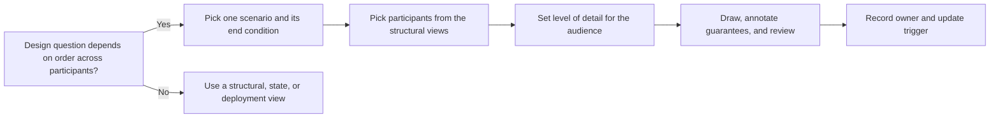

The flow shows that drawing is the fourth step, not the first. Teams that start with the tool produce a long, accurate-looking trace of calls that answers no question; teams that start with the question produce a short diagram that a reviewer can argue with. It also shows that the artifact is not finished when it renders: an owner and an update trigger are part of the work, a point developed under review and maintenance later in this chapter.

## 4. Anatomy of a Sequence Diagram

### 4.1 Participants and lifelines

A participant is anything that can send or receive a message in the scenario: a person or role (an actor), a service, a database, a message broker, an external system. Each participant is drawn as a box at the top with a vertical dashed line, its lifeline, running down. Time flows downward; the horizontal distance between lifelines carries no meaning. A lifeline says "this participant exists for the duration of the scenario", not "this participant is running". In Mermaid, `actor` draws a person symbol, `participant` a box, and `participant X as Label` separates a short identifier from a display name.

Participants should map to something a reader can find elsewhere: a container or component in the [C4 Model](CH01_C4_Model.md) views, a named external party, or a named role. A lifeline called "Backend" that stands for six services makes every arrow ambiguous, because the reader cannot tell which team owns the behaviour. Conversely, drawing every internal class turns an architecture view into a code walk-through.

### 4.2 Messages and return messages

A message is an arrow from sender to receiver, labelled with what is being asked or told. Three arrow styles carry most of the meaning:

| Mermaid syntax | Rendering | Meaning in this chapter |
| --- | --- | --- |
| `A->>B: text` | Solid line, filled head | Synchronous call: the sender waits for a reply |
| `B-->>A: text` | Dashed line, filled head | Reply to a synchronous call |
| `A-)B: text` | Solid line, open head | Asynchronous send: the sender continues without waiting |

The open-headed asynchronous arrow follows UML convention, but not every renderer or renderer version supports it, so confirm that your tooling draws it before adopting it; if it does not, adopt a local convention (for example, a note or a distinct label) and state it in the diagram legend. The key point is that the convention must be explicit and used consistently, because the reader will infer blocking behaviour from the arrow style.

Label a message with the intent or contract operation ("Reserve stock", "Authorize payment"), not with the method name ("StockServiceImpl.reserveInternal"). The label should still be true after a refactoring that does not change the contract. A reply should state what the caller learns that affects the next step, such as the outcome class or identifier, rather than a generic "OK".

### 4.3 Activation and self-messages

An activation bar, a narrow rectangle on a lifeline, shows the interval during which a participant is executing on behalf of a call. Its value is showing nested waiting: when the Order service's bar is still open while it waits for the payment provider, the reader sees at once that the order service is occupied, and a thread, connection, or transaction may be held. Mermaid supports explicit `activate` and `deactivate` lines and a shorthand where `+` after the arrow activates the receiver and `-` on the reply deactivates it. A self-message (an arrow from a participant to itself) represents internal work worth naming, such as validation, and should be used sparingly: if the internal step is not a decision the reader needs, omit it.

### 4.4 Notes and numbering

Notes attach text to a participant or span several (`Note over A,B: text`). Use them for facts the arrows cannot carry: a deadline, an idempotency key, a consistency window, an assumption such as "the broker persists before acknowledging". `autonumber` numbers messages, which helps when a review comment or a test case must refer to one step. A numbered diagram that is later edited renumbers silently, so refer to steps by their label in durable documents where possible.

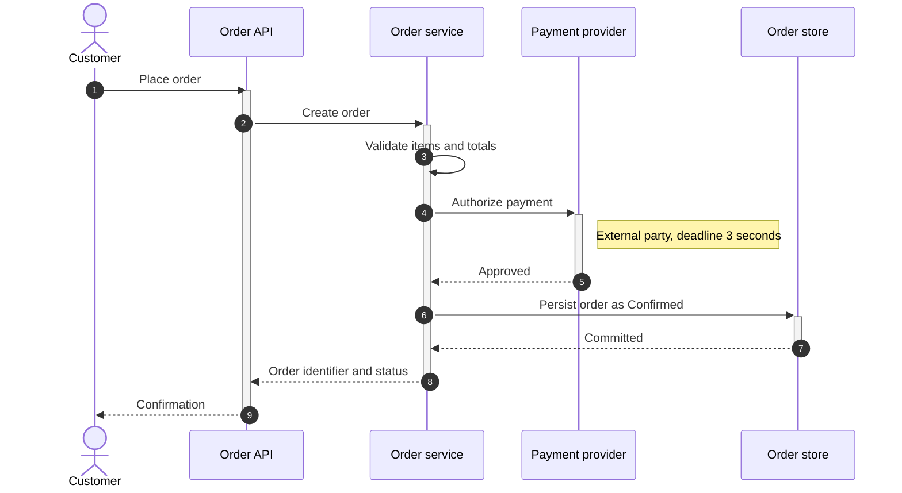

This illustrative diagram answers one question: what does a customer wait for when placing an order? Reading the activation bars, the API and the Order service are occupied through the external authorization and the database commit, so the customer-visible latency is the sum of validation, the provider call, and the commit. Two design consequences follow directly from the drawing. The provider call sits inside the customer's wait, so its deadline must be set against the overall budget and its failure must be shown, which is the subject of the later treatment of timeouts and failure paths. And the order is persisted only after authorization, so a crash between those arrows leaves an authorization with no order; whether that is acceptable depends on a reconciliation step the diagram does not yet show. A diagram that exposes a gap you must then answer is doing its job.

### 4.5 What the notation does not say

An arrow does not state transport (the same arrow can be a Hypertext Transfer Protocol (HTTP) request, a remote procedure call, or an in-process call), serialization, authentication, or delivery guarantee. Message order on a single lifeline is meaningful; order across two independent lifelines is meaningful only where a message connects them, because the notation does not claim a global clock. These omissions are deliberate: they keep the diagram small, but they mean that any property that matters to correctness must be added as a note or as a labelled message, not assumed from the arrow.

## 5. Choosing Scope and Level of Detail

### 5.1 One scenario, one question, explicit boundaries

The most common failure of a sequence diagram is not wrong notation but undefined scope. Before drawing, write down three things: the trigger (the first message, usually from an actor or a timer), the end condition (the point at which the scenario is considered complete, for the reader), and the question the diagram exists to answer. "Customer places an order, ending when the customer sees a confirmation, to review the latency budget" is a scope. "Ordering" is a topic. A topic produces a diagram that grows every time someone remembers another case; a scope produces a diagram that is finished.

Branches are allowed when they change architecture or correctness: a timeout path, a denial, a duplicate. If two branches diverge so much that they share only the first few arrows, they are two scenarios and deserve two diagrams that cross-reference each other. A useful rule is that a reader should be able to state the diagram's purpose in one sentence without using "and".

### 5.2 Choosing participants

Choose participants at the grain at which ownership and failure differ. Merge participants that always succeed or fail together and are owned together; separate those that have independent deployment, ownership, latency, or failure modes. Use the structural views as the source of names, so the diagram and the [C4 Model](CH01_C4_Model.md) views agree. Show an external party as its own lifeline with a note on ownership, because the contract with that party is usually the least controllable assumption.

A practical ceiling is five to seven lifelines. Beyond that the diagram becomes wide enough that readers lose the path of a message; when you need more, either split the scenario at a natural handoff or collapse a group of internal participants into one named boundary.

### 5.3 Choosing the level of detail

The same scenario can be drawn at several levels, and the right one depends on the audience and the decision. The table gives three illustrative levels for one hypothetical scenario, a customer requesting an expedited-delivery quote.

| Level | Participants | Typical audience | Typical question |
| --- | --- | --- | --- |
| System | Customer, our platform, carrier (external) | Product and partner owners | Which party does what, and is the carrier on the critical path? |
| Container | Customer, web client, quote service, rate cache, carrier gateway, carrier | Architects and reviewers | Where is the blocking chain and what happens on carrier failure? |
| Component | Quote service internals: validation, pricing, cache client | The owning team | How is the cache consulted and when is it bypassed? |

Draw the lowest level that answers the question, and no lower. Detail below the level of the question is noise that costs maintenance without benefit. The diagram below draws the container level for the quote scenario.

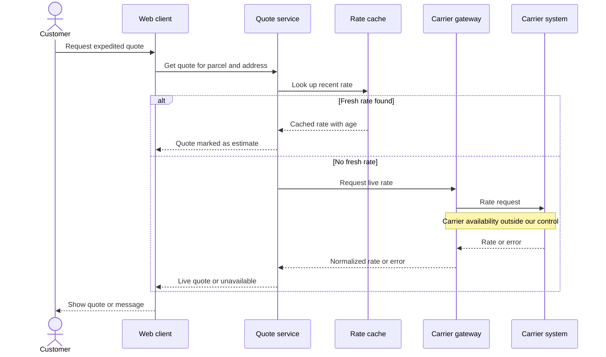

Read this as a design statement. The cache turns an external dependency from always on the critical path into sometimes on it, and the note flags the dependency the team cannot control. The branch labels ("Quote marked as estimate") expose a product decision that could otherwise be made accidentally in code: whether a stale price may be shown at all, and how it is labelled. The diagram does not state the cache lifetime, the carrier timeout, or the retry policy; if those are what a reviewer must decide, they belong in the later treatment of timeouts and retries and, once chosen, in the diagram as annotations.

### 5.4 Leaving things out deliberately

Omit what the reader cannot act on: logging calls, metrics emission, authentication handshakes that are identical in every scenario, and internal helper calls. State the omission once ("Authentication omitted; see platform security view") rather than drawing it repeatedly. The risk of omission is hiding a real dependency, so omit categories of steps, not individual steps that change behaviour; if the identity provider call is on the critical path of this scenario, draw it.

### 5.5 What a sequence diagram is not for

Several uses reliably produce poor diagrams:

- Documenting every path through a complex workflow. A long-running, multi-step business process with many branches is better represented by a state machine or a process model, with sequence diagrams for selected hand-offs.
- Specifying internal algorithms or class collaboration in detail. Code and tests are the better record, and they cannot drift away from the implementation.
- Proving correctness or performance. A diagram records intent; only tests, load experiments, and runtime traces show behaviour.
- Replacing an interface contract. The diagram shows an exchange; the schema, error codes, and versioning rules belong in the contract.
- Capturing a one-off debugging session. A trace of one execution is evidence about that execution, not a design.

## 6. Synchronous and Asynchronous Interactions

### 6.1 Why the distinction is the central one

Almost every architectural consequence of an interaction follows from one fact: does the sender wait? In a synchronous call the sender's execution, and usually a thread, connection, or transaction, is occupied until a reply or a timeout. Latency and availability compose: the caller is only as available as the slowest necessary callee, and a slow callee consumes the caller's capacity. In an asynchronous send the sender continues once the message is handed off, so the caller is decoupled in time from the receiver's speed and availability, but it now owns new questions: has the message been durably accepted, who processes it, what happens if processing fails, and how does anyone learn the result.

Synchronous interaction is chosen when the caller cannot proceed without the answer, when the operation is short and bounded, and when simplicity of reasoning outweighs coupling. Asynchronous interaction is chosen when the work is slow or bursty, when the receiver should be able to fall behind or fail without failing the sender, or when several independent receivers react to one fact. The cost of the asynchronous choice is that the diagram must show more, not less, because completion is no longer implied by the arrow.

### 6.2 Three things that are not the same

A frequent documentation error is to draw a single arrow for what are three distinct events. Keep them separate:

1. Handoff acknowledgment: the broker or queue confirms it has accepted the message, possibly durably. This tells the sender its responsibility for delivery has transferred, under whatever guarantee the broker provides.
2. Delivery and processing: a consumer receives the message and performs the work. It may happen once, repeatedly, late, or not at all, depending on delivery semantics and failure.
3. Business completion: the outcome the user or another system cares about is true and visible, for example "the shipment is booked".

Showing only the first and implying the third is the most damaging shortcut, because a reader will conclude the work is done when it has merely been queued. The delivery guarantees themselves (at-most-once, at-least-once, exactly-once effects) are owned by [Exactly-Once Processing](../07_System_Design_and_Distributed_Systems/CH17_Exactly_Once_Processing.md) and [Idempotency](../07_System_Design_and_Distributed_Systems/CH16_Idempotency.md); the diagram's job is to state which guarantee the design relies on, in a note, so the reader knows what to challenge.

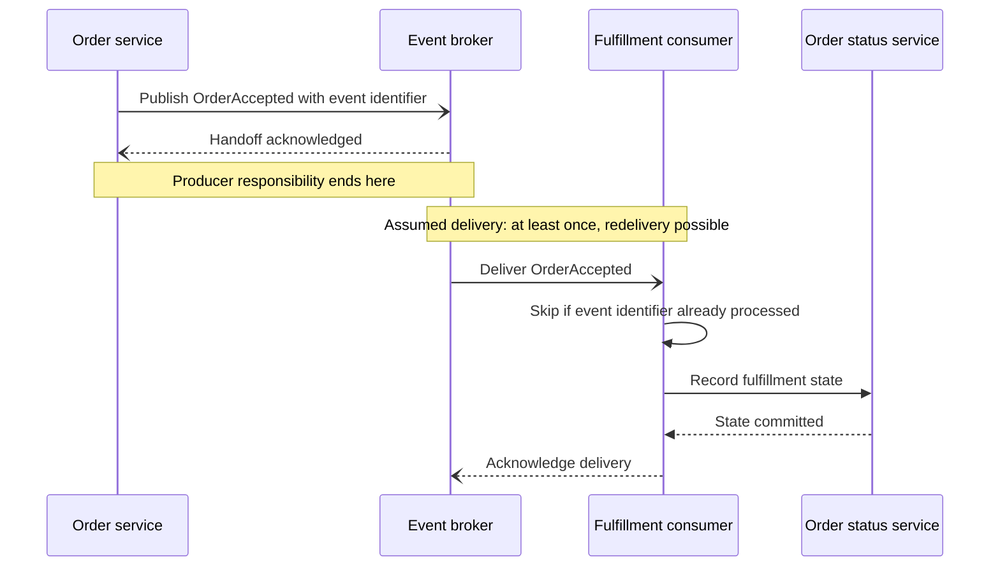

The diagram separates the three events in position as well as in label: the producer's part ends at the handoff acknowledgment, and everything below the second note is the consumer's responsibility and failure to own. The deduplication step makes the redelivery assumption visible, which turns "we use a broker" into a testable claim: a reviewer can ask whether the identifier store is updated in the same transaction as the status write, and what happens if the consumer fails between the two. Note the arrow styles: asynchronous arrows are used between participants that do not wait, while the commit to the status service is a synchronous call from the consumer. If your renderer does not support the open-headed arrow, keep the three-event separation and mark the style in a legend.

### 6.3 Getting the result back

Asynchronous work still has to tell someone when it finishes, and the diagram should show how. The common designs are: the caller polls a status resource, the system pushes a callback or notification, or the user learns through a separate channel such as an email. Each has different consequences for the interface contract, a topic owned by [Async APIs](../08_API_Architecture/CH06_Async_APIs.md); the diagram's role is to make the choice visible and to show what the caller holds meanwhile, typically an identifier for the pending work.

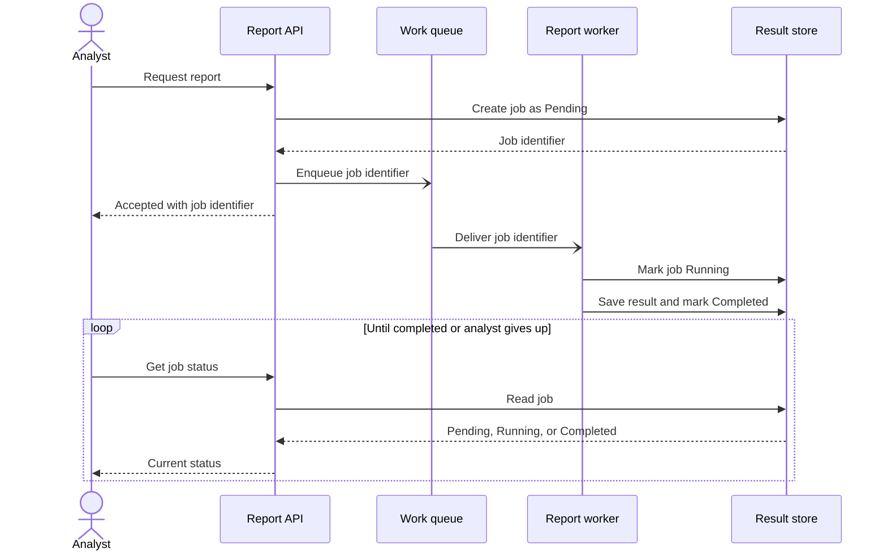

This hypothetical diagram records the decisions an interface reviewer needs. The job record is written before the message is enqueued, so a lost message leaves a visible pending job rather than an invisible loss; the response to the analyst is "accepted", not "done", so the client contract must carry a status concept; and polling places a read load on the API and the store proportional to waiting users, which a push design would avoid at the price of a delivery channel to manage. The diagram also reveals a subtle risk: if the enqueue fails after the job is created, the job is stuck as pending. Whether a sweeper process, a transactional outbox, or a retry covers that is a design decision that the diagram should either answer or flag as open, rather than leave the reader to assume.

### 6.4 Worked scenario: refund request

Consider a hypothetical refund workflow. A support agent submits a refund; the refund service must validate the original charge, ask an external payment provider to reverse it, and notify the customer. The team first draws the whole path as synchronous calls and notices from the activation bars that the agent's screen waits on the provider, whose latency the team does not control. They redraw it with a synchronous validation and job creation, an asynchronous provider call performed by a worker, and a notification published as an event. The redrawn diagram shows three changes of responsibility: the agent sees "refund requested" rather than "refund done"; the worker, not the agent's request, owns provider retries; and the notification is sent only after the provider outcome is recorded.

The redesign has a cost that the diagram makes visible: there is now an intermediate state ("requested but not yet reversed") that support staff and customers can observe, and a refund can be requested twice by an impatient agent. The team therefore annotates the first arrow with an idempotency key and pairs the diagram with a state model of refund status, a pairing treated later in this chapter. The decision to go asynchronous was not free; it traded a blocking dependency for a state to manage, and the diagram is what let the team see both sides of that trade.

### 6.5 Common mistakes with asynchronous arrows

- Drawing a response arrow from a consumer back to a producer that never waits, implying a synchronous result.
- Omitting redelivery, so that an at-least-once consumer appears to run each message once.
- Showing a "success" label on the handoff acknowledgment, which suggests business completion.
- Hiding the correlation or event identifier when it is what makes deduplication or tracing possible.
- Leaving out who owns a failed message, so that dead-letter handling appears to belong to nobody.

## 7. Alternatives, Timeouts, and Retries

### 7.1 Combined fragments and what each one commits you to

A combined fragment is a labelled box around part of a diagram that changes how the enclosed messages are read. Fragments are the notation's way of saying "not always, not once, not in sequence", and each one carries a commitment that the author must be able to defend. The table lists the five that matter for architecture, using the Mermaid keywords.

| Fragment | Meaning | Commitment the author makes | Typical misuse |
| --- | --- | --- | --- |
| `alt` / `else` | Exactly one branch runs | The branches are exhaustive for the question being asked | Drawing success and one failure while a third outcome exists |
| `opt` | The enclosed messages run only if a condition holds | The condition is stated and checkable | Hiding a mandatory step inside "optional" |
| `loop` | The enclosed messages repeat | A bound or exit condition is stated | An unbounded loop that reads as harmless |
| `par` / `and` | Branches proceed independently | The reader is told what the caller waits for | Implying all branches complete when only the first is needed |
| `break` | The scenario ends or leaves the enclosing fragment | The terminal outcome is shown | Using it as a comment instead of a real exit |

Use a fragment only when the branch changes architecture or correctness: a different participant is involved, a different state is written, or the user sees a different result. Branches that differ only in a message text do not need a fragment; a note is enough. Local convention for this chapter: an open-headed arrow (`-)`) means an asynchronous send, and `--)` an asynchronous acknowledgment. Where a renderer version does not draw these arrows, substitute `->>` and prefix the label with "async:" so the meaning survives.

### 7.2 A timeout is an outcome, not a verdict

When a caller stops waiting, it knows only that no answer arrived within its deadline. The remote operation may have not started, may still be running, or may have completed with the reply lost. Diagrams that draw the timeout branch as "operation failed" encode a false belief, and the code written from them tends to repeat the side effect. The branch must instead show the unknown state and the action taken to resolve it. The following hypothetical scenario, a subscription renewal charge, shows a bounded retry, an unknown outcome, and reconciliation.

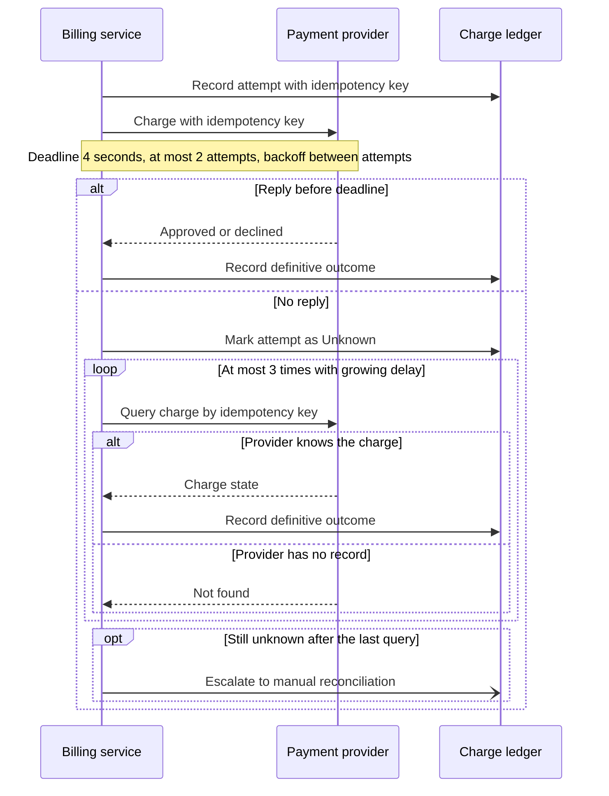

The diagram makes five commitments a reviewer can test. The attempt is written to the ledger before the provider is called, so a crash leaves evidence rather than silence. The same idempotency key accompanies every attempt and every query, which is what makes a second attempt safe to send only if the provider honours the key; that property belongs to the provider's contract and is the reader's first question. "Not found" is shown as distinct from "declined", because the former does not license a new charge unless the design explicitly allows a fresh key. The loop has a bound, and the end of the bound is a named human path, not silence. And the unknown state is a value in the ledger, so downstream steps (access, invoices, notifications) must say what they do while it persists. The idempotency semantics are owned by [Idempotency](../07_System_Design_and_Distributed_Systems/CH16_Idempotency.md); the diagram states where they must hold.

### 7.3 Deadlines, retries, and budgets

Retries multiply load and latency, so the numbers that govern them belong on the diagram when they change the outcome. A deadline is shown on a note next to the call it governs; a retry count and backoff style are shown on the loop label. Two checks catch most errors:

1. Budget arithmetic. The sum of worst-case attempt durations plus delays on the inner call must fit inside the deadline of the caller above it. If the caller waits 5 seconds and the inner call may take 4 seconds twice, the outer caller will give up while the inner one is still retrying, and work continues unobserved.
2. Retry layering. If each of three layers retries twice, a single user action can generate up to eight downstream attempts (two attempts per layer, multiplied across three layers). The diagram should show which one layer owns retries; the others should fail fast.

These are illustrative numbers chosen to show the arithmetic, not recommendations for any real system.

### 7.4 Parallel interaction and what the caller waits for

A `par` fragment shows independent branches, but the notation does not say when the caller continues. State it. In a hypothetical eligibility check, the caller queries a credit service and a fraud service at once.

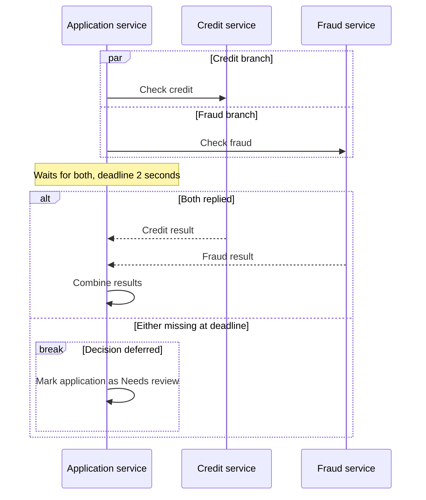

Waiting for both makes latency the maximum of the two and availability the product of the two; waiting for the first success makes sense only when branches are interchangeable replicas, not independent checks. Waiting for a quorum is another valid choice, but the number required must appear on the diagram. The `break` shows that a missing result does not default to approval: a defect-prone shortcut that a diagram without this branch would leave to individual developers.

## 8. Making Failure Paths First-Class

### 8.1 Draw the failure that motivates the view

A diagram that shows only success documents the case that needs the least design. The paths that need design are the ones where a dependency is unavailable, an authorization is denied, data is stale, or a side effect is uncertain. Choose the failure that motivated the diagram and draw it with the same care as the main path. For each failure shown, answer four questions: who detects it, how is it contained so that it does not spread, what fallback applies, and what does the user or caller finally see. If any of the four is "nobody decides", the diagram has found a design gap.

Do not try to draw every failure in one diagram. A diagram with six nested `alt` blocks cannot be read, and the reader will skim past the one branch that matters. Draw the main path with the one or two branches that change the architecture, and link a separate diagram for a failure whose handling diverges materially, in the same way that [Section 5.1](#51-one-scenario-one-question-explicit-boundaries) treats diverging scenarios.

### 8.2 A hypothetical degraded-mode scenario

A recommendation feature calls a ranking model that is slow or unreliable at times. The following hypothetical design shows a deadline, output validation, and an explicit degraded result.

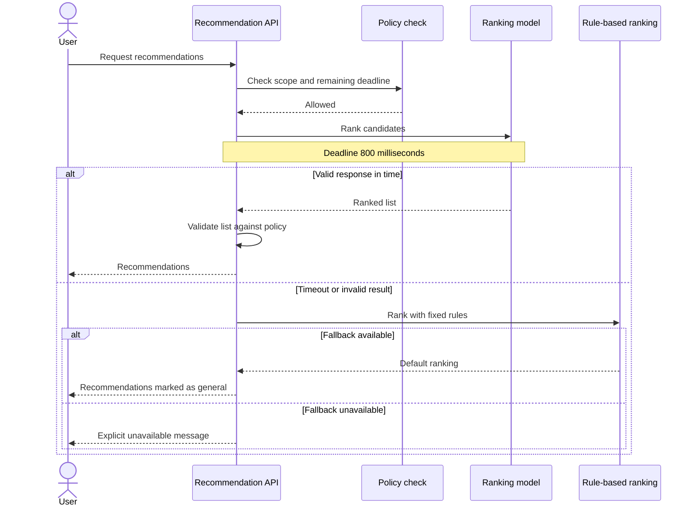

Three points deserve attention. The degraded result is labelled to the user ("marked as general"), because a silent downgrade is a product decision made by accident. The inner `alt` states that the fallback can itself fail, and the terminal outcome is an explicit message, not a hang. And the timed-out model call may still be running: the diagram does not claim it was cancelled, so a reviewer should ask whether the model call is idempotent and whether late results are discarded. If the design has no safe fallback, the correct drawing is not an invented one; it is a branch that fails or defers the request, and the absence of a fallback is a finding to record, perhaps in an [Architecture Decision Record](CH03_ADR_Architecture_Decision_Record.md).

### 8.3 Failure branches as test cases

Every failure branch is a candidate test case, and the connection should be explicit. A reviewer can walk the diagram and list one test per branch: the timeout path, the invalid-output path, the fallback-also-fails path. A branch with no test is either unreachable or untested, and both deserve a question. The diagram does not prove the test exists; the link from branch label to test name, kept in the diagram's source or its companion document, is what makes the claim checkable.

## 9. Pairing Interaction With a State Invariant

### 9.1 Why a sequence diagram cannot carry the invariant alone

A sequence diagram shows when messages occur in one scenario. A correctness rule such as "at most one authorization per order" or "cancellation is allowed only before shipment" is a statement about every scenario, including ones nobody drew. A state model, whose general notation is covered in [UML](CH02_UML.md), enumerates legal states and the transitions between them, so it can state the rule once and let every sequence be checked against it. Pair the two when correctness depends on an invariant, when a message can arrive in more than one state, or when duplicates and late messages are plausible. Do not pair them for a simple request and reply with no persistent state; the second diagram would only repeat the first.

### 9.2 A shared vocabulary

The pairing works only if names match. A message in the sequence ("Cancel subscription") must correspond to an event in the state model, and each state written by a participant must appear as a state. Keep the sequence diagram free of the full lifecycle, and keep the state model free of participants and timing. The hypothetical subscription lifecycle below is the state model that the cancellation scenario in [Section 11](#11-worked-scenario-subscription-cancellation) must respect.

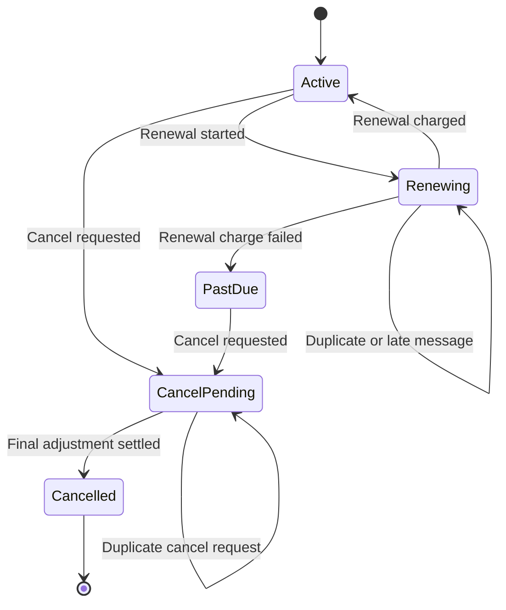

This drawing exposes questions the happy-path sequence hides. There is no transition from `Renewing` to `CancelPending`, so a cancel request that arrives during renewal has no legal destination. The designer must choose: reject it, queue it until renewal ends, or add a transition and define the charge consequence. The self-transition on `CancelPending` states that a duplicate is absorbed rather than repeated, which is the invariant the idempotency annotation in the sequence must realise. A sequence diagram that shows the cancel message arriving while the state is `Renewing`, with no branch for that case, contradicts this model; the review check is to walk each message in the sequence and confirm a legal transition from every state in which it may arrive.

### 9.3 Review procedure for the pair

1. List every message in the sequence that changes state, and name the transition it triggers.
2. For each, list the states from which it can arrive, including states reached by concurrent scenarios.
3. Confirm that each combination has a legal transition, or a rejection or deduplication branch drawn in the sequence.
4. Confirm that no state is written by a participant that is not its owner.
5. Record any resolved conflict as a decision, so the next reader does not reopen it.

## 10. Keeping Diagrams Current

### 10.1 Why diagrams decay

A sequence diagram decays for the same reason any copy of a fact decays: the fact lives in code and configuration, and the copy lives elsewhere. Retry counts change in a configuration file, a team inserts a cache, a synchronous call becomes a queue, and the diagram still renders perfectly while describing a system that no longer exists. A stale diagram is worse than none because readers trust it. The defence is to make drift visible and cheap to correct, not to promise discipline.

### 10.2 Diagram as code

Store the diagram source as plain text next to the design it supports, in the same repository as the service or the architecture documents. Text sources have four benefits: changes appear in a reviewable difference, history shows who changed the interaction and when, the diagram can be rendered automatically, and a pull request that changes behaviour can be asked to change the diagram. Tools differ in the notation subset they render, so pin the renderer used by the repository and record its version, and confirm that the arrow styles and fragments you rely on are drawn.

Do not generate diagrams automatically from implementation call traces and publish them as the design. Generated output shows incidental call stacks, not the contract. Traces from a running system are valuable as evidence to compare against the intended diagram (see [Tracing](../14_Observability/CH03_Tracing.md)), but the intended diagram remains a curated artifact.

### 10.3 Ownership, triggers, and review checks

Each diagram records an owner (a team, not a person), the scenario it covers, the date of last review, and the update triggers. Useful triggers are: a change of participant ownership, a protocol or contract change, a change in retry, deadline, or delivery guarantee, and a new failure mode found in an incident review. The following flow shows a lightweight practice; it is a suggestion, not a standard.

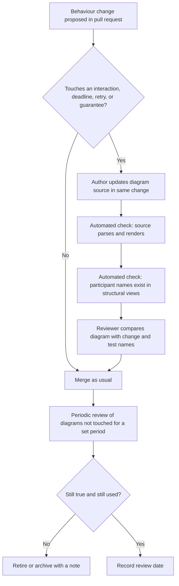

The first two automated checks are cheap and catch broken syntax and misspelt participants; they cannot judge truth. The human check, comparing the drawn deadline with the configured value and the drawn branches with the test names, is the only one that does, so it should be a named item on the pull-request template. The periodic review exists because some drift occurs without a diagram-touching change. Retiring a diagram is a legitimate outcome: a smaller, accurate set beats a large, partially false one. Participant names are validated against the views described in the [C4 Model](CH01_C4_Model.md) chapter, and the review itself is an instance of the practice in [Architecture Reviews](CH11_Architecture_Reviews.md).

| Review concern | Check |
| --- | --- |
| Scope | Are the trigger, end condition, and question explicit? |
| Ownership | Does each lifeline map to a real system or role, and does the diagram have an owning team? |
| Semantics | Are synchronous calls, asynchronous sends, acknowledgments, and business completion distinct? |
| Failure | Are timeout, denial, duplicate, and unknown outcomes shown where relevant? |
| Numbers | Do drawn deadlines, retry counts, and quorums match configuration? |
| Maintenance | Is the update trigger recorded and the last review date current? |

## 11. Worked Scenario: Subscription Cancellation

### 11.1 Scope

This hypothetical scenario combines the earlier ideas into one diagram. Scope: a subscriber cancels, ending when the subscriber sees a stable "cancellation pending" or "cancelled" status, to review duplicate handling and the interaction with renewal. It differs from the refund in [Section 6.4](#64-worked-scenario-refund-request), which was about moving a blocking provider call off the agent's screen, and from the renewal charge in [Section 7.2](#72-a-timeout-is-an-outcome-not-a-verdict), which was about an unknown payment outcome. Here the new difficulty is concurrency with another scenario, renewal, on the same subscription.

The participants are the client, the API, the subscription service (owner of lifecycle state), the billing service (owner of the final adjustment), and a notification consumer reached through an event broker. The state model in [Section 9.2](#92-a-shared-vocabulary) governs. The design decision, which would be recorded in an ADR, is that a cancel request received during renewal is accepted and held until renewal finishes, not rejected and not applied mid-charge.

### 11.2 The diagram

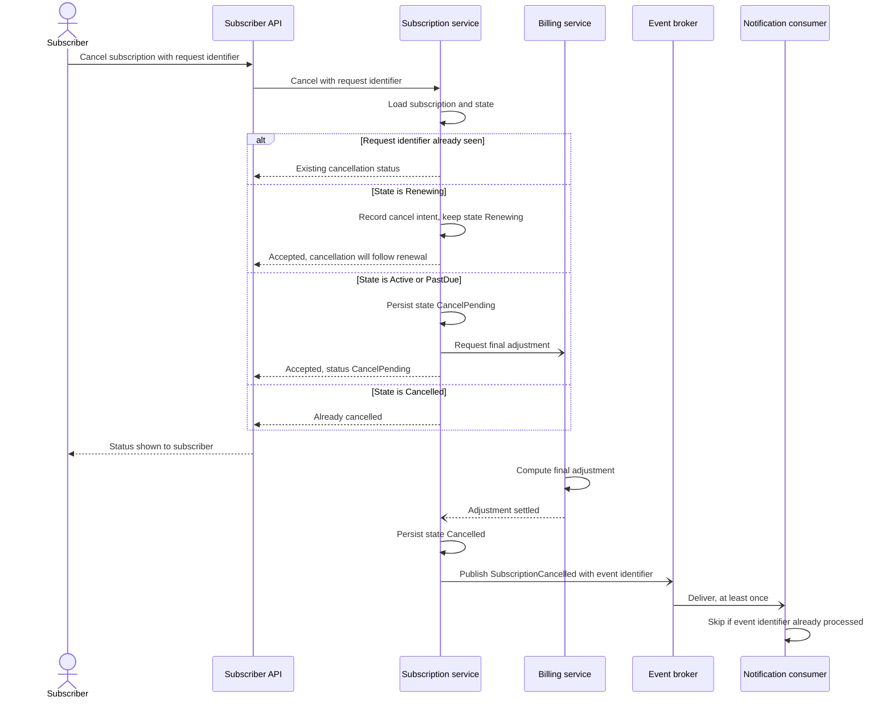

### 11.3 Reading the diagram

Four decisions are now visible and reviewable. First, the request identifier from the client is checked before anything else, so the duplicate-submission case is absorbed and returns the stored status, matching the self-transition in the state model. Second, the Renewing branch resolves the gap found in Section 9: the intent is recorded, the state is unchanged, and the response says the cancellation will follow, so the subscriber is not misled into thinking billing has already been adjusted. Third, the response to the subscriber is produced after the durable write of the pending state but before billing completes, which is the acknowledgment-versus-completion separation from [Section 6.2](#62-three-things-that-are-not-the-same). Fourth, the notification is driven by the published event, so its delivery is a consumer concern with its own deduplication, not part of the cancellation's success.

What the diagram does not yet show is the failure of the final adjustment: billing may time out, decline to compute, or never reply. That is a separate failure diagram, in the style of [Section 8](#8-making-failure-paths-first-class), linked from this one, because it diverges after the Bill lifeline. The unresolved question to list beside the diagram is what happens to the held cancel intent if the renewal charge itself fails and the state becomes `PastDue`; the state model allows cancelling from that state, so the intent should convert, but the design must say so.

### 11.4 Links that keep it true

The sequence is linked to the service contract, to the state model, and to named test scenarios: duplicate request, request during renewal, request in `Cancelled`, and settled adjustment with redelivered event. When the billing provider or the renewal job changes, those links tell the team which views to update together.

## 12. Failure Scenarios and Common Mistakes

### 12.1 Catalogue

The first group of rows describes failures of the documented system that a sequence diagram should have revealed; the second group describes failures of the diagrams themselves. All entries are general patterns, not reports of particular incidents.

| Failure | Symptom | Detection | Mitigation |
| --- | --- | --- | --- |
| Timeout treated as failure | Duplicate charges or side effects after a slow reply | Compare drawn timeout branch with code; trace shows two attempts with one user action | Draw the unknown state, add idempotency key, add a query or reconciliation step |
| Acknowledgment read as completion | Users or callers told "done" while work is queued | Review asks which arrow means business completion | Separate handoff, processing, and completion; expose a status |
| Missing redelivery | Duplicate processing under at-least-once delivery | Walk each consumer: what if this message arrives twice? | Note the delivery assumption; add deduplication step |
| Blocking chain hidden | Latency spikes or caller exhaustion when one dependency slows | Activation bars show nested waiting; load test confirms | Add deadline, bulkhead, or move work off the critical path |
| Retry amplification | Dependency overloaded further during an outage | Count attempts across layers on the diagram | One retry owner, bounded attempts, backoff |
| Message arrives in unexpected state | Rejected or corrupt transition, such as cancel during renewal | Pair sequence with a state model and walk every state | Define reject, queue, or transition explicitly |
| Orphaned intermediate state | Records stuck as pending after a lost handoff | Look for a write followed by a send with no recovery | Sweeper, outbox, or retry, shown on the diagram |
| Diagram drift | Diagram contradicts configuration or code | Review step compares drawn numbers and branches; traces differ | Diagram as code, update triggers, periodic review |
| Scope creep | Diagram grows until nobody reads it | Cannot state the purpose in one sentence | Split into scenarios; link instead of nesting |
| Ownerless lifeline | No team can answer questions about an arrow | Lifeline does not map to a named container or role | Take participants from structural views; assign an owner |

### 12.2 Anti-patterns

- The call-stack dump: every method call drawn, none of the decisions. It documents the code, which already documents itself, and goes stale quickly.
- The happy-path poster: only success is drawn, and the failure cases are discovered in production. Mitigate with at least the one failure that motivates the view.
- The universal "Backend" lifeline: one box for many services, hiding which team owns each interaction.
- The magical broker: an arrow into a broker implies guaranteed once-only processing. State the assumed guarantee.
- The decorative diagram: drawn for an approval, never opened again. If nothing triggers an update, retire it.
- The unlabeled retry: a loop with no bound, no key, and no owner, drawn as if repetition were free.
- Notation purism: arguing about arrow heads while the question of who waits remains unanswered. Clarity for the actual readers outranks fidelity to the standard.

## 13. Trade-off Analysis and Decision Framework

### 13.1 Comparing ways to document an interaction

| Option | Strengths | Weaknesses | Best used when | Maintenance burden |
| --- | --- | --- | --- | --- |
| Sequence diagram | Shows order, waiting, and ownership across participants | One scenario only; can drift; weak on lifecycle rules | The decision depends on ordering across participants | Moderate; rises with detail |
| State diagram | States rules across all messages | Hides who sends what and when | Correctness depends on legal transitions | Low to moderate |
| Activity or flow chart | Shows control flow and decisions | Often hides participant ownership | A process spans roles and decisions | Moderate |
| Prose in a design document | Flexible, carries rationale | Hides ordering; ambiguous | Explaining motivation and trade-offs | Low, but easy to leave stale |
| Interface contract (schema, error codes) | Precise and testable for one boundary | Does not show composition | Defining one boundary for consumers | Low if generated or checked |
| Runtime traces | Evidence of real behaviour | Describes executions, not intent | Verifying or debugging a running system | Not authored, but needs sampling and access |
| Code and tests only | Cannot drift from implementation | Hard for non-authors to review across services | Interaction is local to one component | None extra |

The options are complements more than competitors. A mature design often combines a sequence diagram for the critical scenario, a state model for the invariant, a contract for each boundary, and traces for verification. The trade-off is the cost of keeping several artifacts consistent against the cost of leaving a class of question unanswerable.

Within the sequence diagram itself, three levers trade clarity against upkeep. More detail answers more questions but raises the number of triggers that make it stale. More branches show more failures but reduce readability; splitting into linked diagrams restores readability at the cost of cross-references. Drawing asynchronous steps explicitly prevents the acknowledgment-as-completion error at the cost of a longer diagram. The rule from [Section 5.3](#53-choosing-the-level-of-detail) stands: draw the lowest level that answers the question.

### 13.2 Decision flow

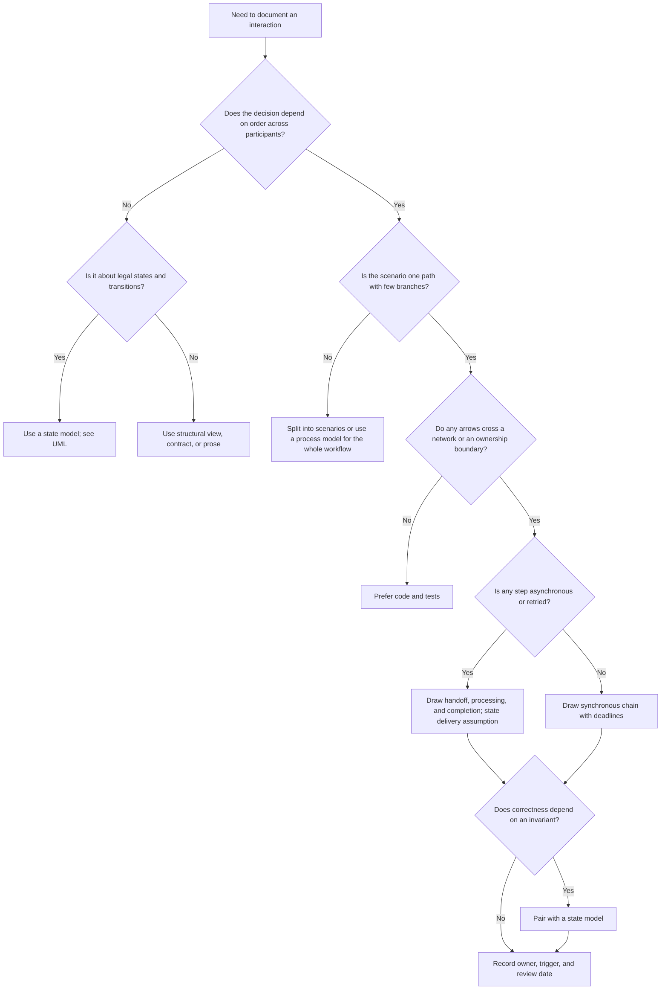

The flow encodes the chapter's priorities. The first gate prevents drawing when a different view fits; the fourth prevents spending diagram effort on in-process collaboration that tests record better; the asynchronous branch forces the three-event separation; and every path ends with an owner and update trigger. The flow is a heuristic, not a rule: a team with a regulated integration may draw even a simple synchronous exchange because an external party requires it.

## 14. Illustrative Composite Case Study and Architect Review Checklist

### 14.1 Case study (hypothetical)

This case is invented for teaching and does not describe any real organization. A team builds an appointment-booking service for a network of clinics. Its first design review draws the happy path: the patient selects a slot, the booking service reserves it, calls an external calendar system to write the appointment, and sends a text-message confirmation, all synchronously. The review applies the checks from this chapter, and each finding is traceable to a section.

- The activation bars show the patient's request open across the calendar write and the text-message send (Section 4.3). Latency and availability of both external systems are therefore on the patient's critical path.
- The text-message send is drawn as a reply to a synchronous call, so a delivery problem would fail the booking (Section 6.2). Confirmation is not part of booking success.
- There is no branch for a calendar timeout (Section 7.2). The reviewers ask what the service believes after the deadline, and learn that a retry would create a second appointment.
- A patient can double-tap submit, and a clinic receptionist can cancel the same slot at the same time (Section 9). Nobody has written down the legal transitions.

The revised design is shown below. The reservation and a pending booking are persisted first, the calendar write is performed by a worker with an idempotency key, and the text message is an event consumer.

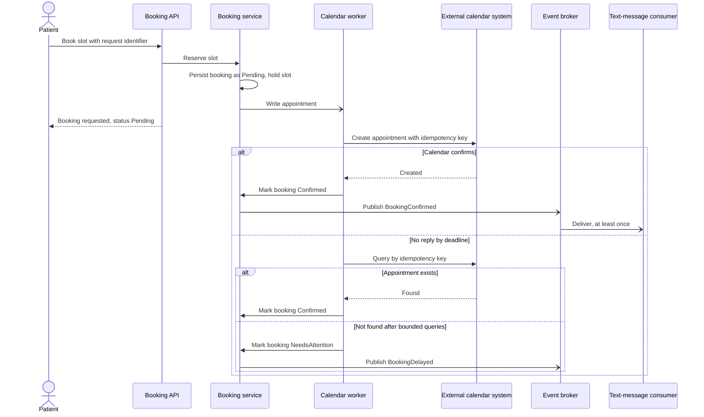

Implications. The patient waits only for the local reservation, which the team controls. The pending state is now visible to patients and receptionists, so the team must define what each sees and for how long a hold lasts; that is a new design obligation the diagram creates. The text message no longer affects booking success, but a failure to send must be owned by the consumer. The `NeedsAttention` outcome gives operations a defined trigger for a procedure, which belongs in a [Runbook](CH07_Runbooks.md). Notice also what the case does not claim: no figure is offered for improved latency or reliability, because the diagram records a design, and only measurement could show an effect.

### 14.2 Architect review checklist

Use the list when reviewing a sequence diagram, whether authored by your team or another.

- [ ] The trigger, end condition, and question are stated, and the purpose fits in one sentence.
- [ ] Each lifeline maps to a named container, external party, or role, and each has an owner.
- [ ] Arrow styles distinguish synchronous calls, asynchronous sends, and replies, and the legend states any local convention.
- [ ] Acknowledgment, processing, and business completion are shown separately for every asynchronous interaction.
- [ ] The delivery guarantee the design relies on is stated, and redelivery is handled or declared impossible.
- [ ] Every outbound call has a deadline, and the sum of nested deadlines fits the caller's budget.
- [ ] Retries have an owner, a bound, a backoff, and an idempotency key where side effects exist.
- [ ] The timeout branch shows an unknown outcome and how it is resolved, not simply "failed".
- [ ] At least the failure that motivates the view is drawn, with detection, containment, fallback, and user-visible result.
- [ ] A write followed by a send has a recovery path for the case where the send is lost.
- [ ] Messages that change state are checked against a state model, including duplicates and concurrent scenarios.
- [ ] Omitted categories (authentication, logging) are stated once.
- [ ] The source is in the repository, with an owner, update triggers, and a last review date.
- [ ] Branches map to named test cases, and drawn numbers match configuration.

## 15. Interview Questions

1. What does a sequence diagram assert, and what does it not?
   Model answer: It asserts the order of messages among chosen participants in one scenario. It does not assert transport, delivery guarantees, timing figures, or that the implementation matches; those need notes, contracts, tests, and traces.

2. Why separate acknowledgment from completion in an asynchronous flow?
   Model answer: An acknowledgment means the message was accepted for delivery; completion means the business outcome is true. Conflating them leads to telling users "done" when work is only queued, and to missing the failure ownership after the handoff.

3. How should a timeout be drawn?
   Model answer: As an unknown outcome, because the remote work may have completed, be running, or never have started. Show the recorded unknown state, a bounded query or reconciliation step keyed by an idempotency identifier, and a named human path when it stays unresolved.

4. When do you choose a synchronous interaction over an asynchronous one?
   Model answer: When the caller cannot proceed without the answer, the operation is short and bounded, and the coupling is acceptable. Choose asynchronous when work is slow or bursty or when the receiver should be able to fail or lag independently, accepting a visible intermediate state and a completion mechanism.

5. What do you check when retries appear on a diagram?
   Model answer: Who owns them, the bound, the backoff, whether the side effect is idempotent, and whether nested deadlines and layered retries multiply load or exceed the caller's budget.

6. When pair a sequence diagram with a state model?
   Model answer: When correctness depends on an invariant, when a message can arrive in several states, or when duplicates, late messages, or concurrent scenarios are plausible. Walk each state-changing message against the legal transitions.

7. How do you keep sequence diagrams from going stale?
   Model answer: Store text sources in the repository, require updates in the same change as behaviour changes, run render and name checks, compare drawn numbers and branches with configuration and tests in review, record owners and triggers, and retire diagrams that are no longer true.

8. How do you decide the level of detail?
   Model answer: Start from the question and audience, and draw the lowest level that answers it. Omit categories of steps that do not affect the decision, state the omission once, and split diverging branches into linked diagrams.

## 16. Hands-on Exercises

1. Rewrite a prose description. Take a paragraph from one of your own design documents describing a multi-service interaction. Draw it as a sequence diagram with a stated trigger, end condition, and question. List every decision the prose left unstated, such as who waits and what happens on failure.
2. Convert a blocking chain. Draw a synchronous three-service request in which the last service is external. Annotate deadlines, check the arithmetic against the outer caller's budget, then redraw the interaction with the external call performed asynchronously. List the new state the redesign introduces and who can observe it.
3. Draw the unknown outcome. For an operation with a side effect (charge, booking, or message send), draw the timeout branch with an idempotency key, a bounded query loop, and a terminal manual path. Write one test case name for each branch.
4. Pair with a state model. Choose a lifecycle with at least four states. Draw a state model and a sequence for one transition, then walk every state-changing message against the model and record each message-and-state combination that lacks a legal transition. Decide for each whether to reject, queue, or add a transition.

## 17. Design and Architecture Review Questions

1. A team presents a diagram in which the order service calls the payment provider, and the activation bar remains open throughout. What questions do you ask, and what changes might you propose?
   Outline: Ask for the deadline, what the service holds while waiting (thread, connection, transaction), and what the caller sees on timeout. Check that the deadline fits the outer budget. Propose drawing the unknown-outcome branch, an idempotency key, and perhaps moving the call off the critical path if a pending state is acceptable. Weigh the new state the change introduces.

2. A diagram shows a producer sending an event, with an arrow labelled "Order completed" directly after the broker handoff. How do you respond?
   Outline: The label equates handoff with completion. Request separate acknowledgment, consumer processing, and completion events, and a status the caller can read. Ask what delivery guarantee is assumed and whether the consumer deduplicates. Ask who owns messages that repeatedly fail.

3. During review, you find a cancel message that can reach a service while a renewal is in progress, and the diagram has no branch for it. What do you do?
   Outline: Pair the sequence with a state model and find the missing transition. Present the options: reject, hold until renewal ends, or add a transition with defined charge consequences. Choose with the product owner, record the decision, and update both views and the associated tests.

4. A team asks to generate all sequence diagrams automatically from traces so they never go stale. Is that a good idea?
   Outline: Traces are useful evidence but show incidental call stacks, not intent or omitted branches. Generating the published design from them loses the curated scenario and failure paths. Suggest curated diagrams as code, with traces used to check them periodically.

5. A diagram has fourteen participants and nine nested branches. How do you help the team?
   Outline: Ask for the question it answers; it probably answers several. Split by scenario, raise the level of detail where participants collapse into one container, link instead of nesting, and move lifecycle rules to a state model. Keep only branches that change architecture or correctness.

## 18. Summary

A sequence diagram documents one scenario in time order so that reviewers can challenge ordering, waiting, and failure assumptions that prose and structural views hide. Its value lies in scope: one trigger, one end condition, one question, and participants taken from the structural views, at the lowest level of detail that answers the question.

The central distinction is whether the sender waits. Synchronous calls compose latency and availability, so deadlines belong on the diagram. Asynchronous sends demand separate treatment of handoff acknowledgment, processing, and business completion, with the delivery guarantee stated. Combined fragments earn their place only when a branch changes architecture or correctness, and a timeout is drawn as an unknown outcome with idempotent reconciliation and a named human path.

Failure paths are drawn as carefully as success, and each branch maps to a test. When correctness depends on an invariant, the sequence is paired with a state model and every state-changing message is walked against it. Diagrams stay truthful through text sources in the repository, owners, update triggers, and review checks that compare drawn numbers and branches with configuration and tests. Using the catalogue of failures, the decision flow, and the checklist, a reader can now choose and defend what to draw, read a diagram critically, and retire one that is no longer true.
