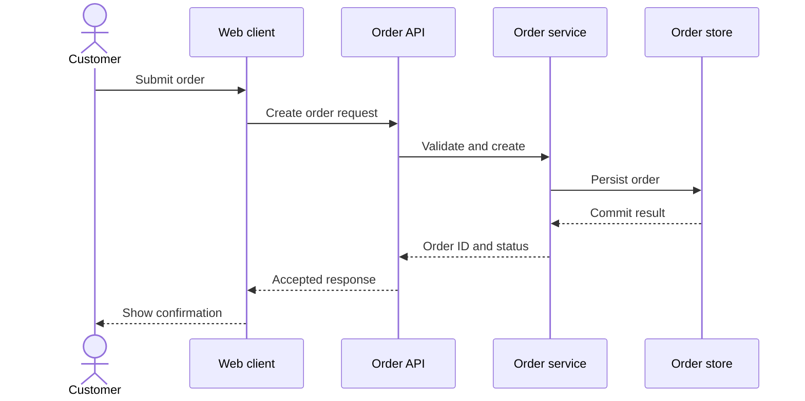
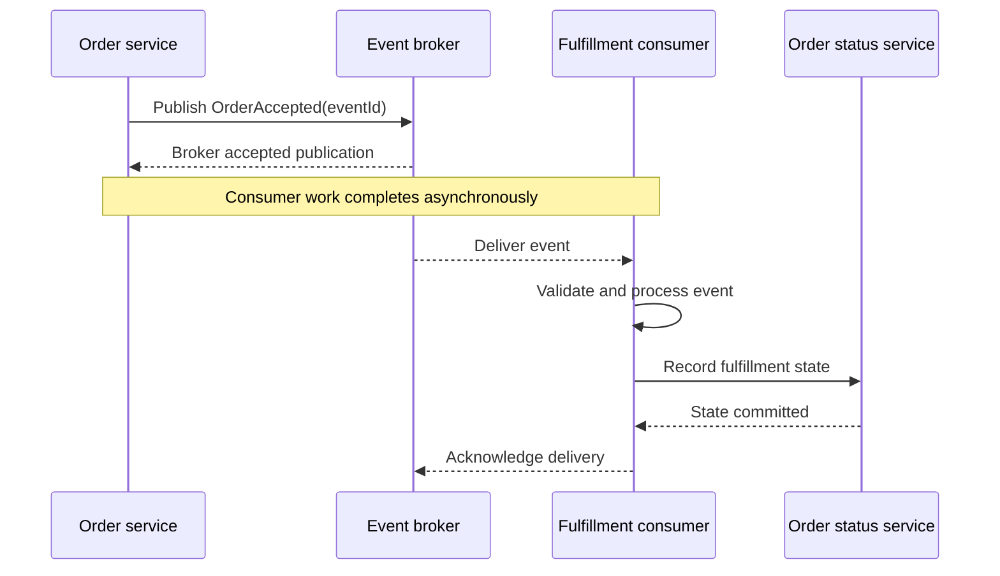
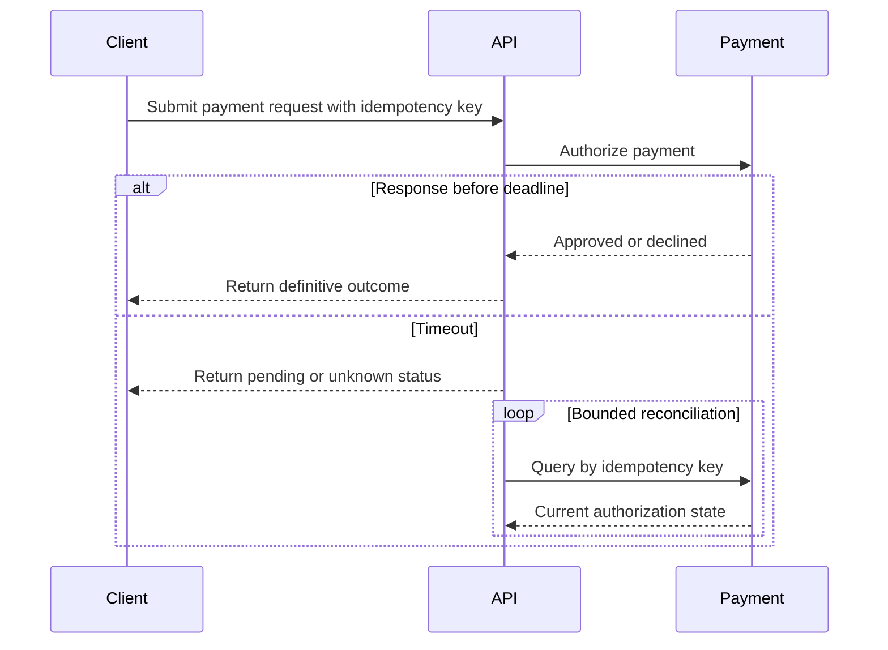
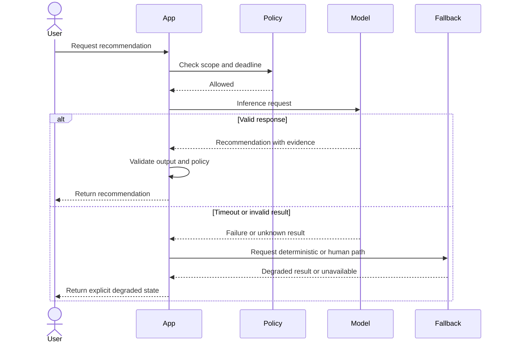
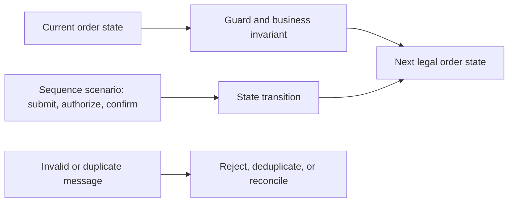

# Sequence Diagrams

Part: [21 — Architecture Documentation](PART_OVERVIEW.md)

A sequence diagram documents interactions in time order among a selected set of participants. It is useful for clarifying ownership, synchronous and asynchronous boundaries, failure handling, and timing assumptions. It is a scenario view, not a complete system model or proof that the implementation behaves as drawn. Part 21 CH02 introduces UML sequence notation; this chapter focuses on choosing and maintaining sequence-diagram artifacts.

## Define Lifelines and Message Meaning

Each lifeline represents a participant such as a user, service, broker, or external system. Messages should identify intent and direction. Synchronous calls imply a caller waits for a response; asynchronous messages allow the sender to continue, but do not imply durable delivery or exactly once execution. Activation bars can clarify execution ownership when nested calls are complex.

Select participants that answer the question. Too many lifelines make the diagram unreadable; too few hide a critical boundary. Name external systems and ownership clearly, and keep message labels at the domain or contract level instead of mirroring every method call.

## Show Asynchronous Interactions Explicitly

An asynchronous publish or queue send does not block for consumer completion. Distinguish publish acknowledgment from business completion, and show the separate consumer path when it matters to the scenario. Include correlation or event identifiers if they are essential to tracing or idempotency.

Show when the sender's responsibility ends and who owns consumer failure. Avoid an arrow that implies the producer knows the consumer completed unless an explicit response or workflow status exists.

## Document Alternatives, Timeouts, and Retries

Combined fragments such as `alt`, `opt`, `loop`, and `par` represent branches, optional work, repetition, and parallel interaction. Use them to show behavior that changes architecture or correctness. A timeout is an outcome, not proof that the remote operation failed; the response may be unknown and require reconciliation.

Annotate retry count, deadline, idempotency, and backoff when they change the outcome. Avoid showing retries as harmless repetition. For parallel fragments, identify whether the caller waits for all branches, the first success, or a quorum.

## Make Failure Paths First-Class

Show the failure that motivates the view: dependency unavailable, authorization denied, data stale, or side effect uncertain. Include detection, containment, fallback, and user-visible result at the level relevant to the decision. Do not overload one diagram with every possible failure; link scenario-specific views when paths diverge materially.

The diagram should match actual fallback semantics. Without a safe fallback, the system must fail or defer the request. A generic “retry” arrow can obscure that the original operation may still be running.

## Pair Interaction With a State Invariant

Sequence diagrams answer when messages occur; a state machine clarifies which states and transitions are legal. Pair them when correctness depends on a state invariant, such as one payment authorization per order or cancellation only before shipment. Keep names consistent and avoid repeating the entire flow in both models.

State and sequence views are complementary. The sequence can show participants and timing; the state view can enumerate legal transitions across all messages. A model review should check that the interaction never performs a transition forbidden by the state invariant.

## Maintain the Diagram With the System

Tie each sequence diagram to a scenario, owner, version, and source of truth. Update it when ownership, protocol, retry, or failure behavior changes. Keep diagrams near the relevant design or repository, and validate participant names against current architecture views. Avoid generating diagrams from implementation when they expose incidental call stacks rather than intended contracts.

| Review concern | Check |
|---|---|
| Scope | Is the scenario, start, and completion event explicit? |
| Ownership | Does each lifeline map to a real system or role? |
| Semantics | Are synchronous calls, asynchronous messages, acknowledgments, and side effects distinct? |
| Failure | Are timeout, denial, and unknown outcome represented where relevant? |
| Maintenance | Is an owner and update trigger recorded? |

## Worked Case: Account Cancellation

A customer cancels a subscription. The sequence shows the client, API, subscription service, billing provider, and notification service. The API returns a pending state while billing confirms the final charge adjustment. The subscription service persists a cancellation request with a stable identifier; duplicate client submissions return the existing state rather than repeating the adjustment.

The diagram includes authorization failure, provider timeout, and successful completion. A paired state model defines when cancellation is allowed and what happens after renewal processing starts. The team links both views to the service contract and test scenarios, so a change to the billing provider updates the sequence and reconciliation behavior together.

## Review Questions

1. Which participants belong in the scenario, and which details can be omitted?
2. How does a message arrow communicate synchronous versus asynchronous behavior?
3. What does a timeout leave unknown about a remote side effect?
4. When should a sequence diagram be paired with a state model?
5. Which changes trigger diagram maintenance?

Sequence diagrams communicate interaction contracts when messages, timing, and failure behavior are explicit. Scope them to one question, distinguish acknowledgment from completion, and keep them aligned with state invariants and system ownership.
