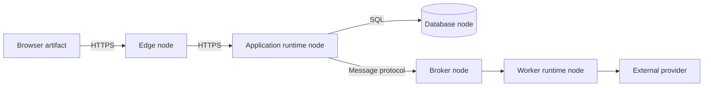
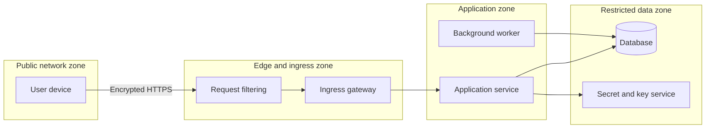
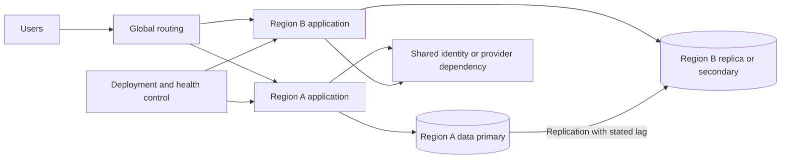
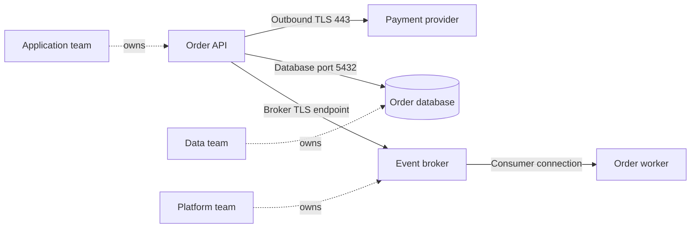
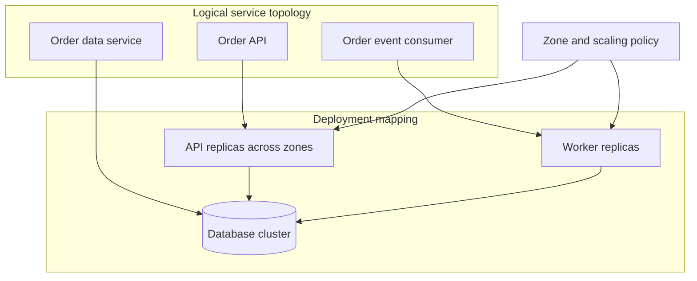

# Deployment Diagrams

Part: [21 — Architecture Documentation](PART_OVERVIEW.md)

A deployment diagram communicates where software artifacts execute, which nodes and environments host them, and how network boundaries connect them. It supports questions about capacity, trust, availability, rollout, and operational ownership. It should distinguish logical components from physical or virtual deployment nodes and state whether it describes current, target, or transitional placement.

Part 21 owns documentation notation; Part 09 owns cloud services, Part 12 owns Kubernetes mechanics, and Part 07 owns solution topology.

## Map Artifacts to Runtime Nodes

Show deployable artifacts, runtimes, nodes, and communication paths at the level needed for the decision. A node can represent a physical host, virtual machine, container platform, managed runtime, or device. Name ownership and environment where relevant. Do not imply a node boundary is a fault-isolation boundary unless the deployment supports that claim.

Deployment and C4 container views answer different questions. A container view describes responsibilities and interactions; a deployment view maps those units to runtime placement. Keep names aligned, but avoid copying implementation detail into both diagrams without a reason.

## Show Network and Trust Zones

Boundaries can represent network zones, identity domains, data residency, or administrative ownership. Label links with relevant protocols and security controls. Trust zones should match the threat model and actual routing; a diagram that shows segmentation not enforced in the system creates false assurance.

Annotate administrative access and service identities when they affect the risk boundary. Avoid decorating every link with generic “secure” labels; show the control owner, authentication path, and relevant segmentation.

## Document Multi-Region Placement and Failure Domains

Multi-region diagrams should show active or standby behavior, data replication, routing, and control-plane dependencies. Distinguish zone failure from region failure and identify which components are shared. Do not imply automatic failover if data, identity, capacity, or DNS state cannot support it.

Label replication direction, allowed recovery point, and who initiates promotion. A shared control dependency may remain a single failure domain even when workloads span regions. Reference the recovery plan and measured failover evidence.

## Include Dependencies, Ports, and Ownership

Ports and protocols help operators understand network rules, firewall requests, and dependency reachability. Show only the ports relevant to the architecture question and identify whether connections are inbound, outbound, or bidirectional. Avoid confusing application-level ports with host ports or managed-service endpoints.

Ports must reflect actual configuration and network policy. Avoid exposing secrets or public addresses in a broadly shared diagram. Link to controlled inventories for environment-specific values, credentials, and approved network rules.

## Correlate Deployment With Service Topology

A deployment view should preserve logical service boundaries while showing instances and placement. It can answer whether a service scales independently, which node hosts a worker, or how a failure is contained. If one logical service spans many replicas, show the group and scaling policy rather than every instance unless instance-level placement is relevant.

Check both views for inconsistent boundaries. A logical component may span trust zones or deployment ownership. Such crossings need a documented connector and operational contract. Update deployment diagrams when topology changes, not only when application names change.

## Worked Case: Order Processing Rollout

A team deploys a new order API alongside the existing version across two availability zones. The deployment view shows ingress routing, API replicas, a worker fleet, database primary and replica, and a managed broker. A staged rollout routes a small cohort to the new API while both versions consume compatible event schemas.

The view marks the database and broker ownership boundaries and identifies that the second region is recovery capacity, not active-active. A failover exercise verifies data lag, promotion authority, routing, and worker idempotency. The architecture record links the current deployment diagram to the rollout and recovery procedures, while environment-specific endpoints remain in controlled configuration.

## Review Questions

1. Which nodes host each deployable artifact?
2. Which network boundaries and trust controls are material?
3. What evidence supports the stated failure-domain and failover behavior?
4. Which ports and dependencies are needed for the architecture decision?
5. How does the deployment mapping remain consistent with logical service boundaries?

Deployment diagrams are useful when placement, network, and operations matter to a decision. Label runtime nodes and boundaries precisely, distinguish target from observed topology, and verify that the diagram matches actual routing, ownership, and recovery behavior.
