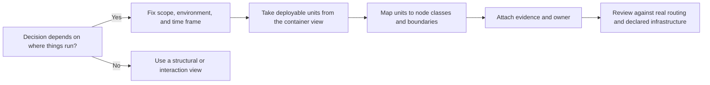
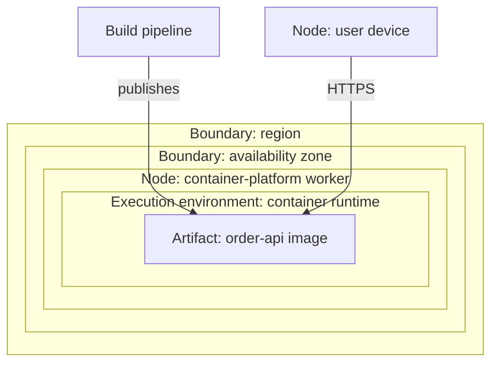
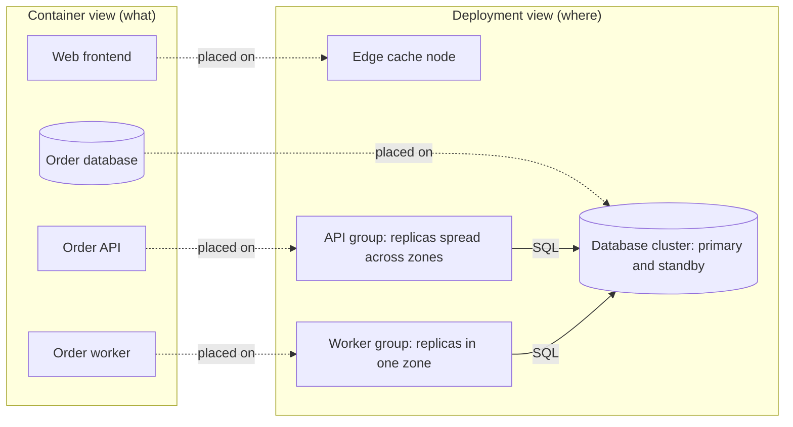
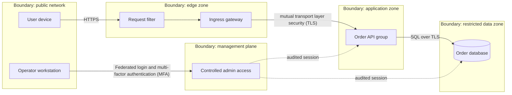
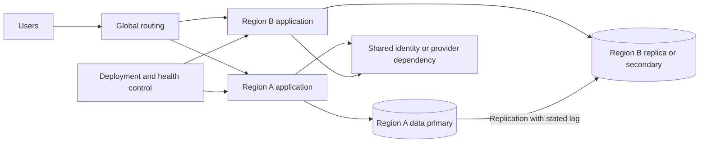
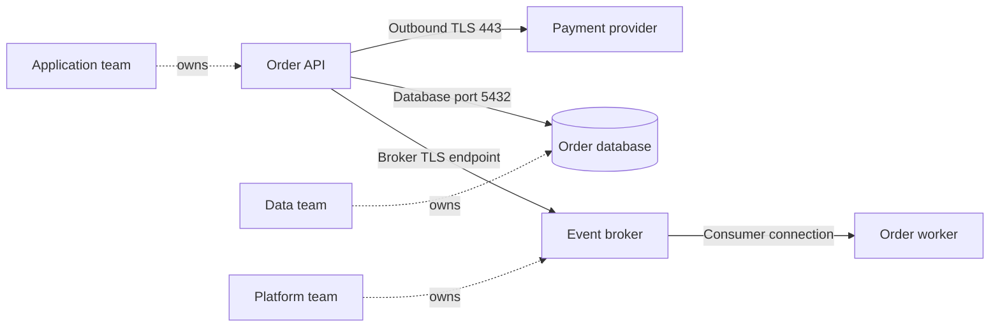
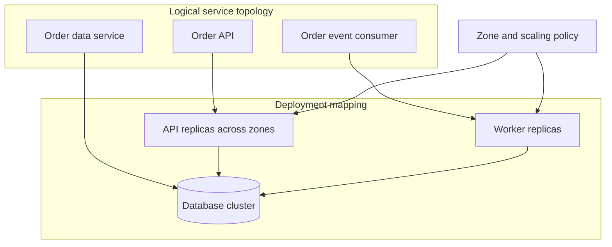

# Deployment Diagrams

Part: [21 — Architecture Documentation](PART_OVERVIEW.md) · Status: Drafted

## 1. Introduction

A deployment diagram documents where software runs. Structural views such as the container view answer "what are the deployable units and how do they collaborate"; a sequence diagram answers "in what order do they talk". The deployment view answers a third question that the others leave open: on which machines, in which networks, under whose administrative control, and in how many copies does each unit actually execute. Capacity, availability, security exposure, data residency, rollout risk, and operating cost are all properties of placement, not of logic, and none of them can be reasoned about from a diagram that omits it.

For an engineer moving into architecture, this is the view that most often separates a design that works on a whiteboard from one that survives production. Two services that look independent in a container view may share a single host, a single database cluster, or a single availability zone. A "highly available" system may depend on one identity provider, one deployment pipeline, or one Domain Name System (DNS) zone that sits outside every redundancy boundary drawn around the workloads. A security reviewer cannot assess exposure from a component diagram, and an operations team cannot size a platform from one. The deployment diagram is where these facts become visible to people who must challenge them.

The artifact is also one of the easiest to get wrong, because it describes the physical world and the physical world changes without the diagram's knowledge. Autoscaling, failover, infrastructure-as-code changes, and emergency fixes all alter real placement. This chapter therefore treats the deployment diagram as a claim that must carry its scope, its time frame, and its evidence, not as a drawing that is correct because it was once reviewed.

This chapter owns the use of deployment diagrams as an architecture-documentation artifact: what to show, which notation conventions to use, how to depict placement, boundaries, and failure domains, and how to keep the view truthful. The boundaries with neighbouring material are deliberate:

- Unified Modeling Language (UML) notation, including the formal definition of nodes, artifacts, and deployment specifications, belongs to [UML](CH02_UML.md); this chapter uses the practical subset and says where its drawings approximate it.
- The C4 (Context, Containers, Components, Code) model owns its own deployment-view conventions and the container names this chapter reuses; see [C4 Model](CH01_C4_Model.md).
- Scenario ordering and message timing belong to [Sequence Diagrams](CH05_Sequence_Diagrams.md).
- The recorded rationale behind a placement decision belongs to [ADR: Architecture Decision Record](CH03_ADR_Architecture_Decision_Record.md).
- Procedures that operate on the deployed system belong to [Runbooks](CH07_Runbooks.md), and the analysis of attackers and trust boundaries belongs to [Threat Models](CH09_Threat_Models.md).
- Managed cloud services and their semantics belong to [Cloud Computing](../09_Cloud_Computing/CH07_Containers.md) and [Cloud Architecture](../10_Cloud_Architecture/PART_OVERVIEW.md); container orchestration mechanics belong to [Kubernetes](../12_Kubernetes/PART_OVERVIEW.md); network and operating-system mechanics belong to [Networking and OS](../05_Networking_and_OS/PART_OVERVIEW.md); security controls belong to [Security](../15_Security/PART_OVERVIEW.md); and solution topology and high-level design belong to [High-Level Design](../07_System_Design_and_Distributed_Systems/CH03_High_Level_Design.md).

After studying this chapter, a reader should be able to:

1. State what a deployment diagram asserts, what question it answers, and what it is not suitable for.
2. Read and write the core vocabulary: node, execution environment, artifact, deployment relationship, communication path, and boundary.
3. Map logical containers to runtime placement at a level of detail suited to the decision, including replication and environment variation.
4. Draw network zones and trust boundaries that match actual enforcement, and avoid diagrams that imply isolation the system does not provide.
5. Label each diagram with scope, time frame (current, target, or transitional), owner, and evidence.
6. Apply these rules to a concrete, hypothetical scenario and decide what to leave out.

## 2. Background and History

Describing hardware and software placement together is older than UML. Early distributed-systems and network design documents routinely drew machines, links, and the programs running on them. UML adopted a deployment diagram in which three-dimensional box shapes called nodes host artifacts, the files or packages that are deployed, and in which lines between nodes show communication paths. Later UML versions generalized the idea to execution environments and devices; the exact wording of each revision is outside this chapter's scope.

Two practical shifts matter to an architect. First, the unit of placement changed. Where early diagrams showed named physical servers, modern systems run on virtual machines, container platforms, managed services, and serverless runtimes, where the exact host is neither chosen nor stable. The implication is that a modern deployment diagram usually shows a class of node and a replica policy rather than a machine name. Second, infrastructure became code. When environments are declared in version-controlled definitions, a diagram can be checked against or even generated from the declared state, which changes the maintenance problem from "remember to redraw" to "decide which facts are authoritative in code and which belong in a human-curated view". Each documentation tool implements its own subset of these notations, so what you can draw depends on the renderer you choose.

## 3. The Problem Deployment Diagrams Solve

Logical diagrams hide placement, and several consequential decisions live in the hiding place. The patterns below are general, not reported incidents.

| Hidden decision | How logical views hide it | What the deployment view forces you to state |
| --- | --- | --- |
| Shared fate | Two boxes appear independent | Whether they share a host, zone, cluster, or account |
| Exposure | An arrow says "calls" | Which network zone the caller and callee occupy, and what filters the path |
| Redundancy | "The service is replicated" | How many copies, in which failure domains, behind which router |
| Ownership | "The platform" is a single word | Which team administers each node, and who can change it |
| Environment drift | One diagram for all stages | Which stages differ in topology, scale, or data |

Alternatives each answer a different question. A container view shows responsibilities and interactions but not placement, so it cannot expose shared fate. A network diagram shows addressing and routing but usually not which application runs on each segment. An infrastructure-as-code repository is authoritative for what is declared, but it is rarely readable by a reviewer as a whole and says nothing about intent. A runtime inventory or service map shows what is observed today, not what was designed. The deployment diagram is chosen when a decision depends on where things run: a capacity review, a failure-domain analysis, a security review of exposure, a migration plan, or an onboarding of operators. If the question is purely about collaboration or ordering, another view is better.

The flow shows that placement is chosen after scope and units are fixed. Teams that begin by drawing every machine produce an inventory nobody maintains; teams that begin with the decision draw only the boundaries that matter. It also shows that evidence and an owner are part of drawing, a point developed in the sections on boundaries and currency.

## 4. Vocabulary: Nodes, Artifacts, and Relationships

### 4.1 Core terms

The vocabulary below is the practical working set. It follows UML usage in spirit; consult [UML](CH02_UML.md) for the formal definitions.

| Term | Meaning | Examples (illustrative) |
| --- | --- | --- |
| Node | A computational resource on which artifacts execute | A virtual machine, a container-platform worker, a device |
| Execution environment | Software that hosts other software inside a node | A container runtime, an application server, a managed function runtime |
| Artifact | A deployable file or package produced by a build | A container image, an archive, a database schema bundle |
| Deployment relationship | Which artifact runs on which node or environment | The order service image runs on the API worker group |
| Communication path | A link over which nodes exchange messages | An encrypted connection from the gateway to the API |
| Boundary | A grouping that carries a property such as network zone, account, or region | A restricted data zone |

The distinction between artifact and container-view unit matters. A container in the C4 sense is a runnable unit with a responsibility; an artifact is how it is packaged; a node is where it runs. Collapsing all three into one box is acceptable at low detail, and harmful when a decision turns on the difference, for example when two artifacts run in one process.

### 4.2 Notation and Mermaid's limits

Mermaid has no native UML deployment diagram. The diagrams in this chapter use flowchart nodes and `subgraph` blocks to approximate nested nodes and boundaries, and edge labels to carry protocols. This loses UML's three-dimensional node shape and its stereotypes, such as an explicit label marking a box as a device or an execution environment. Compensate by stating the kind of node in its label, for example a name followed by a short descriptor, and by using one subgraph level per kind of boundary. Mermaid also offers an architecture diagram type with groups and services; its icon and group model suits placement drawings, but its syntax and availability vary by renderer version, so check your renderer before adopting it.

The nesting reads as containment: the artifact runs inside an execution environment, inside a node, inside a zone, inside a region. Each level is a claim a reader will rely on. A reader who sees the zone box will assume that a zone failure removes only what is inside it; if the platform schedules replicas elsewhere, the nesting is wrong. Nest only what the platform guarantees, and draw scheduler-controlled placement as a policy label, not as a fixed position.

## 5. Mapping Containers to Runtime Placement

### 5.1 The mechanism

Start from the deployable units in the container view. For each, decide the node class that hosts it, the number of replicas and their spread across failure domains, the stateful resources it depends on, and the owner. Then choose the level of detail by the question: a capacity review needs replica counts and node sizes; a security review needs zones and paths; an onboarding view needs only the main nodes. Show a replicated unit as one group with a replica policy, not as individual instances, unless instance-level placement drives the decision.

The diagram makes an asymmetry visible that the container view cannot: the API survives the loss of a zone, but the worker group does not, and both depend on the same database cluster. Whether that is acceptable is a decision, and the diagram lets a reviewer ask it. Record the decision in an [ADR](CH03_ADR_Architecture_Decision_Record.md) and link it from the view.

### 5.2 Decision criteria and trade-offs

| Choice | Benefit | Cost or risk |
| --- | --- | --- |
| One diagram per environment | Accurate for each stage | Duplication, and drift between copies |
| One diagram with environment annotations | A single source, easy comparison | Clutter when environments differ much |
| Instance-level detail | Supports placement and affinity reasoning | Obsolete quickly in autoscaled systems |
| Group-level detail | Stable across scaling events | Hides per-instance placement |
| Fixed names of hosts | Precise for pets-style estates | Misleading where hosts are replaced routinely |

As a default, use group-level detail with a stated replica policy, one primary diagram for the production topology, and a short table of how other environments differ. Switch to instance-level detail only when a decision depends on it, for example anti-affinity of two copies of a stateful service.

### 5.3 Failure modes and edge cases

- Boxes drawn as separate that share a node, account, or cluster, creating false independence.
- Managed services drawn as if they were nodes the team controls, hiding that the provider owns their placement and limits. Show them as external or provider-managed and link to the provider's documented behaviour rather than asserting it.
- Serverless and scheduled functions drawn without their trigger path, so a reader cannot see what starts them.
- Local-only or developer environments presented as if they matched production.
- Stateful and stateless units drawn alike, though recovery differs sharply.

### 5.4 Worked scenario (illustrative, hypothetical)

A team documents an order system for a capacity review. The container view lists a web frontend, an order Application Programming Interface (API), an order worker, and a database. The deployment view places the API in a group of replicas spread over three availability zones, the worker in a group within one zone, and the database as a primary with a standby in a second zone. Reviewing the draft, an operations engineer notes that the worker group has no spare capacity in the other zones, so a zone loss halts order fulfilment even though the API stays up. The team records two options: spread the workers, accepting higher cross-zone traffic and cost, or accept a fulfilment delay and document the recovery step in a [runbook](CH07_Runbooks.md). Choosing the second, they annotate the diagram with the accepted limitation and a link to the recorded decision. The value of the exercise is that the limitation became a visible, owned decision instead of a surprise.

## 6. Network Zones and Trust Boundaries

### 6.1 What a boundary asserts

A boundary groups nodes that share a property. Network zones assert reachability rules; trust boundaries assert that traffic crossing them is authenticated, filtered, or logged; account or tenant boundaries assert administrative isolation; region boundaries assert data location and failure scope. These are different claims and should not share one box. A single subgraph labelled "secure zone" asserts nothing a reader can verify.

For each boundary, state what is enforced and by what: a packet filter, an identity check, an account policy. Show who may administer nodes inside it, because administrative paths are often the weakest crossing. The analysis of what an attacker can do at each crossing belongs to [Threat Models](CH09_Threat_Models.md); the deployment diagram supplies the topology that analysis starts from.

The diagram makes two claims beyond the data path: that the database is reachable only from the application zone and the management plane, and that administrators arrive through a separate audited route. Both are testable. If a network rule allows a developer workstation to reach the database directly, the diagram is false and gives false assurance.

### 6.2 Decision criteria and failure modes

Draw a boundary only when it is enforced by something named and owned. Prefer fewer, truthful boundaries to many aspirational ones. Common failures: boundaries drawn from the intended design rather than the configured rules; shared services such as logging or secret stores placed in one zone though many zones reach them; an administrative or build-pipeline path omitted because it is "not runtime"; and east-west traffic inside a zone assumed to be safe because the zone is labelled internal. Where verification is possible, compare the diagram to declared network policy and to observed traffic, and record the date and method.

### 6.3 Worked scenario (illustrative, hypothetical)

A reviewer is asked whether a new reporting tool may read the order database. The existing diagram shows a restricted data zone reachable only from the application zone. Checking the declared rules, the reviewer finds a rule that also permits a shared analytics subnet, which the diagram omitted. The team corrects the diagram, then evaluates the options: a read replica in the data zone with a narrowly scoped identity, or an export to a separate store. The discrepancy was found because the diagram made a testable claim; a diagram without enforcement detail could not have been wrong, and so could not have been useful.

## Document Multi-Region Placement and Failure Domains

Multi-region diagrams should show active or standby behavior, data replication, routing, and control-plane dependencies. Distinguish zone failure from region failure and identify which components are shared. Do not imply automatic failover if data, identity, capacity, or DNS state cannot support it.

Label replication direction, allowed recovery point, and who initiates promotion. A shared control dependency may remain a single failure domain even when workloads span regions. Reference the recovery plan and measured failover evidence.

## Include Dependencies, Ports, and Ownership

Ports and protocols help operators understand network rules, firewall requests, and dependency reachability. Show only the ports relevant to the architecture question and identify whether connections are inbound, outbound, or bidirectional. Avoid confusing application-level ports with host ports or managed-service endpoints.

Ports must reflect actual configuration and network policy. Avoid exposing secrets or public addresses in a broadly shared diagram. Link to controlled inventories for environment-specific values, credentials, and approved network rules.

## Correlate Deployment With Service Topology

A deployment view should preserve logical service boundaries while showing instances and placement. It can answer whether a service scales independently, which node hosts a worker, or how a failure is contained. If one logical service spans many replicas, show the group and scaling policy rather than every instance unless instance-level placement is relevant.

Check both views for inconsistent boundaries. A logical component may span trust zones or deployment ownership. Such crossings need a documented connector and operational contract. Update deployment diagrams when topology changes, not only when application names change.

## Worked Case: Order Processing Rollout

A team deploys a new order API alongside the existing version across two availability zones. The deployment view shows ingress routing, API replicas, a worker fleet, database primary and replica, and a managed broker. A staged rollout routes a small cohort to the new API while both versions consume compatible event schemas.

The view marks the database and broker ownership boundaries and identifies that the second region is recovery capacity, not active-active. A failover exercise verifies data lag, promotion authority, routing, and worker idempotency. The architecture record links the current deployment diagram to the rollout and recovery procedures, while environment-specific endpoints remain in controlled configuration.

## Review Questions

1. Which nodes host each deployable artifact?
2. Which network boundaries and trust controls are material?
3. What evidence supports the stated failure-domain and failover behavior?
4. Which ports and dependencies are needed for the architecture decision?
5. How does the deployment mapping remain consistent with logical service boundaries?

Deployment diagrams are useful when placement, network, and operations matter to a decision. Label runtime nodes and boundaries precisely, distinguish target from observed topology, and verify that the diagram matches actual routing, ownership, and recovery behavior.
