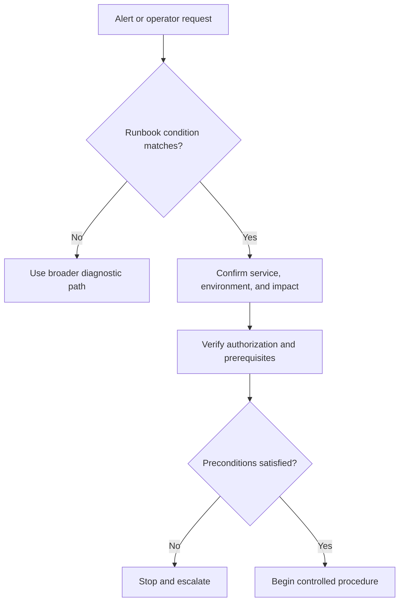
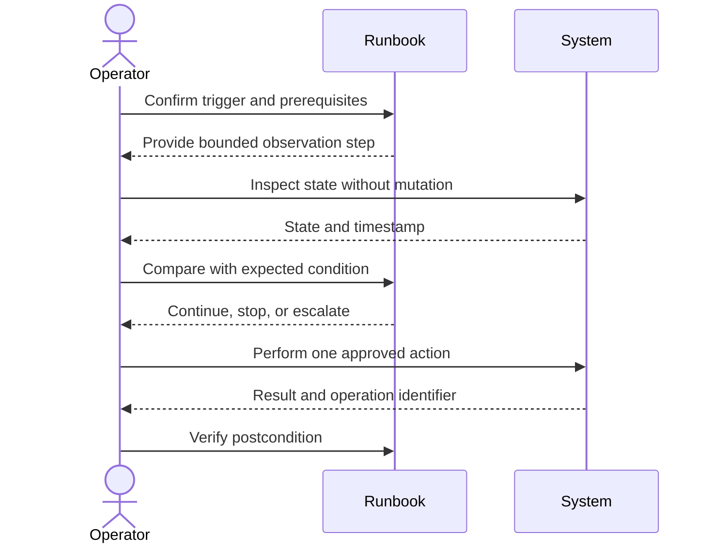
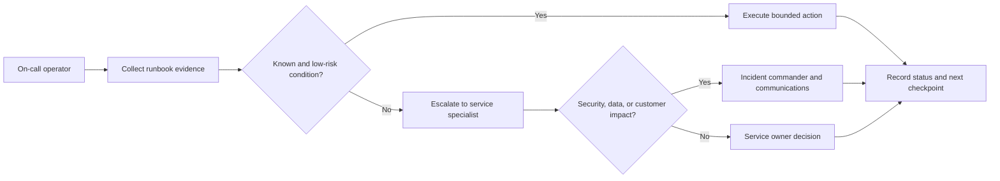
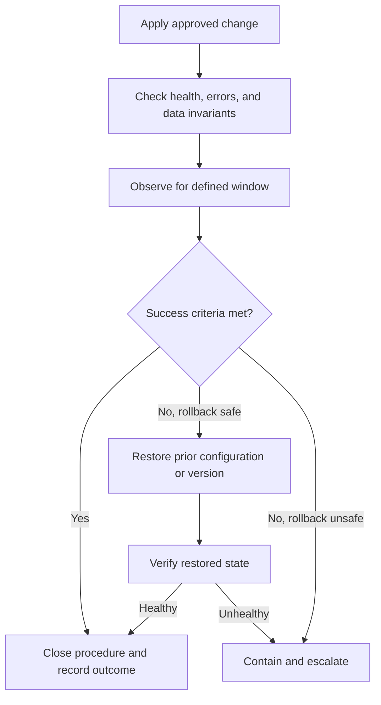
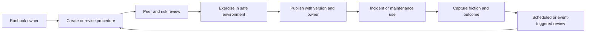

# Runbooks

Part: [21 — Architecture Documentation](PART_OVERVIEW.md)

A runbook is an operational procedure for a known condition or task. It should let an authorized operator act safely, verify each result, and know when to stop or escalate. A runbook is not a list of commands: it includes trigger, scope, prerequisites, decision branches, expected outcomes, and recovery.

Part 14 owns observability platforms, Part 12 owns Kubernetes operations, and Part 07 owns distributed failure semantics. This chapter owns the documentation artifact and its lifecycle.

## Define Trigger, Scope, and Prerequisites

State the symptom or maintenance trigger, affected service and environment, expected impact, required role, access, tools, and preconditions. Identify actions that are read-only, state-changing, or potentially destructive. Include a stop condition and escalation contact before the first risky action.

Avoid ambiguous instructions such as “check the service.” Name the dashboard, signal, expected range, time window, and what evidence supports proceeding. Use placeholders for environment-specific values and explain how to validate them before use.

## Write a Command and Verification Loop

Each action should have a purpose, an expected result, a verification method, and a next step if the result differs. Separate observation from mutation. A command returning exit code zero does not prove that the service is healthy or that the intended state change occurred.

Use copyable commands only when the target environment and permissions are clear. Mark placeholders unmistakably, quote values safely, and warn about irreversible actions. Avoid embedding credentials, production identifiers, or destructive commands without explicit guards and confirmation steps.

## Define Escalation and Communication

Escalation is part of the procedure, not a footnote. Name the role or rotation, required evidence, customer communication owner, and decision authority. Include escalation triggers such as unknown state, repeated failure, data inconsistency, missed service-level objective, or suspected security incident.

Do not ask an operator to make an architectural or risk-acceptance decision outside their authority. An unavailable escalation contact needs a documented secondary route and safe holding action.

## Gate Rollback and Recovery

For a change or remediation, define the success condition, observation window, and rollback trigger before execution. Rollback may be unsafe if state has changed or data migration is irreversible. Explain what rollback restores, what it cannot undo, and who approves it.

If no safe rollback exists, name the forward-recovery or containment path. Operators need to know whether they are restoring service, preserving data, or limiting customer impact when those goals conflict.

## Maintain Ownership and Freshness

Every runbook needs an owner, review cadence, affected service/version, last validation date, dependencies, and update trigger. Test procedures in a safe environment and after material platform changes. Learn from incidents and failed steps; update the runbook without hiding the original incident evidence.

A runbook that has never been executed may be an untested hypothesis. Track successful use, failure, escalation, and time-to-safe-outcome rather than page count. Remove or archive procedures for retired services while preserving incident records.

## Worked Case: Elevated API Error Rate

The runbook triggers when server errors exceed a defined threshold for a stated window. The operator confirms the affected region and release, checks dependency health and traffic changes, and collects dashboards and traces. If a recent release correlates with the regression and rollback is safe, the operator follows the deployment-specific rollback steps and verifies error rate, latency, and data integrity.

If errors appear related to authorization or data corruption, the runbook stops automatic rollback and escalates to the incident commander and service owner. Customer communication is assigned explicitly. The runbook records the release identifier, timestamps, actions, and outcomes; the owner reviews it after the incident and exercises any changed recovery step.

## Review Questions

1. Can an operator confirm the trigger and scope before changing state?
2. What does each command prove, and how is its result verified?
3. Which conditions require stopping or escalating?
4. What can rollback restore, and what is irreversible?
5. Who owns procedure accuracy and exercises it after platform change?

A runbook is operationally useful when it guides safe action and verification under pressure. Make triggers explicit, separate observation from mutation, define escalation and rollback, and keep ownership and validation current.
