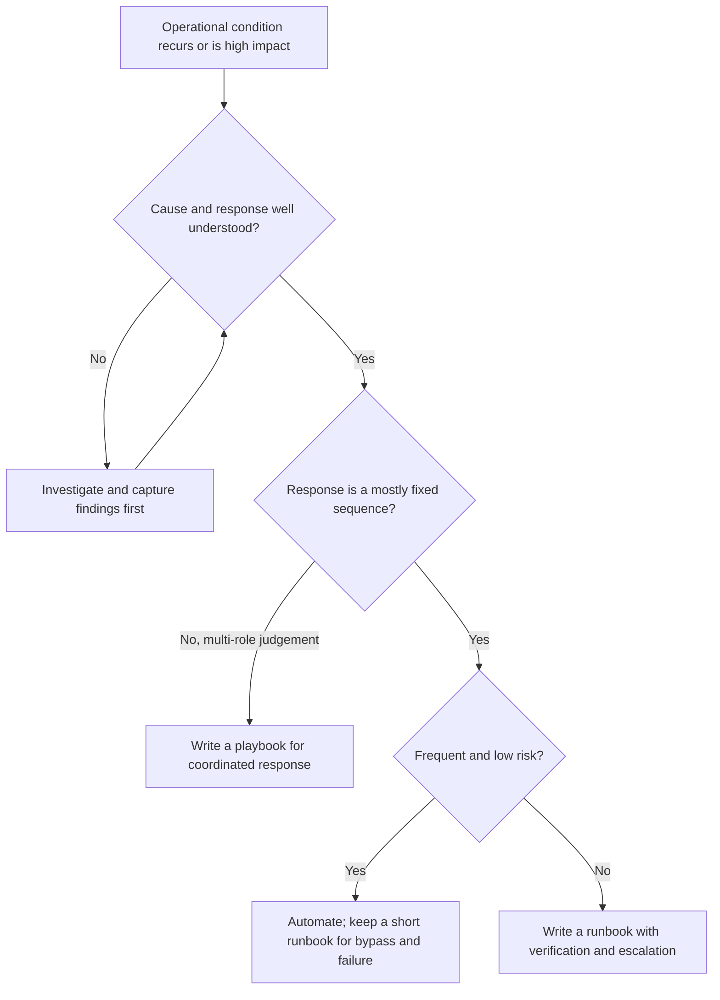
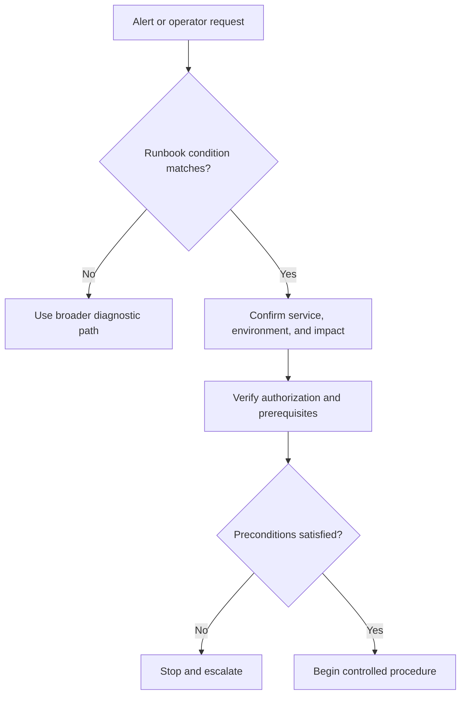
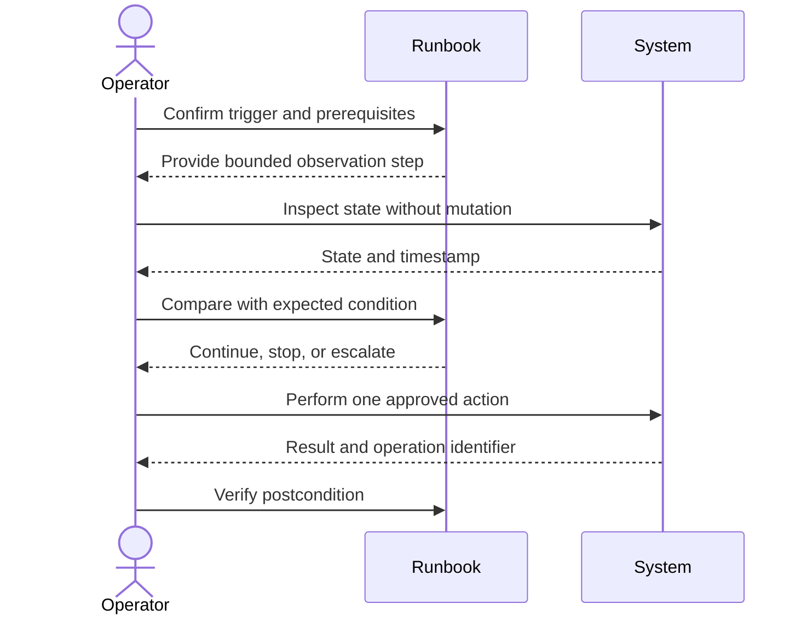
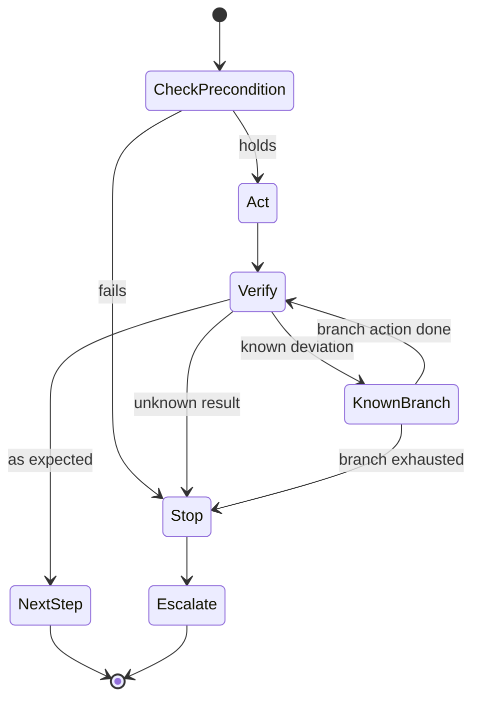
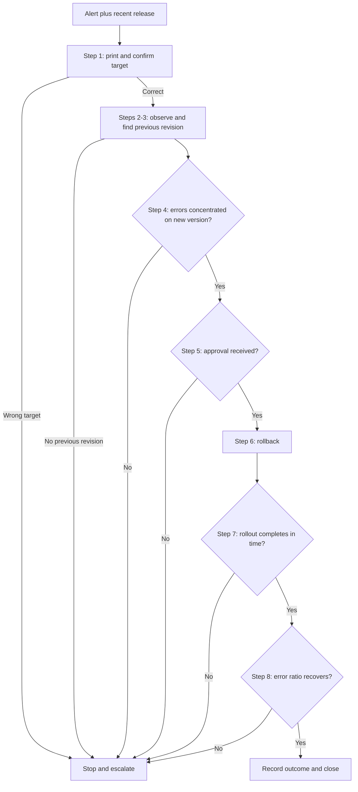
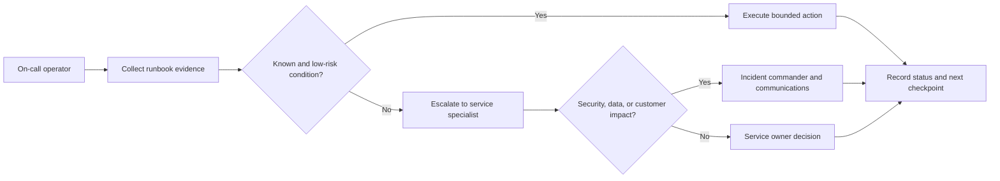
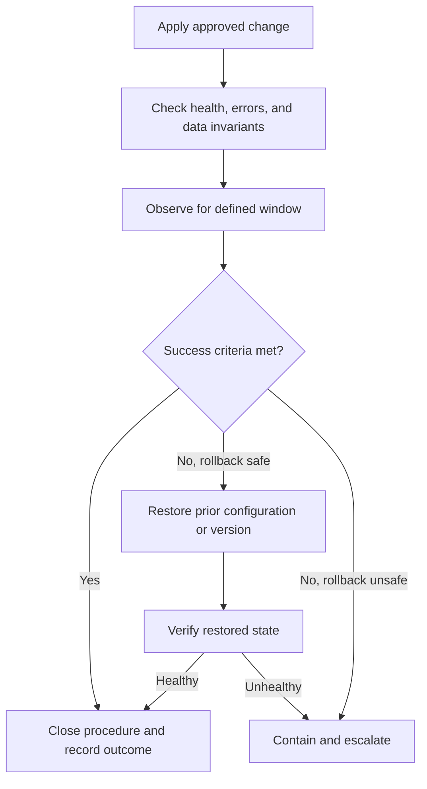
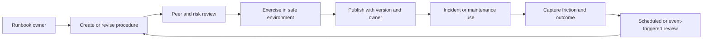

# Runbooks

Part: [21 — Architecture Documentation](PART_OVERVIEW.md) · Status: Drafted

## 1. Introduction

A runbook is a written operational procedure for a known condition or a recurring task. It is written in advance, by someone who understands the system, for someone who may be tired, unfamiliar with that corner of the system, and acting under time pressure. Its purpose is to let an authorized operator take safe, verifiable action, and to tell that operator when to stop and hand the decision to someone with more context or authority.

Experienced engineers often treat operational knowledge as something carried in heads and chat history. That works while the people who built a service are also the people who operate it. It stops working at the moment an architecture succeeds: the system acquires more services, more teams, more rotations, and more changes than any one person can track. The runbook is the artifact by which the architect's understanding of failure modes, blast radius, and safe recovery is transferred to the people who will meet those failures. It is therefore an architectural deliverable, not an afterthought: the architecture determines which failures are likely and which recoveries are safe, and the runbook records that determination in an executable form.

A runbook is not a list of commands. A list of commands says what to type; a runbook says when the procedure applies, what must be true before the first step, what each step proves, what to do when reality differs from expectation, how to undo or contain the change, and whom to call. Commands are the easiest part to write and the least valuable on their own.

This chapter owns the runbook as a documentation artifact: its structure, step design, safety properties, testing, and upkeep. The boundaries with neighbouring material are deliberate:

- Coordinated, multi-role response to scenarios that cannot be reduced to a fixed command sequence belongs to [Playbooks](CH08_Playbooks.md); this chapter defines the line between the two and does not teach incident coordination.
- Metrics, logs, traces, alerting design, and the mechanics of service-level objectives belong to Part 14, beginning with [Metrics](../14_Observability/CH02_Metrics.md) and [Logs](../14_Observability/CH01_Logs.md); a runbook consumes their signals and names the ones it relies on.
- Delivery pipelines, deployment strategies, and rollback mechanics belong to Part 13, for example [CI/CD](../13_DevOps/CH02_CI_CD.md) and [Blue-Green Deployment](../13_DevOps/CH15_Blue_Green_Deployment.md); a runbook references those mechanisms and records when an operator may invoke them.
- Kubernetes object semantics belong to Part 12, for example [Deployments](../12_Kubernetes/CH02_Deployments.md); the worked example here uses a small subset of that behaviour.
- Distributed-failure semantics and availability vocabulary belong to Part 07, for example [Non-Functional Requirements](../07_System_Design_and_Distributed_Systems/CH02_Non_Functional_Requirements.md).
- Structural and behavioural views that a runbook points to belong to the [C4 (Context, Containers, Components, Code) Model](CH01_C4_Model.md), [Sequence Diagrams](CH05_Sequence_Diagrams.md), and [Deployment Diagrams](CH06_Deployment_Diagrams.md).
- The recorded reasoning behind an operational design choice belongs to [ADR: Architecture Decision Record](CH03_ADR_Architecture_Decision_Record.md); a runbook records procedure, not rationale.

After studying this chapter, a reader should be able to:

1. Define a runbook, state what it promises its reader, and distinguish it from a playbook, a design document, and automation.
2. Decide when a situation deserves a runbook and when it does not.
3. Structure a runbook with trigger, scope, prerequisites, steps, verification, rollback, escalation, and ownership.
4. Design a single step so that it has a precondition, a bounded action, a verification, and a defined failure branch.
5. Write commands that are safe to copy, with guards, placeholders, and stop points.
6. Apply a complete, concrete example and identify what makes it safe to run under pressure.

## 2. Background and History

The word "runbook" comes from operations work on shared computing systems, where operators followed written procedures to start, monitor, and recover batch and online systems. Checklists in aviation and surgery are older and independent, and engineers often draw on the same reasoning: under stress, people skip steps and misjudge, and a short written sequence with explicit checks reduces both. The exact lineage of the term and of particular templates is not something this chapter claims to know.

Two shifts matter to a modern architect. First, systems became distributed and changed daily, so the person on call is rarely the author of the component that is failing; a procedure must carry the author's context. Second, many routine procedures moved into code. Infrastructure as code, deployment pipelines, and self-healing controllers now perform steps that once required a human. This changed what runbooks are for: the best-understood, most repeatable procedures are candidates for automation, and runbooks increasingly document the residue (the judgement calls, the unusual conditions, the safe use of automation, and the cases where automation must be bypassed or stopped). The implication is that a runbook is not a competitor to automation but its safety manual.

## 3. The Problem Runbooks Solve

Operational knowledge decays and concentrates. Without a written procedure, three recurring problems appear. The patterns below are general, not reports of specific incidents.

| Problem | How it shows up | What a runbook contributes |
| --- | --- | --- |
| Knowledge concentration | Only one or two people know how to recover a component, so recovery speed depends on who is awake | A procedure readable by any authorized operator on the rotation |
| Unsafe improvisation | An operator under pressure runs a plausible command with a wider effect than intended | Guards, scoped commands, and explicit stop points chosen in advance, when thinking was calm |
| Unverified action | A change is applied and assumed to have worked; the real state is discovered later | A verification after each state change, with an expected result and a branch for when it differs |
| Ambiguous authority | The operator is unsure whether they may restart, failover, or discard data | Stated decision rights and escalation triggers |
| Inconsistent response | Two operators handle the same condition differently, so outcomes and records differ | A common sequence and a common record of what was done |

Alternatives address parts of this. Tribal knowledge is fast when the experts are present and unavailable when they are not. Wiki prose and chat history contain facts but not sequence, checks, or stop points, and they are rarely findable in the first minutes of an event. Pure automation removes human error for covered cases but needs its own documentation for when it misbehaves. Training and apprenticeship are essential but do not scale to every rare condition. A runbook is chosen when the condition is recognizable, the response is mostly sequential, and a competent operator who lacks local context can complete it safely. It is the wrong tool when the situation requires open-ended diagnosis, negotiation among roles, or architectural judgement, which is the territory of playbooks and of senior engineers.



The diagram makes the selection explicit: a runbook sits between investigation, which has not yet produced a stable procedure, and automation, which has removed the human from a well-understood loop. Two implications follow. Writing a runbook early can expose that a condition is not yet understood, which is a useful finding rather than a failure. And a condition that moves from the runbook branch to the automation branch does not delete its runbook; the runbook shrinks to describe the failure and override paths.

## 4. Anatomy of a Runbook

A runbook has a stable skeleton so that an operator who has never seen this particular one knows where to look. The skeleton separates what is read before acting (metadata, trigger, scope, prerequisites) from what is executed (steps) and from what is read when things go wrong (rollback, escalation). The template below is illustrative; adapt the field names to your organization, but keep the separation.

````markdown
# Runbook: <short, symptom-oriented title>

| Field | Value |
| --- | --- |
| Owner | <team or rotation, not an individual> |
| Service / environment | <service name> / <environment> |
| Version of this runbook | <number or date> |
| Last executed or exercised | <date, environment, outcome> |
| Applies to | <service version range, platform version> |
| Risk level | Read-only / State-changing / Potentially destructive |

## Trigger
Which alert, symptom, or request leads here. Which similar conditions do NOT.

## Impact and scope
Who or what is affected. What "not affected" looks like.

## Required access and tools
Role, permissions, tooling, and how to confirm you have them.

## Preconditions
Conditions that must hold before step 1. Each has a check.

## Steps
Numbered. Each: purpose, action, expected result, verification, if-different branch.

## Rollback / containment
What it restores, what it cannot undo, who approves.

## Escalation
When to stop, whom to contact, what evidence to attach.

## Record
What to capture for the incident or change record.
````

Each field exists for a reason. The title is symptom-oriented because an operator searches by what they see, not by the internal name of the fix. The "does not apply" clause in the trigger protects against the common failure of matching a procedure to a superficially similar symptom. The risk level lets a reviewer or operator calibrate caution before reading further. The owner is a team or rotation, because an individual leaves or changes role, and an unowned runbook is soon wrong.

### 4.1 Trigger, scope, and prerequisites

State the symptom or maintenance trigger, the affected service and environment, the expected impact, the required role and access, the tools, and the preconditions. Classify each action as read-only, state-changing, or potentially destructive, and place the stop condition and escalation contact before the first risky action rather than at the end. The operator who needs them is the one who has just seen something unexpected midway through.



The diagram shows that applicability is checked before authority and preconditions, and that failing either check leads to stopping, not to improvising. The implication for authors is that the opening of a runbook must be answerable quickly: an operator should be able to decide "this matches" or "this does not" within a minute.

Avoid ambiguous instructions such as "check the service". Name the dashboard or signal, the expected range, the time window, and what evidence supports proceeding. Use placeholders for environment-specific values, make them visually unmistakable, and explain how to validate them before use. A precondition is only useful if it has a check: "the replica is healthy" is a wish; "the replica reports lag below 5 seconds on the named dashboard panel" is a precondition.

## 5. Designing Steps

The step is the unit of a runbook, and most unsafe runbooks are unsafe at the step level. A well-designed step has six parts: a purpose (why this step exists), a precondition (what must hold now), an action (one bounded thing), an expected result, a verification (an independent check that the intended state was reached), and a failure branch (what to do when the result differs). Steps are small enough that a failure can be attributed to one action.

````markdown
### Step 4: Pause traffic to the lagging replica
Purpose: Prevent stale reads while the replica catches up.
Risk: State-changing (reversible).
Precondition: Step 3 confirmed lag above the threshold and the primary is healthy.
Action:
    <command>
Expected: The replica no longer appears in the load balancer's active set.
Verify:   <read-only command or dashboard panel> shows zero requests to the replica within 2 minutes.
If different: Do not retry more than once. Go to "Escalation", reason "traffic not drained".
Undo:     <command> restores the replica to the active set.
````

### 5.1 Observation before mutation

Separate steps that only read state from steps that change it, and put all the reading first. An operator who has gathered evidence can then make a decision at a defined point, and the evidence is available to whoever takes over. Within a mutating step, change one thing at a time: if two settings change together and the symptom improves or worsens, nobody knows which one mattered. A command returning exit code zero proves that the command ran, not that the service is healthy or that the intended state change occurred; verification must check the effect.

### 5.2 The command and verification loop

The loop below is the core pattern. It alternates a bounded read, a comparison against an explicit expectation, a single approved action, and a verification of the postcondition.



The implication is that the runbook, not the operator's memory, holds the expected value at every comparison. The operator is a participant who performs and reports, and the decision to continue is made against written criteria. Note also that the timestamp returned with the observed state matters: a reading taken before the action cannot verify the action, and a reading taken long after may reflect other causes.

### 5.3 Command safety

Use copyable commands only when the target environment and permissions are clear. The conventions below reduce the chance that a correct command is run against the wrong target or with a wider effect than intended.

- **Mark placeholders unmistakably**, for example `<NAMESPACE>`, and state how to find the real value. A placeholder that looks like a plausible value gets run as written.
- **Name the target explicitly** in the command (cluster context, namespace, host, database) rather than relying on the operator's current shell state, and add a step that prints the target before any mutation.
- **Prefer previews**: dry-run, `--dry-run=server` style options where the tool offers them, `SELECT` before `UPDATE` or `DELETE`, and a count before a bulk change. Confirm that the tool you use supports the option before documenting it.
- **Scope destructive commands narrowly** with a specific resource name or key, never a wildcard, and require a stop point and a named approver before them.
- **Keep secrets out**. Reference where credentials come from; do not embed them. Production identifiers belong in the environment-specific section, not in shared examples.
- **State what is irreversible** next to the command, not in a distant warning.
- **Quote values** so that spaces and special characters do not change meaning, and avoid piping untrusted output into a shell.

A guard that is checked by a person is weaker than a guard checked by the command. Where possible, make the command fail if the context is wrong, for instance by comparing the printed context with the expected name in a conditional, and say that the operator must stop if the guard fails.

### 5.4 Stop points and failure branches

Every step has three exits: the expected result (continue), a known deviation with a defined response (branch), and anything else (stop and escalate). The third exit is the one authors forget. Without it, an operator facing unexpected output must decide alone whether to continue.



The diagram shows that a step is a small state machine with a bounded retry path, since the known-branch loop must be limited by the step text (for example, "retry at most once"). Unlimited retries convert a failed step into a hidden outage. A stop point is also a place for a deliberate human decision: put one before every irreversible action, and write what the approver must confirm, such as the current state of the backup or the recipients of the change.

## 6. Worked Example Runbook: Roll Back a Faulty Release

This section gives a complete illustrative runbook for a hypothetical `checkout-api` service running as a Kubernetes Deployment. The service, names, thresholds, and dashboards are invented for teaching. Commands use standard `kubectl` behaviour (`rollout status`, `rollout history`, `rollout undo`), but verify flags against your cluster and tooling version before adopting any of them. Nothing here describes a real system or incident.

The design choices are as instructive as the text: it begins with read-only evidence, guards the target, makes one state change, and verifies with an independent signal.

````markdown
# Runbook: checkout-api error rate high after a release (EXAMPLE)

| Field | Value |
| --- | --- |
| Owner | Checkout platform on-call rotation |
| Service / environment | checkout-api / production |
| Risk level | State-changing (reversible by rolling forward) |
| Applies to | Deployments managed with Kubernetes rolling updates |

## Trigger
The alert "checkout-api 5xx ratio above 2% for 10 minutes" fires AND a deployment
of checkout-api finished within the previous 60 minutes.
Does NOT apply: errors with no recent deployment; errors limited to one dependency
(use the dependency runbook); any sign of data corruption (go to Escalation).

## Preconditions
- You hold the on-call deploy role (check: you can run the read-only step 2).
- The previous revision exists in rollout history (check: step 3).
- No database schema migration shipped in this release (check: release notes
  field "migration" is "none"). If it is not "none", STOP and escalate.

## Steps

### 1. Fix the target (read-only)
    kubectl config current-context
Expected: `prod-cluster-1`. If different, STOP. Set `CTX=prod-cluster-1`, `NS=checkout`.

### 2. Observe current state (read-only)
    kubectl --context "$CTX" -n "$NS" get deployment checkout-api
    kubectl --context "$CTX" -n "$NS" get pods -l app=checkout-api
Expected: pods running the new image; note restart counts and the image tag.
Record the image tag as NEW_TAG.

### 3. Identify the previous revision (read-only)
    kubectl --context "$CTX" -n "$NS" rollout history deployment/checkout-api
Expected: at least two revisions. Note the revision number before the current one
as PREV_REV. If only one revision exists, STOP and escalate.

### 4. Confirm correlation (read-only)
Open the "checkout-api errors by version" panel. Expected: errors concentrated on
NEW_TAG pods. If errors are spread evenly across versions, STOP: the release is
unlikely to be the cause; go to Escalation.

### 5. Stop point: approval
Ask the incident channel's decision owner: "Rolling back to revision PREV_REV, any
objection?" Wait for explicit approval or 5 minutes without objection if the
severity is critical.

### 6. Roll back (state-changing)
    kubectl --context "$CTX" -n "$NS" rollout undo deployment/checkout-api --to-revision="$PREV_REV"
Expected: command prints that the deployment was rolled back.

### 7. Verify rollout (read-only)
    kubectl --context "$CTX" -n "$NS" rollout status deployment/checkout-api --timeout=300s
    kubectl --context "$CTX" -n "$NS" get pods -l app=checkout-api
Expected: rollout completes; all pods ready; image tag is the previous one.
If the timeout elapses: STOP and escalate, do not run step 6 again.

### 8. Verify outcome (read-only)
Watch the 5xx ratio for 15 minutes. Success: below 0.5% for 15 consecutive minutes.
Spot-check recent orders in the reporting database (read-only role):
    SELECT status, count(*) FROM orders
    WHERE created_at > now() - interval '30 minutes' GROUP BY status;
Expected: no unusual share of "failed" or "pending" rows compared with the usual
baseline on the dashboard.

## Rollback of this runbook
Roll forward by redeploying NEW_TAG through the normal pipeline once fixed.
This runbook cannot restore orders that failed during the incident.

## Escalation
STOP and escalate to the service owner and incident commander if: any precondition
fails, any step's result is unexpected, the rollout does not complete, or errors
persist after step 8. Attach: NEW_TAG, PREV_REV, timestamps, outputs of steps 2-4.
````

Several details deserve comment. Step 1 turns the common "wrong cluster" error into a visible check. The release-notes migration check is a precondition because rolling the application back is only safe if the database schema is compatible with the older code, which a runbook author must know for the specific service. Step 4 guards against the post-hoc fallacy: a release shortly before an alert is correlated with it, which does not prove causation, so the runbook asks for evidence by version before acting. Step 5 is a deliberate human decision before the only state change. Step 7 uses `rollout status` and the pod listing as verification because the undo command only records the intent to change; the real state follows afterward. Step 8 verifies the outcome the business cares about, not just that pods are healthy.



The diagram shows that five of the eight exits lead to the same destination, escalation, and that exactly one step changes state. That ratio is a sign of a well-designed runbook for a risky action: most of its length is evidence-gathering and checking, and the operator can reach a safe stopping point from almost anywhere. A reviewer can read the diagram to confirm that every path either reaches verified recovery or escalates, with no dead ends and no unverified mutation.

What this example does not do is also deliberate. It does not tell the operator to restart pods as a general remedy, to edit the Deployment by hand, or to investigate the root cause of the bug. Root-cause analysis and coordination across roles belong to the incident process and to [Playbooks](CH08_Playbooks.md); the runbook ends when the service is back in a verified, known state or when the operator has handed off.

## Define Escalation and Communication

Escalation is part of the procedure, not a footnote. Name the role or rotation, required evidence, customer communication owner, and decision authority. Include escalation triggers such as unknown state, repeated failure, data inconsistency, missed service-level objective, or suspected security incident.



Do not ask an operator to make an architectural or risk-acceptance decision outside their authority. An unavailable escalation contact needs a documented secondary route and safe holding action.

## Gate Rollback and Recovery

For a change or remediation, define the success condition, observation window, and rollback trigger before execution. Rollback may be unsafe if state has changed or data migration is irreversible. Explain what rollback restores, what it cannot undo, and who approves it.



If no safe rollback exists, name the forward-recovery or containment path. Operators need to know whether they are restoring service, preserving data, or limiting customer impact when those goals conflict.

## Maintain Ownership and Freshness

Every runbook needs an owner, review cadence, affected service/version, last validation date, dependencies, and update trigger. Test procedures in a safe environment and after material platform changes. Learn from incidents and failed steps; update the runbook without hiding the original incident evidence.



A runbook that has never been executed may be an untested hypothesis. Track successful use, failure, escalation, and time-to-safe-outcome rather than page count. Remove or archive procedures for retired services while preserving incident records.

## Worked Case: Elevated API Error Rate

The runbook triggers when server errors exceed a defined threshold for a stated window. The operator confirms the affected region and release, checks dependency health and traffic changes, and collects dashboards and traces. If a recent release correlates with the regression and rollback is safe, the operator follows the deployment-specific rollback steps and verifies error rate, latency, and data integrity.

If errors appear related to authorization or data corruption, the runbook stops automatic rollback and escalates to the incident commander and service owner. Customer communication is assigned explicitly. The runbook records the release identifier, timestamps, actions, and outcomes; the owner reviews it after the incident and exercises any changed recovery step.

## Review Questions

1. Can an operator confirm the trigger and scope before changing state?
2. What does each command prove, and how is its result verified?
3. Which conditions require stopping or escalating?
4. What can rollback restore, and what is irreversible?
5. Who owns procedure accuracy and exercises it after platform change?

A runbook is operationally useful when it guides safe action and verification under pressure. Make triggers explicit, separate observation from mutation, define escalation and rollback, and keep ownership and validation current.
