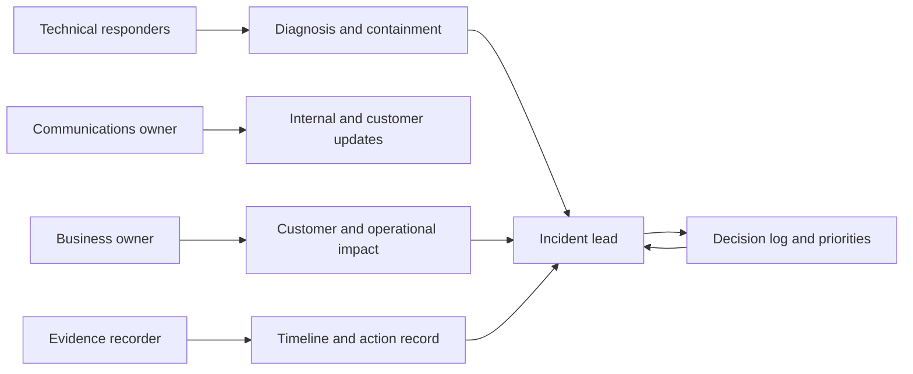
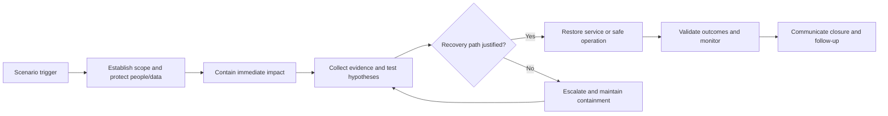
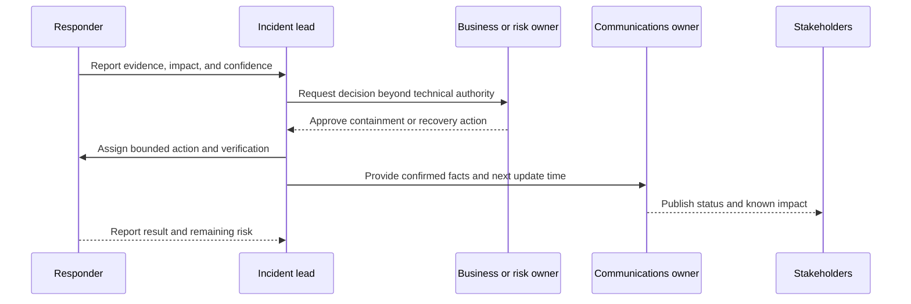
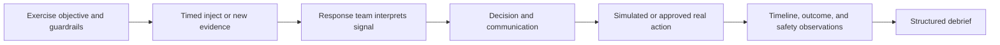
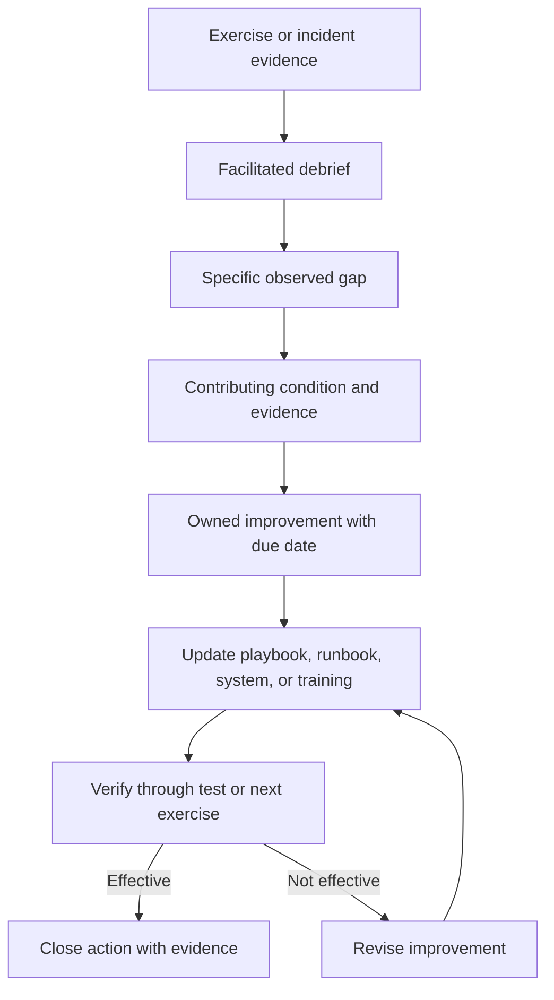

# Playbooks

Part: [21 — Architecture Documentation](PART_OVERVIEW.md)

A playbook coordinates people, decisions, communications, and evidence during a scenario that cannot be reduced to a fixed command sequence. It defines objectives, roles, decision points, inputs, escalation, and closure while allowing responders to adapt. A runbook provides bounded operational steps; a playbook orchestrates judgment and collaboration around them.

Part 14 owns observability platforms, Part 18 owns enterprise review governance, and Part 23 owns broader collaboration practices. This chapter covers the playbook artifact and how it is exercised and maintained.

## Assign Roles and Objectives

Name the incident or scenario lead, technical responders, communications owner, customer or business liaison, decision authority, and note-taker. Define the objective, scope, safety constraints, and a shared status channel. A person may hold multiple roles in a small response, but decision authority and communication ownership must remain explicit.

Role descriptions should say what decisions the role can make and when to escalate. Avoid a playbook that lists job titles without actions or authority. Include required contacts and backups in an access-controlled, current source.

## Structure a Scenario Timeline

A playbook should orient responders to the trigger, early containment, investigation, recovery, and closure. These are checkpoints, not a rigid chronology; teams may revisit earlier decisions as evidence changes. Attach linked runbooks for deterministic operations instead of copying command sequences.

Each phase should state entry conditions, objective, key questions, evidence to capture, and exit criteria. The playbook should help responders know what to do next without pretending to predict every failure path.

## Make Decisions and Communications Visible

Define which decisions require incident-lead approval, business approval, security or privacy consultation, or executive escalation. Communications should distinguish confirmed facts, hypotheses, impact, actions, and next update time. Do not wait for perfect certainty before communicating material impact; state uncertainty plainly.

The playbook should identify a decision owner for irreversible or customer-impacting actions. Record dissent and rationale when a decision is contested. Avoid sending technical speculation as confirmed external communication.

## Exercise Injects and Observe Responses

Exercises introduce events or constraints to evaluate how the team responds. Injects can reveal a lost dependency, conflicting evidence, staff unavailability, or an unexpected customer impact. The exercise controller should record inject time, expected decision, actual action, evidence, and any unsafe assumption. Keep production exercises within a preapproved safety boundary.

An exercise is useful when it tests a named capability, such as escalation, data recovery, or customer communication. Avoid surprise tests that exceed authorized scope. Stop criteria and a safety controller are required when the exercise touches production systems.

## Turn Findings Into Improvements

After action, compare intended outcome with actual response. Identify gaps in authority, information, tooling, procedures, training, or architecture. Assign one owner and due date per improvement, then update the playbook, runbooks, monitoring, or system design. Track closure and validate the change in a later exercise.

Avoid blame-focused reviews that discourage reporting. Distinguish an individual mistake from a system condition such as unclear decision rights, missing access, or an unsafe default. Preserve the event timeline and decisions while protecting sensitive incident data.

## Worked Case: Regional Data-Service Outage

A playbook coordinates response when a regional data service becomes unavailable. The incident lead establishes scope and assigns technical diagnosis, customer impact, and communications. The security owner is consulted if data integrity or unauthorized access is suspected. A linked runbook provides the safe failover procedure; the playbook governs whether the evidence supports using it and who approves the action.

An exercise injects stale replication data and an unavailable regional lead. The team discovers that the fallback decision owner is undocumented and that the customer update cadence is unclear. Follow-up actions assign a backup authority, add a data-freshness decision point, and update the status template. A later exercise verifies the changes.

## Review Questions

1. Which decisions belong to the playbook rather than an executable runbook?
2. Are roles, authority, and backups explicit?
3. How does the team communicate uncertainty and next updates?
4. Which safety boundaries constrain exercises?
5. How are findings assigned and verified after the event?

Playbooks coordinate judgment and people when the path is uncertain. Make roles and authority explicit, link repeatable actions to runbooks, exercise within safe boundaries, and turn observed gaps into owned and verified improvements.
