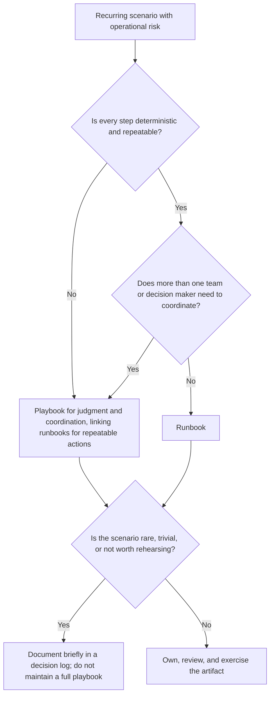
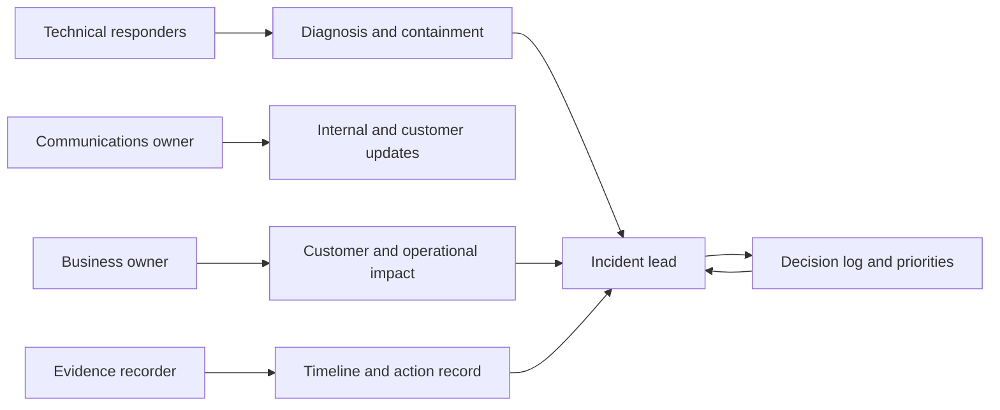
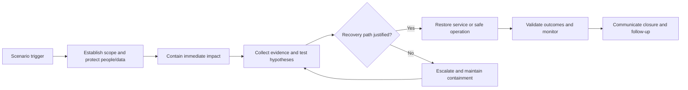
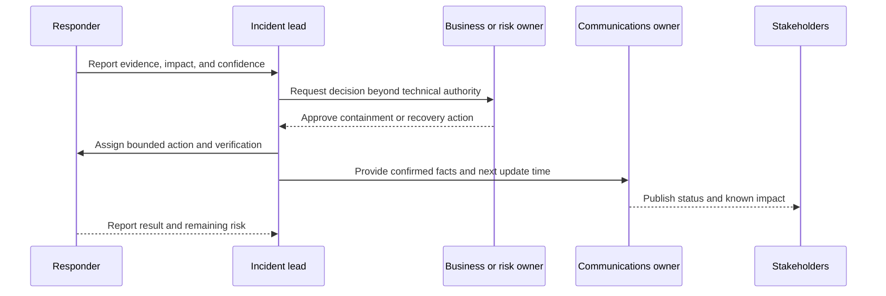
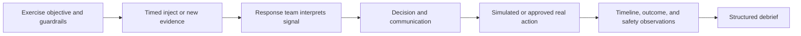
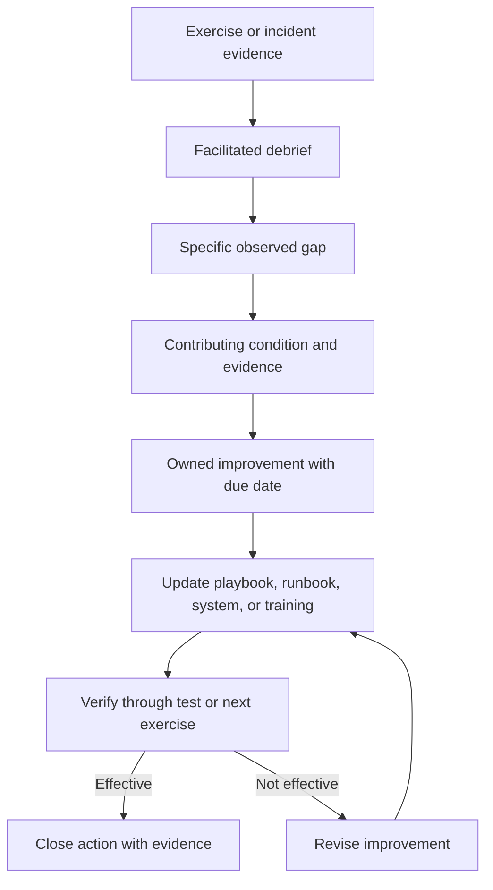

# Playbooks

Part: [21 — Architecture Documentation](PART_OVERVIEW.md) · Status: Drafted

## 1. Introduction

A playbook is a written plan for coordinating people and decisions through a recurring kind of scenario whose exact path cannot be known in advance: a regional outage, a suspected data exposure, a failed migration cutover, a vendor withdrawing a service. It records who is involved, who may decide what, what questions must be answered at each stage, what must be communicated and to whom, when to escalate, and when the scenario is over. It deliberately does not script every action. Where an action is deterministic and repeatable, the playbook points to a runbook and spends its words on the part a script cannot cover: judgment, authority, and communication.

Architects care because a system's design makes promises that only people can keep under stress. A design may claim that a region can fail over, that a corrupted data set can be restored, or that a compromised credential can be revoked within a defined time. Each claim depends on someone recognizing the situation, someone having the authority to choose the disruptive option, and someone telling the affected parties what is happening. If those human steps are undocumented, the architecture's resilience is a hypothesis. A playbook is the artifact that turns the human half of a design into something that can be reviewed, rehearsed, and improved. It also exposes architectural gaps cheaply: when a playbook author cannot name who decides whether to fail over, or which signal justifies it, the design is missing an input, and that is far better discovered at a desk than during an outage.

This chapter owns the playbook as an architecture-documentation artifact: its purpose, its anatomy, how it differs from a runbook, how to write one, and how to keep it truthful. The boundaries with neighbouring material are deliberate:

- Step-by-step executable procedures belong to [Runbooks](CH07_Runbooks.md); a playbook links to them rather than copying them.
- The threats and mitigations that make a scenario plausible belong to [Threat Models](CH09_Threat_Models.md), and the rationale for design choices that a playbook relies on belongs to [ADR: Architecture Decision Record](CH03_ADR_Architecture_Decision_Record.md) and [Decision Logs](CH10_Decision_Logs.md).
- Review of architecture artifacts, including playbooks, belongs to [Architecture Reviews](CH11_Architecture_Reviews.md).
- Alert design, paging, and detection mechanics belong to [Alerting](../14_Observability/CH10_Alerting.md); reliability targets and the policy for spending them belong to [Error Budgets](../14_Observability/CH13_Error_Budgets.md).
- Deliberate fault injection as an engineering practice belongs to [Chaos Engineering](../13_DevOps/CH17_Chaos_Engineering.md); this chapter covers only how scenario exercises are run against a playbook.
- Enterprise governance of architecture decisions belongs to [Architecture Governance](../18_Enterprise_Architecture/CH08_Architecture_Governance.md), and interpersonal practice belongs to [Conflict Resolution](../23_Soft_Skills/CH05_Conflict_Resolution.md) and [Stakeholder Management](../23_Soft_Skills/CH06_Stakeholder_Management.md).

After studying this chapter, a reader should be able to:

1. Define a playbook and distinguish it from a runbook, a policy, and a post-incident report.
2. Decide whether a scenario warrants a playbook, a runbook, both, or neither.
3. Describe the six elements of playbook anatomy: trigger, roles and decision rights, decision points, communication, escalation, and exit criteria.
4. Write decision points whose branches are testable against observable evidence.
5. Produce a complete playbook from a template, with links to runbooks instead of duplicated commands.
6. Critique an existing playbook for missing authority, vague triggers, and unverifiable claims.

## 2. Background and History

The word comes from sports, where a playbook is a collection of prepared plays that a team can call quickly because everyone has rehearsed their part. Operations borrowed the idea for the same reason: under pressure, people perform better against a shared, pre-agreed structure than against improvisation. The underlying practice is older than the word. Emergency-management frameworks such as the Incident Command System (ICS), which originated in wildland firefighting in the United States, formalized clear roles, a single accountable commander, and defined communication, because ad hoc coordination among many responders failed in large events. Many software organizations later adopted similar role structures for production incidents, often with their own names and variations. The details differ between organizations and are outside the scope of this chapter.

Two shifts matter to an architect. First, systems became distributed across teams and vendors, so a single scenario now spans people who do not report to one manager and may not share tools. A written playbook is how decision rights are made explicit across those boundaries. Second, playbooks moved from slide decks and wikis nobody opened to version-controlled text next to the system's other documentation, which makes them reviewable and diffable. The implication is that a playbook is best treated like code: owned, reviewed, tested, and retired when it no longer matches reality.

## 3. The Problem Playbooks Solve

Consider what happens without one. A critical service degrades. Several engineers join a call. Three theories emerge. Someone suggests failing over; nobody knows whether they may approve that, whether the standby data is fresh enough, or whom to tell. Customer-facing staff ask for an update and receive three different answers. Meanwhile an engineer who could settle the data-freshness question is not on the call because nobody knew to ask. None of these failures is technical. They are coordination failures: unclear authority, unclear questions, and unclear communication. The pattern is general and the scenario is illustrative, not a reported incident.

| Coordination failure | How it appears | What a playbook supplies |
| --- | --- | --- |
| Unclear trigger | Responders argue whether this is "bad enough" to act | Observable conditions that start the playbook, and who may declare it |
| Unclear authority | Nobody dares approve a disruptive action, or two people approve conflicting ones | Named decision rights and backups per decision |
| Parallel, unrecorded work | Two people make conflicting changes; nobody can reconstruct what was tried | One lead, one channel, one decision record |
| Inconsistent messages | Stakeholders hear different facts | A communication owner, a fixed update structure, and a cadence |
| Endless scenario | Response drifts on with no agreed end | Exit criteria and a handover to follow-up |
| Knowledge held by individuals | The one person who knows is on leave | Written decision questions and contacts, with backups |

Alternatives each solve part of the problem. A runbook captures procedures but not who decides to use them. A policy states required outcomes, such as "customers must be notified of material impact", without the mechanism. An on-call rotation assigns the first responder but not the multi-party coordination. An incident tool can route pages and host a timeline but cannot decide for you. A playbook is chosen when a scenario is recurring enough to rehearse, consequential enough that confusion is costly, and multi-party enough that coordination is itself a risk. If the scenario is rare, trivial, or fully mechanical, the cost of maintaining a playbook exceeds its value.

## 4. Playbook Versus Runbook

The two artifacts are complements and are often confused. A runbook is a step-by-step operational procedure: given a stated condition, perform these actions in this order, verify these outputs, roll back if this check fails. Its reader is whoever executes it, and success is mostly mechanical correctness. A playbook coordinates people and decisions across a scenario: who leads, what must be decided and by whom, what is communicated, when to escalate, and when to stop. Its reader is the group responding, and success is a good decision made in time with everyone informed.

| Dimension | Runbook | Playbook |
| --- | --- | --- |
| Core question | "How do I perform this operation safely?" | "Who decides what, and how do we coordinate?" |
| Shape | Ordered steps with expected outputs | Roles, decision points, branches, communication |
| Reader | The operator executing | The responding group and decision makers |
| Failure it prevents | Wrong or unsafe action | Delay, conflict, or silence |
| Length of validity | Until the system changes | Until the system, organization, or authority changes |
| Test | Run it in a safe environment | Exercise it with people and injected events |

They connect at the decision points. A playbook decision such as "is the standby data fresh enough to fail over?" has a branch whose action is "execute the failover runbook". The playbook owns the question and the approver; the runbook owns the commands. Keeping them separate lets each change at its own pace: a command syntax change should touch one runbook, not every playbook that mentions it. A common mistake is to paste runbook steps into a playbook so responders have everything in one place. The copies drift, and the playbook becomes too long to read under pressure. Link instead, and review the links.



The diagram is a selection aid, not a rule. Its implication is that the two artifacts form a stack: runbooks at the bottom for repeatable actions, playbooks above them for the choices about whether and when to run them. A scenario with no runbooks may still need a playbook, for example a vendor-outage scenario where the only available actions are communication and negotiation. A scenario with a runbook but no playbook is a hidden risk: the procedure exists, but nobody has agreed who may order it.

## 5. Anatomy of a Playbook

Every effective playbook answers six questions: what starts it, who does what and with what authority, what must be decided and on what evidence, what is said to whom, when to ask for more help, and what ends it. Each is an element a reviewer can check for presence and quality.

### 5.1 Trigger

The trigger states the condition that makes the playbook apply and who may declare it. Good triggers are observable and not interpretive: "the primary data store is unreachable from more than one availability zone for longer than a stated interval", not "major outage". Observability signals come from [Alerting](../14_Observability/CH10_Alerting.md); the playbook should name the signal and the threshold at which a human is entitled to invoke it, and also state that any responder may invoke it when in doubt. A trigger that is too high delays coordination; one that is too low trains people to ignore it. The usual compromise is a low declaration threshold with a cheap exit: it is better to declare and stand down than to hesitate. Include the symptoms that look similar but belong to another playbook, so responders can route correctly.

### 5.2 Roles and Decision Rights

The playbook names each role, what it may decide, and who backs it up. The usual set is a scenario lead who coordinates and owns the decision record, technical responders who diagnose and act, a communications owner who writes updates, a business or customer liaison who reports impact, a decision authority for actions beyond technical scope, and a recorder who keeps the timeline. A person may hold several roles in a small response. What must never be ambiguous is who decides and who communicates. Two principles help. First, separate coordination from hands-on diagnosis: a lead who is also debugging cannot watch the whole situation. Second, tie authority to the decision, not the job title: "approve failover that drops writes" may belong to a named business owner even though a technical lead can recommend it.



The diagram shows information converging on the lead, who holds the decision log, rather than responders coordinating with each other pairwise. That is the point of the role split: findings, impact, and the timeline all feed a single place where priorities are set. Role descriptions should therefore say what decisions the role can make and when it must escalate; a list of job titles without actions or authority fails the test. Contacts and backups belong in a current, access-controlled source linked from the playbook rather than pasted into it, because phone numbers and rotations change faster than the playbook does.

Edge cases deserve explicit text. If the designated lead is unreachable, who acts, and for how long? If the lead is conflicted, for example the responsible engineer for the failing change, who takes over? If the incident involves a vendor, who owns the relationship call? A playbook that answers only the happy-path assignment will fail exactly when staff are scarce.


### 5.3 Phases and Decision Points

A playbook orients responders through five checkpoints: establish scope, contain, investigate, recover, and close. These are checkpoints rather than a rigid chronology, because evidence changes and teams revisit earlier decisions. Each phase states its entry condition, objective, key questions, evidence to capture, and exit criteria. The real content lives in the decision points between phases, where the path branches. A decision point is useful only if it names the question, the evidence that answers it, the decision owner, and what each answer leads to. "Decide whether to fail over" is not a decision point; "Is replica lag below the agreed data-loss tolerance? Evidence: lag metric and last-verified write timestamp. Owner: business owner for data loss, lead for technical risk. Yes leads to the failover runbook; No leads to continued containment and escalation" is. Attach linked runbooks for deterministic operations rather than copying commands.



The loop between escalation and investigation matters: a "no" at the recovery decision does not end the scenario, it keeps containment in place and brings in more authority or expertise. Designing the branches this way prevents the common failure of a playbook that describes only success. The key trade-off is specificity versus durability. Precise thresholds make decisions fast but go stale when the system changes; vague thresholds survive but push judgment back to the moment of maximum stress. A reasonable rule is to state thresholds where they come from an agreed target and to link to the source of that target instead of restating its value.

### 5.4 Communication

Communication is half of the scenario. The playbook assigns a communications owner and defines the audiences: responders, internal stakeholders, affected customers, and, where applicable, regulators or partners. For each audience it fixes a channel, a cadence, and a structure. A durable structure for every update is: what is confirmed, what is suspected, who and what is affected, what is being done, and when the next update will be sent. Separating confirmed from suspected is the single most valuable habit, because it lets the writer communicate early without overclaiming. Do not wait for certainty to report material impact; state the uncertainty plainly. Technical speculation should stay in the responder channel until the lead promotes it. Where legal or privacy obligations might apply, the playbook should name who to consult and leave the interpretation to them; the architect's job is to ensure the consultation point exists, not to assert what the obligation is.

### 5.5 Escalation

Escalation is a defined route for requesting more authority, expertise, or resources. The playbook should state escalation conditions, not vague "if it gets worse": for example, no containment progress within a stated period, evidence of data integrity loss, a decision needing authority beyond the current role, or a conflict between responders the lead cannot resolve. Each condition names whom to contact and what to bring, typically a short summary, current impact, options considered, and the specific decision requested. Escalation has costs, including interrupting senior people and signalling alarm, so the playbook should make the threshold explicit and remove any stigma from using it. Authority questions of the enterprise kind belong to [Architecture Governance](../18_Enterprise_Architecture/CH08_Architecture_Governance.md); the playbook only records the route that applies during the scenario.

### 5.6 Exit Criteria

A playbook without an end condition invites responders to either stop too early or never stop. Exit criteria state observable conditions for each stage: service restored and verified for a stated period, containment confirmed, communications closed with a final update, and follow-up owners assigned. They also define handover: what moves from the scenario channel into a review process, who owns the timeline, and when the review happens. Standing down is itself a decision with an owner. For reviews of what happened, see [Architecture Reviews](CH11_Architecture_Reviews.md) for the artifact review practice; the post-scenario improvement loop appears later in this chapter.

## 6. A Playbook Template

The template below turns the six elements into a fill-in structure. Keep it short enough to read during a scenario: if a section is empty because it does not apply, say so and why, rather than deleting it, so reviewers can tell omission from irrelevance.

```markdown
# Playbook: <scenario name>

- Owner: <role and team>
- Last reviewed: <date>   Next review due: <date>
- Last exercised: <date and exercise reference>
- Related runbooks: <links>
- Related design records: <links to architecture decision records, threat models>

## 1. Purpose and Scope
What this playbook covers, what it does not, and which playbook applies instead.

## 2. Trigger
- Observable conditions (signal, threshold, duration) and who may declare.
- Look-alike symptoms that belong elsewhere.

## 3. Roles and Decision Rights
| Role | Decides | Escalates when | Backup |
| --- | --- | --- | --- |
Contacts are kept in: <link to access-controlled source>.

## 4. Phases and Decision Points
For each phase: entry condition, objective, key questions, evidence to capture, exit criteria.
For each decision point: question, evidence, owner, branch outcomes, linked runbook.

## 5. Communication
| Audience | Channel | Owner | First update | Cadence |
| --- | --- | --- | --- | --- |
Update structure: confirmed, suspected, impact, actions, next update time.

## 6. Escalation
Conditions, contacts, and what to bring.

## 7. Exit Criteria and Handover
Conditions to stand down, final communication, record location, review owner and date.

## 8. Constraints
Safety limits, actions requiring approval, data-handling rules.

## 9. Change History
```

Three design choices in the template deserve comment. The header records ownership and review dates because an unowned playbook decays silently. The "Related runbooks" and "Related design records" fields enforce linking over copying. And the "Constraints" section places hard limits, such as actions that must never be taken without approval, in one findable place instead of scattering them through prose.

## 7. Worked Example: Failover Decision for a Regional Data Store

The following is an illustrative, hypothetical playbook excerpt for a fictional order platform whose primary data store runs in one region with an asynchronously replicated standby in another. All names, thresholds, and periods are invented for teaching. A real playbook would take its values from the system's own recovery targets.

**Trigger.** The order platform's data store is unreachable from the application tier for longer than the agreed detection interval, confirmed by a second independent signal. Any on-call engineer may declare. Look-alike: elevated latency without errors belongs to a separate degradation playbook.

**Roles.** Scenario lead (on-call senior engineer); technical responder for data; communications owner; business owner for order data, who alone approves actions that can lose acknowledged orders; recorder. Backups are listed for each role. If the scenario lead has not acknowledged within the agreed interval, the secondary on-call becomes lead.

**Phase 1, establish scope.** Questions: Is the failure the store, the network path, or the application tier? Is data integrity in doubt? Evidence: health checks from two vantage points, recent change list, replication status. Exit: scope statement posted in the scenario channel.

**Decision point A, is failover justified?** Evidence: a primary recovery estimate from the platform owner and the standby's replication lag. Branches:

1. Primary expected back within the tolerable outage period: continue containment, set a re-evaluation time.
2. Primary not recoverable in that period and lag within the data-loss tolerance: seek business owner approval, then run the failover runbook.
3. Primary not recoverable and lag exceeds tolerance: escalate; the business owner chooses between waiting and failing over with accepted order loss. This choice is never made by the technical team alone.

**Decision point B, is there any integrity or security concern?** If corruption or unauthorized access is suspected, failover may copy the problem. The lead consults the security owner before any irreversible action.

**Communication.** First update within the agreed period after declaration, then at the stated cadence, each in the confirmed, suspected, impact, actions, next-update structure. Customer-facing text is approved by the communications owner and never quotes unconfirmed causes.

**Exit.** Orders flowing in the standby region and verified by sampling; reconciliation owner named for any orders between the last replicated write and the failure; final update sent; review scheduled.

The example shows the division of labour. The playbook owns the questions, evidence, and approvers; the failover runbook owns the commands. It also shows why decision rights are explicit: the third branch is a business decision about acceptable data loss, and writing that down in advance prevents a technical team from quietly making it.

## 8. What a Playbook Is Not For

Playbooks are over-applied, and the following misuses cause most of the harm.

- **Not a script.** If every step is deterministic, write a runbook. A playbook that tries to dictate each action will be ignored the first time reality differs.
- **Not a substitute for design.** If the playbook's main content is a long manual workaround for a fragile component, the component is the problem; record the gap in [Decision Logs](CH10_Decision_Logs.md) and fix the architecture.
- **Not a policy statement.** Required outcomes, such as notification obligations, belong in policy. The playbook says how the team meets them, and it must not assert legal conclusions.
- **Not an assignment of blame.** It names roles, not culprits. A playbook used to punish discourages declaring scenarios early.
- **Not a document that proves readiness.** An unexercised playbook is an untested claim. Whether it works is shown by exercises, which this chapter covers next.
- **Not for every scenario.** Each playbook costs review and exercise time. Reserve them for scenarios that are recurring or severe and multi-party.

## Make Decisions and Communications Visible

Define which decisions require incident-lead approval, business approval, security or privacy consultation, or executive escalation. Communications should distinguish confirmed facts, hypotheses, impact, actions, and next update time. Do not wait for perfect certainty before communicating material impact; state uncertainty plainly.



The playbook should identify a decision owner for irreversible or customer-impacting actions. Record dissent and rationale when a decision is contested. Avoid sending technical speculation as confirmed external communication.

## Exercise Injects and Observe Responses

Exercises introduce events or constraints to evaluate how the team responds. Injects can reveal a lost dependency, conflicting evidence, staff unavailability, or an unexpected customer impact. The exercise controller should record inject time, expected decision, actual action, evidence, and any unsafe assumption. Keep production exercises within a preapproved safety boundary.



An exercise is useful when it tests a named capability, such as escalation, data recovery, or customer communication. Avoid surprise tests that exceed authorized scope. Stop criteria and a safety controller are required when the exercise touches production systems.

## Turn Findings Into Improvements

After action, compare intended outcome with actual response. Identify gaps in authority, information, tooling, procedures, training, or architecture. Assign one owner and due date per improvement, then update the playbook, runbooks, monitoring, or system design. Track closure and validate the change in a later exercise.



Avoid blame-focused reviews that discourage reporting. Distinguish an individual mistake from a system condition such as unclear decision rights, missing access, or an unsafe default. Preserve the event timeline and decisions while protecting sensitive incident data.

## Worked Case: Regional Data-Service Outage

A playbook coordinates response when a regional data service becomes unavailable. The incident lead establishes scope and assigns technical diagnosis, customer impact, and communications. The security owner is consulted if data integrity or unauthorized access is suspected. A linked runbook provides the safe failover procedure; the playbook governs whether the evidence supports using it and who approves the action.

An exercise injects stale replication data and an unavailable regional lead. The team discovers that the fallback decision owner is undocumented and that the customer update cadence is unclear. Follow-up actions assign a backup authority, add a data-freshness decision point, and update the status template. A later exercise verifies the changes.

## Review Questions

1. Which decisions belong to the playbook rather than an executable runbook?
2. Are roles, authority, and backups explicit?
3. How does the team communicate uncertainty and next updates?
4. Which safety boundaries constrain exercises?
5. How are findings assigned and verified after the event?

Playbooks coordinate judgment and people when the path is uncertain. Make roles and authority explicit, link repeatable actions to runbooks, exercise within safe boundaries, and turn observed gaps into owned and verified improvements.
