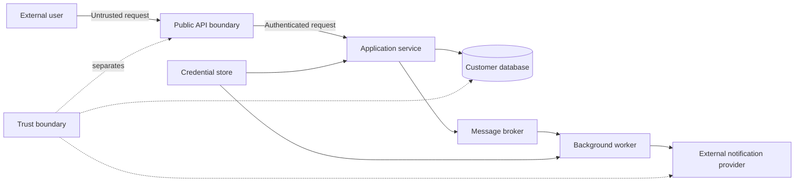
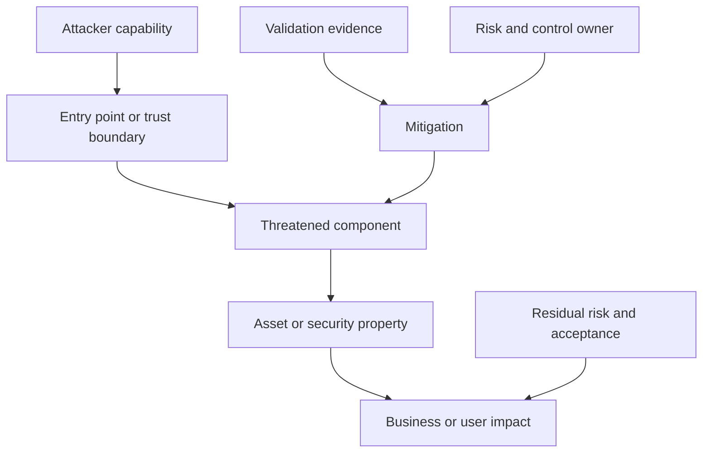
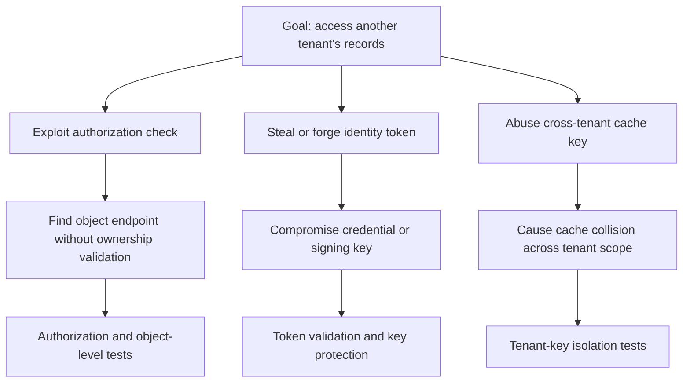
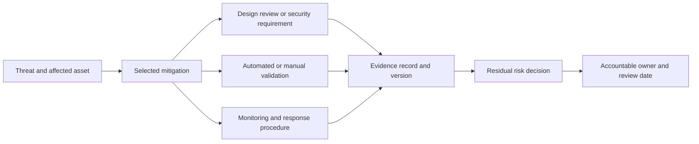
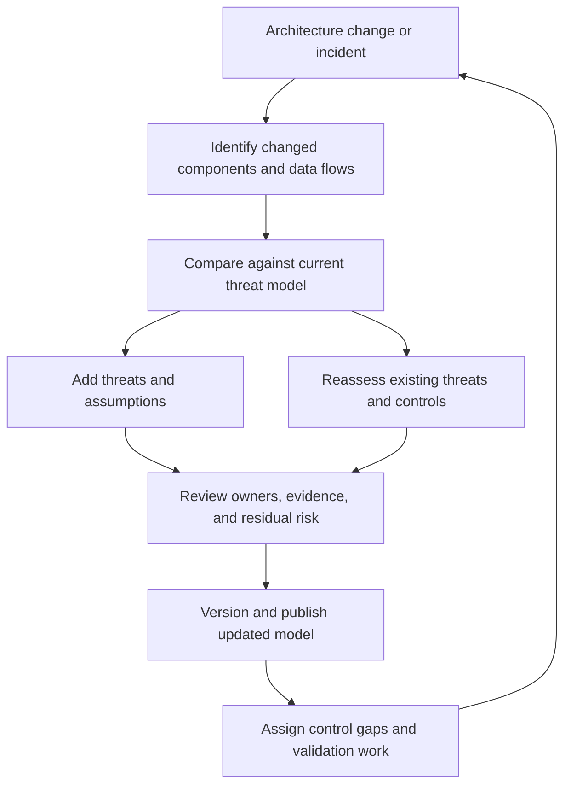

# Threat Models

Part: [21 — Architecture Documentation](PART_OVERVIEW.md)

A threat model is a maintained architecture artifact that records system assets, data flows, trust boundaries, attacker goals, threats, controls, residual risks, and accountable owners. It communicates security assumptions and evidence to teams that design, build, and operate the system. Part 15 owns threat-modeling methods and security foundations; this chapter owns the durable documentation practice.

## Capture Assets, Flows, and Trust Boundaries

Begin with the system scope, actors, assets, entry points, data stores, processes, and trust boundaries. A data-flow diagram should show how sensitive information crosses components and administrative domains. State what is intentionally excluded and why. A threat model without a current architecture context can miss new integrations or deployment paths.

Mark identity, authorization, encryption, and data classification where they change the threat. Show where credentials are created and used. Avoid drawing network boxes without indicating which trust assumptions differ across them.

## Link Threats to Components and Attack Goals

Threat identification can use a structured method such as STRIDE (Spoofing, Tampering, Repudiation, Information Disclosure, Denial of Service, and Elevation of Privilege), abuse cases, or a domain-specific taxonomy. Part 15 owns how to conduct that analysis. The artifact should link each threat to affected assets and components, plausible attacker capability, impact, controls, validation evidence, residual risk, and owner.

Threats should be specific enough to test. “The API is insecure” is not actionable. “An unauthenticated caller can enumerate customer identifiers through the search endpoint” identifies actor, path, and impact. Record uncertainty and assumptions rather than assigning a precise score unsupported by evidence.

## Represent Attack Paths

An attack tree decomposes a goal into alternative paths and required conditions. It helps teams see that several controls may depend on one assumption, such as a trusted identity token or safe deserialization. Pair the tree with component ownership and evidence; a diagram alone does not quantify likelihood or prove mitigation.

Keep path assumptions explicit: required access, skill, timing, or system weakness. Prioritize paths by impact and evidence rather than visual depth. Add new branches when architecture or incident evidence reveals a materially different route.

## Trace Mitigations to Validation Evidence

Controls need evidence appropriate to their claim. A design control may have a review record; an enforcement control may need automated tests, configuration checks, or monitored signals. Record evidence location, version, owner, and last validation date. A mitigation without an owner or verification path should remain an open action, not be marked complete.

Different evidence types prove different things. A passing test does not prove a production configuration remains correct; a policy document does not prove the control is enforced. Link complementary evidence and state its scope and limitations.

## Update the Model When Architecture Changes

Threat models decay as systems change. Triggers include new data classes, trust boundaries, identities, external dependencies, deployment regions, privileged operations, major incidents, and significant version changes. A scheduled review is useful, but event-triggered updates catch changes sooner. Preserve version history and show which threats were added, mitigated, accepted, or retired.

Track model freshness with owner, system version, last review, and known change triggers. If the system has no threat-model owner, assign one before relying on the artifact for release decisions.

## Worked Case: Multi-Tenant File Sharing

A file-sharing service accepts uploads, stores objects, generates previews, and shares links with users. The threat model maps public upload, processing workers, object storage, metadata database, and external identity provider. It records cross-tenant access, malicious-file processing, link guessing, and resource exhaustion as threats with affected assets and owners.

Controls include tenant-scoped authorization, isolated processing, upload limits, short-lived sharing tokens, and abuse monitoring. Evidence links to object-level access tests, malware-processing isolation checks, configuration review, and alert exercises. A new preview provider changes the data-flow boundary and triggers a model update before integration; privacy and security owners review retention and provider access assumptions.

## Review Questions

1. Which assets and data flows cross the system's trust boundaries?
2. Can each threat be traced to an attacker capability and business impact?
3. Which evidence validates each mitigation, and what does it not prove?
4. Who accepts residual risk and owns follow-up actions?
5. Which architecture changes trigger a threat-model update?

A threat model remains useful when it is tied to current architecture and accountable control evidence. Keep the scope explicit, connect threats to assets and owners, record residual risk, and update the artifact when trust boundaries or data flows change.
