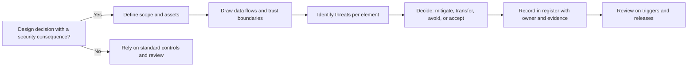
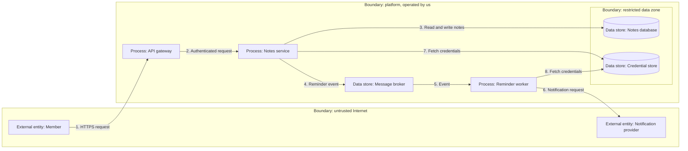
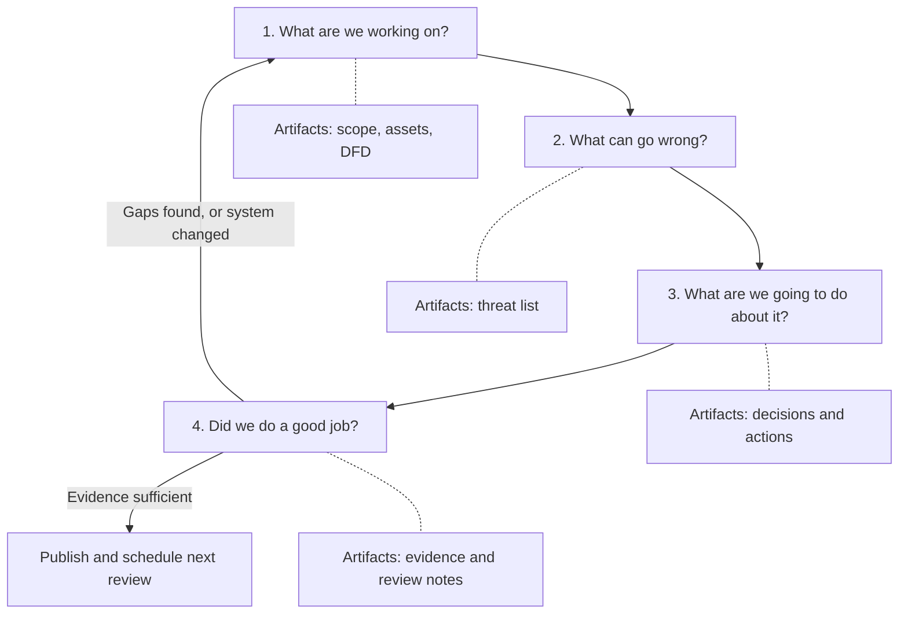
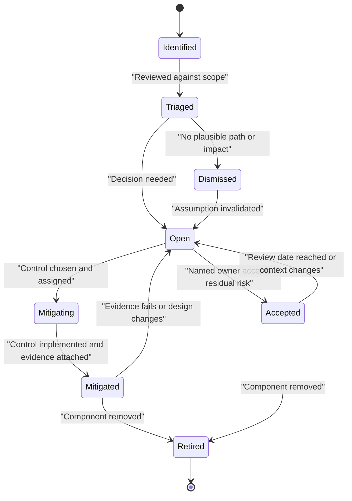
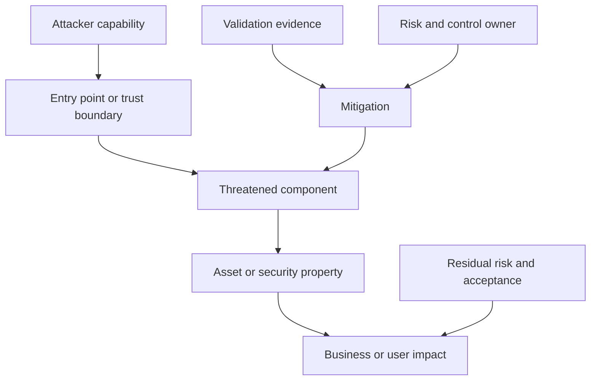
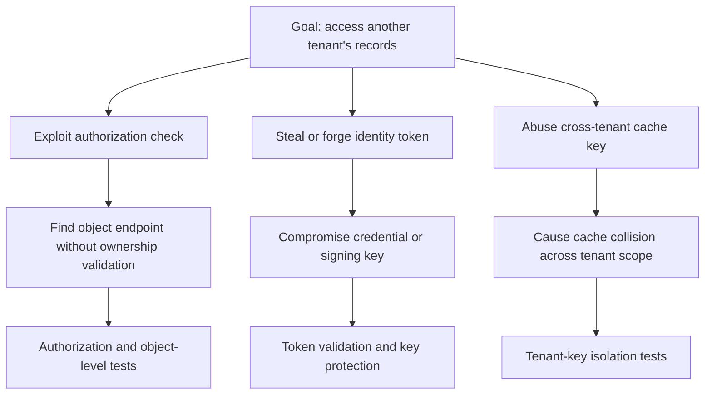
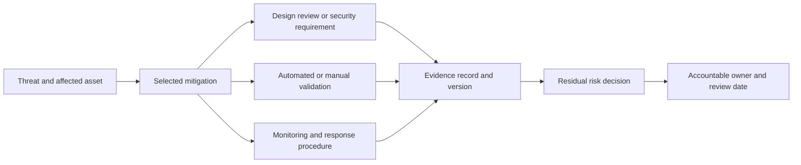
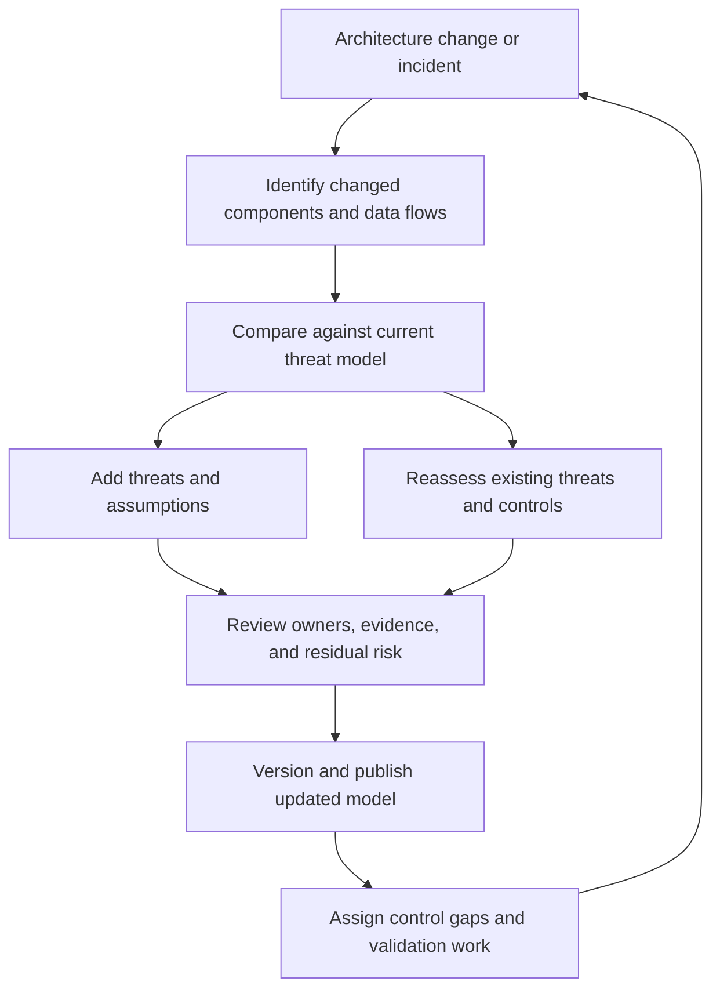

# Threat Models

Part: [21 — Architecture Documentation](PART_OVERVIEW.md) · Status: Drafted

## 1. Introduction

A threat model is a structured, written statement of what a system is trying to protect, who or what could plausibly harm it, how, and what the design does about it. Most architecture artifacts describe what the system does. A threat model describes what the system must survive. It is the one view in which the reader is asked to take the side of an adversary, a careless insider, or a misbehaving dependency, and to ask where the design's assumptions break.

For an engineer moving into architecture, the threat model matters for a practical reason: security defects that originate in design cannot be fixed by careful coding. If a design lets any authenticated user request any customer's record by identifier, every correct line of code implements that flaw faithfully. Such flaws are cheapest to find while the design is still a diagram, and the threat model is the artifact that makes the search systematic instead of dependent on who happens to be in the room. It also gives architects a defensible answer to "is this safe enough to release?": not a claim of safety, but a record of what was considered, what was decided, and who accepted what remains.

The artifact has a second life that is easy to overlook. A threat model that lives in one engineer's head, or in a slide deck from the design phase, helps nobody a year later when a new integration is proposed. Treated as documentation, it is something a newcomer can read to learn the system's security assumptions, something a reviewer can diff when the architecture changes, and something an operator can consult when an alert fires.

This chapter owns the documentation artifact: how a threat model is scoped, recorded, structured, reviewed, and kept current. The boundaries with neighbouring material are deliberate:

- The methodology of conducting threat modelling as a security activity, and the security foundations beneath it, belong to [Threat Modeling](../15_Security/CH12_Threat_Modeling.md) in the Security part; this chapter recaps only what is needed to record the results.
- Where threat modelling sits in the secure development lifecycle belongs to [Secure SDLC](../15_Security/CH13_Secure_SDLC.md).
- Trust assumptions across network and identity boundaries belong to [Zero Trust](../15_Security/CH08_Zero_Trust.md); this chapter records the assumptions a model relies on, not the zero-trust strategy.
- The API-boundary threat model and control placement belong to [API Security](../08_API_Architecture/CH09_API_Security.md).
- The structural views from which assets, components, and boundaries are taken belong to the [C4 (Context, Containers, Components, Code) Model](CH01_C4_Model.md), and network and hosting boundaries belong to [Deployment Diagrams](CH06_Deployment_Diagrams.md).
- The recorded rationale for a security decision belongs to [ADR: Architecture Decision Record](CH03_ADR_Architecture_Decision_Record.md) and [Decision Logs](CH10_Decision_Logs.md); the threat model cites such decisions rather than restating them.
- How a threat model is examined in a design review belongs to [Architecture Reviews](CH11_Architecture_Reviews.md).

After studying this chapter, a reader should be able to:

1. Explain what a threat model asserts, what it deliberately does not, and the questions it exists to answer.
2. Define scope, identify assets, and draw a data-flow diagram that marks trust boundaries where the assumptions change.
3. Apply the four-question framing to organize a model and a review of it.
4. Apply STRIDE (Spoofing, Tampering, Repudiation, Information Disclosure, Denial of Service, Elevation of Privilege) to each element of a diagram and decide which findings are worth recording.
5. Record findings in a threat register with enough structure to be tested, owned, and tracked to closure.
6. Work through a complete, hypothetical example from scope to register, and recognize what a threat model is not suitable for.

## 2. Background and History

Thinking about attackers as a design input is older than any single method; early secure-system work already reasoned about adversary capabilities. The facts an architect most needs are narrower. STRIDE originated at Microsoft in the late 1990s as a mnemonic for categories of threat, and was later popularized through Microsoft's secure development practices and published books on the subject; the exact authorship and dates are best checked against those sources. Attack trees, a way of decomposing an attacker's goal into alternative paths, were popularized by Bruce Schneier in the late 1990s. Data-flow diagrams (DFDs), the drawing style most threat-modelling guidance builds on, come from structured analysis in software engineering, long before security use.

The practical shift since then is cultural more than technical. Early practice treated a threat model as a one-time, expert-led workshop that produced a large document. Contemporary guidance, including community statements such as the Threat Modeling Manifesto, emphasises repeated, lightweight, team-owned analysis that produces findings people act on. The implication for documentation is that the artifact must be cheap to update and live beside the system it describes, because a model that is expensive to revise is revised rarely.

## 3. The Problem Threat Models Solve

Reviews that ask "is it secure?" produce opinions. Reviews that ask "what are we protecting, from whom, across which boundary, and what happens if this control fails?" produce findings. A threat model turns the first kind of conversation into the second. The patterns below are general, not reported incidents.

| Hidden problem | How it stays hidden | What the model forces you to state |
| --- | --- | --- |
| Unclear scope | "The system" is assumed to mean everything | Which components, data, and actors are in and out of scope |
| Unstated trust | A service accepts input because "it is internal" | Which components are trusted, by whom, and why |
| Unowned assumptions | Authorization is "handled somewhere" | Which component enforces each check, and who owns it |
| Uneven attention | Teams analyse what they know, such as login | Every element and flow gets the same set of questions |
| Silent acceptance | A known gap is forgotten after release | Who accepted the residual risk, and when it is reviewed |

Alternatives address related needs. A compliance checklist confirms the presence of required controls but does not discover threats specific to this design. A penetration test examines the built system and finds what exists, but late, and only what the testers reach. A code review finds implementation defects but rarely design-level ones. A threat model is chosen when the decision at hand is design-level: a new trust boundary, a new class of data, a new integration, a new privileged operation. It complements these other activities rather than replacing them.

The flow shows that drawing is the third step, not the first: scope and assets come before the diagram, otherwise the diagram has no boundary of relevance. It also shows that the work does not end with a list of threats; each finding ends in a decision and a record, and the record is maintained. The maintenance step is developed later in this chapter.

## 4. Scope, Assets, Trust Boundaries, and Data-Flow Diagrams

### 4.1 Scope and assets

A model starts with a scope statement: the system or change being analysed, the version or date, what is explicitly excluded, and why. Exclusions matter as much as inclusions. "The managed identity provider is out of scope; we assume it authenticates users correctly" is a legitimate, reviewable assumption. Silence about the identity provider is a gap.

An asset is something whose compromise would hurt someone: customer data, credentials and signing keys, availability of a revenue-bearing function, the integrity of financial records, the reputation of an operator, or the safety of a person. Naming assets first is what separates a threat model from a list of vulnerabilities. A weakness in a component that holds nothing of value and reaches nothing of value is a defect to fix, not a threat to model. For each asset, record the security property that matters: confidentiality (only the right parties read it), integrity (only the right parties change it, and changes are detectable), or availability (it can be used when needed). Where the organization classifies data, cite the class rather than inventing a new one.

### 4.2 Trust boundaries

A trust boundary is a line across which the level of trust, or the party who controls the code or data, changes. Crossing it is where input must be treated as untrusted and where identity, authorization, and validation checks belong. Typical boundaries include the Internet to a public gateway, a user's device to the service, one tenant's data to another's, an internal service to a third-party provider, a process running unprivileged to one running with elevated rights, and a build pipeline to production.

Boundaries are defined by control and assumption, not by network geometry. Two services in the same cluster and the same subnet can sit on different sides of a boundary if one is run by a different team with different privileges, or if one processes untrusted uploads. Conversely, a firewall between two components operated by the same team may mark no useful boundary at all. The decision test is: if the component on one side were compromised or buggy, would the other side need to defend itself? If yes, draw a boundary.

### 4.3 Data-flow diagrams

A data-flow diagram (DFD) shows four kinds of element: external entities (actors or systems outside your control), processes (code that transforms or routes data), data stores (data at rest), and data flows (data moving between them), with trust boundaries drawn around groups of elements. It is chosen over a component diagram for this purpose because it makes data movement and boundary crossing the main subject, and over a sequence diagram because it covers all flows at once rather than one scenario.

The diagram makes several things visible that a component view would not. Flows 1 and 6 cross the outer boundary, so both need explicit treatment: the first carries untrusted input in, the second carries data out to a party that the platform does not control. Flows 3, 7, and 8 cross into the restricted zone, so the data stores should not trust their callers merely because they are "inside". The worker holds a credential and talks to an external system, which makes it a lateral-movement target even though it exposes no public interface. These observations are the raw material for threats.

Practical conventions help keep a DFD useful. Number the flows so the register can refer to them. Label each flow with its protocol or data class where that changes the threat. Draw each boundary once and name it. Stop decomposing when further detail would not change a threat or a control. Link each element to its entry in the structural views rather than redefining it. Failure modes include a diagram so detailed it duplicates the architecture documentation, one so coarse that all flows collapse into a single arrow, and one that omits flows that exist only in operations, such as backups, administrative access, and deployment pipelines.

## 5. The Four-Question Framing

A widely used way to organize threat modelling asks four questions: what are we working on, what can go wrong, what are we going to do about it, and did we do a good job. This framing is commonly attributed to Adam Shostack and is reflected in community guidance such as the Threat Modeling Manifesto; treat the attribution as general rather than exact. It is useful here because each question corresponds to a part of the document, which gives the artifact a stable structure.

| Question | What it produces | Where it is recorded |
| --- | --- | --- |
| What are we working on? | Scope, assets, DFD, assumptions | The scope and diagram sections of the model |
| What can go wrong? | Candidate threats per element and flow | The threat register, one row per threat |
| What are we going to do about it? | A decision per threat: mitigate, avoid, transfer, or accept | The mitigation and status columns |
| Did we do a good job? | Evidence of review, tests, and coverage | The evidence column and the review record |

The loop in the diagram is the important feature. The fourth question can send the team back to the first: reviewing a model often reveals a missing component, a flow nobody drew, or an assumption that cannot be verified. A team that treats the four questions as a linear checklist produces a document; a team that treats them as a loop produces a model. The same framing doubles as a review agenda: a reviewer can ask of any model whether each question has a visible answer.

The third question has four standard answers, and a register should use them explicitly. Mitigate means add or change a control. Avoid means change the design so the threat no longer exists, for example by not storing the data. Transfer means shift the risk to another party by contract or insurance, which does not remove it. Accept means a named person decides to live with it. "Accept" without a name and a review date is indistinguishable from "forgot".

## 6. STRIDE Per Element

STRIDE gives a short checklist of threat categories, each the violation of a security property. Spoofing (S) is pretending to be someone or something else, violating authenticity. Tampering (T) is modifying data or code without authorization, violating integrity. Repudiation (R) is denying an action when the system cannot prove otherwise, violating non-repudiation. Information Disclosure (I) is exposing data to those not entitled to it, violating confidentiality. Denial of Service (D) is making a function unavailable, violating availability. Elevation of Privilege (E) is gaining capabilities beyond those granted, violating authorization.

Applying STRIDE per element means walking each element in the DFD and asking only the categories that can apply to that element type. Broadly, external entities are subject to spoofing and repudiation; processes to all six; data stores to tampering, information disclosure, and denial of service (and repudiation where they hold audit logs); data flows to tampering, information disclosure, and denial of service. This is a heuristic from common STRIDE practice, not a law, and a team may add categories where its system warrants.

| Element type | S | T | R | I | D | E | Typical prompt |
| --- | --- | --- | --- | --- | --- | --- | --- |
| External entity | yes | | yes | | | | Can someone claim to be this entity, or deny what it did? |
| Process | yes | yes | yes | yes | yes | yes | What happens if this process is fed hostile input or its caller lies? |
| Data store | | yes | maybe | yes | yes | | Who can read or change this data, and is it detectable? |
| Data flow | | yes | | yes | yes | | Can this data be altered, observed, or blocked in transit? |

Why choose STRIDE over alternatives? An attacker-centric approach asks "who would attack us and why", which depends on knowing adversaries and tends to produce long speculative lists. An asset-centric approach starts from valued assets and works outward, which is excellent for prioritization but can miss threats to components that merely provide a path. STRIDE is element-centric: it guarantees coverage of the diagram, requires little security expertise to start, and yields prompts that map onto familiar controls. Its weaknesses are real: it can generate many low-value findings, it does not rank them, and it focuses on technical elements, so business-logic abuse and human factors need separate attention. Using it alongside abuse cases or attack trees, which Part 15 covers, is common. Part 15's [Threat Modeling](../15_Security/CH12_Threat_Modeling.md) owns how to run the analysis; here the point is how to record its result.

Edge cases deserve explicit handling. A trust boundary crossing inside a single process, such as a plug-in running in the host's address space, still warrants analysis even though no network is involved. A flow that is encrypted in transit can still be subject to tampering at either endpoint, so "encrypted" is not a complete answer to tampering. A threat that applies to many elements, such as log tampering, should be recorded once with all affected elements listed, not duplicated.

Not every STRIDE prompt yields a threat worth recording. A sound filter is: is there a plausible actor with a path to the element, and would the consequence matter to a named asset? Findings that fail both are noted as considered and dismissed, with a short reason, because a reviewer will otherwise ask whether they were forgotten.

## 7. The Threat Register

The register is the durable core of the artifact: a table with one row per threat, kept in the repository as text so changes appear in diffs. Its columns exist to make each threat testable, ownable, and closable.

| Column | Purpose | Guidance |
| --- | --- | --- |
| ID | Stable reference | Never reused; code, tests, and tickets cite it |
| Element or flow | Where the threat applies | Use the DFD flow number or element name |
| Threat | What can go wrong | Actor, path, and impact in one specific sentence; include the STRIDE category |
| Likelihood and impact reasoning | Why it matters | A short written rationale, not only a label; state the assumed attacker capability |
| Mitigation | Decision and control | Mitigate, avoid, transfer, or accept; name the control |
| Owner | Accountable person or team | One owner per row; a team name alone is weak |
| Status | Position in the lifecycle | For example open, mitigated, accepted, or retired, with date |
| Evidence | Proof the control exists and works | Link to a test, configuration check, review record, or monitor; state what it does not prove |

Likelihood and impact deserve care. Numeric scores look precise but, without data, they record the author's opinion in a form that resists challenge. A defensible alternative is a coarse scale (for example low, medium, high) paired with the reason: "high impact because it exposes all members' notes; medium likelihood because exploitation needs a valid account and knowledge of the identifier format". The reasoning is what a reviewer can dispute and what a later reader can reassess when circumstances change. Where the organization mandates a scoring scheme, follow it and still record the reasoning.

The state diagram makes three rules explicit. A threat moves to mitigated only when evidence is attached, never on the strength of a ticket being closed. Accepted and mitigated states are not terminal: they return to open when the review date arrives, when evidence fails, or when the design changes. And retirement requires a reason, typically the removal of the component, so the register does not silently shrink.

Common register failures are predictable. Rows written at the level of "the system could be attacked" cannot be tested. Rows with no owner never close. Evidence columns filled with links to design documents prove intent but not enforcement. A register that grows without triage becomes noise; recording dismissed threats with reasons keeps the active list short without losing history.

## 8. Worked Example: A Team Notes Service

The following scenario is illustrative and hypothetical. A small organization runs a "team notes" service. Members sign in through an external identity provider, create and share notes, and receive email reminders. The scope is the notes service and its reminder worker, shown in the DFD earlier in this chapter. Out of scope, with reasons recorded: the identity provider (assumed to authenticate correctly, owned by another party), the notification provider's internal security, and the end user's device.

Assets and properties: note content (confidentiality and integrity, classified internal), the credential store contents (confidentiality), the reminder function (availability, low business criticality), and the audit trail of sharing actions (integrity). Assumptions recorded: the gateway terminates and validates tokens; the notes service trusts only gateway-issued identity headers; note identifiers are unguessable but not secret.

Applying STRIDE per element to selected flows yields the following excerpt of the register. The ratings are the authors' hypothetical reasoning, not measurements.

| ID | Element or flow | Threat | Reasoning | Mitigation | Owner | Status | Evidence |
| --- | --- | --- | --- | --- | --- | --- | --- |
| T-01 | Flow 1, gateway (S) | A caller replays or forges a token to impersonate a member | Impact high: full member access. Likelihood medium: token theft from a device is realistic | Mitigate: short-lived tokens, signature and audience validation at the gateway | Platform team | Mitigated | Gateway validation tests; configuration check in release pipeline; does not cover stolen but valid tokens |
| T-02 | Flow 3, notes service to database (E) | A member reads another member's note by changing the note identifier | Impact high: cross-member disclosure. Likelihood high: needs only a valid account | Mitigate: ownership check on every read and write in the service | Notes team | Open | Object-level authorization tests planned |
| T-03 | Flow 2, gateway to service (S) | A compromised workload calls the service directly, bypassing the gateway, with forged identity headers | Impact high. Likelihood low: needs a foothold inside the platform | Mitigate: service accepts only calls authenticated at the transport layer from the gateway | Platform team | Open | None yet |
| T-04 | Credential store (I) | The worker's credentials grant access to the notes service's secrets | Impact medium. Likelihood low | Mitigate: per-workload credentials with narrow access policy | Platform team | Mitigated | Access policy review record, dated |
| T-05 | Flow 6, worker to provider (I) | Note text is included in reminder emails and disclosed to the provider and mail path | Impact medium: content leaves the platform. Likelihood certain by design | Avoid: send reminders without note content | Notes team | Mitigated | Payload contract test |
| T-06 | Audit trail (R) | A member denies sharing a note because share events are not logged | Impact low. Likelihood medium | Mitigate: append-only share events with actor and time | Notes team | Accepted until next quarter by the product owner, review date recorded | Decision record linked |

Three lessons from the excerpt. First, T-03 exists only because the diagram showed a trust boundary inside the platform; a "trusted internal network" assumption would have hidden it, and its empty evidence cell shows an honest gap rather than a claim. Second, T-05 was resolved by changing the design rather than adding a control, which is usually the strongest option and is visible only because the register has an "avoid" decision. Third, T-06 shows acceptance done properly: a named decision-maker, a bounded period, and a linked record, which ties to [Decision Logs](CH10_Decision_Logs.md). A real model would also include threats to the database, the broker, and denial of service, which this excerpt omits for brevity.

## 9. What a Threat Model Is Not For

A threat model is not a guarantee of security. It records the threats the team thought of; threats nobody imagined are absent by construction, so its value is in structured coverage, not completeness. It is not a substitute for testing: it states what controls should exist, and evidence is required to show that they do. It is not a compliance certificate, though it can supply evidence to an audit. It is not a one-time gate before release, since a model that is not revised when the system changes becomes a statement about a system that no longer exists. It is not a risk quantification exercise, and numeric scores without data should not be treated as measurements. Finally, it is not a place to store vulnerability findings from scanners; those belong in the vulnerability management process, and the model should cite them only where they inform a threat.

## Link Threats to Components and Attack Goals

Threat identification can use a structured method such as STRIDE (Spoofing, Tampering, Repudiation, Information Disclosure, Denial of Service, and Elevation of Privilege), abuse cases, or a domain-specific taxonomy. Part 15 owns how to conduct that analysis. The artifact should link each threat to affected assets and components, plausible attacker capability, impact, controls, validation evidence, residual risk, and owner.

Threats should be specific enough to test. “The API is insecure” is not actionable. “An unauthenticated caller can enumerate customer identifiers through the search endpoint” identifies actor, path, and impact. Record uncertainty and assumptions rather than assigning a precise score unsupported by evidence.

## Represent Attack Paths

An attack tree decomposes a goal into alternative paths and required conditions. It helps teams see that several controls may depend on one assumption, such as a trusted identity token or safe deserialization. Pair the tree with component ownership and evidence; a diagram alone does not quantify likelihood or prove mitigation.

Keep path assumptions explicit: required access, skill, timing, or system weakness. Prioritize paths by impact and evidence rather than visual depth. Add new branches when architecture or incident evidence reveals a materially different route.

## Trace Mitigations to Validation Evidence

Controls need evidence appropriate to their claim. A design control may have a review record; an enforcement control may need automated tests, configuration checks, or monitored signals. Record evidence location, version, owner, and last validation date. A mitigation without an owner or verification path should remain an open action, not be marked complete.

Different evidence types prove different things. A passing test does not prove a production configuration remains correct; a policy document does not prove the control is enforced. Link complementary evidence and state its scope and limitations.

## Update the Model When Architecture Changes

Threat models decay as systems change. Triggers include new data classes, trust boundaries, identities, external dependencies, deployment regions, privileged operations, major incidents, and significant version changes. A scheduled review is useful, but event-triggered updates catch changes sooner. Preserve version history and show which threats were added, mitigated, accepted, or retired.

Track model freshness with owner, system version, last review, and known change triggers. If the system has no threat-model owner, assign one before relying on the artifact for release decisions.

## Worked Case: Multi-Tenant File Sharing

A file-sharing service accepts uploads, stores objects, generates previews, and shares links with users. The threat model maps public upload, processing workers, object storage, metadata database, and external identity provider. It records cross-tenant access, malicious-file processing, link guessing, and resource exhaustion as threats with affected assets and owners.

Controls include tenant-scoped authorization, isolated processing, upload limits, short-lived sharing tokens, and abuse monitoring. Evidence links to object-level access tests, malware-processing isolation checks, configuration review, and alert exercises. A new preview provider changes the data-flow boundary and triggers a model update before integration; privacy and security owners review retention and provider access assumptions.

## Review Questions

1. Which assets and data flows cross the system's trust boundaries?
2. Can each threat be traced to an attacker capability and business impact?
3. Which evidence validates each mitigation, and what does it not prove?
4. Who accepts residual risk and owns follow-up actions?
5. Which architecture changes trigger a threat-model update?

A threat model remains useful when it is tied to current architecture and accountable control evidence. Keep the scope explicit, connect threats to assets and owners, record residual risk, and update the artifact when trust boundaries or data flows change.
