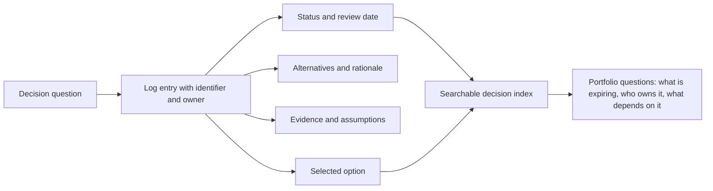
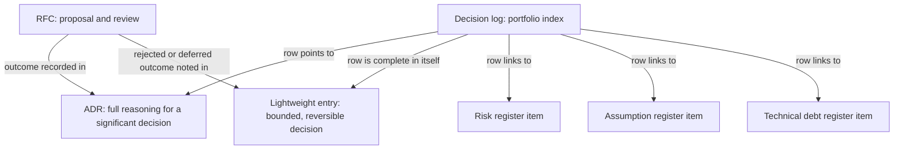
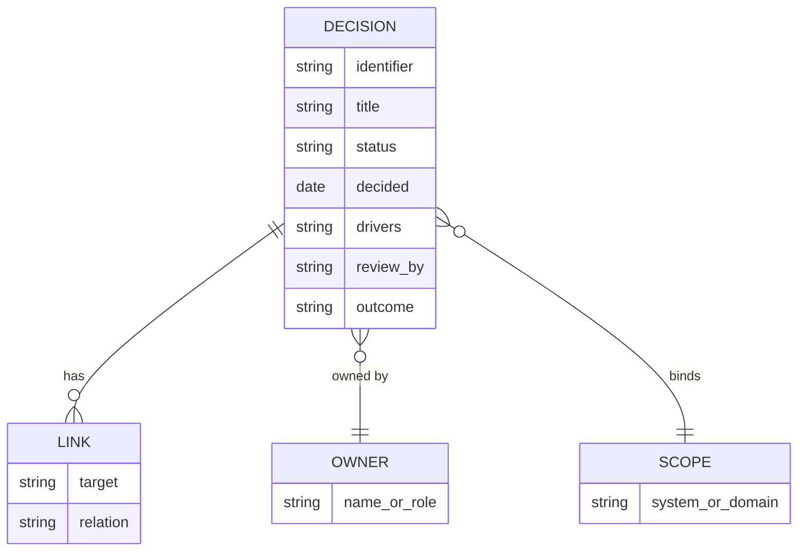
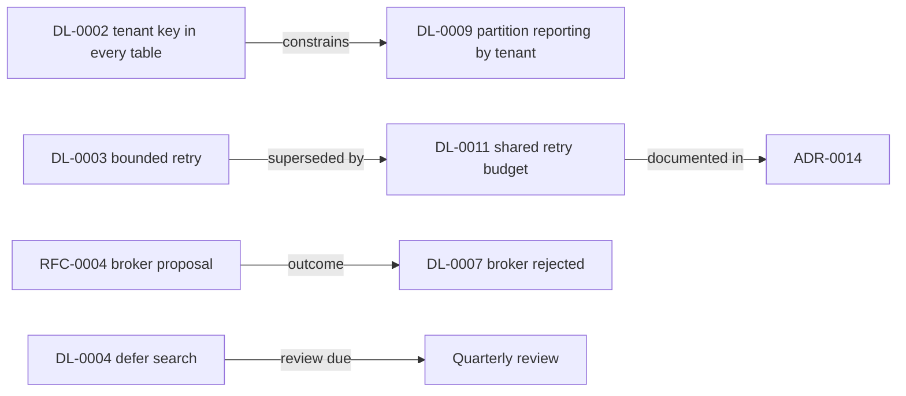
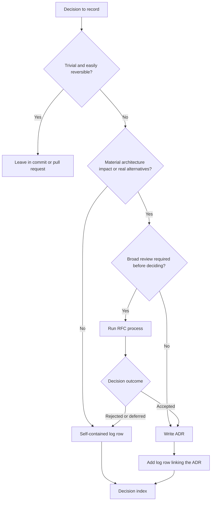
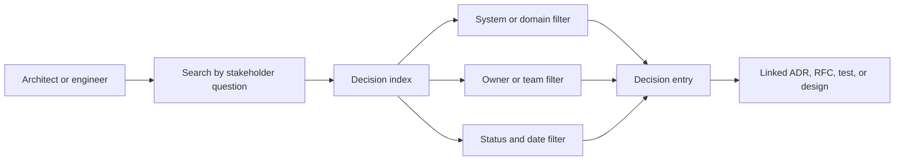
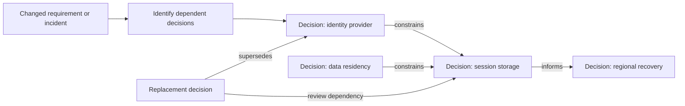
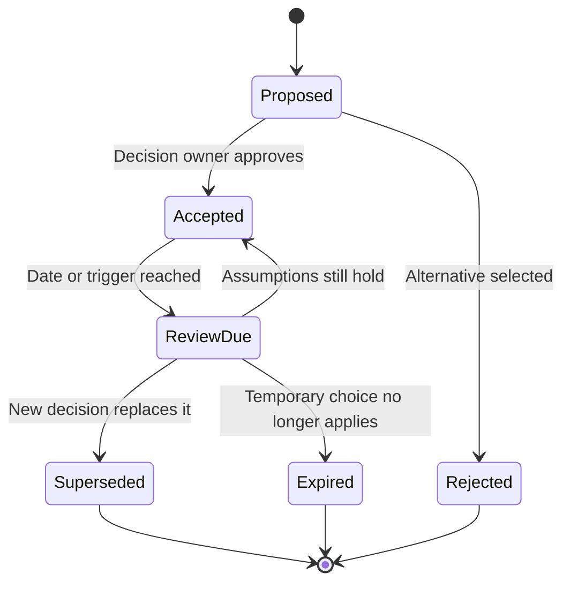

# Decision Logs

Part: [21 — Architecture Documentation](PART_OVERVIEW.md) · Status: Drafted

## 1. Introduction

A decision log is a single, maintained index over many architecture decisions. Each row is one decision: what was decided, who owns it, when it was made, how far it reaches, what it depends on, how healthy it is, and when it should next be questioned. Where an Architecture Decision Record (ADR) captures the full reasoning for one significant choice, the log answers a different family of questions that no single record can: how many decisions are in force for this system, which of them are provisional, which are overdue for review, which were made by a team that no longer exists, and which would be affected if a given constraint changed.

For an engineer moving into architecture this is a shift in unit of work. A developer thinks about the change in front of them. An architect is accountable for the portfolio: the accumulated set of choices that together define what the system is allowed to become. A portfolio that exists only as scattered documents, pull request comments, and memory cannot be managed. You cannot review what you cannot list, and you cannot expire what you never dated. The log is the instrument that turns a pile of decisions into a managed collection.

This chapter owns the decision log as an index and portfolio over many decisions, including its schema, the way it is populated, the rules for what enters it, and the way it is queried and governed. The boundaries with neighbouring material are deliberate, and the chapter recaps and links rather than re-teaching any of it:

- The single decision record, its anatomy, template shapes, and lifecycle belong to [ADR (Architecture Decision Record)](CH03_ADR_Architecture_Decision_Record.md). A log row points to a record; it does not replace one.
- The proposal-and-comment process that often precedes a decision belongs to [RFC (Request for Comments)](CH04_RFC_Request_for_Comments.md).
- The reasoning method behind a good decision, including trade-off analysis, belongs to [Architecture Thinking](../01_Architecture_Mindset/CH03_Architecture_Thinking.md).
- Framing problems, evidence, reversibility, decision timing, and the measurement of decision outcomes belong to [Part 22](../22_Architectural_Thinking_and_Decision_Practice/PART_OVERVIEW.md).
- Whole-architecture assessment, as opposed to portfolio bookkeeping, belongs to [Architecture Reviews](CH11_Architecture_Reviews.md).
- Structural views that decisions refer to belong to [C4 Model](CH01_C4_Model.md).

After studying this chapter, a reader should be able to:

1. Distinguish a decision log from a single ADR, from a set of ADRs, and from a risk or assumption register, and say what each is for.
2. Design a log schema with the columns that make a portfolio searchable, and justify each column.
3. Decide which decisions belong in the log, which deserve a full record, and which belong in neither.
4. Populate a log table with entries that are short but remain intelligible months later.
5. Choose a status vocabulary and review-date discipline that keep the log honest about what is still in force.
6. Recognise the failure modes that turn a log into a stale list nobody trusts.

## 2. Background and History

Keeping a list of design decisions is older than any particular template. Software engineering has long discussed design rationale and the cost of losing it, and many organizations have kept change registers and decision registers under project-management or governance regimes. The lightweight record-per-decision practice used by many software teams today is commonly traced to a 2011 blog post by Michael Nygard, "Documenting Architecture Decisions", which proposed short numbered text files kept alongside the code. The chapter on ADRs covers that lineage.

A log or index over those records is a natural second step, and it appears in practice in several forms: a table at the top of a decision directory, a generated index page, a spreadsheet kept by an architecture group, or a section of a wiki. There is no single authoritative standard for the format of a decision log, and this chapter does not claim one. What follows is a synthesis of common practice, presented with the reasons behind each choice so that you can adapt it rather than copy it.

The practical implication is the same as for ADRs: the log is a convention. Agree a schema, write down local rules for it, and apply them consistently. The value comes from consistency and from the review habit around it, not from the tool.

## 3. The Problem a Decision Log Solves

An individual ADR can be excellent and the portfolio can still be unmanageable. The failure modes below are general patterns, not reports of particular incidents.

- **Records exist but cannot be found.** A hundred well-written records in a directory are only as useful as the reader's ability to locate the one that matters. Without an index, retrieval depends on file names and memory.
- **Nobody knows what is still in force.** A record written two years ago may have been quietly overtaken by events. Without a status and a review date visible in one place, every old decision looks equally authoritative.
- **Temporary choices become permanent.** A workaround accepted "until the next quarter" has no mechanism to expire unless someone can list decisions by review date.
- **Small decisions go unrecorded entirely.** Teams reasonably decline to write a full record for a bounded choice, and so the choice leaves no trace. Later it is indistinguishable from an accident.
- **Ownership evaporates.** The author of a decision changes teams. The decision remains, but no one is named as the person to ask or to authorize a change.
- **Impact analysis is guesswork.** When a constraint changes, such as a data-residency rule or a vendor exit, nobody can list the decisions that depended on it.

The diagram shows why the log is a portfolio instrument and not merely a shorter ADR. Every entry flows into one index, and the value of the index is that it supports questions across entries. A reader of a single record asks "why was this chosen?". A reader of the log asks "what is in force, what is aging, and what is exposed?". Those are different questions, and each is answered by a different artifact.

Link supporting designs, tests, and incidents rather than copying them. The log row is an address, not an archive: its job is to tell you where the reasoning lives and whether it is still current.

## 4. Log, Register, and ADR Set: Drawing the Lines

Three things are routinely confused, and the confusion produces duplicated effort and contradictory sources of truth.

**An ADR set** is the collection of individual records. Each record is a narrative document with context, options, decision, and consequences. The set is a directory; by itself it has no cross-cutting view beyond file order and whatever naming convention is used.

**A decision log** is the index and portfolio view over decisions. Each row is a summary with a pointer. Some rows point at a full ADR. Some rows are self-contained: the entry is a few lines because the decision was bounded and reversible, and the row is the entire record. The log therefore covers a wider range of consequence than the ADR set does, and it is the only artifact that holds the full portfolio.

**A register** is a managed list of a different kind of thing. A risk register lists uncertain events with likelihood, impact, and mitigation. An assumption register lists beliefs the design depends on, each with a validation owner and a deadline. A technical debt register lists known shortcuts and their cost of carry. These are not decisions. A decision may create a risk, rest on an assumption, or knowingly incur debt, and the log should link to the relevant register entry, but the register owns the lifecycle of the item (for example, a risk is closed when it is mitigated, not when a decision is superseded).

| Artifact | Unit | Primary question answered | Typical lifecycle event |
|---|---|---|---|
| ADR | One significant decision, in prose | Why was this chosen over the alternatives? | Accepted, then superseded |
| ADR set | Many records | What detailed reasoning exists? | New record added |
| Decision log | One row per decision, any size | What decisions are in force, owned, and due for review? | Reviewed, superseded, expired |
| Risk register | One risk | What could go wrong and who is managing it? | Mitigated, accepted, closed |
| Assumption register | One assumption | What are we relying on that we have not proven? | Validated or invalidated |

The relationships in the diagram carry an important rule: the log owns the index, and each linked artifact owns its own content and lifecycle. If the rationale appears both in the log row and in the ADR, the two will diverge. Keep the row to a one-line summary and a link, and keep the reasoning in one place.

Why a separate log instead of simply listing ADRs? Because the ADR set cannot hold what does not merit a record, and because reading a directory listing cannot filter by owner, scope, or review date. Why not push everything into ADRs? Because the cost of writing a full record is high enough that teams ration it, and the rationed-out decisions are exactly the ones the log is meant to catch. The log is cheap enough to be applied broadly, which is what makes it complete enough to be trusted.

## 5. The Log Schema

A schema is the set of columns every entry must fill. It is the single most consequential design choice in a log, because it determines which questions the log can answer. A column that is not captured cannot be queried later, and a column that is captured but optional will be blank exactly when it matters.

The recommended columns, with the reason for each:

| Column | Content | Why it exists |
|---|---|---|
| Identifier | Short, stable, unique, never reused (for example, `DL-0042`) | Lets other documents, tickets, and code comments refer to the decision without ambiguity. |
| Title | A phrase naming the decision, not the topic | A reader scanning the table should grasp the choice, not merely the subject. |
| Status | One value from a defined vocabulary | Separates what is in force from what is historical. |
| Owner | A named role or person with authority to revisit it | Gives a question a destination; avoids orphaned decisions. |
| Date | Date the decision was made | Anchors the context; lets a reader judge how stale the evidence may be. |
| Scope | System, domain, or team boundary the decision binds | Supports retrieval by system and prevents a local choice being mistaken for a global one. |
| Drivers | The one to three forces that decided it (quality attributes, constraints) | Preserves why, in a few words, without a full narrative. |
| Links | ADR, RFC, design, test, or incident, plus related decisions and the relation type | Makes the row an address and enables impact analysis. |
| Review-by | A date or an event trigger | Forces the question "is this still true?" to be asked. |
| Outcome | What happened: confirmed, revised, caused problems, or not yet known | Closes the loop; feeds the practice of judging decisions by results. |

Several design choices behind this list deserve explanation.

**Why a controlled status vocabulary?** Free-text status ("mostly done", "probably fine") defeats filtering. Use a small, defined set and write the definition of each value into the log's own header, so that a value means the same thing to every reader.

**Why both owner and date?** The date alone says when; the owner says whom to ask. A decision that has a date but no owner is history. A decision with an owner but no date cannot be judged for staleness. Together they make the row actionable.

**Why drivers and not alternatives?** The alternatives belong in the ADR or the linked design. In the log row, a short statement of the deciding drivers is enough to tell a reader whether their situation resembles the original one. If a row seems to need a paragraph of alternatives, that is a signal the decision should have a full record.

**Why review-by and outcome as separate columns?** Review-by looks forward; outcome looks backward. The first drives the periodic check. The second records what the review, or events, found. Measuring decision quality over time, and the method for judging outcomes, belong to [Part 22](../22_Architectural_Thinking_and_Decision_Practice/PART_OVERVIEW.md); the log only provides the place to write the result down.

The model shows that the links are a repeating group, not a single cell: a decision can relate to several records and decisions, each with its own relation type. Owner and scope are shared dimensions: many decisions point at the same owner or system. That structure is what makes filtering by owner or system meaningful, and it suggests the minimum viable implementation: a table with one row per decision and a structured list of typed links.

Resist adding columns. Each extra mandatory column raises the cost of recording a decision and lowers compliance. A good test: if no query you actually run uses the column, remove it.

## 6. A Worked Log (Illustrative)

The following log is hypothetical. The system, the teams, and the dates are invented to show what well-formed rows look like for an imaginary order-management platform. Nothing here describes a real organization.

| Identifier | Title | Status | Owner | Date | Scope | Drivers | Links | Review-by | Outcome |
|---|---|---|---|---|---|---|---|---|---|
| DL-0001 | Use a managed relational database for orders | Accepted | Platform lead | 2026-01-14 | Order service | Transactional integrity; small operations team | ADR-0003 | 2027-01-14 | Confirmed at first review |
| DL-0002 | Keep tenant identifier in every table key | Accepted | Data architect | 2026-01-20 | All services | Tenant isolation; query safety | ADR-0005; constrains DL-0009 | On new tenancy model | Not yet known |
| DL-0003 | Bounded retry on inventory reads (3 attempts, 800 ms total) | Accepted | Order team lead | 2026-02-03 | Order service to Inventory | Transient errors; latency budget | Load-test report | 2026-08-03 | Revised: see DL-0011 |
| DL-0004 | Defer search service; use database queries for launch | Accepted (temporary) | Product architect | 2026-02-10 | Catalog | Time to launch; low initial volume | RFC-0002 | 2026-07-31 | Not yet known |
| DL-0007 | Reject a message broker for notifications at launch | Rejected | Platform lead | 2026-03-02 | Notifications | Operational load; modest volume | RFC-0004 | On volume above agreed threshold | Not yet known |
| DL-0009 | Partition by tenant for the reporting store | Accepted | Data architect | 2026-04-17 | Reporting | Isolation; independent scaling | Depends on DL-0002 | 2026-10-17 | Not yet known |
| DL-0011 | Shared retry budget with circuit breaker for inventory calls | Accepted | Platform lead | 2026-09-05 | Order and Inventory services | Failure amplification; consistency across services | ADR-0014; supersedes DL-0003 | 2027-03-05 | Not yet known |

Several features of this log reward attention.

DL-0003 is a lightweight entry with no ADR: it is bounded, reversible, and local. DL-0011 supersedes it and does have a full ADR because it spans services and carries broader failure-mode trade-offs. Both rows remain in the log; the old row's outcome column points to its replacement, so the history is preserved.

DL-0004 shows a temporary decision that carries its own expiry. Marking it "Accepted (temporary)" with a review date means that a quarterly check will surface it before the deferral quietly becomes the permanent design.

DL-0007 is a rejected decision. Recording what was decided against, and the trigger for reconsidering, saves the team from re-debating the same proposal and shows exactly what evidence would change the answer.

DL-0009 depends on DL-0002. If the tenancy model changes, a reader can find DL-0009 by following the link from DL-0002 rather than rediscovering the dependency during an incident.

The identifiers have gaps (no DL-0005, DL-0006, DL-0008). That is acceptable and expected: identifiers are never reused, and a gap may represent a withdrawn draft. A log that renumbers to close gaps breaks every reference to the old numbers.

The graph makes the relation types visible: constrains, superseded by, documented in, outcome of, and review due. These typed links are what allow impact analysis. When a requirement changes, the question "which decisions are downstream of this one?" becomes a traversal rather than a guess.

A final observation concerns brevity. Each row is a sentence or two per cell. Where a cell wants to grow, the answer is a link, not more text. A log whose rows have grown into paragraphs has quietly become a badly organized ADR set.

## 7. What to Log: Lightweight and Formal Decisions

A log that records everything becomes noise; a log that records only headline decisions is incomplete. The working rule is that the artifact scales with consequence and with the likelihood that a future reader will need to understand the choice.

Four questions help classify a decision:

1. **How reversible is it?** A choice that can be undone in a day by one team is lightweight. A choice that shapes data formats, contracts, or tenancy is expensive to undo and deserves a record.
2. **How far does it reach?** A decision bounded to one component differs from one that binds several teams or an external interface.
3. **How contested was it?** Real alternatives with real trade-offs deserve explanation. A choice with one obvious answer does not.
4. **Will someone need to know why?** If a plausible future engineer would ask "why this way?", the decision needs at least a log row.

The outcomes fall into three tiers:

| Tier | Typical signal | Artifact |
|---|---|---|
| Not logged | Pure implementation detail, trivially reversible, covered by code review and conventions | Commit message or pull request |
| Lightweight | Bounded, reversible, but a deliberate choice or a temporary workaround | Self-contained log row |
| Formal | Significant, costly to reverse, multiple real alternatives, or wide reach | ADR, preceded by an RFC where broad review is needed, with a log row pointing to it |

The diagram makes one point explicit that is easy to miss: every non-trivial path ends at the index. The ADR path adds a log row; the RFC path ends at an ADR or at a log row for a rejected or deferred proposal. This is the mechanism that gives the log its completeness. The ADR and RFC remain the owners of detailed reasoning and proposals, as set out in their own chapters; the log is where the portfolio is visible.

Two failure modes bracket the rule. Over-recording, where every library choice receives a row, buries significant decisions and trains readers to ignore the log. Under-recording, where a high-impact decision is compressed into one line to keep the log tidy, hides the reasoning that will later be needed. When in doubt, ask who will be hurt if the reasoning is lost; if the answer is a future team making an expensive change, write the formal record.

An edge case is the decision that grows. A lightweight row is created for a local choice, then a second service adopts the same pattern, and the reach has quietly widened. Treat reach changes as an escalation trigger: when a lightweight decision gains a second dependent team, review whether it now needs a full record, as happened with the retry policy in the worked log. Escalation need not be dramatic; the original row remains, links to the new record, and is marked superseded if the scope or content changed.

Another edge case is the retroactive decision. A team discovers an undocumented choice that has been in force for years. Log it honestly: record the date as unknown or approximate, mark the drivers as inferred, name a current owner, and set a review date. A retroactive row is better than none, as long as it does not pretend to a certainty about the past that the team does not have.

## Organize the Index for Retrieval

An index should support retrieval by system, domain, owner, date, status, and affected decision. Keep identifiers stable and link entries to source repositories. A central index can provide discovery while local repositories remain the system of record for each decision.

Avoid a log stored only in meeting notes or chat history. Export or link the durable decision into a versioned repository, and protect sensitive evidence in its source system. Define how duplicate entries and cross-team decisions are merged or cross-referenced.

## Track Dependencies and Supersession

Decisions can depend on standards, assumptions, or earlier choices. When a decision is superseded, retain its entry. Link the replacement. Review downstream decisions when their assumptions may have changed; do not assume every dependent choice is automatically invalid.

Use explicit relation types such as depends on, constrains, supersedes, or informs. Free-form links without context make impact analysis harder. Record the owner responsible for reviewing dependencies after a material change.

## Maintain Status and Review Triggers

Entries can be proposed, accepted, rejected, superseded, or expired. A scheduled review is useful for temporary choices, but event triggers catch changed constraints sooner. Keep the log accurate without rewriting the historical reason for an accepted decision.

Statuses need definitions and owners. “Accepted” does not mean permanently correct; it means the decision was authorized under the recorded context. If the context changes, create or link a new decision and preserve the chain.

## Worked Case: Retry Policy

A team decides to use a bounded retry for a transient read dependency. The entry records the maximum attempts, total deadline, relevant dependency, evidence from a load test, owner, and the condition that would reopen the decision. The choice is local and reversible, so a concise log is sufficient.

Later, the retry change contributes to elevated load during an outage. The incident triggers review. The team records a new decision to use a shared retry budget and circuit breaker, links it as superseding the prior entry, and creates an ADR because the change affects several services and has broader failure-mode trade-offs.

## Review Questions

1. What context makes a short decision entry useful months later?
2. When should a decision become an ADR or RFC?
3. How can stakeholders retrieve decisions by system, owner, or status?
4. What happens to dependencies when an entry is superseded?
5. Which event or date causes a temporary decision to be reviewed?

Decision logs preserve lightweight traceability when entries stay searchable, owned, and linked. Scale documentation to consequence, promote significant choices to ADRs or RFCs, and preserve historical decisions when assumptions change.
