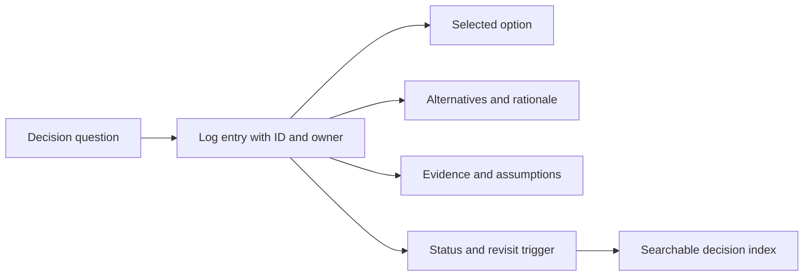
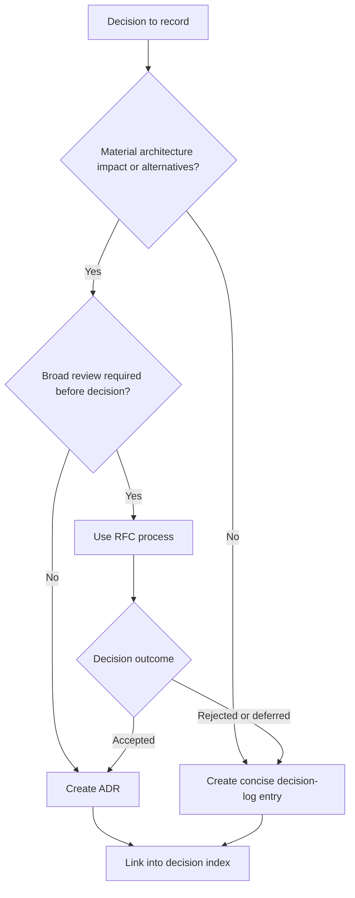
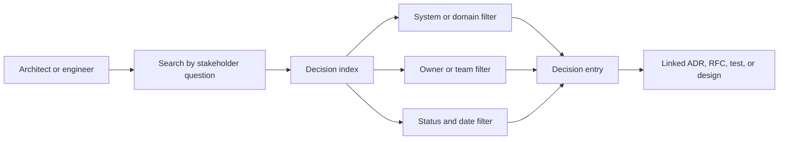
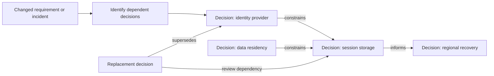
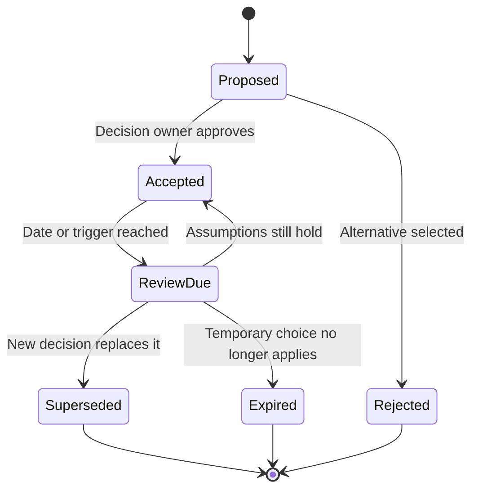

# Decision Logs

Part: [21 — Architecture Documentation](PART_OVERVIEW.md)

A decision log is a lightweight record that makes decisions and rationale searchable. It is useful when traceability matters but the decision does not warrant a full Architecture Decision Record (ADR) or broad Request for Comments (RFC). Part 21 CH03 owns ADRs; CH04 owns RFC process. Part 01 CH03 owns decision reasoning.

## Record the Minimum Useful Context

A log entry should capture a unique identifier, date, owner, scope, question, chosen option, alternatives considered, concise rationale, evidence, status, and revisit trigger. Keep entries short, but include enough context that a future reader can distinguish a deliberate choice from an assumption or temporary workaround.

Link supporting designs, tests, and incidents rather than copying them. Mark provisional decisions and expiry. A log should answer who decided, what changed, why, and when to reconsider.

## Escalate When a Log Is Not Enough

Use a lightweight log for bounded, reversible decisions with limited impact. Escalate to an ADR when the choice is architecturally significant, has substantial trade-offs, or is likely to be revisited by future teams. Use an RFC when broad technical review is required before the decision. An ADR can summarize the final outcome of an RFC.

Do not use an ADR for every minor implementation choice; excessive records hide significant decisions. Conversely, do not compress a high-impact decision into one line merely to keep the log small. The artifact should scale with consequence and future maintenance need.

## Organize the Index for Retrieval

An index should support retrieval by system, domain, owner, date, status, and affected decision. Keep identifiers stable and link entries to source repositories. A central index can provide discovery while local repositories remain the system of record for each decision.

Avoid a log stored only in meeting notes or chat history. Export or link the durable decision into a versioned repository, and protect sensitive evidence in its source system. Define how duplicate entries and cross-team decisions are merged or cross-referenced.

## Track Dependencies and Supersession

Decisions can depend on standards, assumptions, or earlier choices. When a decision is superseded, retain its entry. Link the replacement. Review downstream decisions when their assumptions may have changed; do not assume every dependent choice is automatically invalid.

Use explicit relation types such as depends on, constrains, supersedes, or informs. Free-form links without context make impact analysis harder. Record the owner responsible for reviewing dependencies after a material change.

## Maintain Status and Review Triggers

Entries can be proposed, accepted, rejected, superseded, or expired. A scheduled review is useful for temporary choices, but event triggers catch changed constraints sooner. Keep the log accurate without rewriting the historical reason for an accepted decision.

Statuses need definitions and owners. “Accepted” does not mean permanently correct; it means the decision was authorized under the recorded context. If the context changes, create or link a new decision and preserve the chain.

## Worked Case: Retry Policy

A team decides to use a bounded retry for a transient read dependency. The entry records the maximum attempts, total deadline, relevant dependency, evidence from a load test, owner, and the condition that would reopen the decision. The choice is local and reversible, so a concise log is sufficient.

Later, the retry change contributes to elevated load during an outage. The incident triggers review. The team records a new decision to use a shared retry budget and circuit breaker, links it as superseding the prior entry, and creates an ADR because the change affects several services and has broader failure-mode trade-offs.

## Review Questions

1. What context makes a short decision entry useful months later?
2. When should a decision become an ADR or RFC?
3. How can stakeholders retrieve decisions by system, owner, or status?
4. What happens to dependencies when an entry is superseded?
5. Which event or date causes a temporary decision to be reviewed?

Decision logs preserve lightweight traceability when entries stay searchable, owned, and linked. Scale documentation to consequence, promote significant choices to ADRs or RFCs, and preserve historical decisions when assumptions change.
