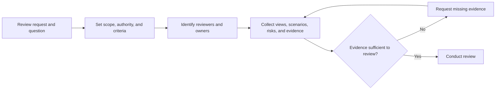
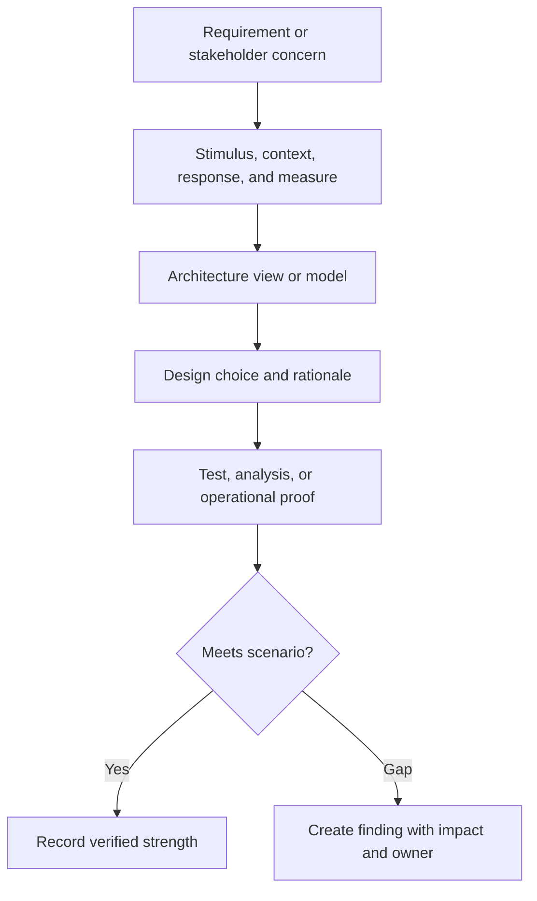
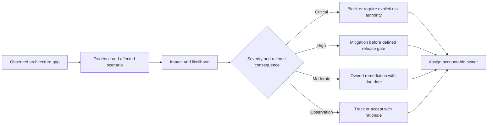
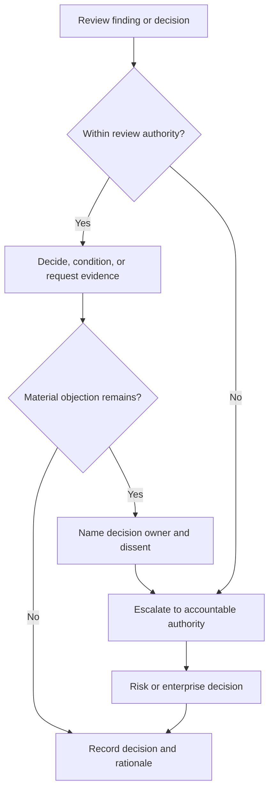
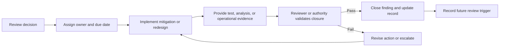

# Architecture Reviews

Part: [21 — Architecture Documentation](PART_OVERVIEW.md)

An architecture review assesses a system or proposed change against explicit goals, requirements, risks, constraints, and evidence. It should produce findings, decisions, owners, and follow-up rather than a ceremonial approval. Part 18 owns enterprise review-board governance; Part 22 owns facilitated decision workshops. This chapter focuses on preparing and conducting a review of architecture artifacts and evidence.

## Prepare the Review and Set Scope

Define the review question, decision authority, scope, participants, constraints, and expected outputs. Select architecture views that address stakeholder concerns and state their version and assumptions. Request evidence early enough for teams to respond. A review should not expand into every system detail unless the decision requires it.

The review owner should distinguish advisory feedback from decisions within delegated authority. Send materials with enough time for independent reading. If a critical stakeholder is absent, document the resulting limitation and decide whether to proceed or reschedule.

## Trace Views to Quality Scenarios

Architecture diagrams are useful when they support a measurable concern. Connect each important view to scenarios such as load, failure, data change, security boundary, or deployment transition. Reviewers should ask what evidence shows the design meets the scenario and what remains uncertain.

For a latency requirement, define load, measured percentile, and boundary. For a failure requirement, define the fault, expected degraded behavior, and recovery objective. Do not treat a diagram as evidence by itself; it describes intended structure, while tests and operational results validate behavior.

## Classify Findings and Assign Owners

Findings should state the condition, evidence, impact, recommendation or decision needed, owner, and due date. Severity should reflect consequence and likelihood under the review context. Distinguish blocking risks from improvement opportunities and observations so teams know what is required before release.

Avoid scoring with false precision. Explain assumptions and affected users. The reviewer may recommend a mitigation, but the accountable owner decides implementation details within approved constraints. Residual risk acceptance belongs to the authority defined by governance.

## Clarify Decision Authority and Escalation

A review can advise, approve within a delegated boundary, or escalate a decision. State the authority before the meeting. If reviewers disagree, record the alternatives, evidence, dissent, and decision owner. Escalate when impact or risk exceeds the review's mandate; do not turn unresolved disagreement into implied consensus.

Enterprise review boards are covered in Part 18 CH09. A review session should focus on the architecture question, while a board's charter determines who can approve standards or exceptions.

## Close Actions With Evidence

Review completion requires action tracking and verification. A finding closes when the owner provides evidence that the agreed condition is met or an authorized decision accepts residual risk. Reopen findings when scope or assumptions change. Capture review date, artifact versions, participants, decisions, and next review trigger.

Measure review cycle time, repeated findings, action closure, and downstream incidents or rework. Use the data to improve preparation and criteria, not to reward teams for minimizing findings or shortening review at the expense of evidence.

## Worked Case: Multi-Region Payment Service

A team proposes expanding a payment service to a second region. Reviewers inspect context and deployment views, data-flow boundaries, recovery scenarios, and test evidence. The quality scenario specifies a regional outage, permitted recovery point, failover authority, and time to resume payment processing. Review identifies that replication lag is measured but conflict behavior during promotion is not.

The finding is classified as a release gate because payment correctness depends on the missing behavior. The team runs a controlled failure exercise, records the recovery decision, and updates the deployment view and runbook. The reviewer verifies evidence; the risk owner accepts the remaining recovery-time exposure. The decision record links artifact versions and establishes a review trigger when transaction volume or data policy changes.

## Review Questions

1. What decision or risk does the review need to resolve?
2. Which views and evidence connect to measurable quality scenarios?
3. How are findings classified and assigned?
4. Who has authority to accept residual risk or grant an exception?
5. What evidence closes an action and when should a review reopen?

Architecture reviews are effective when scope, authority, scenarios, evidence, findings, and follow-up are explicit. Review architecture against observable outcomes, preserve dissent and residual risk, and close actions with evidence rather than meeting minutes alone.
