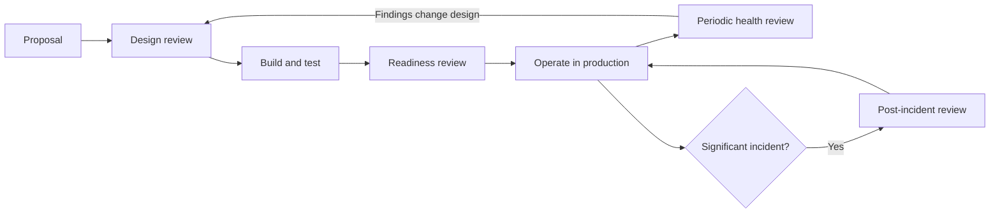
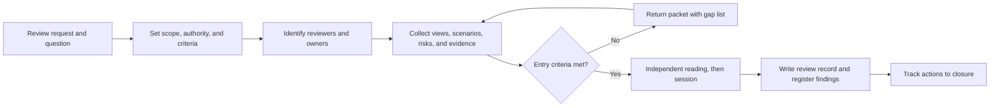
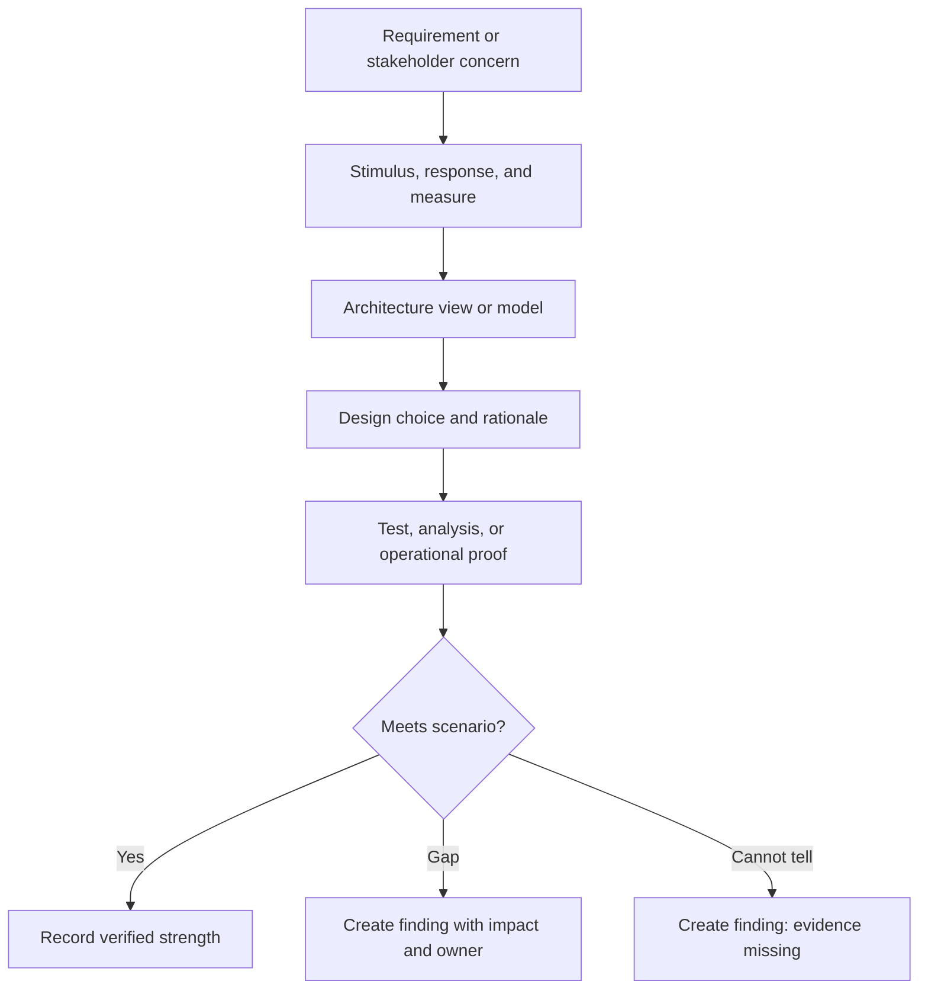
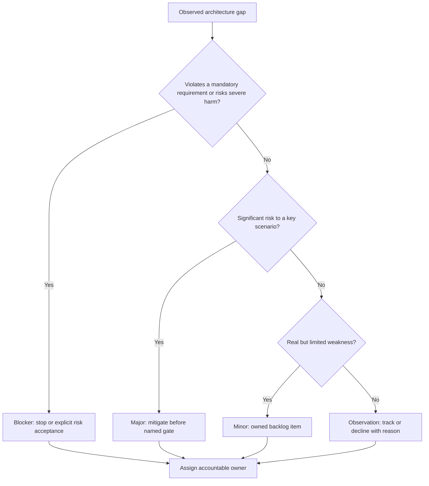
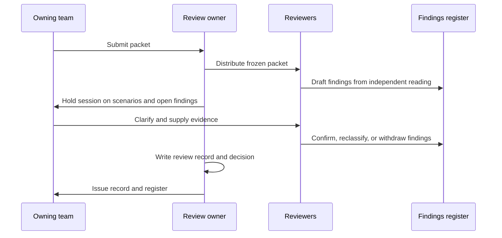
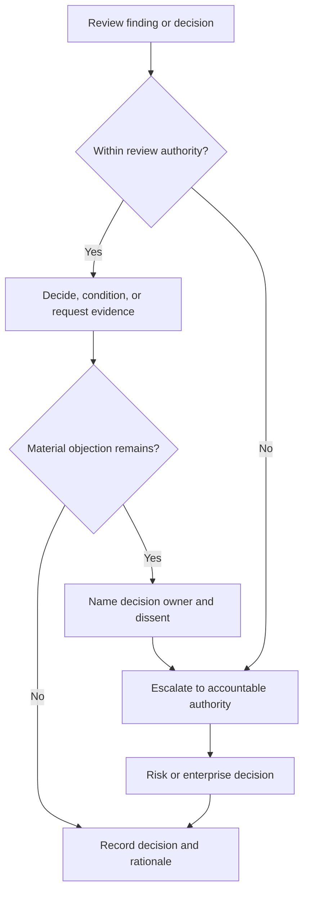
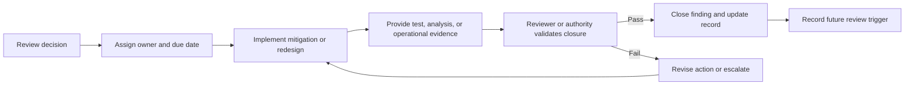

# Architecture Reviews

Part: [21 — Architecture Documentation](PART_OVERVIEW.md) · Status: Drafted

## 1. Introduction

An architecture review is a structured, time-boxed examination of a system, or of a proposed change to one, against explicit goals, quality requirements, constraints, and evidence. Its product is not a meeting; it is a set of written, owned, evidence-backed findings and a decision about what happens next. A review that ends with "looks good" and no record has produced nothing that anyone can audit, learn from, or act on later.

For an engineer moving into architecture, reviews are where judgment becomes visible. An architect is often asked to assess a design they did not create, in a domain they only partly know, under time pressure. The skill is not spotting every flaw by inspiration. It is converting a vague unease ("this feels risky") into a specific condition, an affected scenario, a consequence, and an owner, so the team can respond and the organisation can decide. That conversion depends on documents: a packet that tells reviewers what to examine, a record that captures what was found, and a register that tracks findings until they are closed.

This chapter owns the documentation of a review: the review packet, the review record and findings register, the review report, and follow-up tracking. It teaches how to run a review so that those documents are credible.

**Ownership boundaries**

- Architecture governance, decision rights, and escalation policy: [Architecture Governance](../18_Enterprise_Architecture/CH08_Architecture_Governance.md). This chapter assumes a review has an authority and does not re-teach how that authority is designed.
- Review boards, charters, intake, and board operating models: [Architecture Review Boards](../18_Enterprise_Architecture/CH09_Architecture_Review_Boards.md). A board is one possible venue; this chapter covers what the review produces in any venue.
- Cloud-provider Well-Architected reviews and their question sets: [Framework Foundations and Review Method](../11_AWS_Well_Architected_Framework/CH01_Framework_Foundations_and_Review_Method.md). Those are a prescribed review method; this chapter is method-neutral.
- Pre-mortems and challenge reviews: [Architecture Pre-Mortems and Challenge Reviews](../22_Architectural_Thinking_and_Decision_Practice/CH08_Architecture_Pre_Mortems_and_Challenge_Reviews.md). Those are facilitated techniques for generating risks; a review assesses a concrete design against evidence.
- Recording the decisions a review leads to: [ADR (Architecture Decision Record)](CH03_ADR_Architecture_Decision_Record.md) and [Decision Logs](CH10_Decision_Logs.md).
- Operational procedures that a review may require: [Runbooks](CH07_Runbooks.md); security-specific analysis: [Threat Models](CH09_Threat_Models.md).

After this chapter you should be able to:

1. Choose the right review type (design, readiness, post-incident, or periodic health) for a given question.
2. Set a review's scope and entry criteria so that it neither expands without limit nor starts without enough evidence.
3. Assemble a review packet that lets reviewers judge the design independently before the session.
4. Turn quality requirements into scenarios with stimulus, response, and measure, and use them to drive review questions.
5. Classify findings as blocker, major, minor, or observation, and record them in a findings register with owners and closure evidence.
6. Write a review record, and recognise what a review is not for.

## 2. Background and History

Structured design inspection predates modern architecture practice; software inspection and walkthrough techniques were discussed in the research and engineering literature well before the term "software architecture" was common. The most widely cited architecture-specific method is the Architecture Tradeoff Analysis Method (ATAM), developed at the Software Engineering Institute (SEI) at Carnegie Mellon University. At a high level, it has stakeholders articulate quality-attribute goals as scenarios, examines architectural approaches against those scenarios, and surfaces risks, sensitivity points, and trade-off points. Details of its phases and artifacts vary by publication, so treat the summary here as orientation and consult the original SEI material before claiming to follow the method.

The lasting contribution is the idea this chapter relies on: a review is more reliable when it is driven by explicit scenarios and produces recorded risks than when it is driven by reviewers' general impressions.

## 3. The Problem Reviews Solve

Designers are poorly placed to see their own blind spots. They know the intent, so they read the diagram as they meant it. They have invested effort, so they discount evidence against it. They hold the context of the team, so they skip things everyone on the team already "knows". A review brings in people with different context and asks them to test the design against stated goals.

Without a deliberate review practice, four things typically go wrong:

- **Risks are found late.** A recovery gap found in a design session costs a conversation; found during an outage, it costs an incident.
- **Approval is ceremonial.** If nothing is written down about what was examined, "approved" means only that nobody objected.
- **Feedback is unactionable.** "Consider scalability" has no owner, no measure, and no closure condition.
- **Knowledge stays in heads.** The reasoning behind accepting a risk is lost, and the next reviewer repeats the debate.

A review is a cheap checkpoint relative to what it protects, but it is not free: it consumes the time of scarce senior people. That is why the rest of the chapter concentrates on making each review specific, evidence-based, and documented.

## 4. Review Types

Reviews differ in the question they answer, when they happen, and what evidence is available. Using one generic "architecture review" for all of them produces the wrong questions at the wrong time.

| Type | Core question | Typical trigger | Evidence available | Typical output |
| --- | --- | --- | --- | --- |
| Design review | Will this proposed design satisfy the requirements and constraints? | Before significant build commitment | Views, scenarios, prototypes, estimates | Findings and a go, conditional-go, or rework decision |
| Readiness review | Is this system safe to release or operate at the intended scale? | Before launch or a major cutover | Test results, failure exercises, runbooks, monitoring | Release conditions and accepted residual risks |
| Post-incident review | What did the incident reveal about the architecture? | After a significant incident | Timeline, telemetry, contributing factors | Structural findings and corrective actions |
| Periodic health review | Does the architecture still fit its workload and context? | Calendar or change trigger | Operational data, drift, cost, incident history | Findings, debt candidates, and next-review trigger |



The diagram shows that the four types form a loop rather than a ladder. A periodic health review or post-incident review that discovers a structural problem feeds new design work, which returns to a design review. Each type asks a different question, so the packet and the reviewers change. The design review is forward-looking and relies on analysis; the readiness review demands demonstrated behaviour; the post-incident review is retrospective and must avoid blame-driven conclusions; the health review looks for slow drift that no single change would reveal.

Choose the type by the decision that depends on it. If a release is imminent and the team asks whether the design is "good", the readiness review is the right instrument, and a long argument about alternatives belongs to a design review that should have happened earlier. If the same question recurs in several reviews, that is a sign the earlier type was skipped or was too shallow.

## 5. Scope, Authority, and Entry Criteria

Define the review question, the authority of the review, the scope, the participants, and the expected outputs before any session is scheduled. Select architecture views that address stakeholder concerns and state their version and assumptions. A review should not expand into every system detail unless the decision requires it.

**Scope statement.** A usable scope names what is in, what is explicitly out, and what is assumed. For example: "In: the payment-service failover design for the second region. Out: card-network integration. Assumed: the data-residency policy is as published at the review date." Out-of-scope items that reviewers happen to notice are recorded as observations and routed elsewhere, not debated in the session.

**Authority.** State whether the review is advisory, can approve within a delegated boundary, or must escalate. Reviewers who believe they hold approval power when they do not will issue instructions the owner is not obliged to follow; reviewers who believe they are advisory when the organisation expects a gate will see their findings ignored. Decision rights themselves are designed in governance; the review documents simply states which applies.

**Entry criteria.** A review is only as good as the evidence it examines. Entry criteria are conditions the packet must meet before the session is held. Reasonable criteria include: a stated review question; views current to a named version; quality scenarios for the concerns in scope; named owners for each component in scope; and the evidence the team claims, available to reviewers in advance. If criteria are not met, the review owner returns the packet with a list of gaps rather than holding a session that will produce only speculation.



The loop between packet and gap list is the point of the gate. It moves the cost of missing evidence onto the preparation stage, where it is cheap, and keeps the senior reviewers' time for judgement. Send materials with enough time for independent reading; reviewers who first see the design in the session can only react to the presentation. If a critical stakeholder is absent, record the limitation and decide explicitly whether to proceed or reschedule, rather than letting the gap pass unnoticed.

**Trade-off.** Strict entry criteria delay reviews and can feel bureaucratic, especially for small changes. Scale the gate to the risk: a low-impact change may need only a one-page packet, while a change to a payment or identity path justifies the full set. The point is a known, proportional bar, not a maximal one.

## 6. The Review Packet

The review packet is the set of documents reviewers read before the session. Its purpose is to let a competent outsider judge the design independently, so the session can be spent on disagreement and decisions rather than on explaining the basics. The packet is a snapshot: every item carries a version or date so findings can be tied to exactly what was examined.

**Contents.**

1. **Review question and scope statement.** One paragraph on the decision the review informs, plus the in, out, and assumed lists from the scope.
2. **Context and constraints.** The business goal, the regulatory, cost, schedule, and team constraints, each with its source. Unsourced constraints are a common cause of later argument.
3. **Architecture views.** The few views that address the concerns in scope, such as a context view, a component or container view (see [C4 Model](CH01_C4_Model.md)), a deployment view, and key interaction sequences. Fewer, current views beat a complete but stale set.
4. **Quality scenarios.** The scenarios that drive the design, written as stimulus, response, and measure (see the next section).
5. **Decisions and alternatives.** Links to the relevant decision records, including options rejected and why.
6. **Risks and assumptions known to the team.** Self-declared risks are the strongest signal of a healthy team; a packet with none is itself a finding about candour or analysis depth.
7. **Evidence and its limits.** Test results, load or failure exercises, prototypes, operational data. Each item states what it demonstrates and what it does not, for example "load test at twice current peak on a staging environment with smaller data volume".
8. **Open questions and owners.** What the team does not yet know and who will resolve it.

**Packet size.** A packet that takes more than a few hours to read will not be read. Link to depth rather than embedding it, and lead with the scenarios and risks, since these tell reviewers where to look.

**Failure modes.**

- The *presentation packet*: slides that describe the system attractively but contain no scenarios or evidence.
- The *kitchen-sink packet*: every artifact in the repository, with no indication of which matter.
- The *moving packet*: documents edited during the review, so findings cannot be tied to a version.
- The *advocacy packet*: omits rejected alternatives and known weaknesses, which shifts reviewers from analysis to cross-examination.

Freeze the packet when the session is called. Changes after that point are recorded as responses to findings, not silent edits.

## 7. Quality-Attribute-Driven Review Questions

Reviewers who ask "is it scalable?" receive a confident "yes". Reviewers who ask "what happens when load doubles in ten minutes, and how do you know?" receive an answer that can be checked. The mechanism is the quality scenario, a testable statement of a quality requirement with six parts in the common formulation: source of stimulus, stimulus, artifact, environment, response, and response measure. For review purposes, three are essential and are the minimum to insist on:

- **Stimulus**: the event or condition that acts on the system.
- **Response**: what the system should do, including acceptable degraded behaviour.
- **Measure**: how success is judged, with a number, percentile, or objective boundary.

A requirement with no measure cannot be reviewed; it can only be agreed with. When the packet lacks a measure, the first finding is the missing measure, because without it no later evidence can be judged.

**Example scenarios (illustrative).**

| Quality | Stimulus | Response | Measure |
| --- | --- | --- | --- |
| Availability | Primary region becomes unreachable | Traffic fails over to the second region; payments resume | Resume within 15 minutes; no committed payment lost |
| Latency | Request rate rises to twice the normal daily peak | Service continues to answer within objective | 95th-percentile latency under 400 ms measured at the gateway |
| Security | Compromised internal credential used against the order service | Access limited to that service's scope; alert raised | Alert within 5 minutes; no data outside scope readable |
| Modifiability | A new payment method is added | Change confined to the payment adapter layer | No change to order or ledger components; under 2 weeks effort |



The chain shows why a diagram alone cannot satisfy a reviewer. The view describes intended structure; only the evidence node tests whether the scenario holds. The third outcome matters: "cannot tell" is a legitimate result and should be recorded as an evidence-gap finding rather than rounded to pass or fail.

**Question patterns.** For each scenario, reviewers ask in sequence: Which component handles the stimulus, and where is that visible in the views? What is the decision that makes the response achievable, and which alternative was rejected? What evidence shows the measure is met, under what conditions, and what is it silent about? What breaks first if the stimulus is larger than assumed, or the environment is worse?

**Worked example: latency scenario (illustrative).** The team claims the 400 ms objective. A reviewer finds that the load test used a warmed cache and a dataset one-tenth of production size. The design relies on a database index that the production dataset may not fit in memory. This yields a finding: the evidence demonstrates the measure only under a cache-warm, small-data condition. The recommended closure evidence is a test with a production-scale dataset and a cold-start phase. Note that the reviewer did not claim the design is wrong; the finding states precisely what is unverified.

**Edge cases.**

- *Conflicting scenarios*: strict consistency and low latency may pull against each other. Record the trade-off point and who decided, rather than hiding it.
- *Scenarios nobody wrote*: ask what the most expensive failure would be, then check whether any scenario covers it. Missing scenarios are among the most valuable findings.
- *Unmeasurable qualities*: some concerns, such as operability, resist a single number. Use proxy measures, such as time for a new on-call engineer to execute a documented recovery, and say they are proxies.

For method-specific question sets from a cloud provider, see the Well-Architected material linked in the introduction; those can supplement, not replace, scenarios specific to the system.

## 8. Findings: Classification and the Register

A finding is a statement about the architecture that someone must respond to. Its quality determines whether the review changes anything. A usable finding has five parts: the **condition** (what is true or unverified), the **evidence** and affected scenario, the **impact** (what happens, to whom, how likely), the **recommendation or decision needed**, and an **owner** with a due date or gate. "The failover design is risky" is an impression. "Replication lag is measured, but behaviour when a replica is promoted with unreplicated writes is not specified or tested; payment records could be lost or duplicated during failover" is a finding.

**Severity classes.** Four classes are enough; more invite debate over boundaries.

| Class | Meaning | Release consequence | Typical closure |
| --- | --- | --- | --- |
| Blocker | Violates a mandatory requirement or creates unacceptable harm; no acceptable workaround | Do not proceed until resolved, or an authorised risk owner explicitly accepts | Redesign or fix, verified by evidence |
| Major | Significant risk to a key scenario; manageable with a defined mitigation | Mitigate before a named gate (for example, before production traffic) | Mitigation plus evidence |
| Minor | Weakness with limited impact or easy workaround | Fix on the normal backlog | Owned remediation by a due date |
| Observation | Not a defect now: an improvement idea, a question, or an out-of-scope note | None | Acknowledge, track, or decline with a reason |



The decision tree starts with the most severe test so that serious items are not diluted by later questions. Every branch ends at an owner: an ownerless finding is a complaint. Severity reflects consequence and likelihood in the review context, so the same gap may be a blocker for a payment path and a minor item for an internal report. State the assumptions behind the classification and the affected users; avoid false precision such as numeric risk scores that imply accuracy the evidence does not support.

**Who classifies.** Reviewers propose a class; the accountable owner may challenge it with evidence. If the disagreement persists, record both positions and route it to whoever holds decision authority. The reviewer may recommend a mitigation, but the owner decides how to implement it within agreed constraints. Residual risk acceptance belongs to the authority defined by governance.

**Findings register template.** The register is the single list of findings across the review's life.

| ID | Class | Condition and evidence | Scenario affected | Impact and likelihood | Recommendation | Owner | Due or gate | Status | Closure evidence |
| --- | --- | --- | --- | --- | --- | --- | --- | --- | --- |
| F-01 | Major | Promotion behaviour with unreplicated writes not specified or tested | Regional failover | Lost or duplicated payments; plausible during real outage | Specify and test promotion; update runbook | Payments lead | Before production traffic | Open | Pending |

Statuses should be few and defined: open, mitigation in progress, awaiting verification, closed, accepted risk, and declined. "Accepted risk" must name who accepted it and what condition would reopen it.

**Failure modes.**

- *Severity inflation*: everything is a blocker, so teams learn to ignore the class.
- *Severity deflation*: social pressure turns a major into an observation to preserve a schedule.
- *Findings as opinions*: stylistic preferences logged as defects, eroding trust.
- *Solution-first findings*: dictating a design rather than stating the condition, which removes the owner's accountability.
- *Orphaned findings*: no register, so closure is assumed.

## 9. The Review Record and a Worked Review

The review record is the durable, human-readable account of one review. It differs from the findings register: the register is a living list of work items; the record is a dated snapshot of what was examined, who took part, what was concluded, and under what limits. It lets someone who joins later answer "what did we know when we decided this?"

**Review record template.**

```markdown
# Review record: <system or change> - <review type>

- Date, review owner, authority (advisory / approving within boundary / escalating)
- Question the review answered
- Scope: in / out / assumed
- Packet: documents with versions or dates
- Participants and roles; absent stakeholders and the effect of their absence
- Scenarios examined (with the measure for each)
- Evidence reviewed and its limits
- Strengths verified
- Findings (IDs from the register, with class)
- Decision: proceed / proceed with conditions / rework / escalate
- Conditions and their gates
- Dissent recorded, and who owns the decision
- Residual risks accepted, by whom, reopen trigger
- Next review trigger
```



The sequence shows that most findings are drafted before the session, which keeps the meeting for clarification, reclassification, and decisions. Withdrawing a finding when the team supplies evidence is a sign the review is working. The record is written by the review owner immediately afterward, while the reasoning is fresh, and sent for factual correction by the team.

**Worked example (illustrative, hypothetical).** A team proposes extending a payment service to a second region. The review type is a readiness review ahead of enabling production traffic. The review owner states that the review is approving within a delegated boundary for the release, and escalating anything about risk acceptance.

*Scope.* In: failover design, data replication, deployment view, and recovery runbook. Out: card-network integration. Assumed: the published data-residency policy permits both regions.

*Scenario examined.* Primary region outage; payments resume in the second region within 15 minutes with no committed payment lost.

*Review.* Reviewers read the packet and find that replication lag is measured and the failover exercise passed in staging. They ask what happens to writes acknowledged by the primary but not yet replicated at promotion. The packet is silent. In discussion, the team explains that the payment ledger uses asynchronous replication and that reconciliation runs nightly.

*Findings.*

| ID | Class | Finding |
| --- | --- | --- |
| F-01 | Blocker | Behaviour for acknowledged-but-unreplicated writes at promotion is unspecified; a committed payment could be lost or repeated. Owner: payments lead. Gate: before production traffic. |
| F-02 | Major | The staging failover exercise used one tenth of production data volume; the 15-minute resume time is unverified at scale. Owner: platform lead. Gate: before production traffic. |
| F-03 | Minor | Runbook step ordering for promotion is ambiguous. Owner: operations lead. Due: within four weeks. |
| F-04 | Observation | Consider synchronous replication for the ledger in the longer term. Owner: payments lead; evaluate at next periodic health review. |

*Decision.* Proceed with conditions: no production traffic until F-01 and F-02 are closed with evidence. The team chooses to reject the observation's synchronous option for now because of latency cost; this is recorded as declined with reason, not silently dropped.

*Follow-up.* The team defines a promotion procedure that fences the old primary and reconciles the unreplicated writes from the ledger log, then repeats the failover exercise at production data volume. The reviewer verifies the exercise results and the updated deployment view before closing both items. The residual exposure, a recovery time modestly above the original target in the scale test, is escalated to the risk owner, who accepts it in writing with a reopen trigger of a rise in transaction volume or a change in data policy. The record links the artifact versions and states that next review is triggered by either condition.

The example shows the pattern: a specific question from a scenario, a finding that states what is unverified rather than accusing the design, classes that drive release consequence, closure by evidence, and an explicit acceptance of residual risk by the authority entitled to give it.

## 10. What a Review Is Not For

Misusing a review wastes the scarce time it consumes and damages trust. A review is not:

- **A substitute for design.** Reviewers can test and challenge a design; they cannot produce it. If the review reveals that no design exists, return the packet.
- **An approval ritual.** If outcomes are always "approved", the review is theatre. A review that cannot say no, or "not yet", is not a control.
- **A performance evaluation of people.** Findings concern the architecture. Linking findings to individuals' ratings leads teams to hide risks and shrink packets.
- **A place to relitigate settled decisions.** If a decision has been made with a recorded rationale, a review may challenge it only on new evidence or changed assumptions.
- **A tool for imposing preference.** Style and taste are not findings unless tied to a scenario, constraint, or standard.
- **A replacement for testing and monitoring.** A review reasons about evidence; it does not generate it. A design that passes review but has no tests is unverified, not verified.
- **A way to transfer accountability.** A reviewed design remains owned by the team. Review does not make the reviewers responsible for outcomes, and an owner cannot cite "it was reviewed" to excuse unexamined risk.
- **The right instrument for every change.** Low-risk, reversible changes are better served by a lightweight decision record than by a convened session.

A useful test before convening: name the decision or risk the review will inform, and what evidence would change the outcome. If neither can be named, the review is not yet needed.


A review can advise, approve within a delegated boundary, or escalate a decision. State the authority before the meeting. If reviewers disagree, record the alternatives, evidence, dissent, and decision owner. Escalate when impact or risk exceeds the review's mandate; do not turn unresolved disagreement into implied consensus.



Enterprise review boards are covered in Part 18 CH09. A review session should focus on the architecture question, while a board's charter determines who can approve standards or exceptions.

## Close Actions With Evidence

Review completion requires action tracking and verification. A finding closes when the owner provides evidence that the agreed condition is met or an authorized decision accepts residual risk. Reopen findings when scope or assumptions change. Capture review date, artifact versions, participants, decisions, and next review trigger.



Measure review cycle time, repeated findings, action closure, and downstream incidents or rework. Use the data to improve preparation and criteria, not to reward teams for minimizing findings or shortening review at the expense of evidence.

## Worked Case: Multi-Region Payment Service

A team proposes expanding a payment service to a second region. Reviewers inspect context and deployment views, data-flow boundaries, recovery scenarios, and test evidence. The quality scenario specifies a regional outage, permitted recovery point, failover authority, and time to resume payment processing. Review identifies that replication lag is measured but conflict behavior during promotion is not.

The finding is classified as a release gate because payment correctness depends on the missing behavior. The team runs a controlled failure exercise, records the recovery decision, and updates the deployment view and runbook. The reviewer verifies evidence; the risk owner accepts the remaining recovery-time exposure. The decision record links artifact versions and establishes a review trigger when transaction volume or data policy changes.

## Review Questions

1. What decision or risk does the review need to resolve?
2. Which views and evidence connect to measurable quality scenarios?
3. How are findings classified and assigned?
4. Who has authority to accept residual risk or grant an exception?
5. What evidence closes an action and when should a review reopen?

Architecture reviews are effective when scope, authority, scenarios, evidence, findings, and follow-up are explicit. Review architecture against observable outcomes, preserve dissent and residual risk, and close actions with evidence rather than meeting minutes alone.
