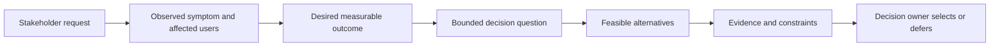
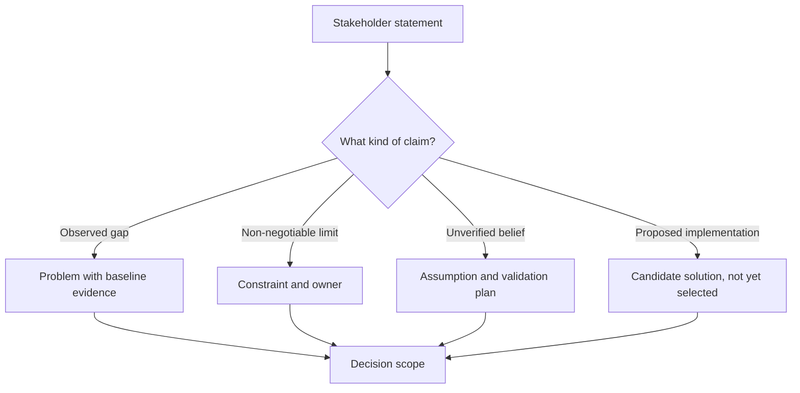
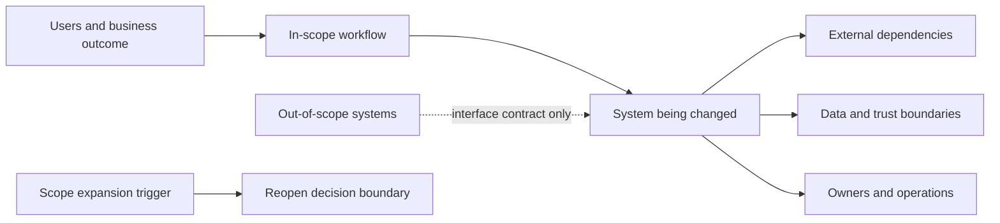
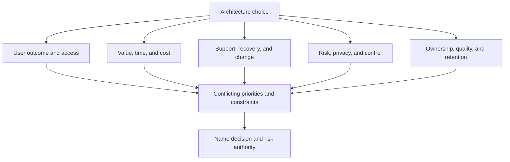
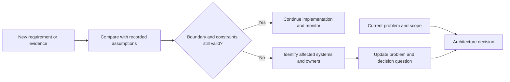

# Framing Architecture Problems and Decision Boundaries

Part: [22 — Architectural Thinking and Decision Practice](PART_OVERVIEW.md)

Architecture work often begins with a proposed solution disguised as a request: “move to microservices,” “add a cache,” or “adopt a new platform.” The first task is to identify the outcome, decision boundary, constraints, assumptions, stakeholders, and evidence before selecting a pattern. Part 01 CH03 owns the general architecture decision loop and decision records; this chapter applies that reasoning to ambiguous requests.

## Translate the Request Into a Decision

Separate the observed problem from its proposed explanation and remedy. Ask what is failing, for whom, under which conditions, and how the outcome is measured. A bounded decision statement identifies what must be chosen, what is in scope, which constraints are hard, and who owns the decision.

For example, “add a cache” is a proposed implementation. “Product pages exceed the p95 latency objective during campaigns; determine whether query optimization, caching, or capacity changes best meet the objective without serving stale price” frames the decision and its quality boundary.

## Separate Problem, Constraint, Assumption, and Solution

A problem is an observed gap or risk. A constraint limits feasible choices. An assumption is a claim not yet verified. A solution is a candidate response. Mixing them makes an untested assumption look like a requirement and prevents useful alternatives from being considered.

Keep the source and confidence for each claim. A “regulatory requirement” should cite the owner or obligation; an “assumption” should have a test, expiration, or decision consequence. Do not silently promote a preference into a hard constraint.

## Establish Scope and Boundaries

Define what the decision includes and excludes: systems, teams, users, data, regions, lifecycle stage, and time horizon. Identify upstream dependencies and downstream consequences without absorbing every adjacent concern into one review. A boundary is useful when it names ownership and the conditions under which the decision must be reopened.

Document explicit exclusions and the interface assumptions that remain. “Outside scope” does not mean “irrelevant”; it means the decision relies on a contract or owner elsewhere. If the change affects data rights, failure domains, or operational ownership, revisit the boundary.

## Surface Stakeholder Goal Conflicts

Different stakeholders optimize different outcomes: users value completion and clarity, operations value diagnostic clarity and safe recovery, security values control, and product owners value delivery and cost. Identify who bears each consequence and who has authority to accept trade-offs. Avoid collapsing disagreement into an averaged score.

Use concrete scenarios to make concerns comparable. “Fast” should specify workload and latency percentile; “secure” should identify assets and threat; “easy to operate” should identify roles and recovery actions. Part 07 owns detailed system requirements and design workflows.

## Revisit the Boundary When Requirements Change

New evidence can reveal that a decision was framed too narrowly. Define triggers such as a new region, data class, user population, failure mode, or integration. Track which assumptions become invalid and which stakeholders must participate in the reopened decision.

Reopening a decision is not failure. It is a controlled response when evidence, scope, or constraints change. Preserve the prior rationale and record what changed so the team does not repeat old analysis without learning from it.

## Worked Case: “Move the API to Microservices”

A product leader requests a microservices migration after a release delay. The team investigates and finds that releases are coupled because three groups edit a shared data model and run one integration suite. The desired outcome is weekly independent deployment without increasing incident rate. Constraints include customer-data residency and a small operations team; the untested assumption is that service separation alone improves release lead time.

The bounded decision becomes whether to change module ownership, data boundaries, and release validation to improve independent delivery. Options include enforcing modular boundaries in the current deployment, extracting one high-change capability, or a broader service decomposition. The team collects change-coupling and deployment data, then selects a small pilot with a rollback and reconsideration trigger. The original request becomes one alternative rather than the conclusion.

## Review Questions

1. Which part of a request is observed evidence, and which is a proposed solution?
2. What makes a constraint hard, and who confirms it?
3. Which stakeholders bear the trade-offs?
4. What systems or assumptions define the decision boundary?
5. What event should cause the problem framing to be revisited?

Good architecture framing converts a solution-shaped request into a bounded, evidence-aware decision. Separate facts from assumptions, name affected owners, define scope and outcomes, and keep the chosen implementation among alternatives until evidence supports it.
