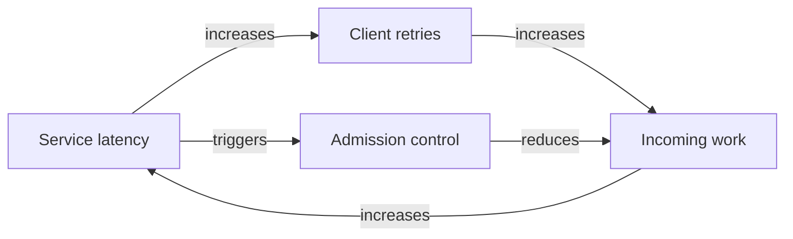
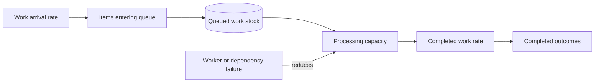
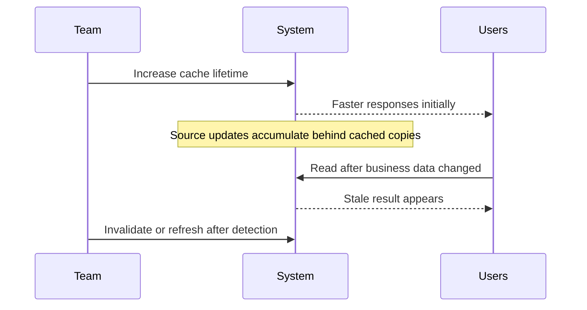
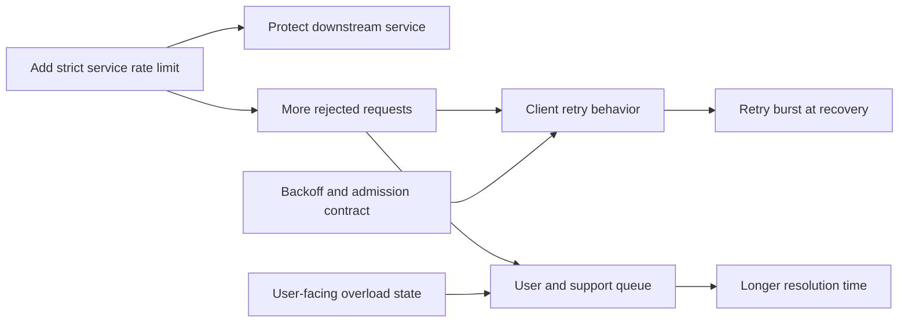
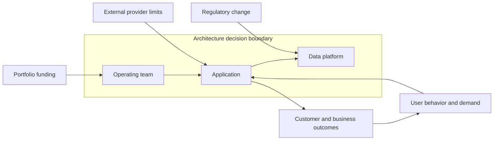

# Systems Thinking for Architecture

Part: [22 — Architectural Thinking and Decision Practice](PART_OVERVIEW.md)

Systems thinking examines how components, people, policies, and feedback interact over time. It helps architects look beyond a local symptom to accumulation, delays, reinforcing behavior, and unintended consequences. Part 01 CH03 owns the general architecture-thinking foundations; this chapter applies them to changes in software and operating systems.

## Identify Feedback Loops

A reinforcing loop amplifies change: a service slowdown creates retries, which increase load and cause more slowdown. A balancing loop counters change, such as admission control reducing work as capacity saturates. The same intervention can produce both loops at different timescales.

Map the behavior, not only the components. Label each arrow with the changing quantity and its timescale. Validate loop direction with operators and production evidence; intuitive cause-and-effect assumptions are often incomplete.

## Model Stocks, Flows, and Accumulation

A stock is accumulated state such as backlog, unprocessed events, open incidents, or stale records. Flows increase or decrease it. A system can have stable average throughput yet accumulate a backlog during bursts when completion temporarily falls below arrival rate. Capacity changes should account for both inflow and drain time.

Measure stock size and age, not only throughput. An old backlog can violate user expectations even when current processing rate looks healthy. Define how the system handles admission, prioritization, and recovery after an outage.

## Account for Delays and Second-Order Effects

Architecture interventions often have delayed effects. Increasing cache duration may lower database load immediately while making stale data visible later. Adding replicas may help after deployment but worsen database pressure during warm-up. A causal timeline helps identify when to measure and when to stop.

Do not evaluate a change only at its first response. Define a measurement window long enough to capture delayed behavior, including cache refresh, staff workload, operational incidents, or dependency load shifts.

## Map Intervention Side Effects

Every optimization or control changes incentives and workload elsewhere. Rate limits can protect a service while shifting retries to clients; centralized governance can reduce risk while slowing local teams; a new approval step can reduce unsafe actions while creating a queue. Identify who absorbs the cost and what metric could reveal it.

Consider unintended consequences across users, operators, dependencies, cost, and security. Add a balancing mechanism such as client backoff or a bounded queue. Define how to observe its effect.

## Choose the System Boundary

A system boundary makes analysis possible but can hide external forces. Include upstream demand, regulatory obligations, user behavior, third-party dependencies, and operational ownership when they influence the outcome. Separate what the team controls from what it can only influence or monitor.

Document the external owner, the dependency, and the escalation or fallback. A diagram that ends at the application boundary can imply control the team does not actually have.

## Worked Case: Queue Growth After a Feature Launch

A product launch increases events per transaction. The worker service processes the same number of events per second, so backlog age rises. Increasing workers initially drains the queue, but database writes and downstream notifications also increase, making those dependencies slower. The team maps the feedback loop, adds bounded concurrency, batches writes where semantics permit, and introduces an overload response for optional notifications.

The success criteria include queue age, completed user workflows, database saturation, notification delay, and support volume. The team tracks the backlog through a full peak and recovery cycle rather than declaring success when queue count briefly falls. A runbook documents the stop condition if downstream capacity is exceeded.

## Review Questions

1. Which reinforcing and balancing loops influence this change?
2. What stock accumulates, and which flows increase or drain it?
3. Which effect appears only after a delay?
4. Who bears the side effect of an intervention?
5. Which external forces sit outside the design boundary but affect the outcome?

Systems thinking helps architects reason about behavior over time and across ownership boundaries. Make feedback, accumulation, delay, and intervention effects visible, then choose measures that can falsify the causal story.
