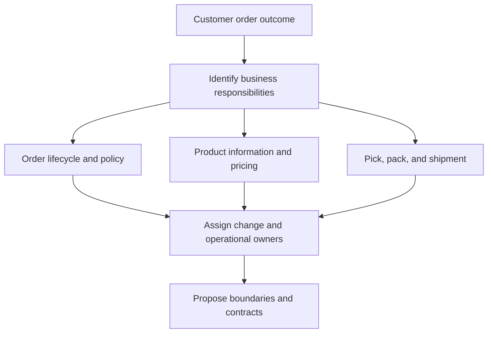
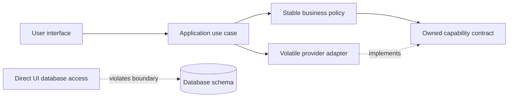
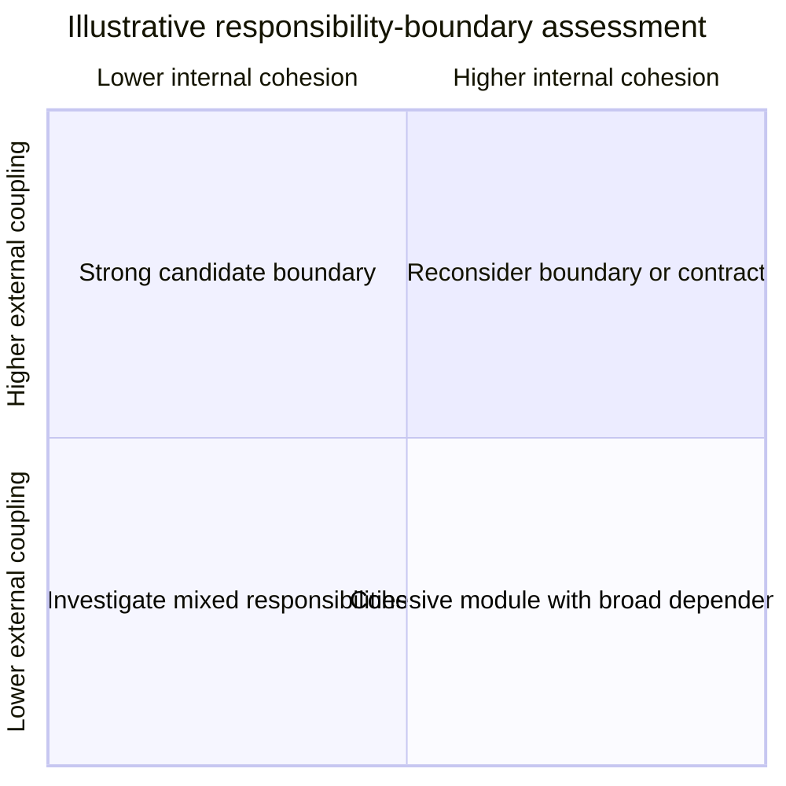
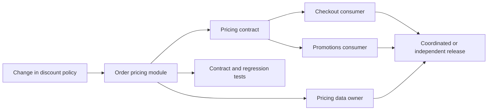
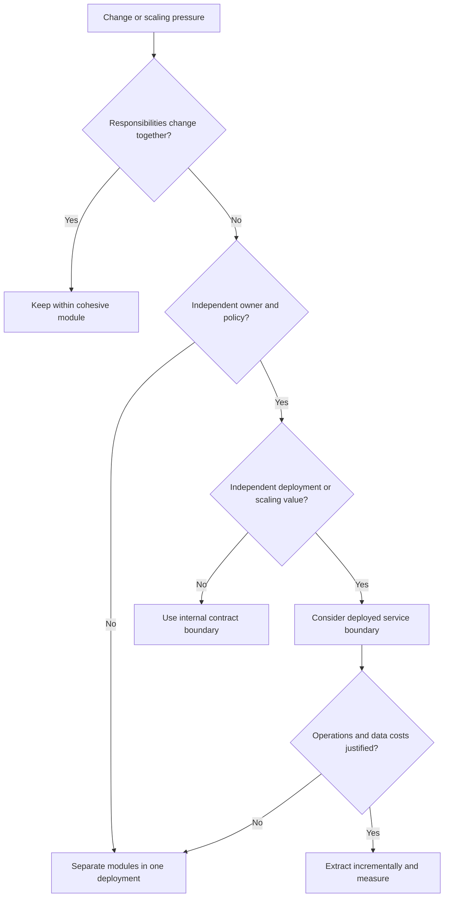

# Decomposition, Boundaries, and Dependency Reasoning

Part: [22 — Architectural Thinking and Decision Practice](PART_OVERVIEW.md)

Decomposition is the act of choosing which responsibilities belong together and which should interact across a boundary. A useful boundary aligns change, ownership, policy, and operational responsibility; a diagram of components alone does not justify it. Part 20 owns architecture-pattern catalogs, Part 07 owns solution design, and Part 18 owns enterprise capability and application maps.

## Decompose Around Responsibilities

Start with outcomes and behavior that change together. Identify actors, decisions, state ownership, invariants, and supporting capabilities. A responsibility should have a coherent reason to change and an owner who can make and operate that change. Decomposition should not merely mirror current teams or database tables.

Use concrete change scenarios to test cohesion. If the same rule is edited in several modules, the responsibility may be split incorrectly. If a module changes for unrelated reasons, it may contain too many responsibilities. Treat these as evidence, not automatic rules.

## Trace Dependency Direction

Dependencies include runtime calls, data ownership, shared libraries, build references, and operational reliance. Draw direction and reason. Dependencies that point from stable policy toward volatile implementation can make changes propagate inward; dependency inversion can improve flexibility when the boundary is real and the contract remains smaller than the implementation.

Review both compile-time and runtime direction. A source dependency can point inward while a call flows outward through an interface. Record whether the boundary is intended to isolate change, security, scaling, data ownership, or failure; boundaries with no decision purpose add ceremony.

## Balance Cohesion and Coupling

High cohesion keeps closely related policy and data together. Low coupling limits how many other responsibilities must change when one changes. Both are contextual: splitting a cohesive transaction across services can increase network and consistency coupling, while one large module can create change contention.

Use the map to ask questions, not to assign a simplistic score. Examine co-change history, ownership handoffs, test scope, failure impact, and data invariants. A boundary with many consumers may still be sound if its contract is stable and ownership is clear.

## Follow Change Propagation

Trace a representative change from requirement through code, data, interfaces, deployment, and operations. Identify how many owners and contracts must coordinate and what can fail during rollout. This reveals whether a boundary localizes change or only hides coupling in shared schemas and synchronized releases.

Change propagation is not always a flaw; regulation may intentionally require coordinated updates. The important question is whether the coordination is visible, owned, and affordable. A large blast radius should influence release strategy and decision timing.

## Compare Boundary Alternatives

Common options include one module, modular monolith, shared service, independently deployed service, or a data product boundary. Compare them on team ownership, change cadence, latency, availability, security, data authority, consistency, and operating capacity. Avoid selecting a boundary solely from deployment preferences.

The tree is a prompt for evidence, not an algorithm. Reversibility and migration cost matter. Prefer a boundary that can evolve locally while keeping an extraction path open if future scale or ownership diverges.

## Worked Case: Fulfillment Changes

A retailer changes shipping rules frequently while order acceptance changes rarely. Both currently share a module and release schedule. Change history shows teams touching separate code but sharing a database table and deployment pipeline. The team first separates domain modules and assigns a fulfillment owner; it versions an internal contract and removes direct table writes.

After observing independent change and operational demand, the team evaluates a separate service. It measures added latency, support load, data synchronization, and release independence. The decision retains a modular monolith until the autonomy benefit exceeds distributed operation cost; the contract keeps a future extraction option open.

## Review Questions

1. Which responsibilities change together, and what evidence supports that grouping?
2. What dependency directions create costly propagation?
3. Which coupling is intentional and which is hidden?
4. How do data ownership and operational capacity affect a boundary choice?
5. What small change could test whether the proposed boundary localizes change?

Decomposition is a reasoned boundary choice, not a diagramming exercise. Tie responsibilities to change and ownership, trace dependencies and propagation, and select the least costly boundary that provides the required autonomy and isolation.
