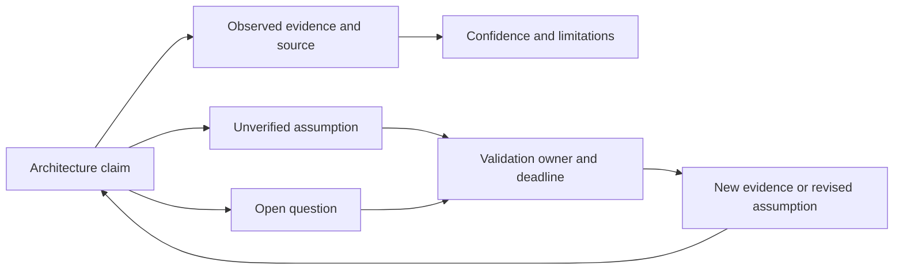
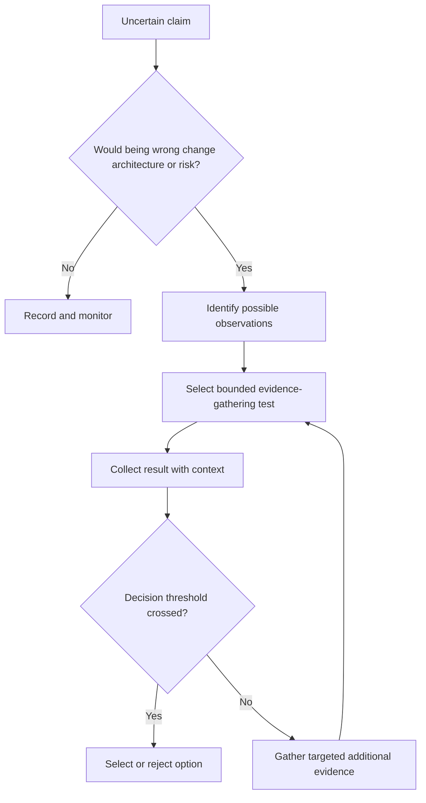
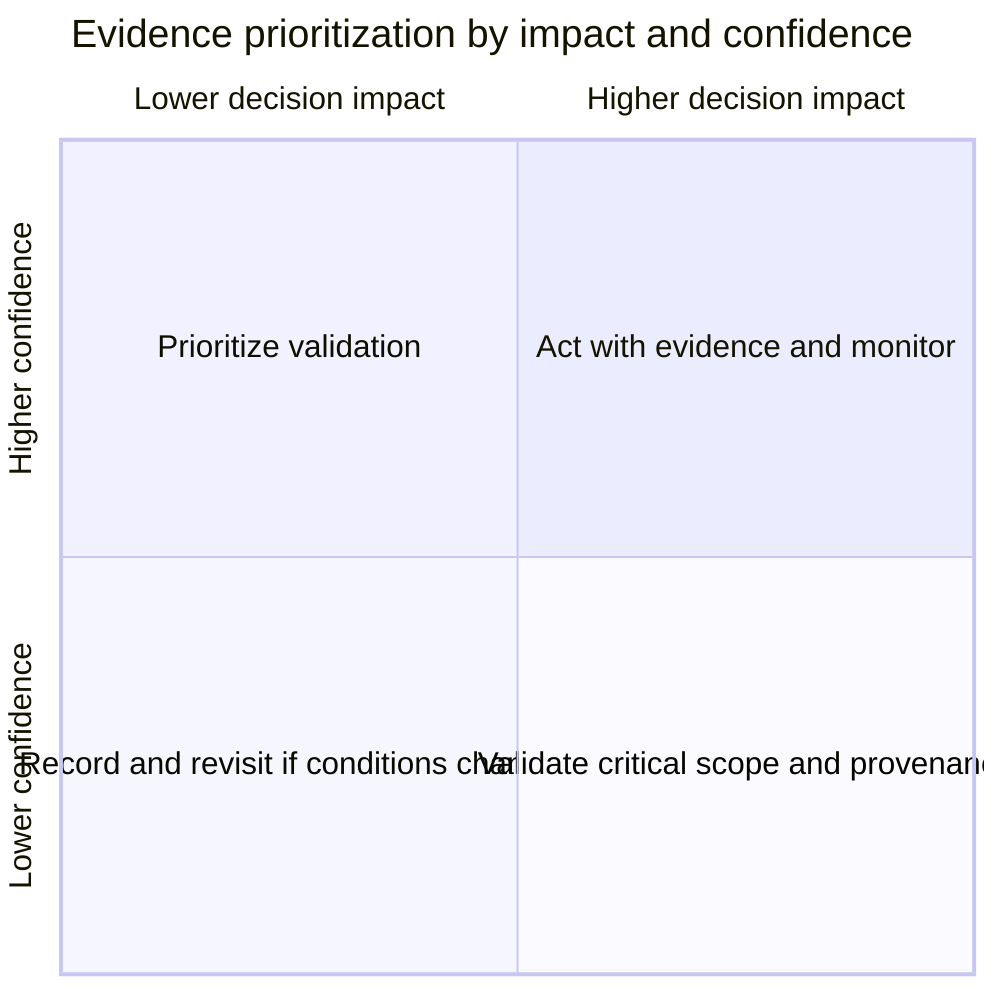
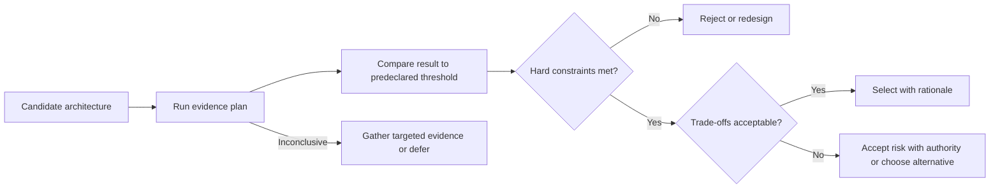
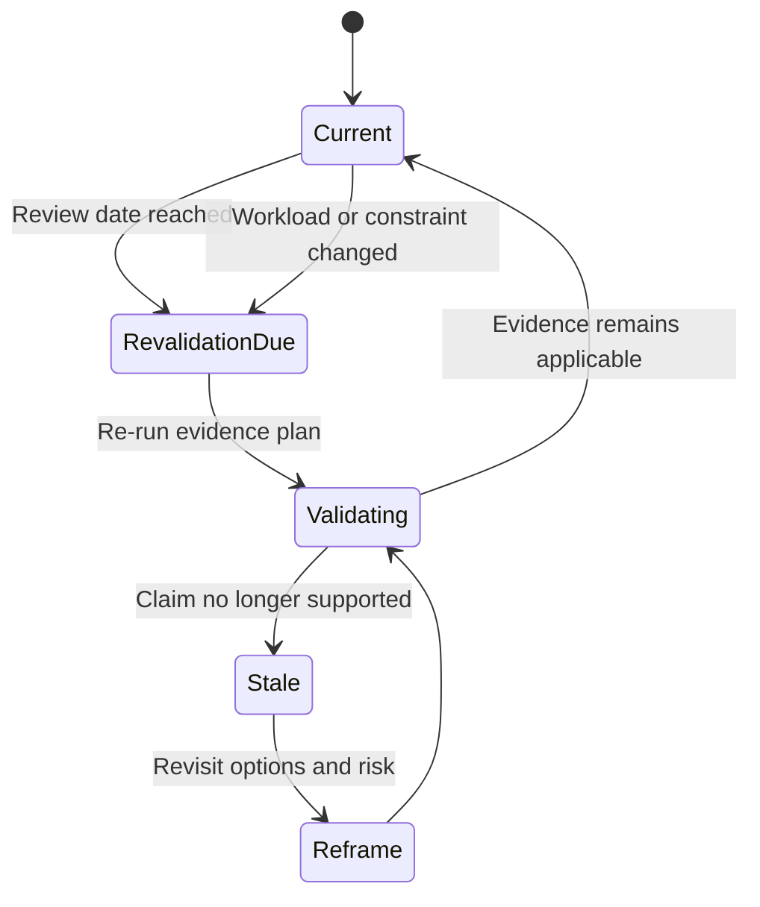

# Evidence, Assumptions, and Uncertainty

Part: [22 — Architectural Thinking and Decision Practice](PART_OVERVIEW.md)

Architecture decisions are often made with incomplete evidence. The useful practice is not to eliminate uncertainty before acting, but to label what is known, expose assumptions, and choose evidence that can change the decision. Part 01 CH03 owns quality-attribute scenarios and decision reasoning; this chapter applies evidence discipline under time and organizational constraints.

## Keep Claims, Evidence, and Assumptions Distinct

A claim describes the system or expected outcome. Evidence supports or challenges it. An assumption is a claim treated as true for current planning but not yet verified. Unknowns are questions that have no credible answer yet. Record source, date, scope, confidence, owner, and consequence if each assumption is wrong.

Do not present an estimate as a measurement or a stakeholder preference as an external constraint. A concise evidence ledger can link to load tests, support data, interviews, regulatory interpretation, or incident history without duplicating those sources.

## Convert Uncertainty Into an Evidence Step

For each high-impact unknown, identify what observation would reduce uncertainty and how it could affect the architecture choice. Choose the smallest safe test that can distinguish competing explanations. A benchmark, prototype, stakeholder interview, dependency inventory, or failure exercise may answer different questions; select the method from the uncertainty, not from tool availability.

Define test scope, cost, owner, completion date, and stop condition. A test that cannot alter the decision may be unnecessary. If evidence cannot be gathered safely or in time, record the residual uncertainty and choose a reversible path or explicit risk owner.

## Prioritize by Impact and Confidence

High-impact, low-confidence claims deserve attention first. Low-impact uncertainty can often be monitored. A confidence rating should state its basis, such as repeated production measurement, a representative experiment, expert estimate, or unverified assumption. Do not treat confidence as probability unless the underlying method justifies it.

The matrix prioritizes validation effort, not the decision itself. High confidence can still be wrong if evidence is stale or outside the relevant population. Record sample, environment, date, and scope alongside the rating.

## Set Decision Thresholds Under Uncertainty

Specify which evidence changes the decision and what happens when results are inconclusive. A threshold can be a latency target, quality floor, cost cap, failure rate, or legal sign-off. Separate hard gates from preferences and define who can accept residual risk. This prevents teams from moving thresholds after seeing unfavorable results.

Record who set the threshold and which stakeholder outcome it protects. Inconclusive evidence should not be treated as a pass. The decision record should preserve the metric definition and test context.

## Keep Evidence Fresh and Reusable

Evidence decays when traffic, code, contracts, data, price, or team ownership changes. Link each claim to a revalidation trigger and date. A load test from a previous scale may not support a new region; a vendor assurance report may not cover a new data use. Preserve raw results and configuration where practical.

Evidence repositories need owners and access controls. Avoid copying sensitive data into decision notes. Store the conclusion, source reference, date, conditions, and confidence so future reviewers can find and assess it.

## Worked Case: Database Migration Estimate

A team assumes a database migration can complete within one maintenance window. The estimate comes from a small test dataset and omits index rebuild, rollback, and peak write traffic. The migration is high impact and the confidence is low, so the team inventories actual data volume and schema, tests a production-shaped copy, measures write freeze and catch-up time, and rehearses restore.

The decision threshold is a maximum write interruption and a verified recovery point. The first test exceeds the interruption budget. The team preserves the threshold and compares online migration with a phased transition. It records the remaining uncertainty in replication lag under peak writes and schedules a second test with a stop condition.

## Review Questions

1. Which statement is a measured fact, and which is an assumption?
2. What evidence could materially change the architecture choice?
3. Which high-impact, low-confidence claims need validation first?
4. Are thresholds and risk authority set before the test result?
5. What change makes existing evidence stale?

Evidence discipline makes uncertainty visible and actionable. Label claims and assumptions, prioritize tests by decision impact, define thresholds in advance, and revalidate evidence when its conditions no longer match the system.
