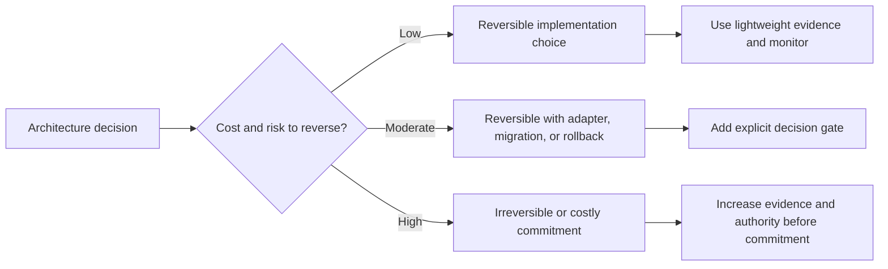
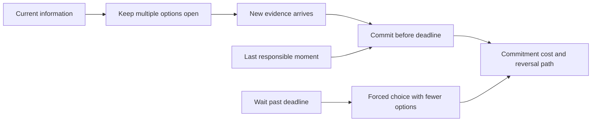
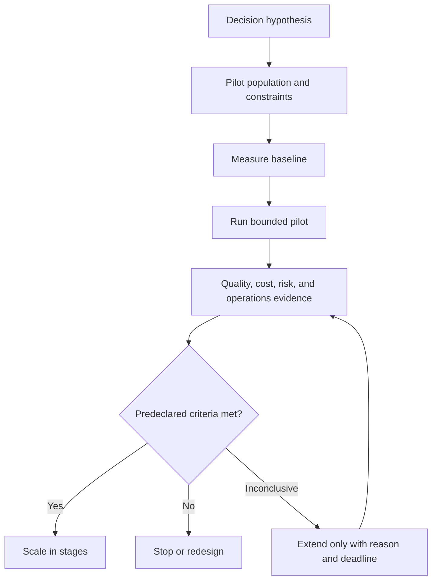
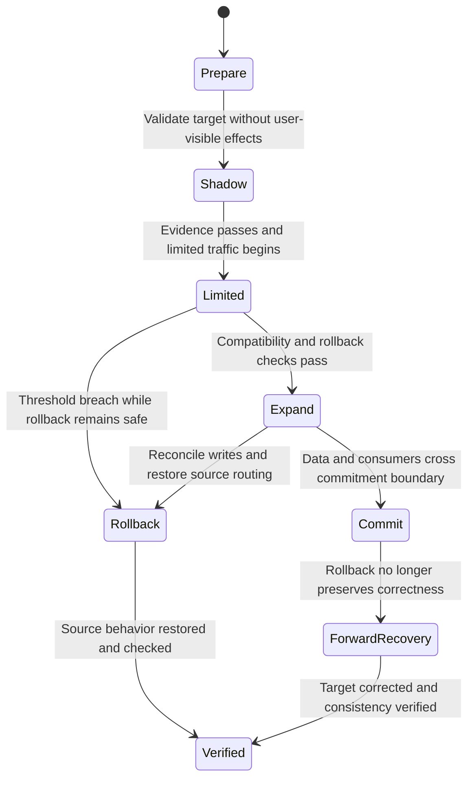
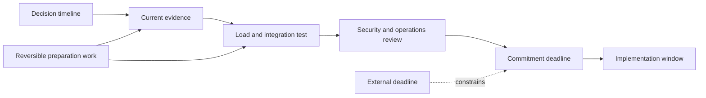

# Reversibility, Optionality, and Decision Timing

Part: [22 — Architectural Thinking and Decision Practice](PART_OVERVIEW.md)

Reversibility describes how easily a decision can be changed after new evidence arrives. Optionality is the set of future choices preserved by delaying an irreversible commitment or designing a migration path. Part 01 CH03 owns the one-way/two-way-door heuristic and decision reversibility concepts; this chapter applies them to pilots, migration gates, and timing.

## Classify Commitment and Recovery Cost

Classify a decision by its undo cost, not by whether it appears technical or managerial. A library choice may be reversible in a module but expensive across a public contract. A database migration may be reversible before writes move but difficult after consumers rely on new state. Identify money, data, contracts, customer impact, staffing, and operational recovery involved in changing course.

Part 01 CH03 covers the underlying reversibility heuristic. Here, the practical task is to make recovery concrete: what state changes, who restores it, how long the restoration takes, and which consequences remain even after technical rollback.

## Preserve Options Without Delaying Indefinitely

Waiting can preserve choices when evidence is expected soon and the cost of delay is low. Waiting can also consume a migration window, increase lock-in, or defer a necessary control. Identify the last responsible moment: the latest point at which the decision can be made without jeopardizing delivery or safety.

Optionality has a carrying cost: parallel designs, temporary adapters, or deferred investment consume time and complexity. Keep options open only when the information value exceeds that cost. Set a decision date and define what evidence must arrive by then.

## Use Pilots as Decision Gates

A pilot should answer a high-value uncertainty with a bounded population, explicit success and stop criteria, and a named decision owner. It should not become production through inertia. Design pilot boundaries so data, security, and operational impact remain contained, while results still represent the workload that matters.

Pilots can distort behavior if users know they are in a trial or if the sample excludes difficult cases. Record representativeness and generalization limits. Scaling should have its own gates for capacity, migration, support, and rollback.

## Define Migration and Rollback Boundaries

A migration may be reversible at the infrastructure layer while data semantics or external behavior are not. Identify the point where writes, identifiers, contracts, or customer actions make rollback unsafe. Use expand-and-contract migrations, shadow comparison, dual-read or dual-write only when consistency and reconciliation are explicitly designed.

Name the irreversible boundary before migration. After that point, forward recovery or compensation may replace rollback. The exact gate depends on data ownership, consumer adoption, and whether both systems can safely accept writes.

## Time Decisions Against Information Arrival

Evidence arrives at different rates. A technology support date may be fixed; load test results may arrive in days; user research may take weeks. Map decision deadlines against evidence arrival and required lead time. Make early decisions that are reversible; delay only commitments whose option value remains greater than the cost.

Preparation work can preserve options without selecting the final architecture, such as defining a stable interface or validating migration tooling. Do not confuse reversible preparation with an implicit commitment that becomes difficult to unwind.

## Worked Case: Replacing a Message Broker

An organization considers replacing its broker before a contract renewal. The current system has a known support deadline, while workload tests and consumer inventory are incomplete. The team keeps the interface stable, tests a candidate broker with representative producers and consumers, and sets an evidence deadline before procurement.

The pilot checks delivery behavior, ordering needs, replay, operations, cost, and migration effort. A limited shadow deployment preserves the old path. The final traffic cutover is declared the commitment boundary because consumers may create state that cannot be reconciled automatically. If the candidate misses the evidence threshold, the team renews the current contract for a bounded period and records the next review trigger rather than forcing a premature migration.

## Review Questions

1. What is the true cost and residue of reversing this decision?
2. Which information is expected, and when does it arrive?
3. What does a pilot need to prove, and what is outside its evidence scope?
4. Where is the migration's irreversible commitment boundary?
5. Which reversible preparation preserves options without creating hidden lock-in?

Reversibility is a design property as well as a decision label. Preserve options when evidence can change the choice, set deadlines to avoid indefinite delay, and mark the point after which recovery becomes forward correction rather than rollback.
