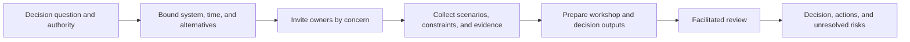
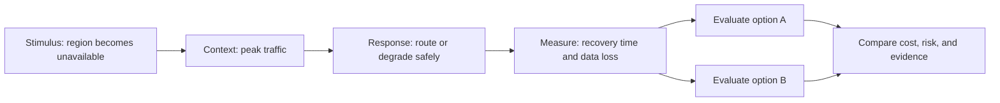
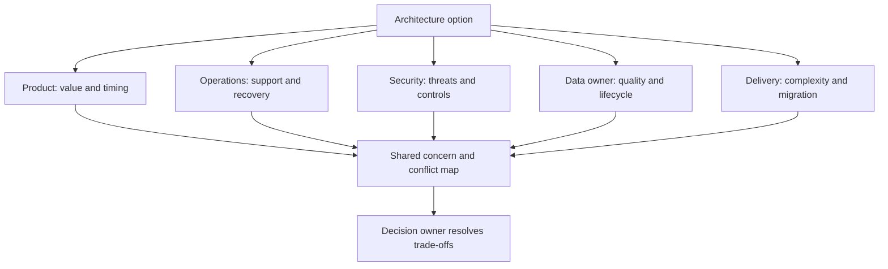
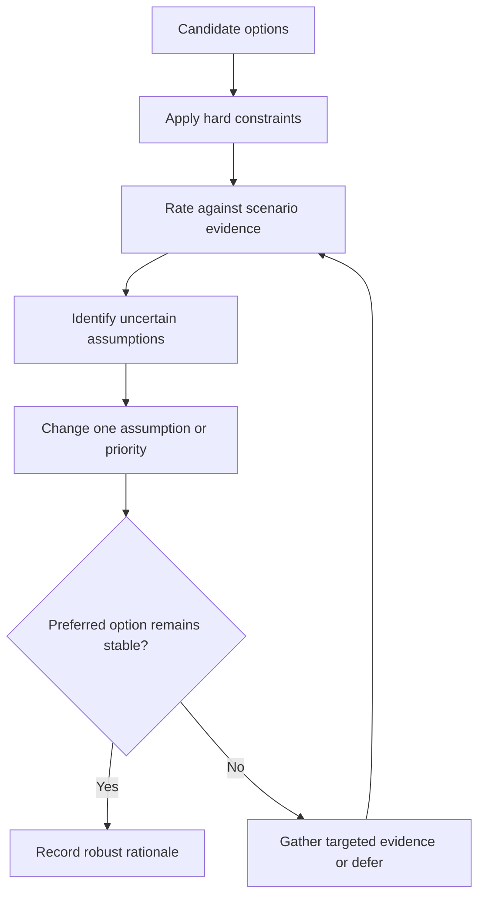
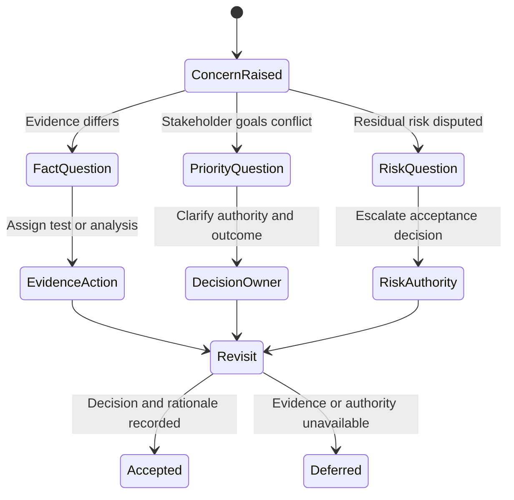

# Facilitating Architecture Trade-off Workshops

Part: [22 — Architectural Thinking and Decision Practice](PART_OVERVIEW.md)

An architecture trade-off workshop helps stakeholders compare feasible options against quality goals, evidence, constraints, and risk tolerance. The facilitator structures the discussion so disagreement becomes explicit and decision owners can act. Part 01 CH03 owns the Architecture Tradeoff Analysis Method (ATAM), quality-attribute scenarios, and general decision reasoning; this chapter focuses on applying those tools in a workshop.

## Prepare the Workshop Around a Decision

State the decision question, scope, decision owner, participants, timebox, and required outcome before scheduling. Collect current architecture views, constraints, scenarios, evidence, and candidate options. Ask participants to distinguish preferences from hard requirements and to submit assumptions or objections in advance.

Do not use a workshop to discover basic system facts that can be gathered beforehand. If evidence is missing, make that a planned uncertainty exercise rather than letting the loudest assumption become the baseline.

## Use Concrete Quality Scenarios

Part 01 owns the full quality-attribute-scenario structure. In practice, recap each scenario with stimulus, context, response, and measurable response threshold. This turns vague goals such as “resilient” or “fast” into comparable architecture consequences.

Ask which scenario materially distinguishes options. A scenario that every alternative meets equally may still be a gate, but it does not explain the trade-off. Record evidence limitations and conditions that would change the ranking.

## Surface Stakeholder Concerns

Participants may prioritize different outcomes. Identify who is affected, who bears operating cost, who accepts residual risk, and who decides. Give quieter or less represented teams explicit opportunities to surface constraints. The facilitator does not decide by vote unless the governance model explicitly assigns voting authority.

Make authority visible before discussion. If the decision owner is not present, the workshop can still gather evidence and options, but it should not imply an accepted decision.

## Compare Options and Test Sensitivity

Use a small set of criteria tied to scenarios. Separate hard gates from preferences, and show how the result changes when assumptions or weights change. Qualitative scales can support discussion, but a decimal score does not make judgment objective. Explain the mechanism behind each rating.

Use sensitivity analysis to discover which assumptions drive the choice. If small changes reverse the ranking, the decision is fragile and may need a pilot, a reversible option, or explicit risk acceptance.

## Handle Disagreement and Close the Session

Separate disagreement about facts, priorities, and risk tolerance. Assign evidence gathering when facts are uncertain; escalate priority or risk acceptance to the authorized owner. Summarize the decision, dissent, conditions, actions, owners, and review trigger at the end of the session.

Do not manufacture consensus. A documented decision with a named owner and dissent is more useful than an ambiguous meeting note that implies everyone agreed.

## Worked Case: Regional Data Platform

The workshop compares a centralized platform, regional replicas, and separate regional deployments. Participants include product, data governance, security, platform operations, and application teams. Scenarios cover regional outage, residency change, peak query latency, and cost. Hard residency constraints eliminate one option; recovery and operational capacity distinguish the remaining choices.

Sensitivity analysis shows the preferred option changes if replication lag exceeds the business tolerance. The group assigns a test to measure lag and a cost estimate for the regional deployment. The decision owner defers the final topology choice until that evidence is available, while accepting reversible interface work in parallel. The record preserves the unresolved trade-off and decision date.

## Review Questions

1. What decision can the workshop actually make, and who has authority?
2. Which scenarios distinguish the candidate options?
3. How are hard constraints separated from weighted preferences?
4. What does sensitivity analysis reveal about assumptions?
5. How are facts, priorities, and risk-tolerance disagreements resolved?

Effective workshops make trade-offs inspectable and decisions actionable. Prepare evidence, use concrete scenarios, surface stakeholder priorities, test sensitivity, and record unresolved concerns with owners rather than manufacturing consensus.
