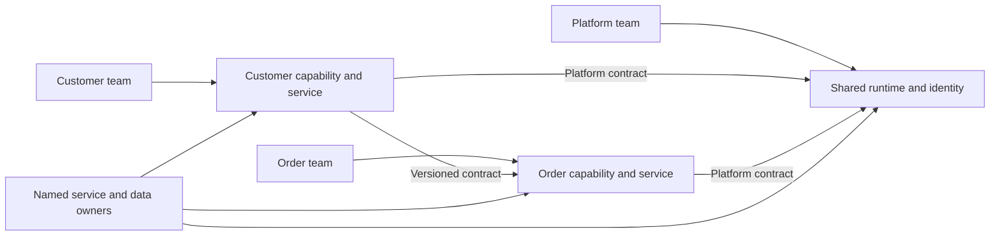
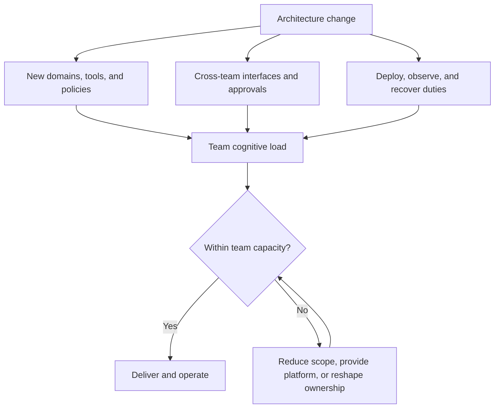
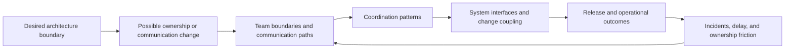
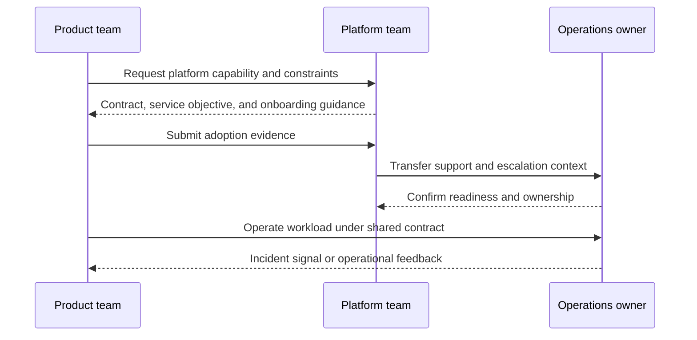
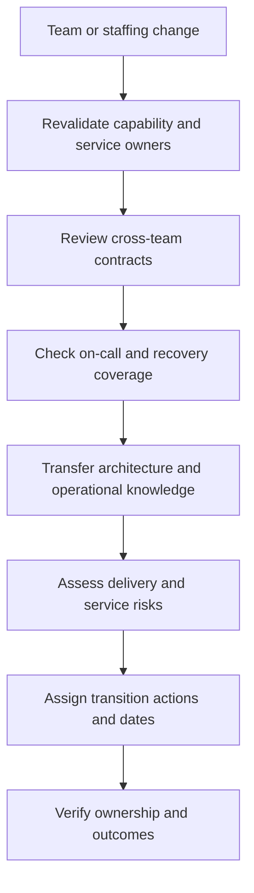

# Socio-Technical Architecture Reasoning

Part: [22 — Architectural Thinking and Decision Practice](PART_OVERVIEW.md)

Architecture is produced and operated by people organized into teams, with particular skills, decision rights, incentives, and communication paths. A technically clean boundary can fail when ownership is unclear or cognitive load exceeds a team's capacity. Part 01 owns Conway's Law and team-topology foundations; Part 18 owns enterprise capability and organization mapping. This chapter applies those ideas to architecture decisions.

## Align Ownership With Change Boundaries

Map which teams own capabilities, code, data, interfaces, and operations. A service boundary that requires daily coordination across teams may signal misaligned ownership or an intentionally shared contract that needs an explicit owner. A team that owns a service but cannot deploy or observe it lacks meaningful operational control.

Make cross-team interfaces explicit: contract owner, change notice, support responsibility, escalation, and operational objective. Shared platforms can reduce duplicated work but must provide a usable service boundary rather than simply centralizing approvals.

## Account for Cognitive Load

Cognitive load includes the concepts and coordination a team must understand to deliver and operate a system. It grows with unfamiliar technologies, inconsistent conventions, cross-team dependencies, and unclear failure ownership. The goal is not to minimize complexity everywhere; it is to keep complexity aligned with team capacity and the value delivered.

Reduce avoidable load through consistent platforms, clear boundaries, documentation, and enabling support. Do not hide complexity in a platform team that becomes a bottleneck or loses domain context. Assign a realistic operational load to each team.

## Use Conway's Law as a Hypothesis

Conway's Law observes that system designs tend to reflect communication structures. Part 01 CH01 owns the full concept; here it is used as a diagnostic hypothesis, not a deterministic prediction. If teams communicate through slow handoffs, architecture may accumulate batch interfaces or centralized integration. If teams are reorganized, interfaces and ownership may change even when code does not.

Do not reorganize teams solely to match a diagram. Identify the specific coordination bottleneck, desired outcome, transition cost, and evidence. A change to team boundaries can disrupt trust and domain knowledge; consider interface or platform changes as alternatives.

## Make Ownership Handoffs Visible

Handoffs occur when one team creates a dependency another team must operate or change. Document the trigger, artifact or contract, receiving owner, acknowledgment, failure route, and support expectation. An “owner” field in a catalog is insufficient if the team lacks capacity or authority to respond.

If no team accepts a handoff, the architecture is not operationally complete. Define who owns incidents, schema changes, data quality, user communication, and service retirement.

## Assess Organizational Change Impact

A reorganization, acquisition, or staffing change can affect system interfaces, release cadence, operational coverage, and knowledge retention. Map which architecture decisions depend on specific expertise or informal coordination. Create a transition plan that preserves access, ownership, and runbook knowledge.

Measure transition readiness through named owners, access, support rota coverage, decision rights, and unresolved dependencies. Do not assume a new reporting line automatically changes technical ownership or operational capability.

## Worked Case: Shared Identity Platform

Several product teams depend on a central identity platform. The platform team's queue for custom changes delays product delivery, while product teams independently implement inconsistent workarounds. The review finds that the platform team owns implementation but lacks capacity to support all product-specific policy decisions.

The architecture separates stable authentication capabilities from product-owned authorization policy. It publishes self-service contracts and an escalation route for exceptional cases. An enabling engineer helps teams migrate and transfers operational knowledge. The change is evaluated by integration lead time, policy consistency, incident ownership, and platform-team load rather than by team count alone.

## Review Questions

1. Which teams own each capability, interface, dataset, and operational response?
2. What creates avoidable cognitive load or coordination delay?
3. Which communication structure may be reflected in the current architecture?
4. Are handoffs acknowledged and supported by capacity?
5. What changes when team ownership or skills move?

Socio-technical reasoning connects system boundaries to team capacity, communication, and ownership. Use organizational models as hypotheses, make handoffs explicit, and evaluate team or platform changes by operational and delivery outcomes rather than diagram symmetry.
