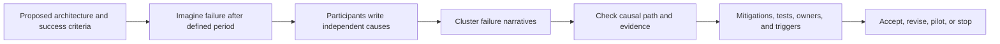
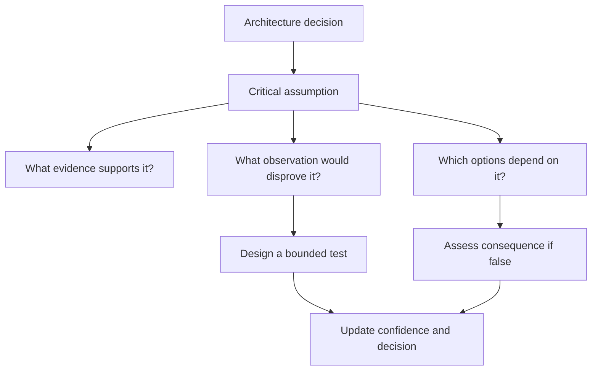
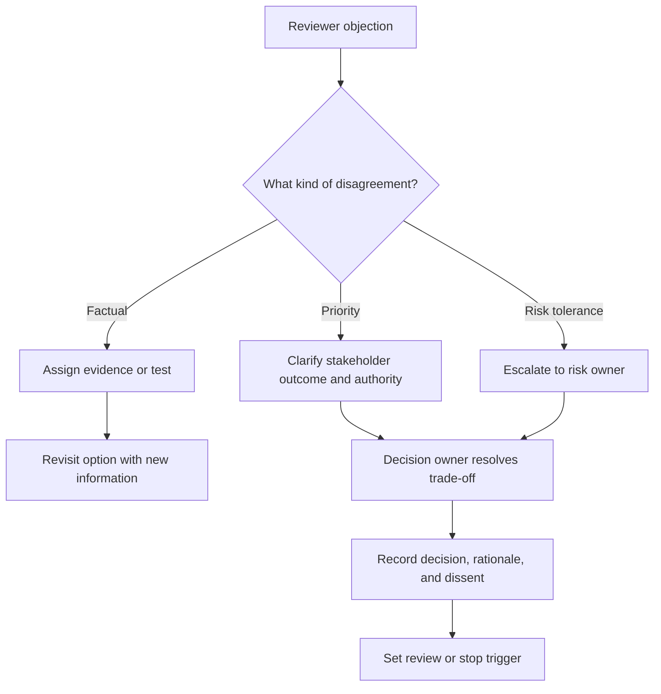
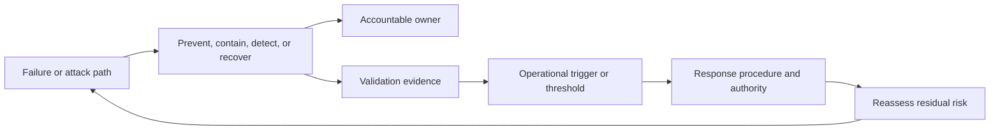

# Architecture Pre-Mortems and Challenge Reviews

Part: [22 — Architectural Thinking and Decision Practice](PART_OVERVIEW.md)

A pre-mortem asks a team to imagine that a proposed architecture failed and work backward to plausible causes. A challenge review deliberately seeks disconfirming evidence, weak assumptions, and failure paths before a high-impact commitment. These techniques complement Part 01 decision reasoning and Part 15 threat modeling; they do not replace security analysis or incident planning.

## Run a Pre-Mortem Before Commitment

State the proposal, scope, success criteria, and time horizon. Ask participants to independently imagine a credible failure, then share causes before group discussion. Group related causes, identify leading indicators, and assign mitigations or evidence tasks. Avoid turning the exercise into generic brainstorming detached from the architecture.

Independent generation reduces anchoring on the most senior person's explanation. Capture who is affected, what failed, why controls did not prevent it, and how the failure becomes visible. Distinguish plausible scenarios from remote imagination by identifying mechanisms and evidence.

## Challenge Assumptions Deliberately

For each major assumption, ask what evidence supports it, what would disprove it, which alternatives depend on it, and what happens if it is false. Use a challenge tree to reveal hidden premises. The purpose is to improve the decision, not to defend a preferred option or reward adversarial behavior.

Use one challenge method at a time: red-team perspective, alternative hypothesis, boundary challenge, or failure narrative. Record the response and residual uncertainty. Some assumptions cannot be tested directly. Assign a risk owner and preserve a reversible option where possible.

## Walk an Attack or Failure Scenario

Trace an adversarial or accidental path from trigger to impact through components, data, identity, and controls. Part 15 owns threat-modeling technique; this exercise is a challenge lens for architecture decisions. Include how the event is detected, contained, communicated, and recovered.

```mermaid
flowchart LR
    Trigger[Malicious or accidental trigger] --> Entry[Entry point or dependency]
    Entry --> Weakness[Assumption or control gap]
    Weakness --> Propagation[Cross-boundary propagation]
    Propagation --> Impact[Customer, data, or service impact]
    Impact --> Detect[Detection signal and owner]
    Detect --> Contain[Containment and recovery path]
    Contain --> Evidence[Validation and residual risk]
```

Do not stop at “the service fails.” Identify whether data is corrupted, requests are duplicated, users are misled, or operators lack authority to intervene. Select scenarios that can change the architecture, not merely add routine tests.

## Preserve Dissent and Escalate Responsibly

Disagreement can reveal different facts, priorities, or risk tolerances. Let participants state objections without interruption, classify the disagreement, and identify who owns the decision. Escalate unresolved material risk to the proper authority; record dissent and evidence rather than relabeling it as consensus.

Challenge is not a veto mechanism. A decision owner may proceed with documented residual risk when authorized, but should not erase a material objection. An absent authority requires deferral. Continue only with reversible preparatory steps.

## Map Mitigations to Owners and Evidence

Every material failure path needs a response: reduce likelihood, limit impact, detect, recover, or consciously accept risk. Assign one owner and the evidence that shows the mitigation works. A mitigation with no owner or test is an intention, not a control.

Review for single points of failure in mitigations themselves. For example, a human approval gate is weak if the reviewer cannot see evidence, has no time, or lacks authority to reject. Define fallback when the mitigation is unavailable.

## Worked Case: Data-Platform Consolidation

A team proposes consolidating regional data systems into a shared platform. The pre-mortem imagines that the migration misses a residency obligation and that a shared capacity incident affects every tenant. Participants identify assumptions about classification quality, network isolation, and platform-team response coverage.

A challenge review asks what evidence would falsify the belief that the platform isolates tenants. The team schedules an isolation test, a regional recovery exercise, and a load test under one tenant's burst. A dissenting risk owner requires a regional escape path before broad migration. The decision proceeds as a limited pilot with tenant scope, mitigation owners, stop criteria, and a review date.

## Review Questions

1. What plausible causal path could make the proposal fail?
2. Which assumptions are most consequential and falsifiable?
3. Who can raise dissent and who owns unresolved risk?
4. Which mitigation has a named owner and validation evidence?
5. What signal causes the team to pause or revisit the decision?

Pre-mortems and challenge reviews make failure and uncertainty discussable before commitment. Keep scenarios causal and bounded, preserve dissent with its evidence, assign mitigation owners, and feed findings into the decision and validation plan.
