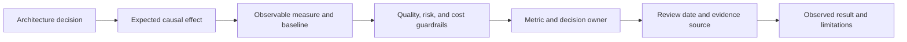
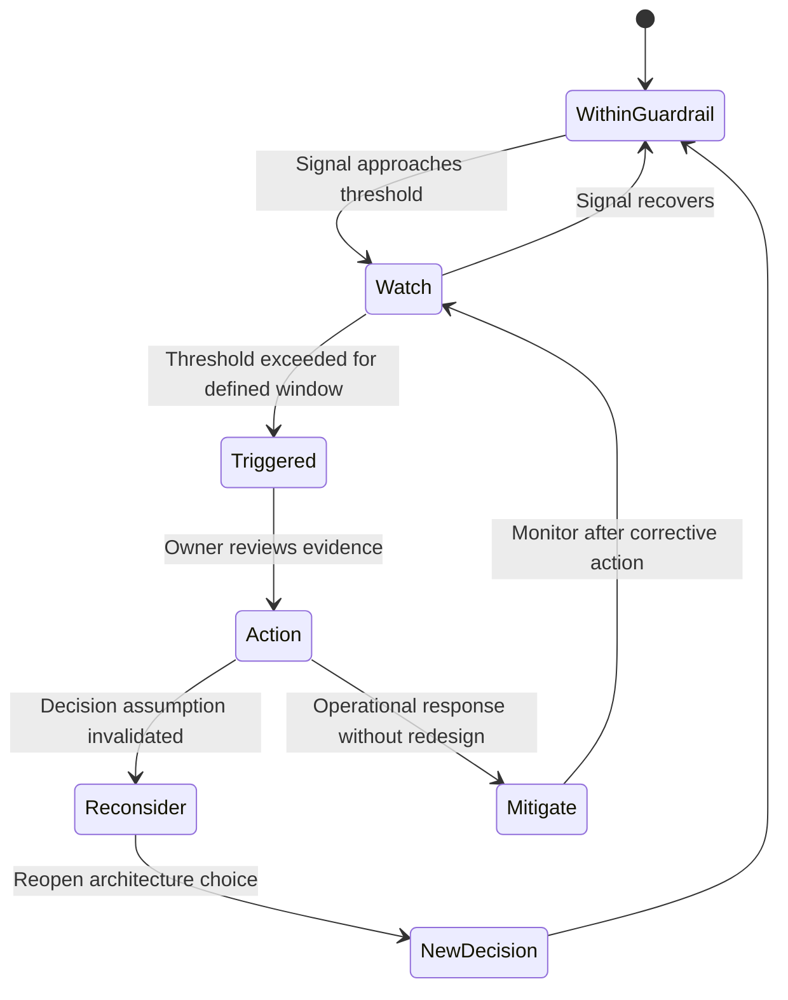
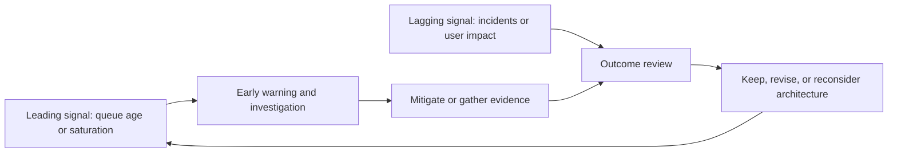
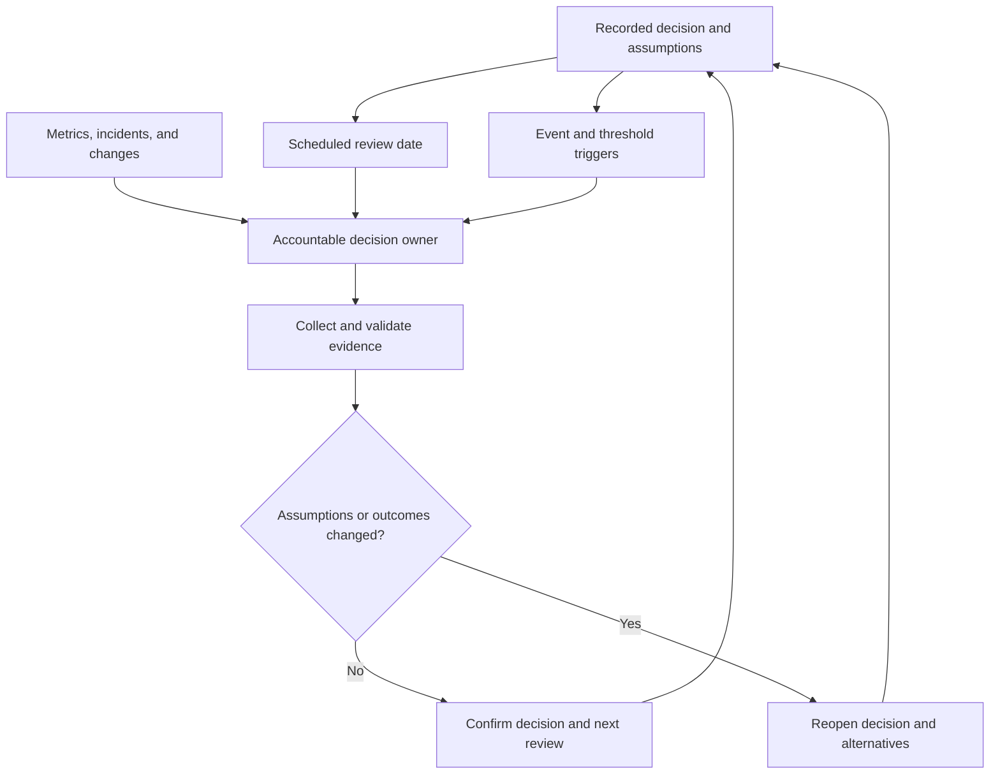
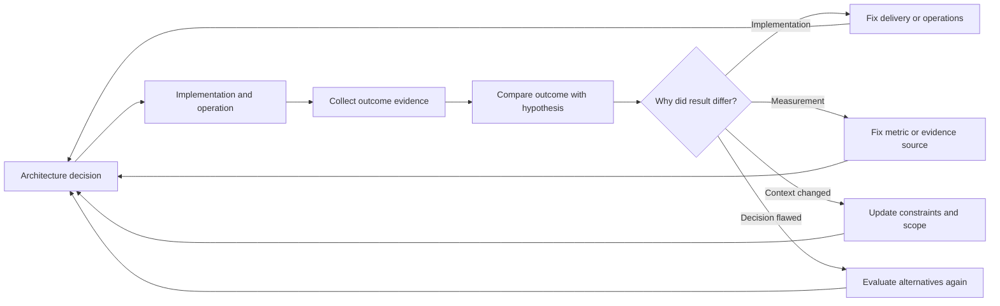

# Measuring Decision Outcomes and Reconsideration Triggers

Part: [22 — Architectural Thinking and Decision Practice](PART_OVERVIEW.md)

An architecture decision should state what outcome it expects and what evidence would justify revisiting it. Measures do not prove causality by themselves; they make assumptions observable and create a feedback path. Part 01 CH03 owns architecture fitness functions and decision reasoning. This chapter applies those concepts to ownership, thresholds, and review triggers.

## Connect a Decision Hypothesis to a Measure

Write the expected outcome in a testable form: if the team makes a design change, then a measurable quality or business result should improve without violating a guardrail. Name the baseline, population, time window, owner, and decision threshold. Include negative outcomes such as cost, incidents, user effort, and operational burden.

Choose a measure close enough to the decision to be actionable. A proxy metric can be useful, but record what it does not capture. For example, deployment frequency does not alone establish safer or faster customer outcomes.

## Define Thresholds and Actions

A trigger should say what signal crosses what threshold, over which interval, and what action follows. Use hysteresis or multiple observations when noisy signals could cause repeated toggling. Thresholds need an owner and an adjustment process; changing them after an alert should not erase the original decision criterion.

Separate operational mitigation from architecture reconsideration. An alert may call for scaling or incident response without invalidating the underlying design. Revisit the decision when evidence challenges its assumptions or the workload changes materially.

## Pair Leading and Lagging Evidence

Lagging indicators show outcomes after they occur; leading indicators can provide earlier warning but may be noisy or indirect. Pair them where possible. For example, customer incident rate is lagging, while queue age or dependency saturation can be leading. Define how signals relate and avoid treating correlation as proof.

Metrics should have clear data sources and definitions. If a signal changes due to sampling, population, or instrumentation changes, flag that before attributing it to the architecture. Preserve the ability to compare against the original baseline.

## Assign Review Cadence and Ownership

Scheduled reviews suit temporary exceptions and technology lifecycle choices. Event-triggered reviews follow major workload shifts, regulatory changes, incidents, or cost thresholds. Assign an owner responsible for collecting evidence and convening the right decision authority.

Avoid reviews that merely repeat the original meeting. Reassess only the assumptions, outcomes, and context that could change the choice. If the owner leaves or the system changes ownership, transfer the review responsibility explicitly.

## Feed Outcomes Back Into Architecture

After observing results, distinguish implementation failure, measurement failure, changed context, and flawed decision logic. Update the decision record, risks, operating controls, and next trigger. A failed hypothesis should inform architecture practice rather than become a reason to hide the metric.

This loop should preserve historical context. Do not edit the old rationale as if the new evidence had been available at the time; add the result and link any replacement decision.

## Worked Case: API Boundary Choice

A team chooses a synchronous API integration to keep order confirmation simple. The decision records an expected latency objective, a dependency availability assumption, and a fallback policy. Leading signals include downstream p99 and timeout rate; lagging signals include failed orders and support contacts. The service owner reviews weekly during launch and after any provider change.

Two months later, timeout rates rise with peak traffic while provider availability remains stable. The evidence indicates that capacity and deadline propagation, not the synchronous boundary itself, are the immediate issue. The team adjusts concurrency and admission controls, then observes a later region expansion that invalidates the original latency assumption. A new architecture review compares regional placement with asynchronous completion and records a replacement decision.

## Review Questions

1. What measurable outcome does the architecture decision predict?
2. Which guardrails prevent an optimization from hiding a negative consequence?
3. What triggers operational mitigation versus architecture reconsideration?
4. Who owns data quality and review cadence?
5. How is historical rationale preserved when a decision is replaced?

Decision outcomes become useful when measures, thresholds, owners, and actions are defined in advance. Pair leading and lagging evidence, revisit only when context or assumptions change, and preserve the learning in linked decision records.
