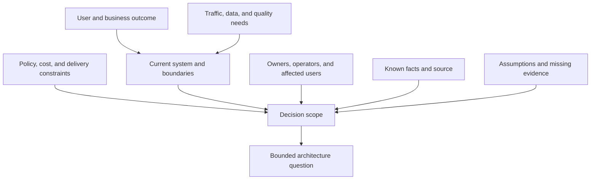
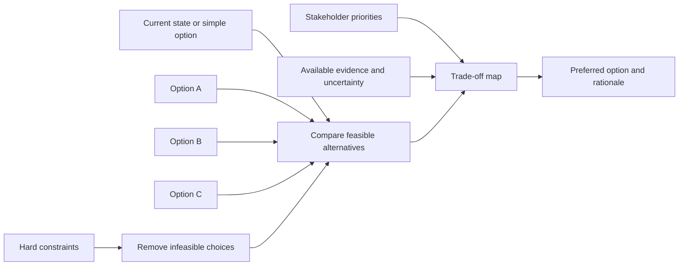
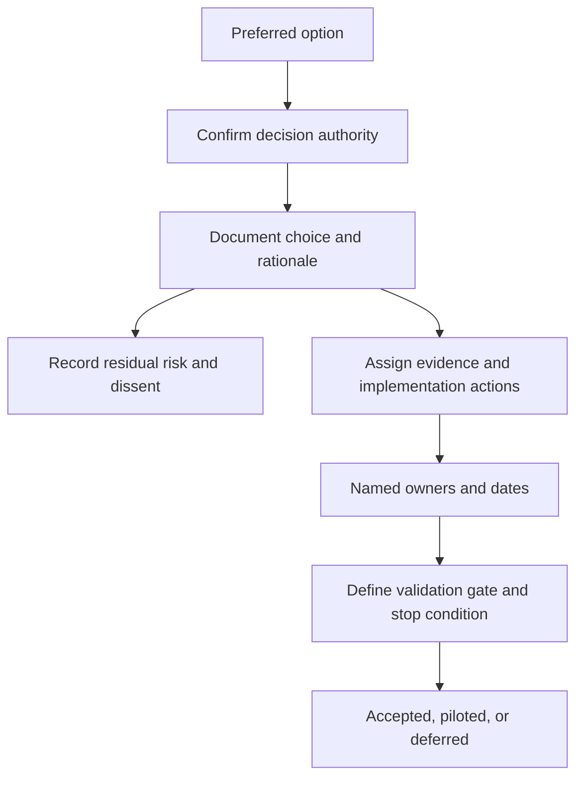
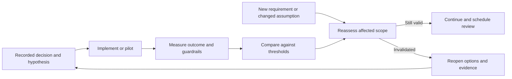

# Integrated Architecture Decision Clinics

Part: [22 — Architectural Thinking and Decision Practice](PART_OVERVIEW.md)

An architecture decision clinic is a structured case exercise in which a team frames a problem, identifies constraints and stakeholders, compares options, gathers evidence, records a decision, and defines follow-up. It combines the practices from this module with domain guidance elsewhere in the handbook. Part 01 CH03 owns the core decision loop and ADR reasoning; Part 07 owns system-design workflows; Part 18 owns enterprise governance.

## Run the Clinic From Context to Decision

The facilitator provides a bounded case, available evidence, and decision authority. Participants distinguish facts from assumptions, identify a decision boundary, generate viable options, and choose what evidence matters. The clinic should produce a decision or an explicit deferral, not just a preferred design diagram.

```mermaid
flowchart LR
    Case[Case context and outcome] --> Frame[Frame decision and boundaries]
    Frame --> Stakeholders[Identify concerns and authority]
    Stakeholders --> Options[Generate feasible alternatives]
    Options --> Evidence[Compare evidence, risks, and uncertainty]
    Evidence --> Decision[Decide, pilot, or defer]
    Decision --> Record[Record rationale, owners, and triggers]
    Record --> Followup[Validate outcomes and revisit]
```

Timebox each phase and provide a visible parking lot for out-of-scope issues. If the group cannot agree because evidence is missing, identify an evidence action and decision date rather than forcing a vote.

## Establish Case Context and Constraints

Give participants enough context to reason: user or business outcome, current system, workload, stakeholders, constraints, baseline, known failures, and available teams. Include deliberate unknowns so the group practices identifying evidence needs. State which decisions are in scope and which owners are not represented.

Do not hide facts that change the answer, but avoid prescribing the solution. Label simulated evidence and identify what additional information a real team would require. The facilitator should reveal new evidence only when the group asks a relevant question or reaches a defined inject point.

## Compare Alternatives and Trade-Offs

Require at least one non-preferred alternative and the strongest simpler baseline. Identify hard constraints first, then compare feasible options against stakeholder scenarios, risks, reversibility, operations, and cost. Note where different stakeholders value the outcomes differently.

Scoring may expose differences but must not turn subjective judgments into false precision. Ask which assumption changes the ranking, what evidence would reduce uncertainty, and what risk the decision owner accepts.

## Produce a Decision Record and Action Plan

Capture the decision, context, alternatives, rationale, consequences, assumptions, dissent, evidence, owner, status, and revisit trigger. Link a full ADR when the decision is significant; use a shorter record when the choice is bounded and reversible. Assign actions with one owner and a due date.

Separate the decision from follow-up execution. A clinic may conclude that no option is ready because a critical assumption remains untested; record a bounded experiment rather than treating deferred as failure.

## Validate and Reconsider the Choice

Define observable outcomes, guardrails, measurement windows, and conditions for revisiting the decision. Follow-up checks whether implementation matched the choice and whether expected outcomes occurred. If context changes, reopen only the affected assumptions and dependencies rather than repeating the entire clinic without cause.

The exercise is complete when owners, evidence, and reconsideration triggers are explicit. Production decision quality is judged by outcomes and learning, not how quickly the group reaches a preferred option.

## Worked Clinic: Partner Data Exchange

A company must share account data with a partner. The case provides user impact, volume, latency, data classification, a regulatory constraint, current integration behavior, and an incomplete partner recovery commitment. Participants compare direct API, queued exchange, and managed transfer options. Security and operations identify different priorities; the data owner clarifies that some fields cannot leave a region.

The group rules out an option that violates residency, chooses a bounded regional pilot, and identifies missing evidence about partner idempotency and recovery. The decision is provisional, with a pilot scope, validation threshold, owner, deadline, and rollback plan. A dissenting concern about support coverage is recorded and assigned for resolution before expanding to all regions.

## Clinic Exercise Template

Use these prompts to run a short case:

1. State the outcome and decision boundary in one sentence.
2. List facts, constraints, assumptions, and unknowns separately.
3. Name the stakeholders, decision owner, and risk authority.
4. Compare the strongest baseline with at least two feasible alternatives.
5. Identify the evidence that changes the ranking and the safest test.
6. Record a decision, deferral, or pilot with owners and triggers.
7. Define how outcomes are measured and when the choice is revisited.

## Review Questions

1. Did the team frame the problem before choosing a pattern?
2. Were stakeholder conflicts and decision authority explicit?
3. Which assumptions drove the selected option?
4. What evidence and guardrails are required before broader adoption?
5. What event would cause the decision to be reopened?

Decision clinics practice architecture judgment across boundaries and uncertainty. Keep the case bounded, compare real alternatives against evidence, record ownership and dissent, and make follow-up part of the decision rather than an afterthought.
