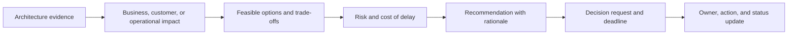
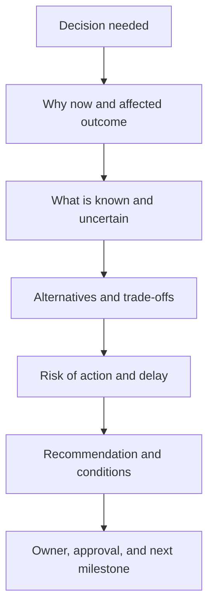
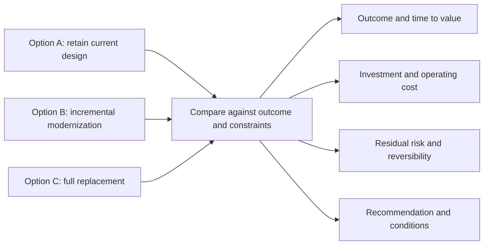
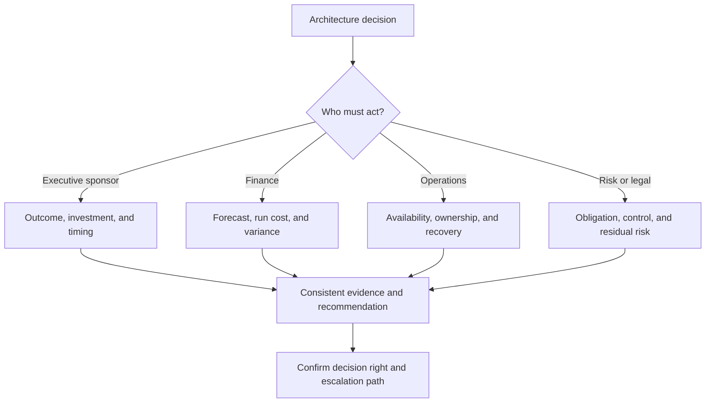
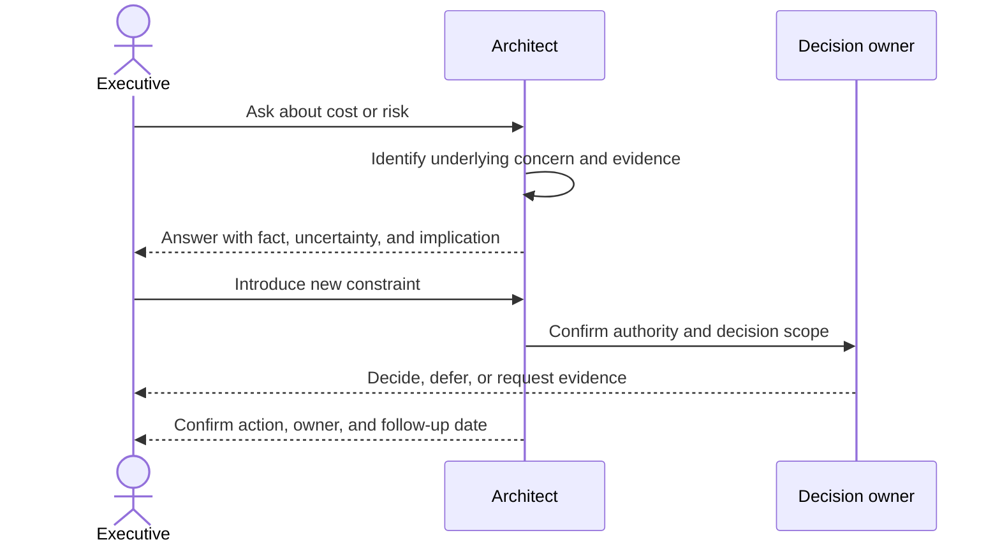

# Executive Communication

Part: [23 — Soft Skills](PART_OVERVIEW.md)

Executive communication makes architecture implications useful for decisions about outcomes, risk, investment, and timing. It does not mean removing technical substance; it means selecting the evidence and detail that an audience needs to act. Part 21 owns documentation artifacts, and Part 22 owns decision reasoning and facilitation. This chapter applies those practices to concise executive conversations and follow-through.

## Translate Technical Evidence Into a Decision

Start with the business outcome, current condition, and decision requested. Connect technical evidence to user or operational impact, then explain options, trade-offs, risk, recommendation, and the consequence of delay. State what the audience must decide and by when.

Avoid leading with a technology label. “Adopt a service mesh” is not an executive decision request. “Approve the investment to reduce cross-region recovery from four hours to one hour, with a two-quarter rollout and an annual operating cost of X” states an outcome and trade-off.

## Structure a Briefing Around the Decision

A useful briefing usually includes the decision, why now, evidence, alternatives, risk, recommendation, investment, and follow-up. The order can vary, but the audience should not have to infer the ask from technical detail. Put the recommendation early and support it with evidence rather than building suspense.

Keep the primary briefing concise and put technical details in linked backup material. Avoid hiding material uncertainty in backup slides. The summary should stand on its own while making assumptions and decision limits visible.

## Compare Options, Risk, and Cost

Executives need to understand what they gain, what they spend, what risk remains, and what is deferred. Use comparable dimensions and units. Distinguish one-time investment from ongoing cost, and technical risk from business exposure. Avoid a single composite score that hides which stakeholders bear a trade-off.

Use ranges when estimates are uncertain and name the assumptions behind them. Show the cost of delay or failure where meaningful. A recommendation is stronger when it says what evidence would change it.

## Match Message to Audience and Authority

An executive sponsor may care about investment and strategic exposure; finance about lifecycle cost; operations leadership about service continuity; legal or risk leadership about obligations and accountability. Adapt vocabulary and depth while preserving the same facts and decision record. Confirm that the person in the room has authority to decide or can route the request to the correct owner.

Audience adaptation is not message manipulation. Do not omit material risk for one audience or present different facts to different stakeholders. Use the same underlying evidence with emphasis tailored to each decision responsibility.

## Handle Questions and Escalation

Listen for the concern behind a question: impact, timing, cost, risk, feasibility, or authority. Answer directly, distinguish known facts from assumptions, and offer a follow-up when evidence is unavailable. If a question changes scope or reveals a new constraint, restate the decision boundary and determine whether the recommendation still holds.

Do not bluff. If evidence is missing, state what is known, what is uncertain, how to resolve it, and when the answer can be returned. Record the resulting decision and actions after the conversation.

## Worked Case: Recovery Investment

An architecture team needs approval for regional recovery capability. The current recovery objective is eight hours; the proposed design targets two hours and adds operating expense. The briefing presents incident history, business impact, two design options, a cost range, and the residual risk that data replication may lag during a regional failure.

The recommendation is a phased investment: first improve restore automation and validate recovery data, then add a second region if the exercise does not meet the agreed objective. The executive sponsor can approve funding but not accept the regulatory residual risk, so the architect routes that condition to the risk authority. The meeting ends with owners, evidence gates, and a decision date.

## Review Questions

1. What exact decision is requested, from whom, and by when?
2. Which technical evidence matters to the business outcome?
3. Are options compared on consistent cost, risk, and timing dimensions?
4. Which uncertainty could change the recommendation?
5. What owner and follow-up close the communication loop?

Executive communication is successful when the right authority can make an informed decision. Lead with the ask and outcome, support trade-offs with evidence, communicate uncertainty honestly, and close with ownership and follow-through.
