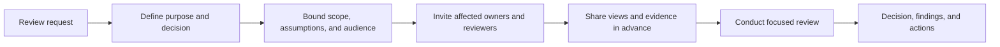
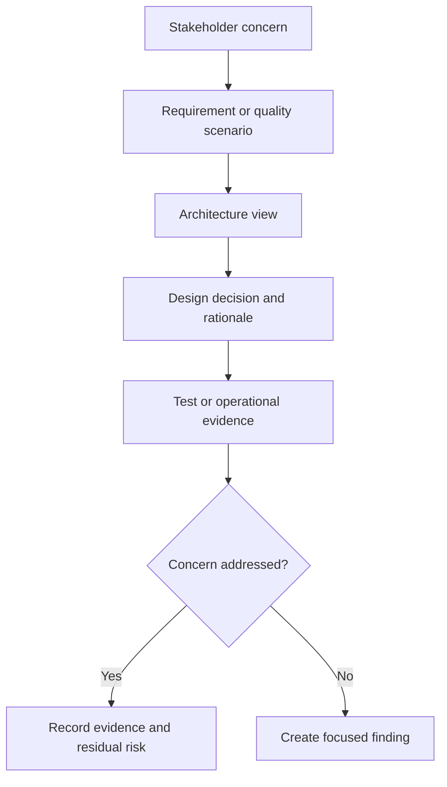
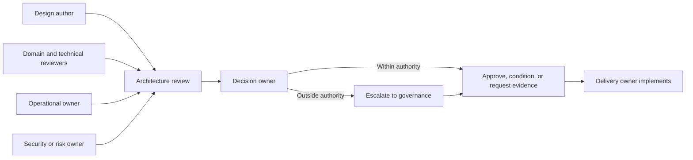
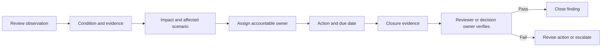

# Architecture Reviews

Part: [23 — Soft Skills](PART_OVERVIEW.md)

An architecture review is a collaborative examination of a design, change, or operating system against explicit goals and evidence. A constructive review tests assumptions and risks without turning disagreement into personal criticism. Part 21 CH11 owns review artifacts and follow-up structure; Part 22 CH06 owns facilitated trade-off workshops; Part 18 CH09 owns review-board authority.

## Set Purpose and Prepare Participants

State the review purpose: advice, risk assessment, decision, or readiness check. Share scope, architecture views, scenarios, constraints, open questions, and decision authority before the session. Invite people who own affected requirements, systems, operations, and risks. A review with no decision owner can produce feedback but cannot close the question.



Prepare reviewers with a clear prompt: which quality scenario, boundary, or risk should they inspect? Avoid sending a large document set without a question. Allow time for asynchronous review and identify which feedback requires live discussion.

## Connect Architecture Evidence to Concerns

Reviewers should trace stakeholder concerns through requirements, views, decisions, validation, and operational ownership. Ask whether the diagrams match the described behavior, whether assumptions are tested, and whether failure and recovery paths are credible. Distinguish missing evidence from a design defect.



Use evidence proportionate to impact. A low-risk, reversible decision may need a focused test; a high-impact data or availability boundary may require a scenario exercise, threat review, and recovery evidence. Avoid demanding a particular artifact if another source reliably answers the concern.

## Make Roles and Decision Rights Explicit

The author explains intent and evidence; reviewers challenge assumptions and surface risk; decision owners choose or defer; risk owners accept residual exposure; facilitators maintain a fair process. A reviewer is not automatically the approver. State who can decide, who must be consulted, and how unresolved objections escalate.



Keep challenge focused on claims and consequences: “What evidence supports this failure assumption?” is more useful than “This design is wrong.” Invite dissenting views and ensure the people affected by the design can speak without needing to out-rank the author.

## Turn Findings Into Owned Actions

A finding should include condition, evidence, impact, severity, owner, due date, and closure criteria. Separate blocking issues from risks accepted by authority and improvement suggestions. Avoid vague actions such as “improve resilience”; name the scenario and evidence that demonstrate the change.



Track actions after the meeting and report overdue or blocked items. A review is not complete just because feedback was sent. If risk is accepted without mitigation, record the authority, scope, duration, and reconsideration trigger.

## Prioritize Findings and Escalation

Severity should reflect consequence, likelihood, exposure, and release context. A potential data loss on a critical path is different from a maintainability preference. The review should distinguish a release blocker, a condition for approval, an accepted residual risk, and an advisory improvement.

```mermaid
quadrantChart
    title Review finding priority
    x-axis Lower impact --> Higher impact
    y-axis Lower evidence confidence --> Higher evidence confidence
    quadrant-1 Confirmed high-impact finding: gate or mitigate
    quadrant-2 Investigate high-impact uncertainty
    quadrant-3 Track proportionately
    quadrant-4 Validate before prioritizing
```

The matrix guides discussion, not automatic decisions. A high-impact, low-confidence finding may warrant immediate validation; high confidence in a low-impact issue may still be a backlog item. Escalate when authority, risk tolerance, or scope exceeds the review's mandate.

## Worked Case: Account Recovery Design

A team proposes a new account-recovery flow using an external identity provider. Reviewers include product, security, support, and operations. The author presents abuse scenarios, recovery time targets, provider behavior, failure modes, and support escalation. Security asks how the flow handles a compromised email account; support identifies that the proposed fallback requires evidence agents cannot access.

The review separates a confirmed gap in evidence access from an open question about attacker behavior. The decision owner conditions approval on a privacy-reviewed evidence path and a support exercise. The remaining high-impact risk is escalated to the risk authority. Actions name owners and closure tests, and the review record links the architecture views and decision.

## Review Questions

1. Is the review purpose and decision authority explicit?
2. Can each concern be traced to a view and evidence?
3. Are disagreements about facts, priorities, or risk tolerance separated?
4. Does every finding have an owner and closure criterion?
5. Which issues require escalation beyond the review group?

Constructive architecture reviews improve decisions by testing evidence and assumptions in a fair process. Prepare the right participants, distinguish advice from authority, classify findings proportionately, and follow actions through verified closure.
