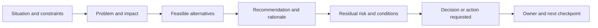
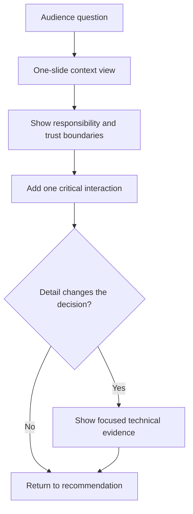
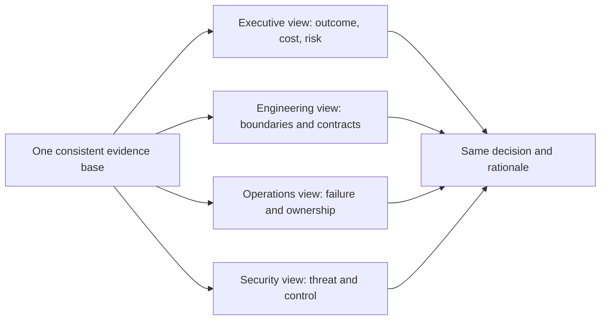
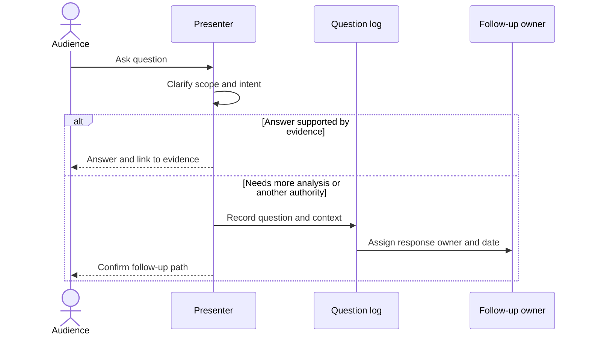
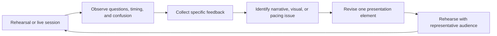

# Presentation Skills

Part: [23 — Soft Skills](PART_OVERVIEW.md)

Architecture presentations help an audience understand a problem, evaluate options, and take action. Effective delivery combines a coherent narrative, audience-appropriate visuals, rehearsal, and deliberate handling of questions. Part 21 owns architecture diagram formats; this chapter focuses on how an architect presents and facilitates understanding.

## Build a Decision-Oriented Narrative

Structure the presentation around the audience's question: context, problem, impact, options, recommendation, risks, and requested action. Start with the outcome and decision needed, then provide enough technical evidence to support the conclusion. Do not begin with a component inventory unless the audience asked for one.

One presentation should have one primary decision or learning outcome. Secondary information can be linked or placed in backup material. If the audience needs to approve funding, the narrative should connect architecture choices to cost, timing, risk, and measurable outcomes.

## Control Visual Density and Detail

Use a progression from context to detail. Introduce boundaries and actors before internal components, then show interactions or deployment only when they answer the question. A diagram should be legible at presentation scale and should have a verbal headline that explains what the audience should notice.

Avoid shrinking a full system diagram until labels are unreadable. Split views, reveal layers progressively, or move implementation detail to an appendix. Ensure color is not the only carrier of meaning, use sufficient contrast, and provide accessible descriptions for essential visuals.

## Adapt to Audience Attention and Prior Knowledge

Executives often need outcome, investment, risk, and authority; engineering teams may need contracts, dependencies, and failure behavior. The same facts can be presented at different levels without changing the conclusion. Ask what the audience already knows and define acronyms or domain terms that are necessary to the decision.

Audience adaptation changes emphasis, not facts. Keep risks and assumptions visible in every version. Avoid framing technical detail as inherently more rigorous or executive summaries as permission to omit uncertainty.

## Pace and Handle Questions

Rehearse transitions and time allocation. Leave time for questions and distinguish clarification from a new decision request. When a question is important but out of scope, capture it with an owner and response date instead of dismissing it. For remote presentations, pause for questions, narrate visual changes, and verify that participants can read the material.

Do not answer beyond the evidence. State what is known, what is uncertain, and how a follow-up resolves it. If the question changes a key assumption, return to the decision boundary rather than forcing the original recommendation.

## Use Feedback to Improve

Feedback should describe observable behavior and impact: unclear decision request, illegible diagram, missing alternative, or rushed risk discussion. Review audience questions and follow-up requests to find gaps in the narrative. Change one aspect and observe whether the next audience reaches the intended understanding or decision.

Do not optimize only for presenter confidence or slide count. The relevant measure is whether the audience can explain the options, risks, and requested action accurately enough to decide.

## Worked Case: Platform Investment Briefing

An architect seeks approval for a shared developer platform. The briefing opens with the delivery delay and support cost it addresses, compares a shared platform with continued local tooling, and recommends a staged investment. A context diagram shows the teams and services affected; a second slide shows only the onboarding and operations boundary.

The architect states the cost range, staffing assumptions, migration risk, and decision deadline. An executive asks whether the platform can support a regulated workload. The evidence is incomplete, so the architect records a follow-up with the security owner rather than claiming approval. Feedback shows that the operating-cost slide was unclear; the next briefing separates one-time migration cost from ongoing support cost.

## Review Questions

1. What decision or learning outcome anchors the narrative?
2. Which visual detail is necessary at the audience's current level?
3. How can the same evidence serve different audiences without changing facts?
4. What is the response when a question exceeds available evidence?
5. Which audience signal shows that the presentation worked?

Presentation skill turns architecture evidence into shared understanding and action. Lead with the decision, layer visuals deliberately, pace for comprehension, handle uncertainty honestly, and use audience response to improve the next briefing.
