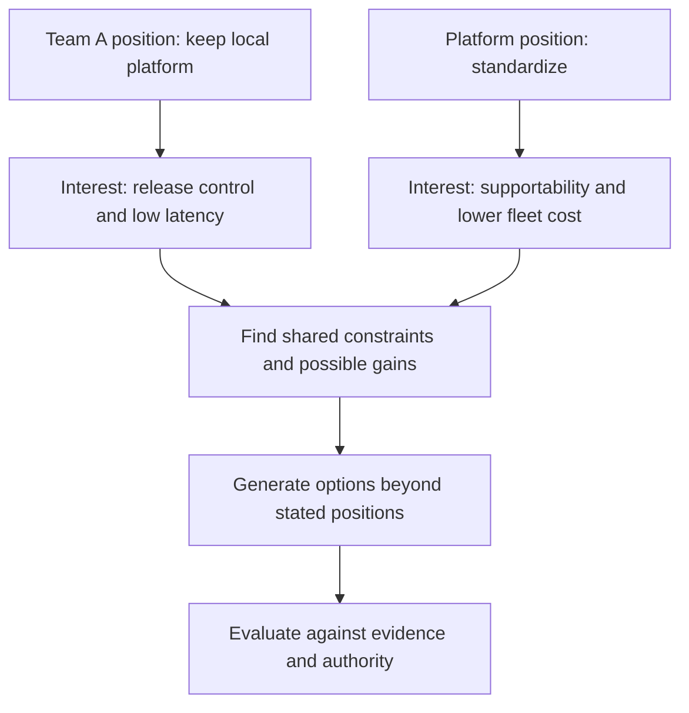
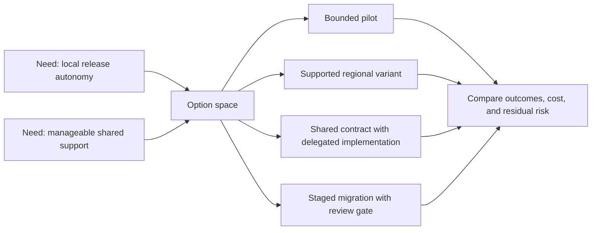
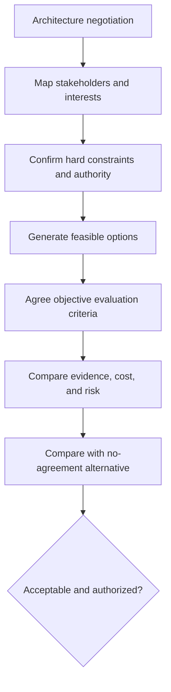
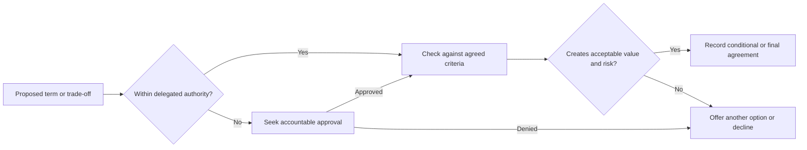
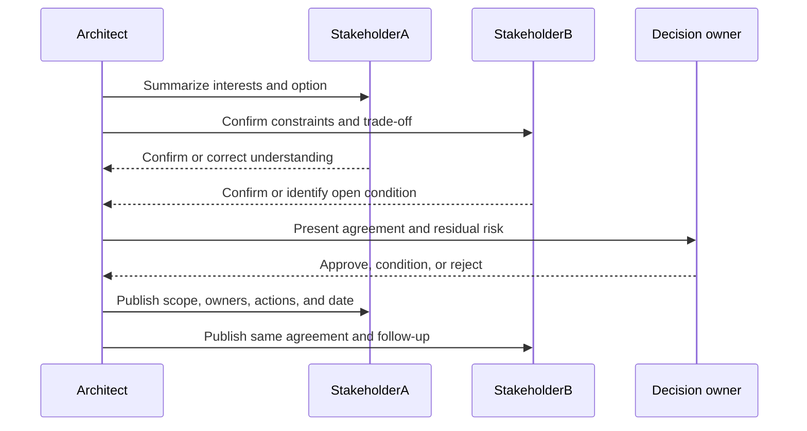

# Negotiation

Part: [23 — Soft Skills](PART_OVERVIEW.md)

Architecture negotiations align stakeholders who depend on shared systems but value outcomes differently. Durable agreements come from understanding interests, constraints, alternatives, authority, and evidence rather than winning a debate over positions. This chapter applies negotiation to architecture decisions; Part 22 owns facilitated technical trade-off workshops.

## Separate Positions From Interests

A position is a requested outcome, such as “use the shared platform” or “retain the current database.” An interest is the underlying need: latency, control, auditability, delivery speed, or support ownership. Asking why a position matters can reveal options that meet several interests without adopting either initial proposal unchanged.

Do not assume stated positions are negotiable interests or that every interest can be satisfied. Clarify hard constraints and identify who can confirm them. Avoid treating a regulatory or contractual obligation as a bargaining preference.

## Expand the Option Space

Create options before selecting one. Architecture choices can vary by scope, sequence, service level, ownership, migration, or evidence gate. A pilot, regional variant, shared interface with local implementation, or staged migration may create value that binary “standardize or reject” framing misses.

Separate option generation from evaluation long enough to avoid anchoring on the first proposal. Then assess each option with objective evidence and identify who bears implementation and operating cost.

## Prepare Alternatives and Objective Criteria

Know the Best Alternative to a Negotiated Agreement (BATNA): what happens if no agreement is reached. Also define the minimum acceptable outcome, decision authority, evidence, and concessions available. A negotiation without a credible alternative can drift into coercion or an agreement no one can implement.

Objective criteria can include measured latency, support commitments, compliance constraints, migration cost, or an agreed quality scenario. Record assumptions and uncertainty. If parties dispute facts, assign an evidence test rather than negotiating over unsupported claims.

## Respect Concession and Approval Boundaries

Concessions should be deliberate, reciprocal when appropriate, and within the person's authority. Do not promise service levels, funding, security exceptions, or delivery dates that require another owner's approval. Distinguish an exploratory option from a commitment and state what approval remains outstanding.

Ethical negotiation requires truthful evidence and transparent limits. Do not manufacture urgency, conceal material risks, or imply consensus that does not exist. A no-agreement outcome can be appropriate when the alternatives violate hard constraints.

## Convert Agreement Into Owned Actions

An agreement is incomplete until scope, decision, owner, approvals, actions, dates, measures, and unresolved risks are clear. Confirm whether the agreement is final, conditional, or a pilot. Send a written summary promptly and invite correction before teams build against different interpretations.

Link the agreement to the architecture decision record or review artifact when appropriate. If a condition is not met, state whether the decision pauses, reopens, or proceeds under an alternative.

## Worked Case: Shared Data Platform

Two product teams disagree about using a shared data platform. One wants independent release timing and a regional deployment; the platform team wants standard operations and reduced support burden. The architect confirms residency and recovery constraints, asks both teams to separate positions from interests, and explores a common contract with a supported regional variant.

They agree to a limited pilot with measured recovery, release lead time, operating cost, and support ownership. The regional variant requires platform-owner approval and funding. The written agreement names the pilot owner, decision date, stop criteria, and no-agreement alternative: keep the current service under a time-bounded exception while evidence is gathered.

## Review Questions

1. What interest lies behind each stated architecture position?
2. Which hard constraints cannot be negotiated away?
3. What is the no-agreement alternative?
4. Which objective criteria distinguish the options?
5. Who has authority to make each commitment and approve each concession?

Architecture negotiation is successful when parties reach an implementable agreement grounded in shared evidence and clear authority. Explore interests and options, respect hard constraints, and convert commitments into named actions with owners and review points.
