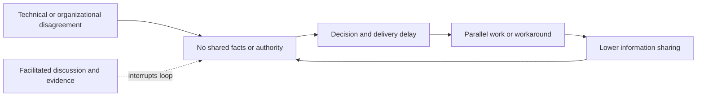
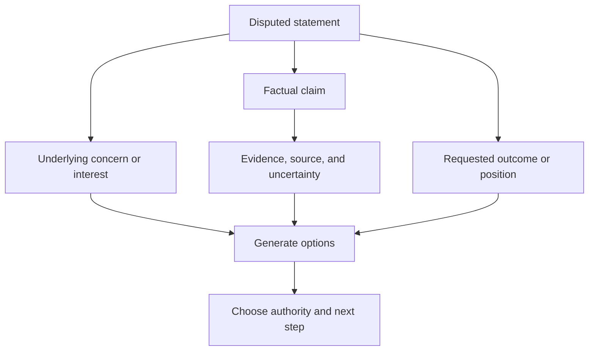
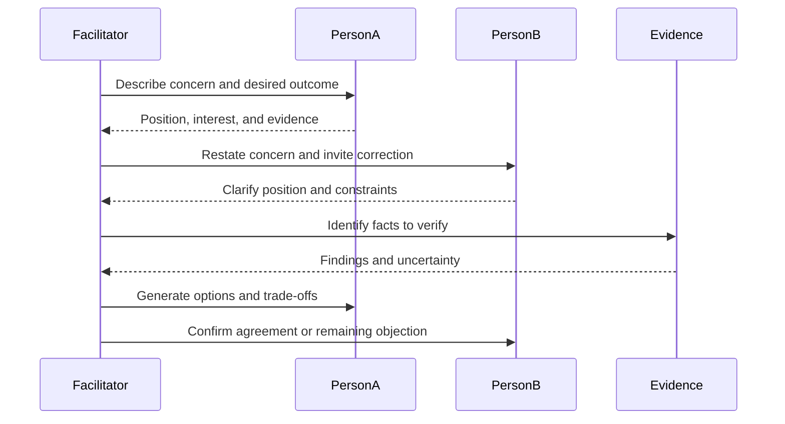
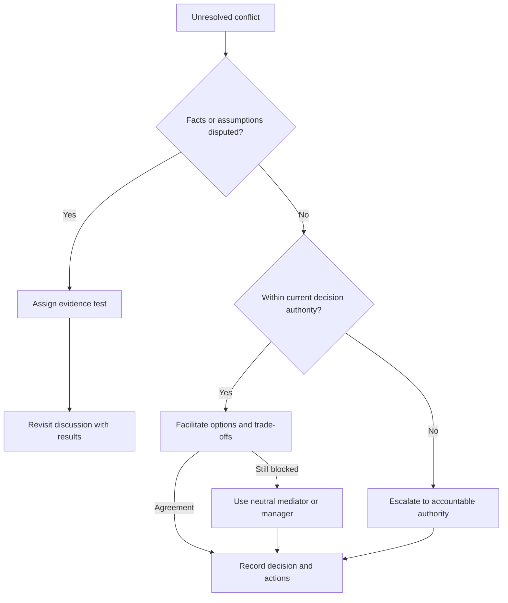
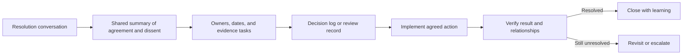

# Conflict Resolution

Part: [23 — Soft Skills](PART_OVERVIEW.md)

Conflict is a signal that people disagree about facts, priorities, authority, risk, or fairness. Unaddressed conflict can become delivery delay, silent noncompliance, or personal distrust. The architect's role is to make the disagreement discussable and help the right owners resolve it; it is not to force consensus or act as a substitute for a people manager.

Part 22 owns architecture challenge and facilitation practice. Part 18 owns enterprise governance and review authority.

## Notice Escalation Early

Signals include repeated rework, withheld information, sarcasm, decision avoidance, side-channel lobbying, or teams implementing incompatible designs. Respond while the issue is still about the work. Avoid diagnosing motive from one comment; describe observable behavior, impact, and the decision that remains blocked.

The cycle is not inevitable. A timely discussion can surface a missing stakeholder, constraint, or decision owner. If behavior threatens safety, inclusion, or professional conduct, use the organization's appropriate management or reporting path.

## Separate Positions, Interests, and Evidence

A position is what someone requests. An interest is the outcome or concern behind it. Evidence is what supports claims about system behavior, cost, risk, or constraints. Separating these categories makes it easier to generate options that address the underlying need without accepting an unsupported position.

Ask each participant what constraint or outcome makes their position important. Verify claims together where possible. Do not treat seniority as evidence or assume that disagreement means one party is irrational.

## Facilitate a Resolution Conversation

Set a shared goal and ground rules: describe the decision, hear each perspective, clarify terms, distinguish facts from assumptions, identify interests, and generate options. Reflect back what was heard before proposing a solution. Invite quieter participants and keep the discussion focused on observable impact.

If emotions are high, pause and agree on a smaller next step. A facilitated conversation is not appropriate for harassment, retaliation, or power abuse without additional safeguards and formal support.

## Escalate or Mediate When Needed

Escalation is appropriate when decision rights are unclear, impact exceeds the current authority, the conflict persists after evidence review, or a policy owner must accept residual risk. Mediation can help when communication is blocked but participants can still engage safely. Define what decision the escalation body can make and which evidence it receives.

Escalation should not be used as a threat. Present the issue neutrally, identify what remains unresolved, and state the decision needed. Preserve dissent and avoid implying that a decision authority has approved a position before they have acted.

## Confirm Agreement and Follow Up

Summarize what is agreed, what remains open, who owns each action, the date, and the signal that reopens the issue. Check understanding with participants. A verbal agreement can be misremembered; capture the decision in an appropriate log or review artifact and verify that implementation follows it.

Follow up privately when needed to ensure that participants can raise new concerns safely. After closure, reflect on whether unclear ownership, missing evidence, or process design created the conflict.

## Worked Case: Shared API Contract

An application team wants to add a required field to a shared API. A consumer team objects because its release window is slower. The architect asks each team to state the outcome and constraints, then reviews usage evidence and the compatibility policy. The concern is not resistance to change; it is the risk of breaking a consumer before its deployment window.

The teams agree to an optional field first, a usage metric, and a deprecation date. The API owner records the decision and consumer migration actions. If usage remains after the date, the owner escalates for a compatibility decision rather than silently removing the field. The review also adds an earlier consumer inventory step to prevent recurrence.

## Review Questions

1. What observable behavior shows conflict is escalating?
2. Which statements are positions, interests, or factual claims?
3. What evidence would change the disagreement?
4. When is facilitation, mediation, or formal escalation appropriate?
5. How should the team verify agreement and follow-up?

Conflict resolution is a disciplined way to restore shared understanding and decision ownership. Address observable issues early, separate evidence from priorities, use fair process, and document agreements, dissent, and follow-up.
