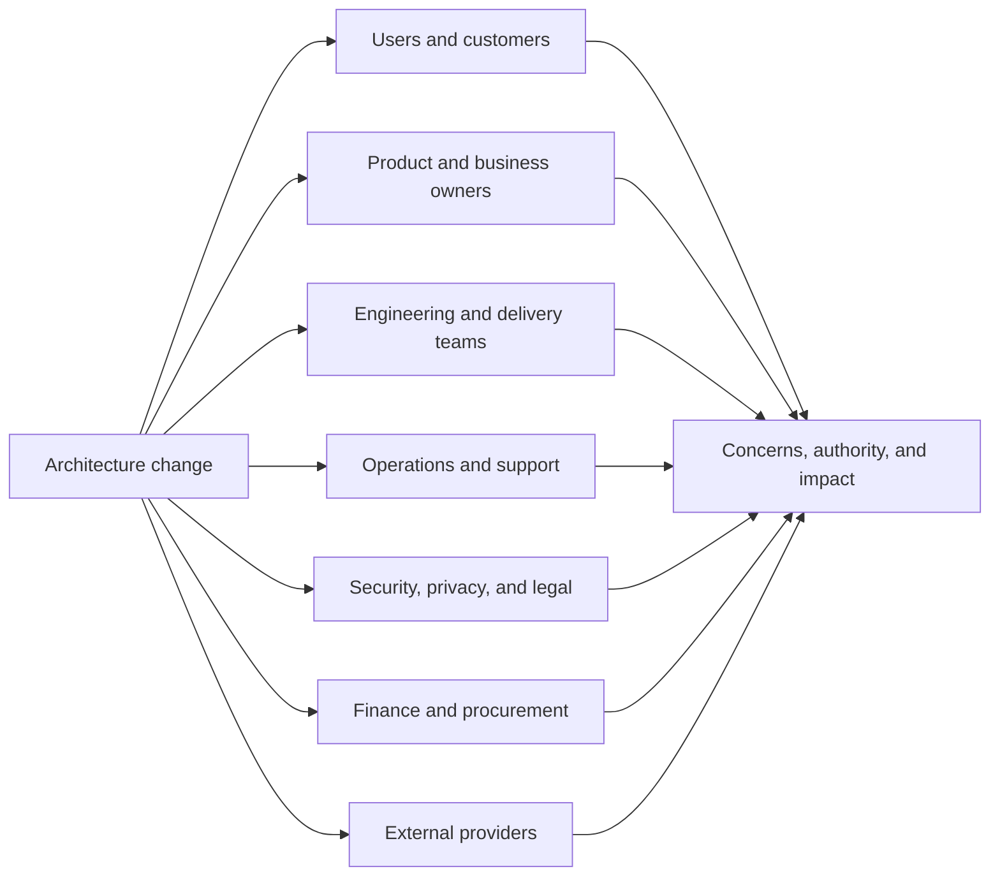
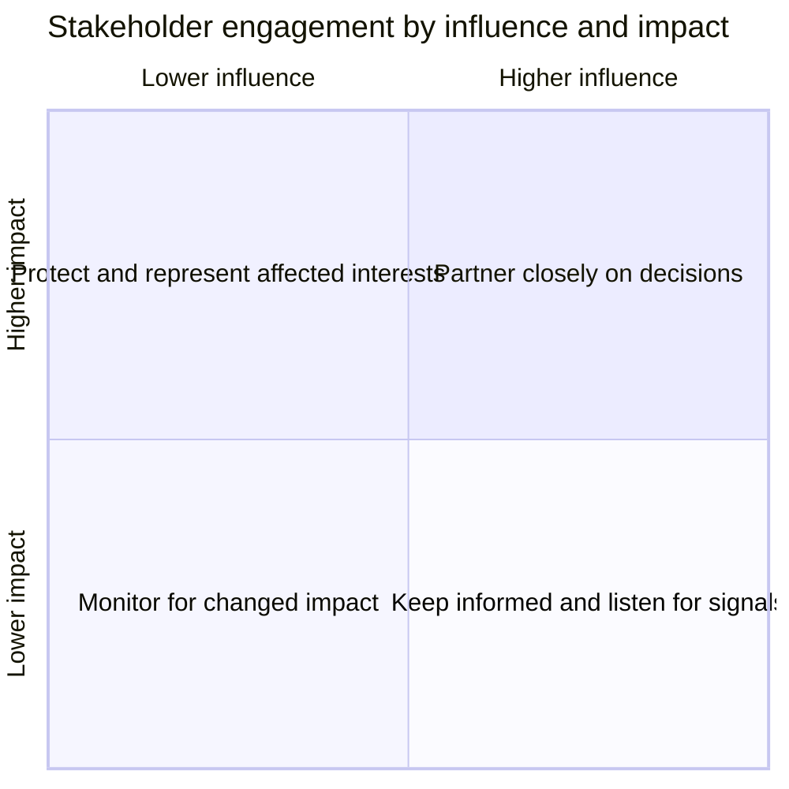
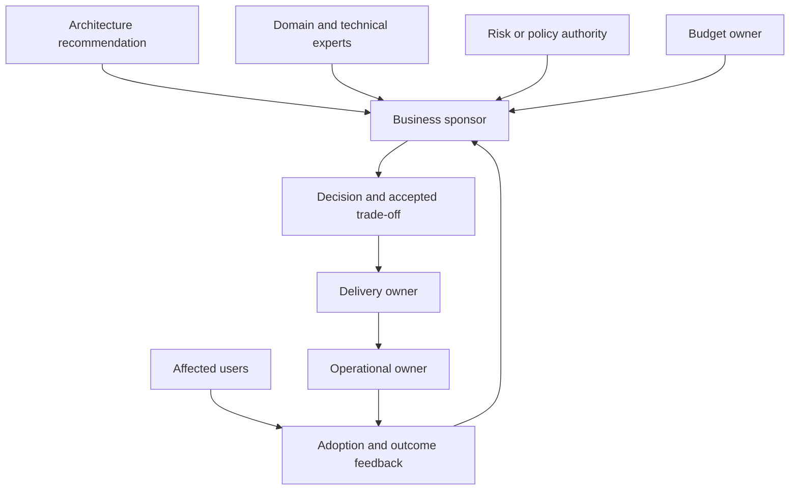
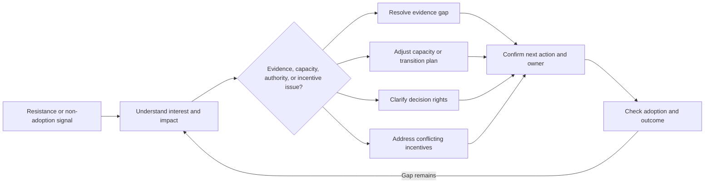

# Stakeholder Management

Part: [23 — Soft Skills](PART_OVERVIEW.md)

Stakeholder management identifies who is affected by architecture decisions, what outcomes they need, how much authority or influence they hold, and when they must participate. It is an ongoing relationship and information practice, not a campaign to secure approval. Part 18 owns enterprise stakeholder and governance models; Part 22 owns decision facilitation.

## Discover Stakeholders and Their Concerns

Begin with users, sponsors, operators, delivery teams, data owners, security, legal, finance, support, vendors, and downstream consumers. Identify affected parties through system boundaries, data flows, ownership, incidents, and change impact. Ask what they need, what they fear, and what evidence would make the decision usable for them.

Stakeholder maps are hypotheses that need validation. Support teams and data subjects can be affected indirectly; include them when the change shifts their work or risk. Avoid treating an organization chart as a complete list of decision owners.

## Prioritize Engagement by Influence and Impact

Influence is the ability to shape the decision; impact is how much the decision changes a stakeholder's outcomes or responsibilities. High-impact, low-influence groups can be overlooked. Use the matrix to plan engagement proportionately, not to manipulate or withhold information from people with less authority.

Record the basis for each placement and revisit it when scope changes. A frontline operator may have low approval authority but high practical insight; representation and feedback mechanisms should reflect that.

## Plan Engagement Through the Change

Engagement should match decision milestones and stakeholder needs. Early discovery surfaces constraints; option review tests trade-offs; implementation communication prepares affected teams; post-change follow-up checks whether outcomes occurred. Avoid one large presentation as a substitute for ongoing dialogue.

```mermaid
flowchart LR
    Discover[Discover needs and constraints] --> Frame[Agree problem and scope]
    Frame --> Options[Review alternatives with affected owners]
    Options --> Decide[Confirm authority and decision]
    Decide --> Prepare[Communicate migration and responsibilities]
    Prepare --> Change[Implement and support]
    Change --> Feedback[Collect impact and adoption evidence]
    Feedback --> Reengage[Revisit stakeholders and assumptions]
```

Use different formats for different needs: one-to-one interviews for sensitive concerns, working sessions for trade-offs, written summaries for asynchronous review, and operational briefings for readiness. Document decisions and open questions in a shared source.

## Understand Decision Influence Networks

Decisions often involve formal approvers, technical experts, budget owners, policy authorities, and trusted advisors. Map who recommends, decides, implements, and bears risk. Avoid confusing influence with accountability; the person who argues most strongly may not own the outcome.

Clarify how disagreement is resolved and which authority accepts residual risk. Stakeholder influence can change as evidence, incident impact, or funding changes; keep the map current rather than assuming static roles.

## Manage Resistance and Ownership Transitions

Resistance can indicate loss of autonomy, workload increase, unaddressed risk, insufficient capacity, or disagreement with the evidence. Listen before labeling it as obstruction. Offer transparent options and clarify what is negotiable. When ownership changes, transfer context, access, support responsibilities, and decision history.

Not every concern can be accepted. Explain the decision authority, why an option was selected, what risk remains, and how stakeholders can raise new evidence. Ethical engagement allows dissent and protects people from retaliation for surfacing risk.

## Worked Case: Shared Identity Migration

An organization moves several applications to a shared identity platform. Stakeholders include security, application owners, help desk, end users, accessibility specialists, and regional compliance. The engagement map shows end users and support staff have high impact but little approval power; they are included in pilot testing and migration communication.

Application teams worry about release disruption, while security requires consistent authentication controls. The architect separates the policy requirement from rollout timing and negotiates a phased migration with office hours, a rollback window, and explicit support ownership. Adoption and login-failure data are reviewed by cohort; a region-specific constraint triggers reassessment with the compliance owner.

## Review Questions

1. Which affected stakeholders are missing from the initial map?
2. Who has decision authority, who implements, and who bears residual risk?
3. How does engagement change across discovery, decision, and rollout?
4. What might resistance reveal about capacity, incentives, or evidence?
5. How are ownership and context transferred after the change?

Stakeholder management improves architecture decisions when it exposes real concerns, authority, impact, and feedback. Engage affected groups early, represent low-influence stakeholders fairly, clarify decision rights, and keep ownership visible through implementation and operation.
