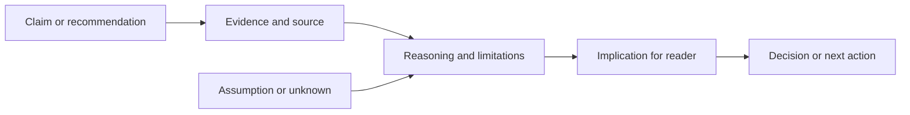
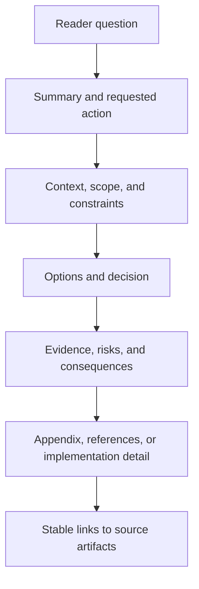
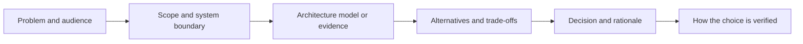
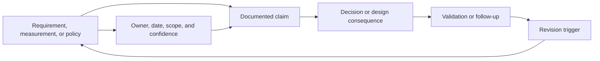
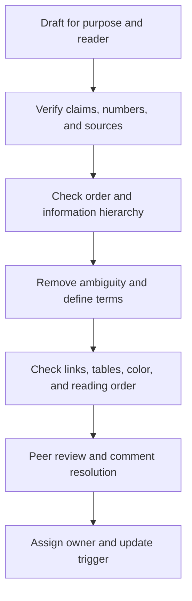

# Technical Writing

Part: [23 — Soft Skills](PART_OVERVIEW.md)

Technical writing lets a reader understand context, evidence, decisions, and required action without relying on the author's presence. Its quality depends on audience, purpose, claim accuracy, structure, terminology, and maintenance. Part 21 owns artifact-specific formats such as ADRs, diagrams, and runbooks; this chapter covers the writing practice across them.

## Connect Claims to Evidence and Action

State the claim, evidence, reasoning, consequence, and action. Distinguish measured fact, estimate, assumption, and recommendation. Cite sources close to the claim and describe the conditions under which the evidence applies. Avoid using a confident tone to hide uncertainty.

One paragraph should usually carry one main point. Unsupported claims need narrower wording or more evidence. Record an owner and validation trigger for every decision-critical assumption.

## Build a Reader-Friendly Information Hierarchy

Organize content so readers can find the summary, decision, rationale, evidence, and detail at the depth they need. Put the most decision-relevant information early. Use headings that describe questions or outcomes, not empty labels. Tables and diagrams help compare relationships but do not replace explanatory prose.

Separate essential content from reference detail. Use consistent headings, short paragraphs, meaningful link text, and accessible tables. Avoid decorative formatting that makes a document harder to scan or maintain.

## Guide the Reader Through the Technical Argument

Readers need a path from problem to design. Begin with the system boundary and stakes, introduce the relevant model, show how it operates, compare alternatives, and conclude with consequences and validation. A reader should not need to infer why a diagram appears or what decision it supports.

Use diagrams near the explanation they support and refer to their key implication in prose. Define acronyms at first use, use terms consistently, and avoid introducing multiple names for the same component unless the distinction matters.

## Preserve Source-to-Claim Traceability

Technical documents often combine requirements, measurements, estimates, policy, and recommendations. Readers need to distinguish those kinds of statements and trace important claims to their source and date. Record versions for diagrams, benchmark results, standards, and vendor claims that can change.

Use quotations and citations when exact wording matters, and explain the interpretation. Avoid unsupported claims such as “industry standard” or “best practice” without a source and applicability. Respect confidentiality and link to access-controlled evidence rather than copying sensitive material.

## Edit for Precision and Accessibility

Editing should test whether each sentence is accurate, necessary, and understandable to the intended reader. Replace vague terms such as “fast,” “robust,” or “simple” with measures or conditions. Prefer active voice when it clarifies ownership, define specialized terms, and remove duplicated explanation without removing needed context.

Accessibility includes meaningful headings, descriptive links, text alternatives for visuals, sufficient contrast, and not using color alone to convey meaning. Reviewers should identify whether the document supports its task, not only whether the prose is grammatically correct.

## Worked Case: Migration Proposal

An architect writes a proposal to migrate a data service. The first draft begins with implementation detail and an unsupported claim that the migration improves performance. The revision states the decision requested, current latency distribution, target, scope, data constraints, options, and risk. The benchmark's environment and workload are linked; assumptions about write lag are identified as unverified.

The document places a context view beside the boundary discussion and a migration diagram beside the sequence explanation. It defines the validation gate, rollback boundary, owner, and review date. A peer review catches that the cost estimate excludes parallel operation; the author updates the assumptions and decision comparison before review approval.

## Review Questions

1. What question and action should the document support?
2. Which claims are facts, estimates, assumptions, or recommendations?
3. Can the reader trace important claims to current evidence?
4. Does the information hierarchy serve both scanning and deep reading?
5. Which accessibility and maintenance needs apply to the artifact?

Technical writing makes architecture reasoning portable across people and time. Organize around the reader's decision, connect claims to evidence, use precise language and accessible visuals, and assign ownership for keeping the document current.
