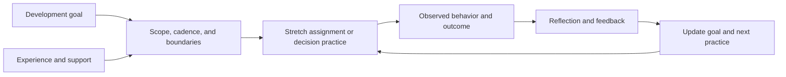
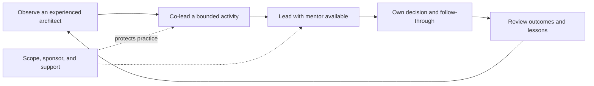
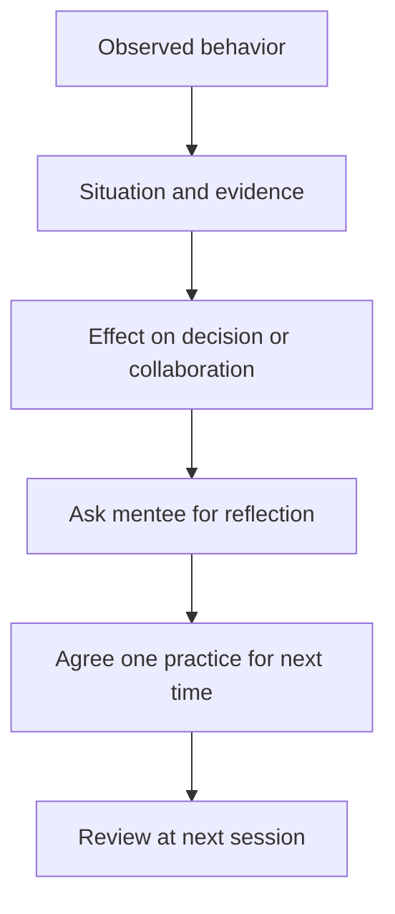
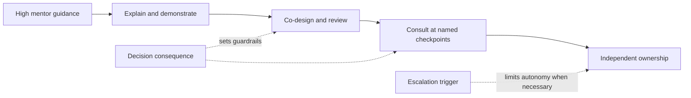
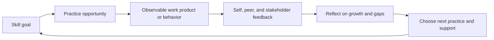

# Mentoring

Part: [23 — Soft Skills](PART_OVERVIEW.md)

Mentoring helps a colleague grow judgment through reflection, guided practice, feedback, and increasing ownership. It is not taking over the mentee's decisions or using every conversation to prescribe the mentor's preferred design. Part 22 owns applied architecture decision practice; this chapter focuses on the interpersonal and developmental relationship.

## Agree on Goals and Boundaries

Clarify what the mentee wants to develop, what the mentor can offer, confidentiality limits, cadence, duration, and the review method. Goals should be observable in practice, such as leading a bounded architecture review or explaining trade-offs to a product owner. A mentoring relationship should not replace management, formal performance processes, or specialist support.

Make confidentiality explicit, including exceptions for safety, policy, or serious conduct concerns. Let the mentee own the agenda and decisions. The mentor can offer a perspective, but should distinguish advice from an organizational requirement.

## Build Skills Through Practice

Architectural judgment grows through repeated work at gradually increasing scope: analyze an interface, facilitate a small review, own a cross-team decision, then lead a broader change. Select practice that is challenging but safe, with an appropriate sponsor and a fallback if the mentee encounters a blocker.

Do not equate confidence with competence. Increase scope when the mentee demonstrates preparation, stakeholder listening, evidence use, and follow-through. If practice exposes a skill gap, agree on another exercise rather than taking ownership away without discussion.

## Give Specific, Actionable Feedback

Feedback should describe an observed behavior, its impact, and a next step. Avoid identity judgments such as “you are not strategic.” Ask the mentee to reflect first, then share the mentor's observation. Balance affirmation with a concrete growth edge and invite correction if the mentor misread the situation.

Keep feedback timely and private when appropriate. Separate feedback on the artifact from feedback on the person. When mentor and mentee have a reporting relationship, clarify how developmental discussion differs from performance evaluation.

## Balance Support and Ownership

The mentor should adjust involvement based on risk, experience, and the mentee's preference. Too much direction prevents learning; too little support can expose the mentee or organization to avoidable failure. Agree in advance on decision checkpoints, escalation triggers, and the mentor's role in high-stakes situations.

Autonomy is not abandonment. The mentee should know how to ask for help and when the mentor intervenes. For decisions with irreversible customer or regulatory consequences, governance and decision authority remain in effect regardless of mentoring arrangements.

## Track Goals and Evidence Responsibly

Maintain a lightweight record of goals, practice, feedback themes, and next steps, with the mentee's agreement. Avoid collecting sensitive personal detail that is not needed for development. Use evidence such as a facilitated review, decision memo, stakeholder feedback, or retrospective rather than attendance or self-confidence alone.

Review goals periodically and close the relationship when the goals are met or the arrangement no longer helps. A mentee may need a different mentor for a different domain. Preserve agency and allow either person to end or renegotiate the relationship respectfully.

## Worked Case: First Cross-Team Review

A senior engineer is preparing to lead a review for an API boundary change. The mentor and mentee agree that the goal is to facilitate a clear decision, surface data ownership, and record unresolved risks. The mentor observes a rehearsal but does not rewrite the proposal. During the review, the mentee invites operations and data stakeholders and distinguishes a hard residency constraint from a preference.

Afterward, the mentor asks what felt effective and shares that the decision request arrived late in the presentation. They agree the next briefing states the decision up front and checks authority before option discussion. The mentee retains ownership of the review outcome; the mentor intervenes only if a material risk exceeds delegated authority.

## Review Questions

1. What development goal belongs to the mentee?
2. Which practice opportunity is challenging but safely bounded?
3. Does feedback describe observable behavior and impact?
4. When should the mentor advise, co-lead, or step back?
5. What evidence shows growth without reducing it to attendance?

Mentoring develops architectural judgment through practice and reflection. Agree on goals and boundaries, give evidence-based feedback, scale support to risk, and preserve the mentee's ownership of decisions and outcomes.
