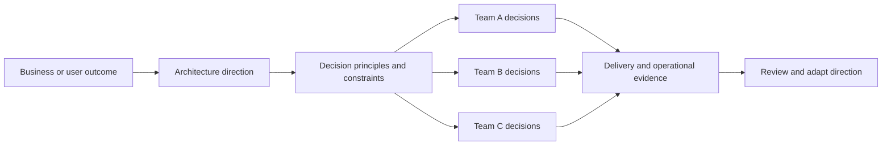
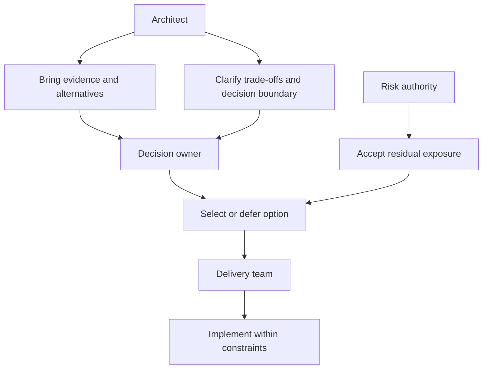
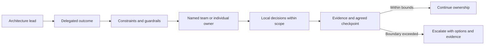
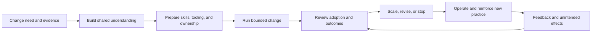
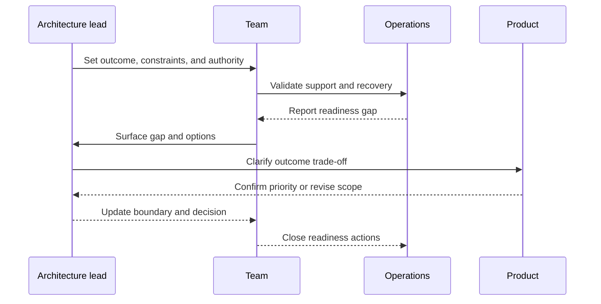

# Leadership

Part: [23 — Soft Skills](PART_OVERVIEW.md)

Architecture leadership creates direction, decision clarity, and accountability across teams, often without formal authority. It aligns people around outcomes and enables them to make decisions within clear boundaries. Leadership is not charisma or control; it is a practice of creating conditions for responsible action and learning.

## Translate Vision Into Team Action

A useful vision connects business outcomes to architectural choices, near-term milestones, and measures of progress. Teams need to understand why the direction matters, which constraints are fixed, and where they retain local discretion. A vision that cannot guide a trade-off is too abstract to coordinate work.

Explain the rationale and boundaries in language teams can use. Invite feedback when local constraints conflict with the direction. Adjust the direction when evidence changes rather than asking teams to follow a plan that no longer serves the outcome.

## Distinguish Authority From Influence

Formal authority comes from role or delegated decision rights; influence comes from expertise, relationships, trust, and useful evidence. Architects often rely on influence to surface risks and coordinate across domains. Be transparent about which decisions are yours, which belong to another owner, and where escalation is needed.

Do not use influence to bypass accountability. If a decision requires budget, policy, or risk authority, bring the evidence to the authorized owner and record the outcome. Credibility grows when architects distinguish expertise from authority.

## Delegate With Clear Decision Boundaries

Delegation gives another person ownership of an outcome and the authority needed to achieve it. State the goal, constraints, decisions they can make, support available, and escalation triggers. Delegating tasks without authority creates frustration; delegating authority without context creates avoidable risk.

Use checkpoints to learn and unblock, not to reclaim ownership automatically. Define how to respond when a boundary is crossed: discuss evidence, update scope, or escalate to the right authority. Recognize good judgment even when the outcome differs from the leader's initial preference.

## Lead Change Adaptively

Architecture change affects habits, skills, incentives, and operations as well as code. Explain why change is needed, identify who experiences the cost, build capability, and adjust support based on feedback. A staged approach can reduce risk, but transition fatigue and dependencies must be managed.

Do not interpret resistance as ignorance by default. It may identify missing capacity, an unaddressed risk, or conflicting incentives. Use feedback to adjust the path while preserving the outcome and non-negotiable controls.

## Build Accountability and Feedback

Accountability is clear ownership for a result, the authority to act, and a way to learn from outcomes. Create feedback loops that reveal whether decisions work in practice. Praise surfacing bad news early; punish-the-messenger behavior causes teams to hide risks until they are harder to manage.

Leaders should model asking for evidence, acknowledging uncertainty, and revisiting decisions. When accountability is shared, name one coordinator and the specific responsibilities of each contributor.

## Worked Case: Platform Adoption

An architecture lead is asked to move product teams onto a shared deployment platform. Instead of mandating a date without support, the lead states the target outcome: safer, faster releases with clear operational ownership. Teams receive a migration guide, office hours, and a bounded pilot; each retains authority over implementation within published security and support constraints.

The first pilot reveals that a legacy workload needs a capability the platform lacks. The lead records the gap, funds a time-bounded adapter, and asks the platform owner to decide whether the capability belongs in the shared service. A team that identifies a problem early is recognized for protecting the rollout, not blamed for delay. Progress is measured by recovery exercise results, deployment lead time, and support load.

## Review Questions

1. Can teams translate the architecture direction into local decisions?
2. Which decisions belong to the architect, owner, risk authority, and delivery team?
3. Does delegated ownership include sufficient authority and guardrails?
4. How does the change process respond to resistance and new evidence?
5. What feedback reveals whether leadership actions improved outcomes?

Architecture leadership creates direction while preserving responsible local ownership. Communicate rationale and boundaries, delegate authority with support, adapt change to evidence, and make accountability safe enough for teams to surface problems early.
