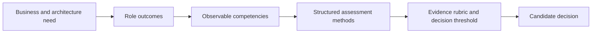
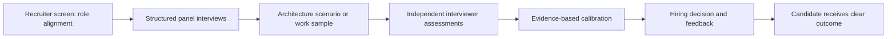
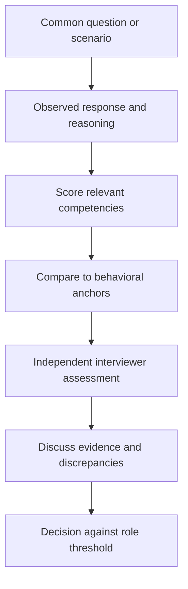
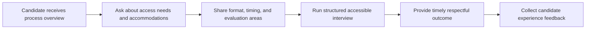
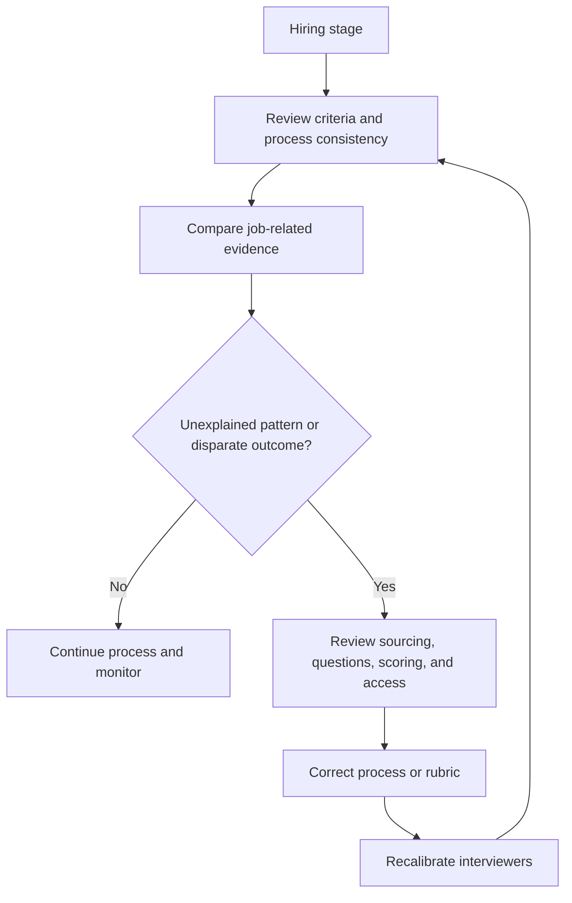

# Hiring

Part: [23 — Soft Skills](PART_OVERVIEW.md)

Hiring for architecture roles should assess the role's actual work through consistent, job-relevant evidence. A fair process defines outcomes before selecting interview questions, uses structured evaluation, and gives candidates a clear and accessible experience. Avoid relying on prestige, personality similarity, or vague “culture fit.”

## Define Role Outcomes and Competencies

Describe expected outcomes for the first year, decision scope, collaboration model, technical breadth, communication needs, and operational responsibilities. Translate those outcomes into observable competencies. A role requiring cross-domain trade-off facilitation differs from one focused on platform specialization; do not hire against an inflated list of every technology in the enterprise.

Separate required capabilities from skills that can be learned. Define which signals demonstrate judgment, systems thinking, influence, and technical depth in the actual role context. Involve the hiring manager and future collaborators in validating the profile.

## Structure the Interview Loop

Each interview should have a purpose, prepared questions, consistent time, and an evidence rubric. Work samples or architecture scenarios can reveal reasoning more directly than trivia. Keep exercises bounded, accessible, and respectful of candidate time; do not request unpaid production work.

Use the same core prompts across candidates and allow follow-up questions that clarify evidence. Interviewers should take notes on observed reasoning and examples rather than inferred personality. Collect assessments independently before group discussion to reduce anchoring.

## Evaluate With a Consistent Rubric

Define levels with behavioral examples, such as clarifying ambiguous requirements, identifying alternatives, explaining trade-offs, responding to new evidence, and communicating risk. The rubric should permit different valid approaches. A candidate need not choose the same architecture as the interviewer to demonstrate strong reasoning.

Keep evidence separate from ratings. If interviewers disagree, identify whether they observed different behavior, applied different thresholds, or value different capabilities. Resolve calibration against the role outcomes rather than seniority or advocacy strength.

## Support Candidate Experience and Accessibility

Tell candidates what the process includes, how long it takes, which competencies the interviews assess, and how to request an accommodation. Provide accessible materials and flexible ways to demonstrate relevant competencies when appropriate. Avoid surprise exercises that test endurance or obscure job requirements.

Candidate experience is part of the employer's reputation and the quality of evidence gathered. Keep communication timely, protect candidate data, and explain delays without exposing confidential deliberation.

## Check Bias and Decision Quality

Bias can enter through sourcing, question design, evaluator expectations, and calibration. Use diverse sourcing channels, consistent criteria, accessible assessment, and structured review. Monitor process outcomes for unexplained disparities while protecting privacy and following applicable law. Do not lower or raise a standard based on identity; examine whether the standard is job-relevant and consistently applied.

Calibration should improve consistency, not force identical scores. Preserve rationale and decision authority. Review rejected candidates for evidence gaps in the process without retroactively inventing criteria.

## Worked Case: Staff Architect Search

An organization seeks a staff architect for a cross-team platform. It defines outcomes: lead a migration decision, align product and operations stakeholders, identify failure boundaries, and produce an actionable design. Interview stages assess technical reasoning, facilitation, and written communication with shared scenario prompts and behavioral anchors.

One panelist favors a candidate who chose a familiar cloud design; another values the candidate who asked more questions and surfaced data ownership. Calibration returns to the rubric: both candidates are evaluated on requirements discovery, alternatives, risks, evidence, and communication rather than tool preference. The process offers candidates accessible materials, clear timing, and a structured feedback path.

## Review Questions

1. Which role outcomes does each interview stage assess?
2. What observable evidence supports a rating?
3. How does the rubric allow different technically sound approaches?
4. Which bias checks apply at sourcing, assessment, and calibration?
5. Is the candidate experience clear, accessible, and proportionate?

Fair architecture hiring begins with role outcomes and consistent evidence. Use structured questions and accessible work samples, calibrate against behavioral anchors, and review the process for bias without replacing evidence with intuition.
