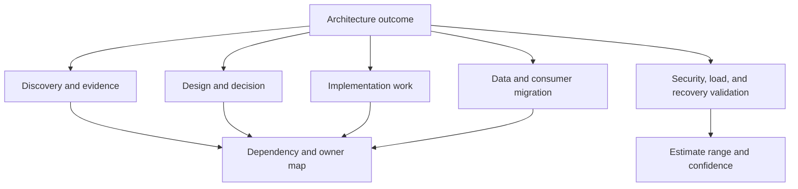
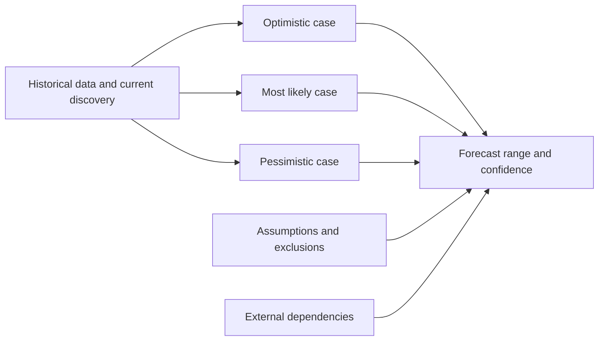
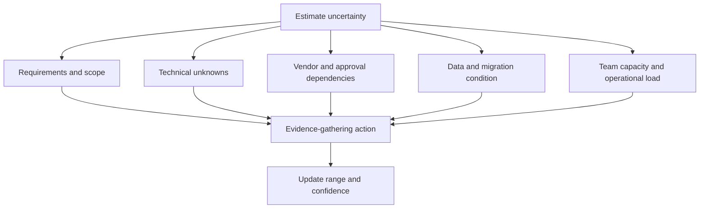
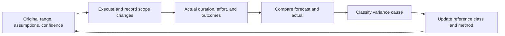
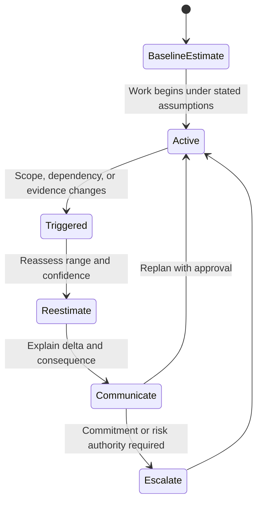

# Estimation

Part: [23 — Soft Skills](PART_OVERVIEW.md)

An estimate is a conditional forecast based on scope, assumptions, evidence, and capacity. It is not a commitment unless an authorized owner makes it one. Architecture estimates should communicate uncertainty, dependencies, confidence, and what would change the range. Part 07 owns system-design estimation within its HLD workflow; this chapter covers professional estimation practice across architecture work.

## Decompose Scope Without Hiding Unknowns

Break the work into outcomes and deliverables small enough to reason about. Identify dependencies, integration points, migration, testing, security, operational readiness, and decision latency. Decomposition improves visibility, but it does not eliminate uncertainty; discovery and coordination may be harder to estimate than implementation tasks.

Make work visible at the level needed for the decision. Avoid decomposing into tasks so small that the estimate appears precise while missing architecture uncertainty, external approvals, or integration work.

## Communicate a Range and Confidence

Use ranges or scenarios such as optimistic, likely, and pessimistic when uncertainty is material. State what each estimate assumes and what contingency it includes. A confidence level should reflect evidence, reference-class fit, and dependency stability rather than personal certainty.

Do not present a single number without context when the range is wide. Explain whether the estimate includes review, migration, support readiness, and contingency. If a sponsor needs a commitment date, separate the requested commitment from the forecast and identify the authority accepting the risk.

## Account for Uncertainty Sources

Common uncertainty sources include unclear requirements, legacy behavior, external approvals, data quality, integration contracts, team availability, vendor response, and migration volume. Prioritize uncertainties by impact and the cost to learn. A small prototype, inventory, or dependency confirmation can reduce estimate spread more effectively than adding arbitrary contingency.

State which uncertainty cannot be reduced before the decision. Then define a risk owner, a range, and a decision gate. Contingency should correspond to identified risks, not function as an unexplained buffer.

## Track Forecasts Against Actuals

Calibration improves when teams compare estimates and actual outcomes across similar work. Preserve the estimate as originally made, scope, assumptions, and actual completion. Classify variance: scope change, blocked dependency, estimation error, quality rework, or capacity shift. Avoid rewarding teams for optimistic estimates that later create delivery pressure.

Compare like with like. An estimate for a migration with unknown data quality should not be calibrated against a routine feature change. Use observed history to refine ranges while preserving uncertainty and avoiding false precision.

## Define Update Triggers

Update an estimate when scope, assumptions, dependencies, staffing, or evidence changes materially. State the trigger and communication owner before work begins. A changing estimate is not necessarily poor performance; failing to communicate the change is.

Escalate when a change invalidates an approved commitment or consumes contingency beyond delegated authority. Preserve the original and revised forecasts so leaders can understand what changed and what decision is now required.

## Worked Case: Regional Database Migration

A team estimates moving a service database to a new regional platform. The initial range assumes a known data volume, stable consumer contracts, and one rehearsal. An inventory reveals undocumented consumers and expands the migration and validation scope. The team adds a consumer-discovery task and a data-copy rehearsal before committing to a cutover date.

The forecast reports a likely duration with a wider pessimistic range driven by replication lag and rollback validation. Two weeks later, the rehearsal narrows the range. When a compliance review adds a retention requirement, the team updates the estimate, explains the additional work, and asks the sponsor to choose between scope reduction and a later delivery date.

## Review Questions

1. What assumptions and exclusions shape the estimate?
2. Which unknown is most costly if wrong, and what evidence reduces it?
3. How are optimistic, likely, and pessimistic cases distinguished?
4. What does variance say about scope, dependency, or estimation quality?
5. Which trigger requires communication or reapproval?

Estimates support decisions when they communicate range, evidence, confidence, and dependencies. Preserve the original forecast, update it when facts change, and treat variance as learning rather than a reason to manufacture precision.
