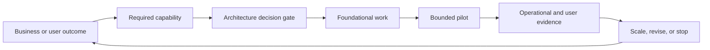
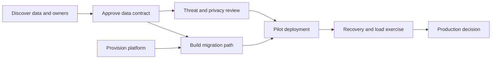
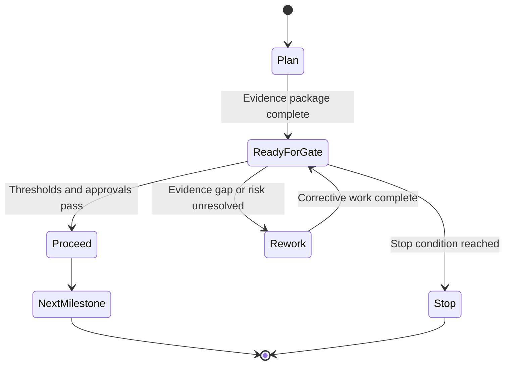
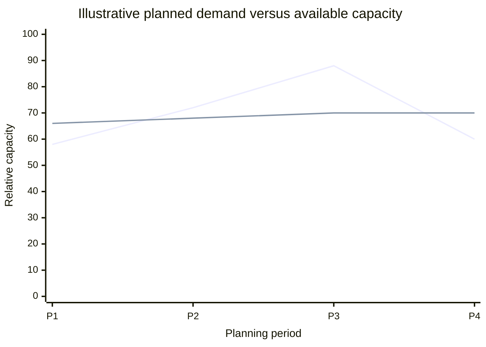
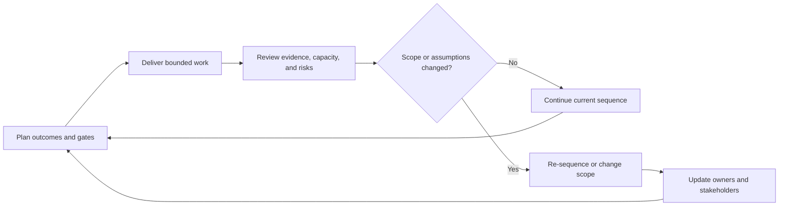

# Planning

Part: [23 — Soft Skills](PART_OVERVIEW.md)

Architecture planning sequences outcomes, decisions, dependencies, capacity, and validation into a path that can adapt as evidence changes. A plan is a coordination model, not a promise that uncertainty has disappeared. Part 07 owns system-design planning within its HLD workflow; this chapter focuses on cross-team and architecture-change planning.

## Translate Outcomes Into Milestones

Start with measurable outcomes and constraints. Define milestones as observable capabilities or decision gates. Avoid using only a date or task completion as the milestone. Sequence discovery, enabling work, migration, rollout, and validation so each step reduces risk or delivers usable value.

Each milestone needs an owner, acceptance evidence, dependencies, and a date or review condition. If a milestone is only “finish design,” state which decision or implementation becomes possible afterward.

## Model Dependencies and Critical Paths

Dependencies include technical work, decisions, teams, vendors, data availability, security review, and operational readiness. Map which are sequential, parallelizable, or conditional. A critical path is determined by dependency and duration, but uncertainty and resource contention can change it.

Do not treat an external dependency as a date certainty. Identify owner, latest needed date, alternative, and what work can proceed while waiting. Reassess the path when a dependency slips rather than compressing validation automatically.

## Use Decision Gates and Buffers

Decision gates stop the plan from silently advancing past unresolved risk. A gate may require a test result, stakeholder approval, data migration proof, security evidence, or operational rehearsal. Buffers should be tied to uncertainty and recovery need, not inserted as unexplained time.

Define who can approve each gate and what happens when evidence is inconclusive. A gate can produce proceed, revise, defer, or stop; it need not force a binary go/no-go when the scope can be narrowed.

## Balance Capacity and Demand

Plans compete for people with limited skills and operational commitments. Estimate available capacity after support, incidents, leave, and shared dependencies. Parallel work can reduce elapsed time only when teams and systems have capacity; excessive work in progress increases context switching and delays completion.

The values are illustrative. Compare committed demand with available capacity by skill and team, not only aggregate headcount. If a critical specialist is overallocated, resequence work or reduce scope rather than assuming the bottleneck can absorb more tasks.

## Inspect and Adapt the Plan

Review the plan at a cadence appropriate to change rate and risk. Compare intended outcomes with actual evidence, update assumptions, identify dependency changes, and re-sequence work. Communicate scope, timing, and risk changes to affected stakeholders early.

Replanning should preserve decision history and explain why the path changed. Avoid reporting only percentage complete; show outcomes achieved, unresolved risks, and next evidence gate.

## Worked Case: Identity Platform Migration

An organization plans to move applications to a shared identity platform. The sequence begins with application inventory and policy review, followed by contract design, a low-risk pilot, staged migrations, and decommissioning. The plan includes owners for each application, rollback criteria, and a security gate before production credentials move.

The identity team has limited capacity and a large operational workload. Planning reveals that migrating every application in parallel would exceed its support capacity. The team groups applications by integration type, reserves time for incident response, and uses the pilot to refine the migration estimate. A vendor date change triggers re-sequencing; security validation and rollback rehearsal remain fixed gates.

## Review Questions

1. Which outcomes and evidence define each milestone?
2. What dependencies determine the critical path?
3. Which decision gates protect against irreversible mistakes?
4. Does the plan reflect real team capacity and operational demand?
5. What signals trigger replanning and stakeholder communication?

Architecture plans are useful when they connect outcomes to decisions, dependencies, owners, and validation. Keep uncertainty visible, protect capacity for operations, and adapt the sequence when evidence changes rather than hiding variance behind percentage complete.
