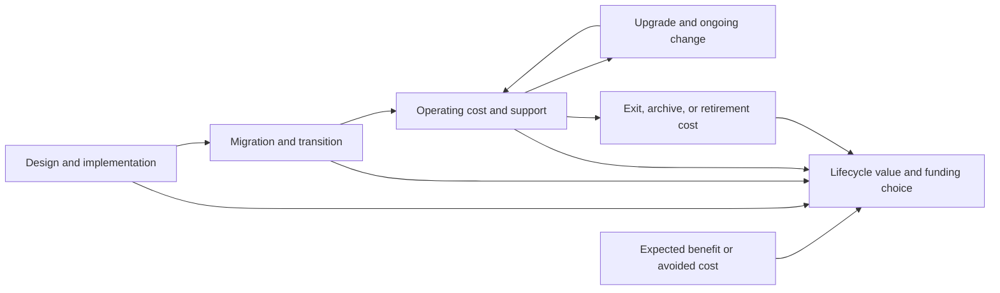
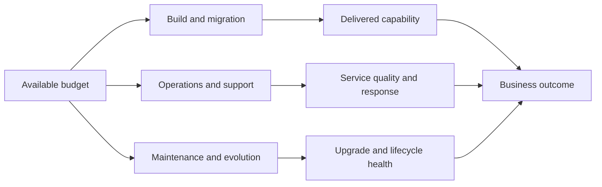
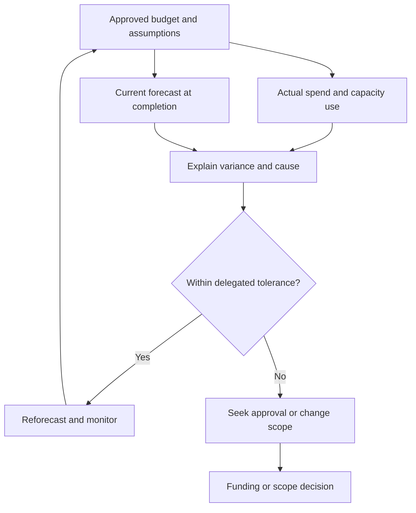
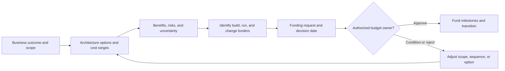
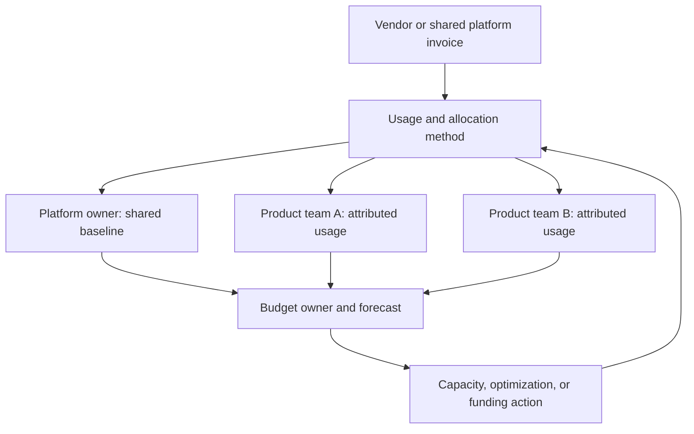

# Budgeting

Part: [23 — Soft Skills](PART_OVERVIEW.md)

Architecture budgeting makes the cost and funding consequences of design choices explicit across build, migration, operation, and retirement. A credible budget links spend to a capability or outcome, states assumptions, and assigns owners for variance. Part 25 owns FinOps methods; this chapter covers architecture communication and planning of costs.

## Model Lifecycle Cost

Separate one-time investment from recurring cost. Include people, platforms, licenses, data movement, security, support, migration, training, and eventual exit. A design with a low implementation cost can create high operating cost or vendor dependency; a migration can incur temporary parallel-run expense before savings appear.

State time horizon, utilization, pricing assumptions, staffing needs, and the cost owner. Compare options over the same horizon and service scope. Do not count projected savings as guaranteed funding until the organization can actually reduce or reallocate the corresponding spend.

## Balance Build, Run, and Change

Budgets often separate project funding from operational funding even though architecture crosses both. Identify which team pays for platform build, application migration, ongoing support, and future upgrades. Underfunded operations create hidden architecture costs through incident response, delayed patching, or duplicated support.

Show the transition from project team to service owner. Include operational readiness, monitoring, support coverage, and training in the budget before launch. Funding a platform without onboarding and support capacity can turn intended reuse into a queue.

## Forecast and Explain Variance

Forecasts should be ranges with assumptions and confidence. Track committed, actual, and forecast-at-completion values; explain variance by changed scope, usage, price, capacity, vendor terms, or estimate error. Treat variance as information. Preserve the original estimate and its assumptions.

Use consistent accounting boundaries. A vendor price reduction may be offset by egress, support, or staff time. Separate unit economics from total expenditure and identify which metric drives the next decision.

## Connect Funding Decisions to Approval

A funding request should state the outcome, options, total lifecycle estimate, uncertainty, funding owner, decision date, and cost of delay. Separate mandatory obligations from discretionary improvements. If a choice depends on another team's budget, secure that owner before the architecture assumes the capability exists.

Funding approval should include conditions and review points. Avoid presenting a single exact estimate when scope or usage is uncertain. Identify which scope can be reduced safely if funding changes and which requirements cannot be traded away.

## Assign Cost Ownership

Cost transparency requires owners who can explain and influence the spend. Map platform cost to consumers, shared cost allocation, vendor contracts, and operational responsibility. Use a fair allocation method and document exceptions; chargeback or showback without reliable usage data can create conflict rather than accountability.

Separate costs a team can control from centrally negotiated or fixed costs. Provide enough breakdown to act without encouraging harmful underuse, such as skipping security tests to meet a budget. Revisit allocation when service boundaries or usage patterns change.

## Worked Case: Shared Analytics Platform

An organization proposes a shared analytics platform to replace duplicated pipelines. The budget includes migration, parallel operation, licenses, storage, data transfer, platform support, and training. The forecast shows lower steady-state spend after migration, but savings depend on retiring legacy contracts and reducing duplicated support.

Finance approves staged funding with a migration gate after two representative domains. The platform owner funds shared security and support, while product teams fund domain migration. Actual egress cost exceeds the initial range; the team traces the variance to data locality and adjusts architecture before onboarding more domains. Savings are credited only after legacy spend is removed and service quality meets the agreed objectives.

## Review Questions

1. Which lifecycle costs are missing from the initial implementation estimate?
2. Who funds build, transition, operations, and evolution?
3. What assumptions explain the cost range and variance?
4. Which scope can change if funding is constrained?
5. Can each cost owner influence the spend they are assigned?

Architecture budgets are useful when lifecycle costs, assumptions, ownership, and outcomes are transparent. Compare options on the same horizon, fund operations and transition explicitly, explain variance early, and tie approval to measurable outcomes and decision rights.
