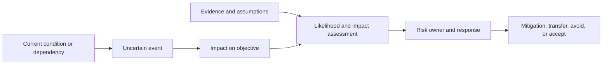
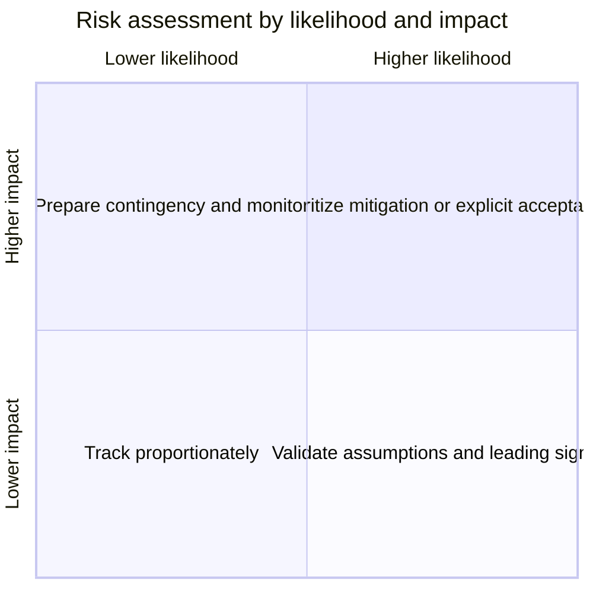
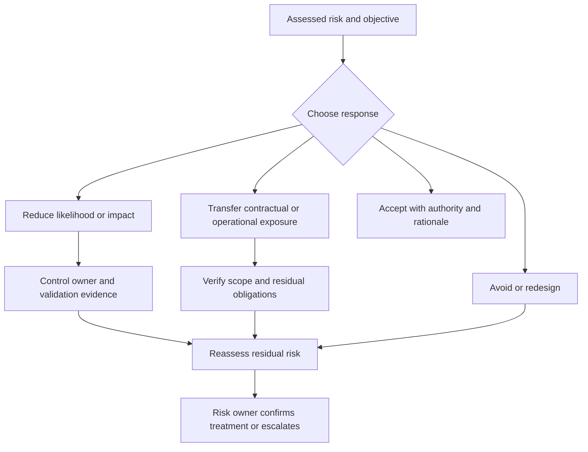
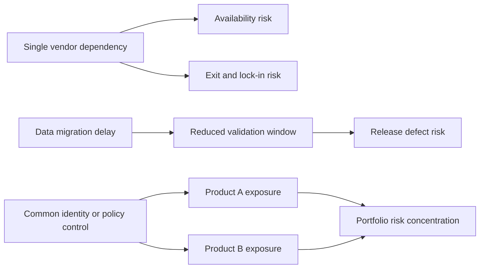
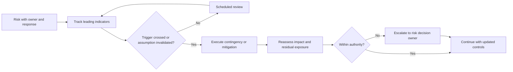

# Risk Management

Part: [23 — Soft Skills](PART_OVERVIEW.md)

Risk management identifies uncertain events that could affect objectives, evaluates exposure, chooses a proportionate response, and assigns accountability. A risk is not simply an issue that has already occurred or a vague label such as “security concern.” It should describe condition, uncertain event, and consequence. Part 15 owns security risk methods; Part 18 owns enterprise governance.

## Write a Specific Risk Statement

Use a causal format: given a condition, an event may occur, causing a measurable consequence. Link the risk to the affected objective and evidence. Distinguish the risk owner, who is accountable for treatment or acceptance, from action owners who implement controls.

For example: “Because migration depends on an undocumented consumer, that consumer may write to the old schema after transition. Customer records can become inconsistent and require recovery work.” This statement names a trigger, event, consequence, and possible evidence task.

## Prioritize With Evidence

Likelihood and impact help prioritize attention, but they are estimates with uncertainty. Define scales, time horizon, affected population, and evidence basis. Consider detectability, reversibility, dependency concentration, and regulatory exposure where relevant. Do not let a numeric score hide a high-impact low-confidence risk.

The matrix guides discussion rather than determining the answer automatically. Record confidence and review date. A severe but unlikely risk can deserve mitigation if it is irreversible; a frequent low-impact risk may be managed through routine operations.

## Select Treatment and Track Residual Risk

Treatment options include avoiding the activity, reducing likelihood, limiting impact, transferring some exposure, or accepting residual risk. A mitigation should address a causal mechanism and have evidence, owner, due date, and validation. The remaining risk after treatment must be visible to the authority that accepts it.

Risk transfer does not remove accountability for the outcome. A vendor contract or insurance may shift some cost, but the organization still needs operational readiness, data handling controls, and a response plan.

## Model Dependencies Between Risks

Risks can share causes or amplify each other. A delayed data migration can compress security testing, which increases release risk; a shared vendor outage can affect multiple products simultaneously. Map causal dependencies and common controls to avoid counting correlated risks as independent.

Dependencies can be mitigated at the root cause, such as introducing a second provider, increasing migration evidence, or isolating a shared control. Assign a coordinator for cross-team risks while retaining explicit owners for each consequence.

## Define Triggers and Review Cadence

Risks change as evidence, scope, contracts, and architecture evolve. Define leading indicators and thresholds that trigger action, not just a calendar review. Escalate when exposure exceeds delegated authority, when a mitigation fails, or when an assumption becomes false.

Do not over-monitor indicators that cannot change action. Keep the signal, threshold, response, and decision authority linked. Close a risk only when the condition is removed or exposure is formally accepted with a review trigger.

## Worked Case: Vendor Dependency

A critical identity capability depends on a single vendor. The risk statement links vendor outage or contract change to user lockout and recovery delay. Evidence includes service history, contractual remedies, data portability, and internal support capacity. The owner chooses to reduce impact through a tested break-glass path and exit plan while accepting that full provider replacement is not currently economical.

Leading triggers include sustained service degradation, contract-renewal notice, and failed recovery exercises. Security, operations, procurement, and product owners have distinct actions. The residual risk is reviewed before renewal and after any incident; contractual remedies do not replace the technical recovery test.

## Review Questions

1. Does the risk statement include condition, uncertain event, and consequence?
2. What evidence supports likelihood and impact?
3. Which treatment changes the causal mechanism, and who validates it?
4. Are related risks correlated through a shared cause or control?
5. What trigger changes action or requires escalation?

Risk management is most useful when statements are specific, evidence and uncertainty are visible, and each response has an owner. Track residual exposure and dependencies, define triggers that change action, and escalate acceptance to the proper authority.
