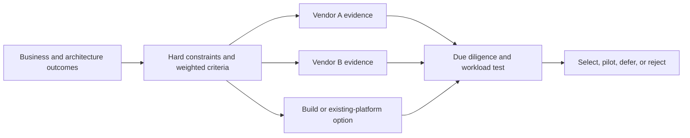
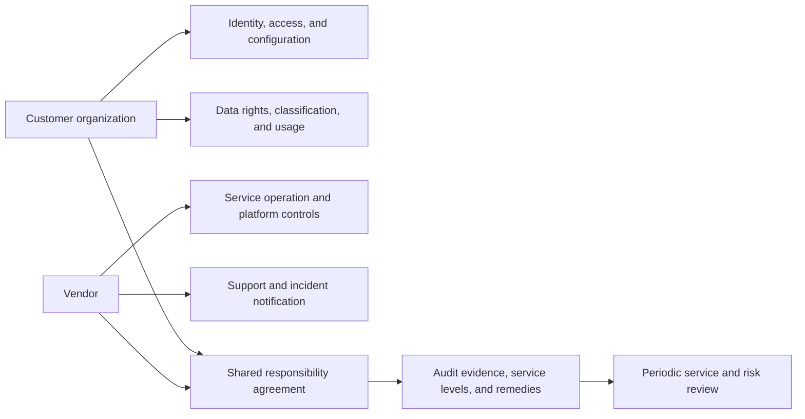
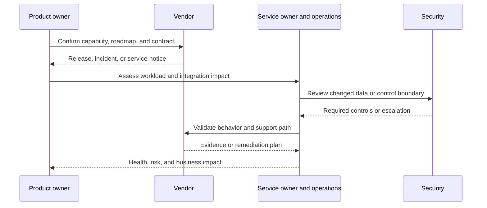
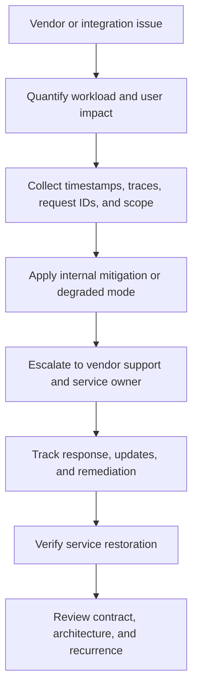
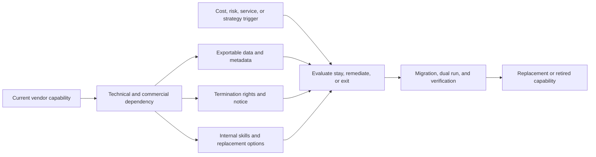

# Vendor Management

Part: [23 — Soft Skills](PART_OVERVIEW.md)

Vendor management governs an external technical dependency across evaluation, contracting, integration, operation, change, and exit. The architecture team translates business and technical needs into evidence and ownership; procurement, legal, security, and service owners retain their respective authorities. Part 09 owns cloud-service architecture, and Part 25 owns FinOps methods.

## Evaluate Capability and Fit

Define outcomes, hard constraints, integration needs, service expectations, data handling, support, portability, and total lifecycle cost before selecting a vendor. Compare vendors against the same evidence request. Distinguish documented capability from roadmap claims, sales commitments, and assumptions that require proof-of-concept validation.

Evaluate integration, performance under representative load, security evidence, regional availability, operational tooling, support model, financial stability, and exit options. A proof of concept should test a decision-driving uncertainty with bounded scope and success criteria, not become a free implementation project.

## Establish Shared Responsibilities and Contract Terms

Document which controls the vendor operates and which remain with the customer: identity, configuration, data classification, incident response, backups, recovery, and access review. Contractual service commitments should align with architecture requirements and provide clear measurement and remedies.

Align legal terms with technical architecture: data location, subprocessors, retention, deletion, security notification, recovery targets, service availability, change notice, and support escalation. A generic security questionnaire does not replace review of the actual service configuration and data flow.

## Govern Integration and Service Health

Assign an internal service owner and technical integration owner. Define versioning, change notice, environment separation, credentials, observability, incident contacts, and testing for provider updates. Track operational service health as well as the business value that justified purchase.

Monitor dependency latency, error rate, quota, version, cost, and support responsiveness. Provider status pages may not reflect the customer's tenant configuration or end-to-end service objective. Preserve request IDs and evidence for joint incident investigation.

## Escalate Service Problems With Evidence

An escalation should state impact, time window, affected scope, evidence, service commitment, requested action, and next update time. Keep a timeline of customer and vendor actions. Escalate through the contractual path when a material service or security commitment is missed, while maintaining internal incident ownership.

Do not delegate incident command to the vendor. The organization remains accountable for customer communication, internal risk decisions, and safe degraded behavior. Record when a workaround changes data handling or availability guarantees.

## Manage Dependency, Portability, and Exit

Portability is a spectrum. Open formats and stable contracts can reduce migration effort, but proprietary features may deliver material value. Document the cost of switching, data export format, transition time, skills, dual-run needs, and conditions that trigger exit. An exit plan should be tested enough to validate access and restoration, not merely promised in a contract.

Review portability during selection, not after a dispute. Avoid paying for unnecessary abstraction that removes valuable features; also avoid depending on undocumented behavior with no migration path. The right choice records expected switching cost and who funds an exit.

## Worked Case: Managed Messaging Vendor

A company adopts a managed messaging service to reduce broker operations. Evaluation tests throughput, ordering needs, region behavior, schema evolution, support response, and export format. The contract names availability commitments, incident notice, data retention, and escalation. The internal platform owner tracks quotas, cost, consumer lag, and provider version changes.

After a pricing change, finance and architecture review the total lifecycle cost against the original case. The team confirms that event data can be exported and replayed in a secondary environment, but a proprietary feature requires migration work. It records a switching-cost estimate and trigger for a proof of replacement, while continuing with the vendor because current service benefits outweigh exit cost.

## Review Questions

1. Which criteria are hard gates, and which are preferences?
2. What responsibilities remain with the customer under the service contract?
3. Who owns integration health and vendor escalation?
4. What evidence is needed when service commitments are missed?
5. Which trigger activates an exit assessment and who funds it?

Vendor management is continuous architecture work. Evaluate against evidence, align shared responsibilities and contracts, retain internal incident ownership, and make dependency and exit costs visible before they become urgent.
