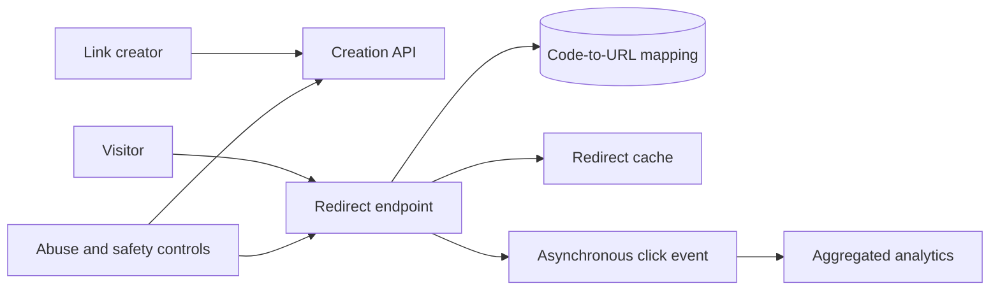
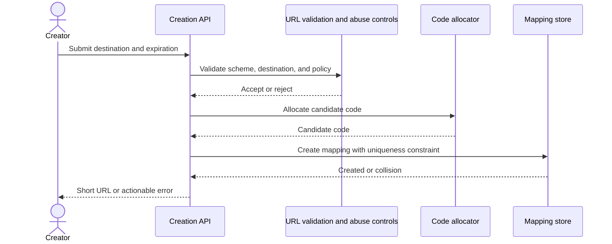
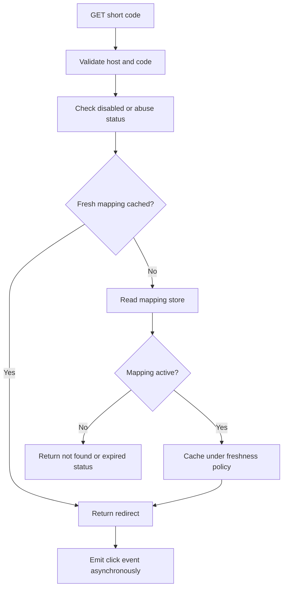
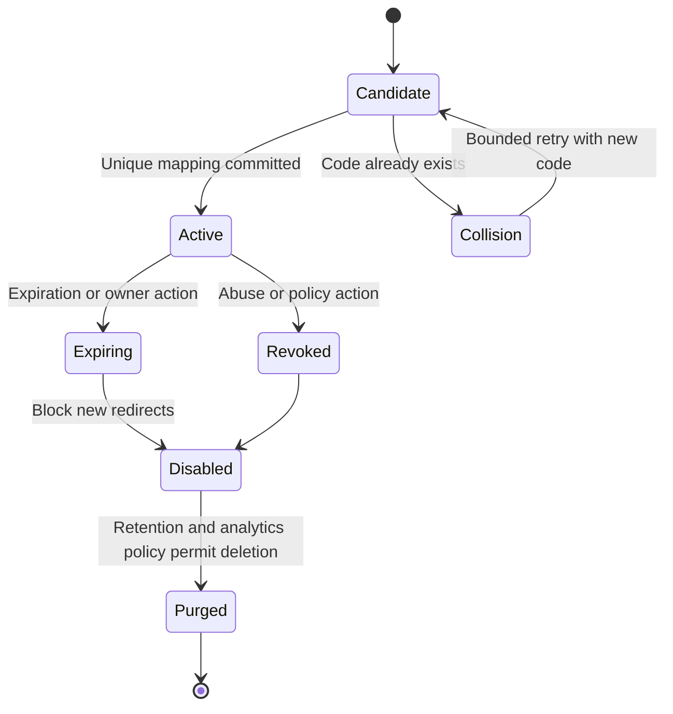
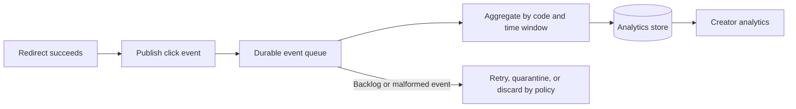

# URL Shortener

Part: [24 — Real-World Architecture Case Studies](PART_OVERVIEW.md)

This case study designs a public URL-shortening service that creates compact links and redirects visitors to long URLs. The goal is low-latency redirects with reliable code resolution, abuse protection, and enough analytics for product decisions. Part 07 owns general system-design methods; Part 19 owns caching and performance techniques. This chapter applies those concepts to one workload.

## Frame Workload and Constraints

Assume link creation is low volume relative to redirects, traffic is globally distributed, and links may be public or access-controlled. The product requires stable codes, a defined expiration policy, abuse reporting, and redirect availability. Constraints include untrusted destination URLs, hot links, privacy obligations for click data, and possible bot traffic.

State the key workload measures before implementation: redirect latency percentile, redirect success rate, creation conflict rate, abuse rate, mapping freshness, and analytics delay. A high redirect cache hit rate is useful only if cached destinations remain authorized and current under the product's update policy.

## Choose Code Allocation and Creation Flow

Options include random codes with collision checks, monotonically allocated identifiers encoded in a compact alphabet, or partitioned ID generation. Random codes reduce predictability but need collision handling; sequential IDs are efficient but reveal ordering and volume. The choice depends on uniqueness, privacy, scale, and operational complexity.

Validate destination schemes and protect preview or validation services from server-side request forgery. Use a bounded retry policy for allocation collisions and monitor the collision rate. Custom aliases need separate authorization, reservation, and conflict behavior.

## Optimize the Redirect Read Path

Redirects are latency-sensitive and read-heavy. Resolve the code through a cache backed by a durable mapping store, then return the appropriate redirect response. Cache keys must include the complete code and relevant tenant or access scope. Hot keys may require edge caching or request coalescing; expiration and destination changes need invalidation.

Decide whether destination edits take effect immediately or after a bounded cache lifetime. If instant revocation is required, a long-lived cache cannot be the sole authority; use a revocation check or very short freshness. Analytics must not block redirect completion.

## Handle Collision, Expiration, and Cache Consistency

Code uniqueness must be enforced at the authoritative store, even when allocation is distributed. Expiration can be lazy at read time, background cleanup, or both. Keep expired-code behavior explicit, particularly if codes may be reused; reuse can redirect old bookmarks to an unintended destination.

Do not reuse codes unless the product explicitly manages old-link semantics. A disabled or revoked mapping should invalidate cached redirects; monitor propagation delay and keep an emergency disable path for abuse response.

## Separate Click Analytics From Redirection

Click events can include timestamp, code, coarse location, referrer, and device attributes, but collection should be minimized and governed. Emit events asynchronously and design for duplicate, delayed, or dropped analytics messages. Analytics aggregates are not authoritative for redirect correctness and should not increase redirect latency during an outage.

Define retention, access, and aggregation thresholds for click data. Do not expose individual visitor identifiers to link creators unless a lawful purpose and policy support it. Monitor event lag separately from redirect availability.

## Alternatives, Risks, and Validation

| Decision | Option A | Option B | Primary trade-off |
|---|---|---|---|
| Code generation | Random code with collision check | Encoded allocated identifier | Predictability versus coordination |
| Read path | Central mapping lookup | Cache or edge-assisted lookup | Freshness and revocation versus latency |
| Analytics | Synchronous write | Asynchronous event | Completeness coupling versus redirect latency |
| Expiration | Lazy validation | Background cleanup plus read check | Storage cleanup versus operational complexity |

Validate hot-link traffic, cache failure, store outage, code collision, destination revocation, bot spikes, and queue backlog. Define deterministic fallback: if mapping cannot be verified, fail safely rather than redirect to an untrusted or stale target. Load tests should report p95/p99 redirect time and cache-miss behavior.

## Worked Decision

For a public consumer service, choose globally unique random codes with a database uniqueness constraint, bounded collision retry, and a cache with short freshness plus active revocation invalidation. Publish click events to a queue and keep analytics eventual. Disable suspicious links centrally, preserve code non-reuse, and keep the destination store authoritative.

## Review Questions

1. Which workload ratios and latency targets shape the read path?
2. How are code uniqueness and collision retries guaranteed?
3. How quickly must revocation take effect through caches?
4. What visitor data is necessary for analytics and how long is it retained?
5. What happens when the mapping store or analytics pipeline is unavailable?

A URL shortener is dominated by a fast redirect path and safe link lifecycle. Separate creation, resolution, abuse controls, and analytics; keep mapping authority explicit; and validate hot keys, revocation, and degraded behavior under realistic load.
