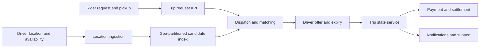
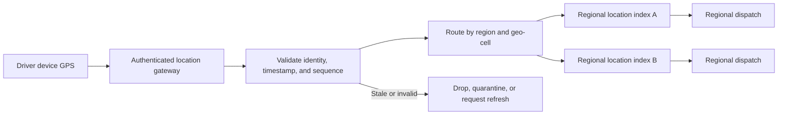
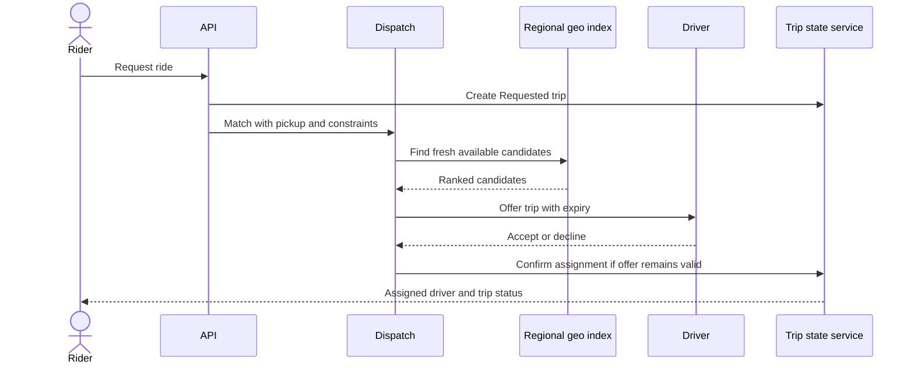
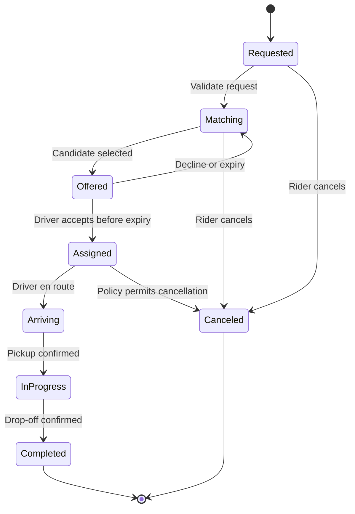
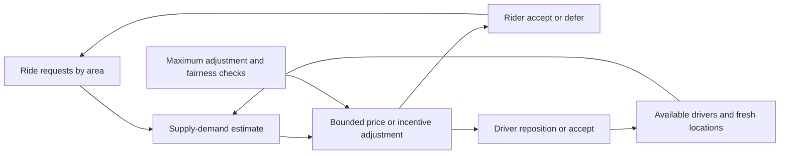
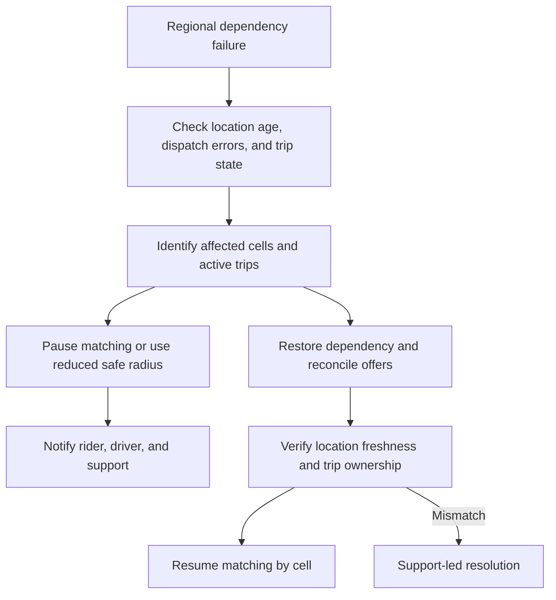

# Ride Sharing Platform

Part: [24 — Real-World Architecture Case Studies](PART_OVERVIEW.md)

This case study designs a ride-sharing platform connecting riders, drivers, dispatch, pricing, trip state, notifications, and payment. The central architecture problem is matching under fresh-location, low-latency, safety, and marketplace constraints. Assumptions: the initial service operates in multiple cities, driver locations arrive frequently, and regional service loss must degrade safely rather than silently misassign a trip.

## Frame Workload and Quality Scenarios

Rider requests are bursty and geo-local. Driver availability changes rapidly; stale coordinates can create unusable offers. The system must return a dispatch decision quickly, protect user location and identity, handle offer expiry, and maintain a consistent trip lifecycle. Measures include time to match, offer acceptance, stale-location rate, cancellation, trip completion, and fairness across regions and driver cohorts.

Keep matching, trip state, and payment responsibilities distinct. A successful candidate search is not a confirmed trip; driver acceptance and rider confirmation are separate transitions. User location, safety events, and payment details have different access and retention rules.

## Ingest and Partition Driver Location

Location updates are high-volume, time-sensitive signals. Partition them by city, region, or geo-cell so dispatch can find nearby available drivers without scanning a global index. Include timestamp, driver availability, and sequence or version; reject stale updates and detect disconnected devices. Location data should be minimized and access controlled.

Update cadence is a trade-off: more frequent updates improve recency but consume battery, network, and ingestion capacity. Apply adaptive cadence based on movement and availability. Set a maximum location age for dispatch and communicate when no sufficiently fresh candidate exists.

## Match With Bounded Search and Trip State

Dispatch can expand a geo-search radius or offer to a ranked candidate set. Ranking may consider distance, estimated arrival, vehicle requirements, driver availability, and marketplace policy. Keep the match objective transparent and avoid indefinite offer loops. Each offer has an expiry and idempotency identity so late responses do not confirm an obsolete assignment.

Trip states should prevent two drivers from accepting the same assignment or a canceled request from being revived by a late message. State transitions need authoritative ownership and an audit trail. Payment authorization and capture should follow trip and cancellation policy, not race with dispatch state.

## Manage Pricing Feedback and Regional Failure

Dynamic pricing can balance supply and demand, but a feedback loop can amplify a shortage if higher prices reduce rider demand unevenly or cause drivers to reposition simultaneously. Apply bounded changes, explain pricing to users, and monitor wait time, acceptance, cancellation, and access effects—not only revenue or utilization.

A regional outage can disrupt location ingestion, dispatch, or payment separately. Isolate cells by city or region, declare a degraded state when location freshness or matching capacity is insufficient, and avoid assigning from stale data. Recovery should reconcile outstanding offers and trips before normal dispatch resumes.

## Worked Decision: Central or Regional Dispatch

A centralized dispatch service simplifies policy consistency and global operations but adds network distance and creates a larger failure domain. Regional dispatch improves locality and cell isolation but needs policy distribution, placement, and cross-region trip handling. The design selects regional dispatch cells with a shared control plane for policy and monitoring; active trips remain owned by their originating cell.

The first release pilots one city and validates match latency, stale-location rejection, offer expiry, trip-state correctness, and outage behavior. Expansion depends on capacity and safety evidence. Pricing changes have independent guardrails and review because they affect marketplace behavior beyond the dispatch component.

## Review Questions

1. How fresh must location data be for a dispatch decision?
2. Which component owns authoritative trip state and offer expiry?
3. How does pricing influence both rider demand and driver supply?
4. What does the system do when regional matching cannot meet safety or latency limits?
5. Which evidence gates city-by-city expansion?

Ride-sharing architecture is a real-time marketplace with rapidly changing state. Partition for locality, reject stale inputs, make trip transitions authoritative, bound pricing feedback, and degrade by region without pretending a match is confirmed before it is.
