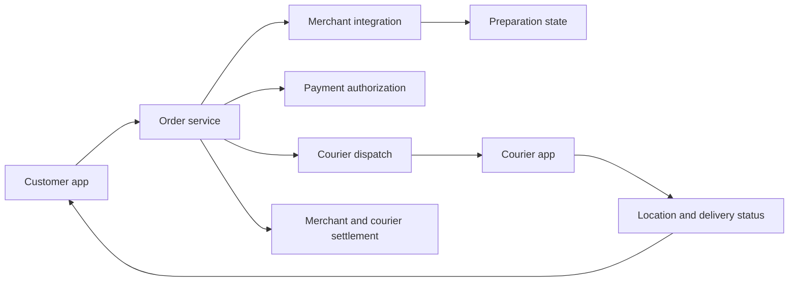
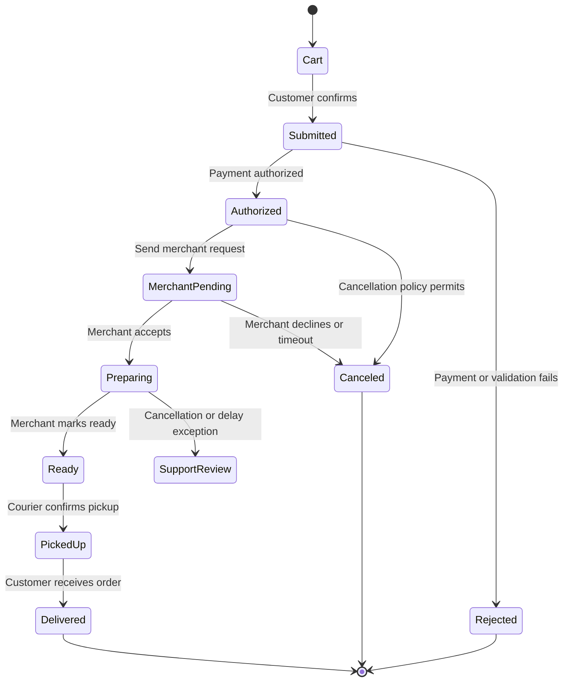
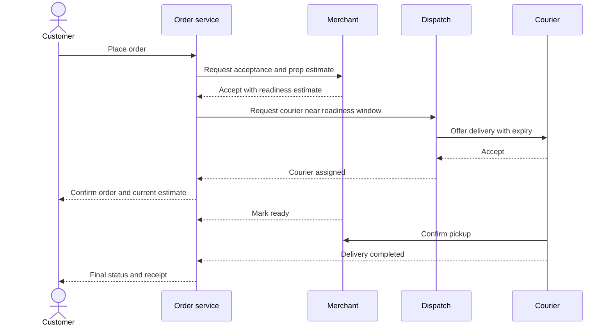
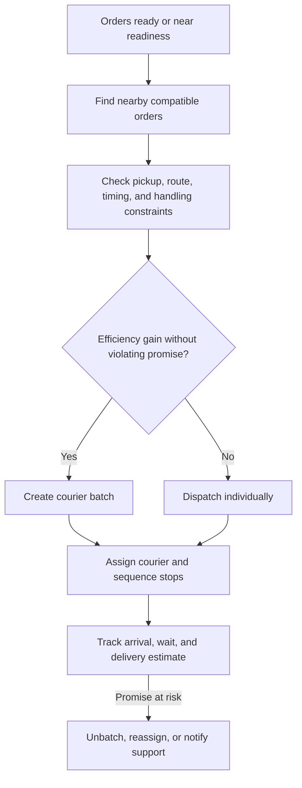
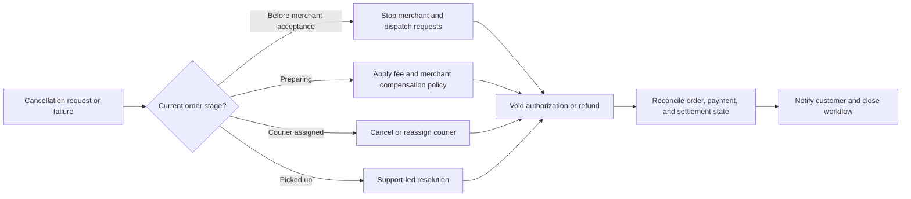

# Food Delivery Platform

Part: [24 — Real-World Architecture Case Studies](PART_OVERVIEW.md)

This case study coordinates customer ordering, merchant preparation, courier dispatch, delivery tracking, payment, and settlement. The architecture must handle independent actors, changing preparation estimates, perishable timing, cancellation, and partial failure. Assumptions: the service operates within defined delivery regions and supports card or wallet payment through an external provider.

## Frame Domain and Quality Goals

The customer expects accurate menu availability, clear pricing, and timely status. Merchants need control over acceptance and preparation; couriers need fair assignments and safe routing; operations need a way to resolve stuck orders. Measures include checkout completion, merchant acceptance time, pickup delay, delivery estimate error, cancellation rate, payment reconciliation, and support contacts.

Keep order state authoritative and represent external participant status as versioned inputs. A merchant acceptance is not the same as courier assignment; a payment authorization is not settlement. The workflow needs explicit semantics for each transition.

## Model the Order Lifecycle

The order crosses customer, merchant, payment, and delivery states. Each transition needs an owner, guard, timeout, and compensation or escalation. Cancellation behavior depends on the stage: before merchant acceptance it may be simple; after preparation or pickup it may incur a fee or require a support decision.

Do not allow stale callbacks to move an order backward or revive a canceled order. Use transition versions and idempotent event handling. The customer-facing status should reflect the authoritative state and explain when an exception needs support.

## Coordinate Merchant, Courier, and Customer

Merchant preparation time and courier arrival influence pickup wait and food quality. Dispatch can assign a courier after merchant acceptance, just before estimated readiness, or in stages based on distance and uncertainty. Each strategy balances courier idle time, merchant wait, delivery time, and reassignment risk.

Estimates should update from merchant signals and courier progress. Avoid sending frequent contradictory updates; expose confidence or ranges when readiness is uncertain. If no courier accepts, the order service needs a bounded fallback such as widening the eligible area, delaying, or offering cancellation.

## Batch Dispatch With Explicit Constraints

Batching can reduce courier travel and improve utilization, but it can increase delivery time and quality risk. Candidate orders should be grouped only when pickup and drop-off constraints, dietary separation, temperature, and delivery promises remain valid. The dispatch policy should be measurable and explainable to operations.

Batching decisions should account for uncertainty in merchant preparation and traffic. A route-efficient batch can still be poor if the first meal waits too long. Track incremental delivery delay and cancellation by batch size, and cap the number of stops based on evidence.

## Handle Events, Cancellation, and Compensation

Use a status-event timeline to correlate changes across participants. Events can arrive late, out of order, or more than once. Reconcile them against the order version and actor identity. Cancellation or failure may require releasing payment authorization, compensating the merchant, reassigning a courier, or issuing a refund; those effects are not one atomic transaction.

Define which service owns cancellation authority and what happens when payment status is unknown. Every compensation should be idempotent and linked to the original order. A human support action needs a reason code and audit trail.

## Worked Case: Merchant Delay During Dinner Peak

A restaurant accepts an order with an eight-minute preparation estimate but later reports a delay. Dispatch has already assigned a courier. The system updates the delivery estimate, informs the customer, and evaluates whether the courier can be resequenced without violating another order's promise. If the delay exceeds a threshold, the workflow offers cancellation under policy and reconciles the payment authorization.

Operations monitors merchant delay distribution, courier wait, batch effects, cancellation, and compensation. The platform does not hide merchant uncertainty behind a single precise arrival time. A repeated delay pattern updates the merchant's preparation model and may change dispatch timing for that location.

## Review Questions

1. Which service owns authoritative order state and each transition?
2. How do merchant readiness and courier assignment affect one another?
3. What constraints govern batching and route resequencing?
4. How are late, duplicated, or conflicting status events handled?
5. Which compensations and payment reconciliations follow cancellation?

Food delivery architecture coordinates multiple autonomous actors around one customer promise. Make lifecycle transitions explicit, use preparation and courier estimates as uncertain inputs, constrain batching, and design cancellation and settlement as recoverable workflows.
